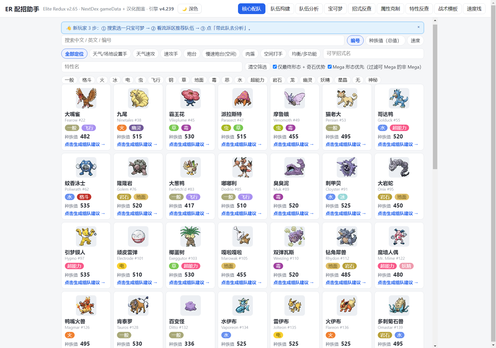
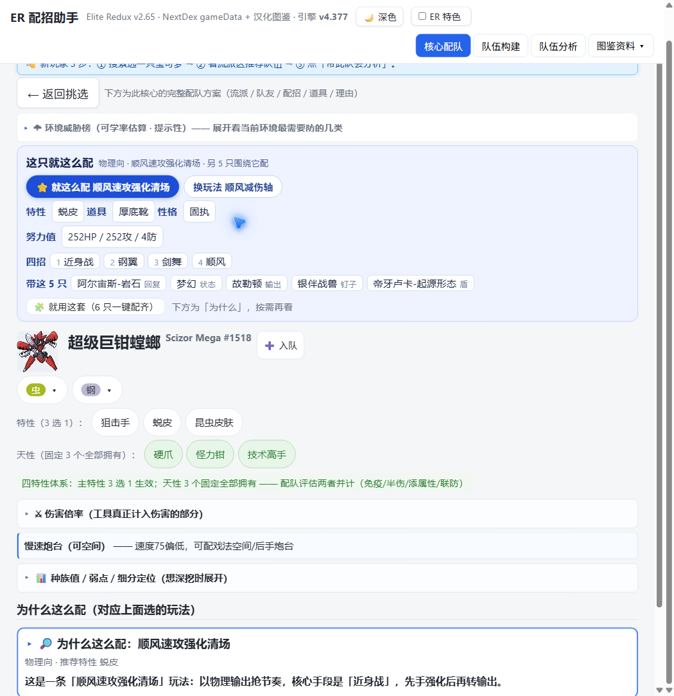
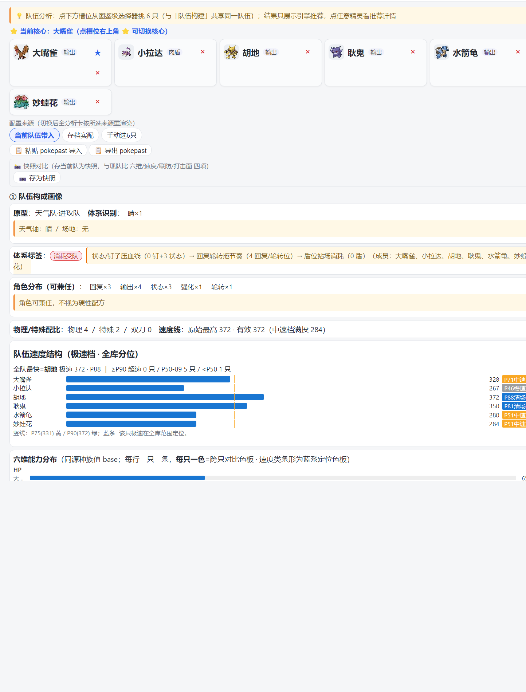
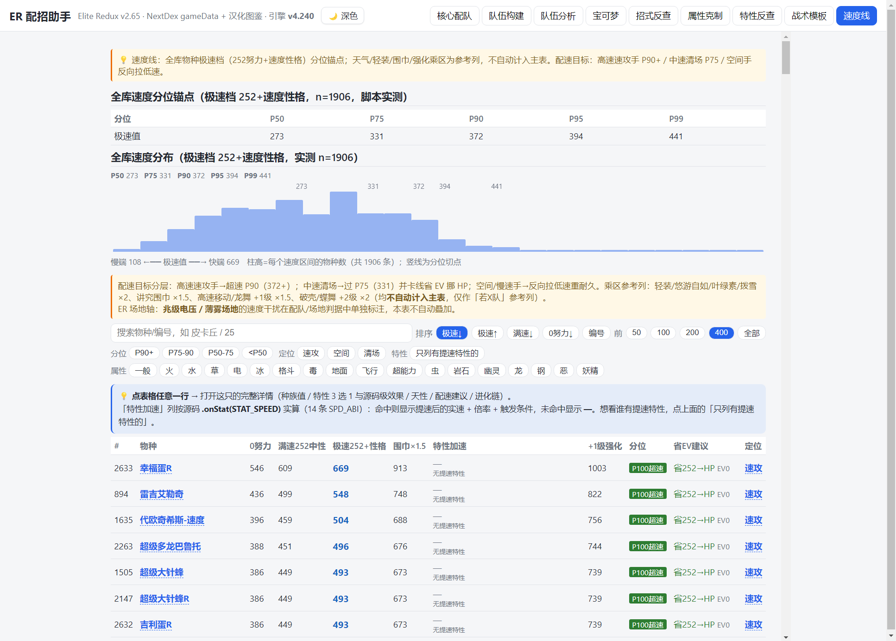
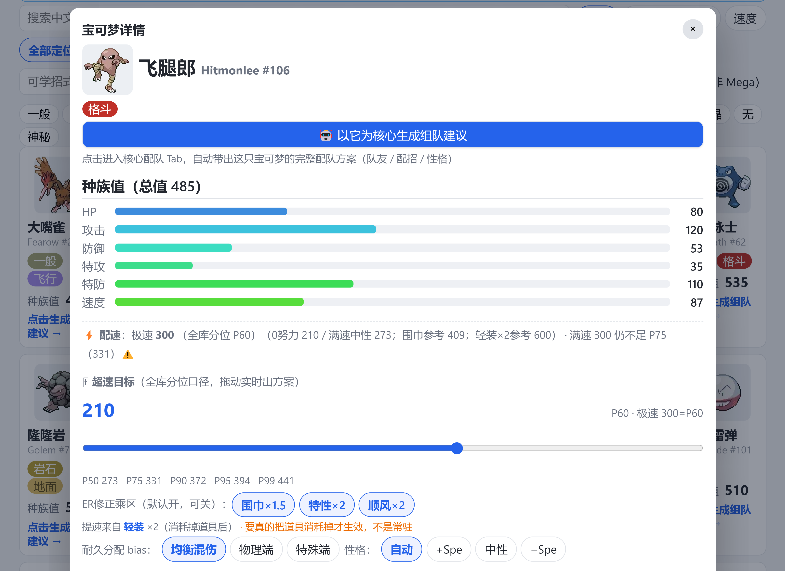
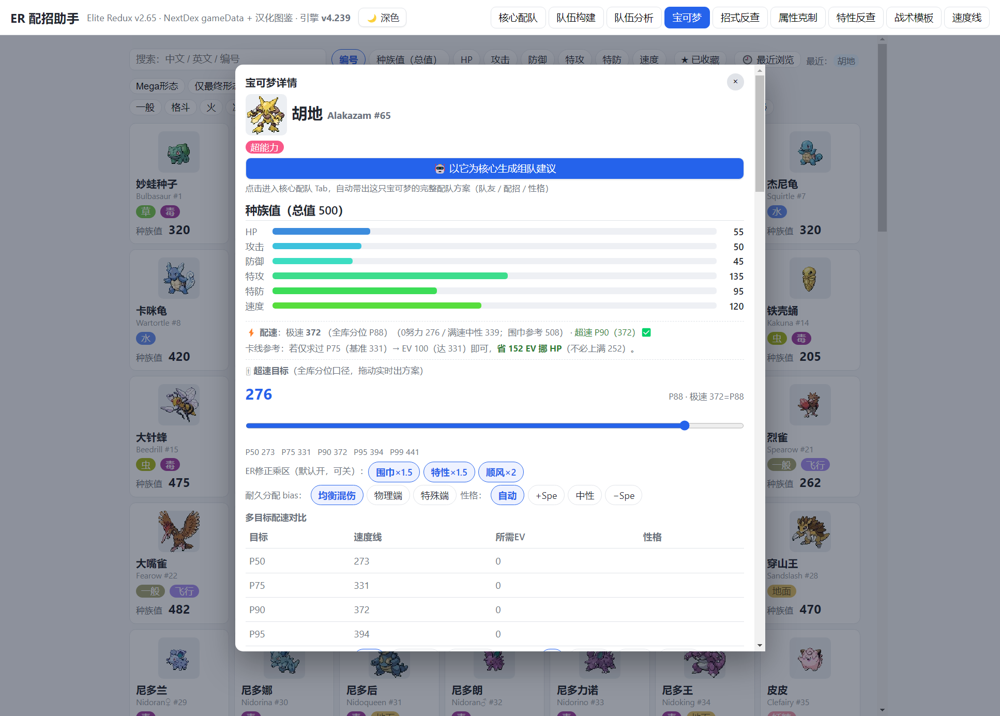
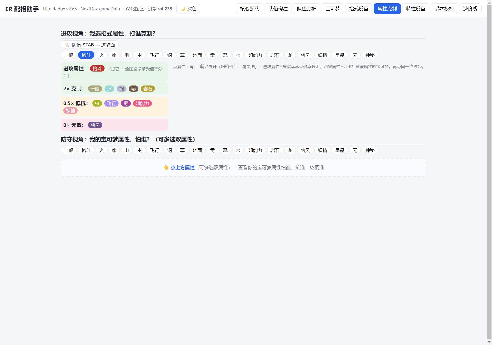

<div align="center">

# ER 配招助手

**《Pokémon Elite Redux》的智能配队 · 配招 · 速度 · 伤害工作台**

1906 只宝可梦 · 1033 个特性 · 1032 个招式 · 全部按 **游戏源码真实效果** 判定

<br>

[**在线直接打开**](https://wsjshy.github.io/elite-redux-teambuilder/)　·　[使用手册](docs/manual/功能清单与使用手册.md)　·　[开发者入口](AGENTS.md)

<br>

**手机、平板、电脑，随时用。不用下载，不用装环境。**

</div>



---

## 它解决什么问题

玩 Elite Redux 时，你大概反复遇到过这几件事：

- 看上一只宝可梦，**却不知道它能怎么配** —— 几百个特性、上千个招式，全靠记
- 配好一只，**不知道该配谁当队友** —— 凑六只总是靠感觉
- 想打得快一点，**却不知道速度该投多少努力值** —— 投多了浪费，投少了被超速
- 伤害算不准，**不知道这一下到底能不能秒**
- 特性说明只有一句官方文字，**真实效果藏在代码里** —— 实际打起来和想的不一样

这个工具把这些变成**问一句就有答案**。

---

## 九个工作台

| 工作台 | 你在这里做什么 |
|:---:|---|
| **核心配队** | 选一只当核心，反推它可以怎么配、配谁当队友 |
| **队伍构建** | 拼六只、算缺口、试「换掉 X 换入 Y」 |
| **队伍分析** | 六槽位队伍画像 + 伤害判定 + OHKO 反解 |
| **宝可梦** | 全图鉴检索，点开一只看到完整详情 |
| **招式反查** | 一个招式，查谁学得会 |
| **属性克制** | 进攻视角 / 防守视角双表 |
| **特性反查** | 一个特性，查真实效果和持有者 |
| **战术模板** | 24 套现成体系，机制数值一次看全 |
| **速度线** | 全库速度分布 + 配速建议 |

---

## 这一项，别的地方给不了

### 特性 / 招式一律按游戏源码判定，不照抄数据层文案

ER 的数据层只写一句说明，真正生效的倍率、条件、例外都在 `src/abilities.cc` 里。这个工具的每一条特性结论，都是**翻开源码一句句读出来**的：


> **雾眼**：`打出去 · 幽灵招 ×1.5（雾天）` / `改相性 · 雾天 封顶 ×0.5`
>
> 这两行不是把官方说明复述一遍，是从源码的 `.onOffensiveMultiplier` 和 `.onAfterTypeEffectiveness` 两个钩子里拆出来的真实数值与触发条件。

拆出来的结论会**落到工具每一个相关角落** —— 不是只写在一个说明页里：

| 位置 | 体现 |
|---|---|
| 核心配队 | 「伤害倍率」块，特性增伤 / 减伤与条件逐条列出 |
| 伤害面板 | 「倍率分解」行，克制 · 特性 · 天气 · 道具 · 随机各是多少 |
| 配速滑块 | 「提速来自 轻装 ×2（消耗掉道具后）」—— 连触发前提都写出来 |
| 特性反查 | 每条特性带源码依据，不是官方文案 |
| 属性克制 | 结合具体宝可梦与特性，不是只看属性表 |

---

## 流派合理性：不硬造，也不漏判

工具会先判断「这只配不配走这条流派」，再决定要不要给你，判据是**耐久三角 + 减伤特性 + 回复手段一起看**：

- **玻璃炮台**不再硬塞一条全是变化招的联防/辅助流派。像超级大针蜂（耐久三角 205、三特性全适应力），现在只保留两条物理输出流派：


- **慢速耐久重炮**会补回名实相符的输出流派。像超级土王（145 物攻 + 地面本系 + 350 耐久），原来误标「双刀」的破盾流改为物理向的「速攻压制」，四招垃圾射击 / 挖洞 / 撒菱 / 剧毒，性格勇敢：


- **触发条件不满足的特性**（发电机、不仁不义、天气依赖、狙击手/超幸运、神枪手/炮术等）会自动降权或换成不依赖该条件的特性，不会让你带着一条永远不触发的特性。
- **晴、雨、场地触发的特性**（叶绿素/太阳之力/悠游自如/雨盘/速度之力/草之皮毛等）同样按「有源才生效」判：自身或队伍开不出对应天气/场地就降权；干燥皮肤因自带水吸收免疫，不判死。

- **雾天气触发的特性**（流质/精神集中/缥缈奔腾/受热激升/回声定位等 11 个）也按「有源才生效」判：自身或队伍开不出雾（低能见度/造雾机/诡异浓雾）就降权；画皮、白噪音因自带独立收益不判死。
- **道具和招式对不上会直接纠偏**：打嗝必须持有/吃过果实才能选，没带果实就换龙火果；肉盾/受队流派不挂生命宝珠，毒系换黑色污泥、其余换剩饭。


- **方向标签按实际招式算**。肉盾/受队/联防/辅助类流派如果四招里只有 ≤1 个伤害招（双墙辅助流就是光墙 / 反射壁 / 月光 / 守住），
标签写「防御向」，不再写「物理向 / 特殊向」——不会被读成「要堆攻击」。
- **慢速流派不投速度**。名字带「慢速 / 空间」的流派，EV 按空间低速模板给：252HP + 252 主输出 + 4 防、速度 0，并把 +速度性格剔掉；
像海龙狮「慢速重炮」（基础速度 60）原来投满 252 速，卡上会直接写明为什么改。


- **条件不成立的特性会直接换掉**。第八批 38 个条件型特性（属性伤害招族 / 满血先制族 / 单招绑定族 / 天气·道具双通道 / 队友依赖）收口：
四招缺该属性伤害招、没带指定招、整队没有对应天气场地或同伴时，先换通用防守特性，没有再换队里分数最高的其他可选特性 ——
拿到的仍是一套完整配置，不用自己回头挑。残血双档（有 1.2/1.3 底档）和依赖当前 HP 的那批不判死，只在卡上写明条件。


- **答案卡每个值都能点开看**。顶部「这只就这么配」答案卡的招式、道具、性格、努力值、特性、队友全部可点击，弹层展示完整底层信息（属性、类别、威力、命中、PP、先制、描述），点空白或 × 关闭、不跳页；显示保持精简，想深入时点一下就看全。

- **性格按速度带分，不再一律爽朗**。速度种族 ≥110 时，工具统计全库有多少对手落在该物种的速度加成区间：极高速带（≥155）能多压的对手不足 0.5%，加力更划算 → 固执；速度 110–114 一带有约 10% 对手要抢速 → 爽朗。

- **非本系杂技不再冠名，攻击位固定取最强**。杂技（飞行/物 75）只有飞行系、轻装，或有效威力确实不弱于本系最强招时才保留（白名单 56 条留 13 删 43）；前两个攻击槽按评分取最强，不会再把最强本系招挤掉。同时修复了高速玻璃大炮的努力值越界（HP 不再超过 252、速度不再被清零）。


- **玻璃大炮不挂被动团队辅助钉子**。高速纸耐久打手（速度种族 ≥100 且耐久三角 <270）不再花一回合铺毒菱/隐形岩/撒菱/黏黏网——那回合容易被一击秒、钉子自己还吃不到。这个槽位改为急速折返/伏特替换（打一下就走、不留场）、补盲攻击或替身保命；靠多回合站场的「钉子轮转流」也不再给脆皮。唯一例外是恶作剧之心：变化招 +1 先制，能先手撒钉再走。


- **招族判定补全：箭/角/空/锤/投掷/钻头/光线七族入表**。有些特性只对特定招族的招式增伤（如巨翼强化空中招、强大之角强化角类招、超级重击者强化锤类招），旧的招族表缺了这七族，相关特性理论上会「永不触发」。现在按游戏源码把七族全部补齐，12 个对应增伤特性也接入同一判定：实配有对应招族就加一分、显示真实倍率（多数 1.3，灵魂粉碎者 1.1、锤拳 1.25、岩石载荷/恶作剧礼物 1.5），没有就降权提示换特性。


- **防守流派死特性自动换常驻防守特性**。受队、联防、辅助流里，首推特性要是触发不了（比如肉盾的「叶绿素」要晴天、小锻匠R 的「水栖居民」要水系伤害招，可这套配招里都没有），等于白占一个槽。旧版只老实标注「当前不生效」，要你自己去备选里挑；现在工具直接帮你换好——只要备选里有不依赖天气、场地、指定招式、常驻就生效的防守特性（纯朴、硬壳盔甲、坚硬岩石、防尘、我行我素、灾祸之简等），就自动换成它并写明原因。没有合适的防守备选就不硬凑、保留诚实标注，进攻流派也不处理。本版共 9 个防守流派（7 只宝可梦）换成常驻防守特性，其余全库推荐不变。


- **修复巨钳螳螂三处判定缺陷：反伤误纳、狙击手误推、技术高手纳入评估**。有玩家对超级巨钳螳螂的默认「反伤后手流」提出质疑，审计后确认是三个独立引擎缺陷，全部修复：①反伤流不再用跨攻击类型的低门槛误纳高物攻手——物攻150的巨钳螳螂不再被塞进浪费物攻的物理反伤流，全库清掉113个误纳流派；②狙击手只在本流派真的带高暴击招时才推荐，不再因「能学」就误推；③技术高手现在会被真正评估——旧的威力硬门在加成前就把子弹拳过滤掉，引擎此前根本没评估过它。修复后巨钳螳螂收敛为单一顺风强化清场答案卡，配置完整、逻辑自洽。


- **修复黑鲁加欺诈流误配：高速特殊攻击手不再被当成欺诈物反流**。有玩家对超级黑鲁加的默认「欺诈物反流」三问：欺诈流是什么、真存在吗、欺诈适合黑鲁加吗、黑鲁加不算肉盾。欺诈（Foul Play）是真实合法的恶系物理招，但它按**对方物攻**结算，正统用法是给不投资攻击的耐久防守宝可梦反制物攻手；用在特攻140、速度125、耐久三角仅255的黑鲁加身上当核心就是误配。修复：①新增高速攻击手硬门（最高攻击种族≥110且速度≥100即剔除），全库精确移除22个速攻手（耿鬼、超梦、黑鲁加、甲贺忍蛙、达克莱伊等），慢速高耐久宝可梦保留欺诈用法；②欺诈流性格不再被通用块从正确的「大胆」覆盖成无用的「固执」，保留的135个流派性格全部正确（大胆130/悠闲5）；③黑鲁加旧欺诈流的死特性太阳之力随流派移除自动消解，它收敛为单一晴增伤清场特殊流，太阳之力在大晴天加特殊招下才真正生效。


- **速攻手不手动开天气/场地，队伍级辅助交给队友**。有玩家指出：黑鲁加是玻璃大炮，回合金贵，没有多余回合手动开晴天；没有队友给它开，它宁愿不带这个体系。这是队伍级的配队思维，本版举一反三覆盖全部速攻手——天气/场地这类队伍级辅助由队友提供，没有队友就不依赖，而不是自己花回合开。工具会自动把手动天气/场地招换成补盲攻击招、把残留的晴免蓄力招（日光束/日光刃）换掉、把依赖天气的特性换成常驻特性（如黑鲁加换「燃烧」，火招常驻×1.5），并去掉流派名里的天气前缀；恶作剧之心和自身特性自动开天气为例外。全库 40 条速攻流派收口，换出常驻特性 25 条，带常驻效果的特性（如沙之守卫反先制、北风入场极光幕）不会误删。


- **速攻手不再自己撒钉、开戏法空间——队伍的活交给队友。** 速度快、主打输出的宝可梦，回合是最值钱的：撒菱、隐形岩、毒菱、黏黏网和戏法空间的收益都在全队身上，自己花一回合铺开，这一回合就少打一下。现在工具把这些队伍级辅助交给队友安排，速攻手专心输出；双墙叠在一起的收掉一张，单张减伤墙因为自己也吃减伤、留作保命；顺风不动——它自己也提速，是自我加速。换下来的槽位补成攻击招（优先急速折返 / 伏特替换打了就走，其次补盲）。


- **脆皮不再自己开顺风，耐久进攻手保留。** 顺风全队提速，但纸耐久的脆皮开顺风那一回合容易被一击带走；工具把脆皮配招里的顺风换成急速折返 / 伏特替换这类打了就走的游击招或补盲，名字里的「顺风」也去掉。换完没有别的提速手段时，答案卡会写明速度前提由队友顺风提供，流派照样保留；站得住场的耐久进攻手仍自己带顺风。


- **气势披带不再发给耐久核。** 披带是给「满血就可能被一下秒」的脆皮撑第一回合的；耐久很高的宝可梦本就不易被秒，首位披带等于占着道具位。现在耐久三角 ≥300 的耐久核改发剩饭等续航件——反伤后手流配剩饭+凸凸头盔+防岩果，替身强化流配剩饭；270–299 边缘档保留披带并注明仅满血生效，脆皮不动。


- **配招先看自己的速度，队友快不算你快。** 以前队里有高速手，脆皮 / 慢速手也会被顺手冠上速攻；现在速攻身份只认本物种自身——种族速度够快，或自带顺风 / 叶绿素 / 悠游自如 / 拨沙拨雪 / 轻装等提速体系且折算后真有 ≥100 的有效速度；慢速重炮必须本人 ≤60。队友快慢只写进说明（「队内高速 2 只」），不再决定流派生成。


- **速攻卡名实不符就改名，不再硬挂速攻。** 名字叫速攻却没投速度、又没有提速来源的卡片，降级为耐久输出定位的普通冠名（强化清场 / 主力输出压制等），说明写清按耐久输出定位；只改名字，不动努力值和性格；界面上的模板名也一并从「速攻」改为「高速线」。真有天气提速 / 轻装 / 围巾 / 顺风来源的保留速攻名，卡片说明里也写清速度来自哪套体系。


- **减伤轴只认自己的特性，队友扛伤不算。** 以前队里有减伤手，脆皮 / 输出手也会被贴上「减伤轴」；现在只有卡面首推特性真带减伤/免疫（多重鳞片、毛皮大衣、厚脂肪、坚硬岩石、过滤这类伤害减半）才叫减伤轴。满血不被秒（结实、画皮）和回血续航（再生力、毒疗）不算减伤；属性免疫单列联防位。说明里写清是哪个特性、减多少、什么条件生效。


- **叫「轮转」就必须真有打了就走的招。** 轮转流派靠急速折返 / 伏特替换换人防身；四招里没有这两个换人招的，不再挂轮转名，按实配落到输出 / 受队 / 联防等既有流派。

- **体系前缀要看自己，队友有天气手不算你的。** 以前队里有晴天手，输出手也挂「晴强化」；现在只有自己自动开体系、自己带开体系招、或自己特性真吃到进攻加成，才保留晴/雨/沙/雪/场地前缀；无来源去掉前缀，按实配落到强化清场 / 主力输出压制 / 稳健联防。


- **叫「受队消耗」就得真能消耗，真肉盾不挂弱点保险。** 没回复手段、耐久也不够厚的不再叫受队消耗；弱点保险只给会被克制招打到的均衡位，耐久 ≥300 的肉盾撤下改剩饭等续航件，270–299 边缘保留并注明生效前提。


- **改名之后，努力值和性格跟着最终身份重算。** 以前名字在最后才调整，会留下「叫速攻却投 0 速」的卡；现在定名后再过一遍最终化检查，只改努力值和性格，招组/道具/特性不动。进攻流投资攻击或特攻，速攻额外要求速度 252 或有自有提速来源；防守身份耐久合计 ≥252、速度 ≤4（空间队例外）。快照逐条比对：未命中判据的卡零漂移。


- **默认答案就是进攻答案，玻璃大炮不带睡觉。** 机制卡不再无条件顶到第一张：有合格进攻卡的物种，进攻卡排第一、机制卡留作换玩法备选；展示层默认标签页也锚定引擎排好的第一张。脆皮速攻手的睡觉换成真回复招，无回复的改补盲伤害招；耐久达标的防守位保留睡觉。性格候选矛盾的按首项归一化。快照逐条比对：未命中判据的卡零漂移。


- **图鉴特性描述全面对齐游戏源码。** 汉化分片、文案注册表、源码三方对照，冲突以源码为准，旧文案并列保留；复合特性的拆分结构原样保住，避免流派分类被翻转。睡觉按耐久/双防/4 倍弱点判据收口，受队消耗与食梦位写理由保留；干净字典 150 条让玩家真的看到正确幅度（被守卫剥掉的技术分句由字典覆盖）。快照逐条比对：除授权改名与换招外零推荐变化。


- **「受队消耗」不再是个筐。** 以前这个兜底名字同时装着两种物种完全不同的卡：真能吃伤害、靠毒和寄生慢慢磨的耐久核，和四招全是变化招的脆皮骚扰位。现在按「耐久三角 + 有没有真回复」拆成三档 —— **受队消耗**（真耐久位，耐久 ≥300，或 ≥270 且自带真回复）、**骚扰消耗**（脆皮快卡，伤害招 ≤1）、**耐久压制**（耐久够且带 ≥2 招输出）。速度种族 ≥100 的骚扰位不再零速空投，努力值拉满速度、性格换加速项；一个伤害招都没有的防守卡，性格正项改为真实投资项，且减项永远落在没投满的那一侧。


- **「耐久压制」这个名字撤了 —— 说耐久，就得底子真够厚。** 上一版拆三档时，第三档只按「手里有几招伤害招」来分，没看这张卡扛不扛得住，于是 349 张脆皮被贴上了「耐久」两个字（和不带攻击招却叫受队消耗是同一种错）。现在判据写成两条：**属性词（耐久 / 肉盾 / 铁壁 / 大炮 / 重炮）按种族底子的绝对档卡**（耐久三角 ≥300 进前 18%、≥360 只有 70 只；火力 ≥130 才进前 22%），**战术词（骚扰 / 轮转 / 强化 / 清场）只看这张卡自己的配置**。极端流派要两条硬门槛同时满足（超级抗伤 = 耐久 ≥360 且速度 ≤60，全库仅 30 只）。本版直接撤掉那一档而不是抬门槛：那一档要处理的本来就是没过耐久线的卡，抬线只会留下一个「有名字、没住户」的死名字。落地：耐久压制 382 / 57 → **0 / 0**，骚扰消耗 470 → **852**，顺带又修好 140 张快卡零速。
- **「主力输出压制」补回打手门 —— 火力不到 95 的不当主力打手。** 上一版记下的同一个毛病：这个「输出」名字准入看的是努力值投了多少，不是这只本身火力够不够，于是六人队 299 张里 185 张火力不到 95 也叫「主力输出」。更直接的证据是工具自己前后矛盾 —— 速攻候选那层写着「不到 95 不许当打手」，兜底发名字那一段却没接这条门。现在只改名字：去掉「主力」两字改叫「输出压制」，「强化 / 钉子 / 顺风 / 空间 / 免疫 / 接棒」前缀全部保留；努力值、招式、道具、特性一个字不动。落地：主力输出压制 299 / 388 → **114 / 185**，火力不到 95 的残留 **0 / 0**；改名落成「输出压制」184 / 202。门槛取工具本来就在用的 95，不取更狠的 110（否则 95–109 这 37 张合格的会被一起误降）。


- **名字说「骚扰」的，得真带一件骚扰手段。** 前两版查的是「属性词」（说耐久要够厚、说主力输出要火力够），这一版查的是另一半 ——「**战术词按这张卡自己的配置**」。「骚扰消耗」这个名字其实是上一版给「没能归进任何一档」的卡统一改的，抄的是兜底桶的身份，不是这些卡的配置：六人队 852 张里 **423 张招式栏一件骚扰手段都没有**（钉子、状态、削弱逼换，三族全无）。现在按它自己的配置落回**工具已有的名字**：带强化招且有伤害招 → 强化清场；两发以上伤害招、火力够 95 → 主力输出压制；两发以上、火力不到 95 → 输出压制；伤害招 ≤1 但带墙 → 双墙辅助流；其余 → 稳健联防。落地 **423 / 0** 张（六人队 / 空队），留下的 429 / 68 张「骚扰消耗」逐张核过真带骚扰手段。努力值、招式、道具、特性一个字不动，变的只有名字。


- **攻击向流派不再挂「肉盾」，定位标签和名字、努力值一起对齐。** 前几版改名字时都只改卡面那一行、明确「定位不动」，于是引擎内部的定位标签还停在候选生成那一刻——一张最终叫「强化清场」、走特殊方向、满特攻满速的卡，内部定位仍写着「肉盾」、跑耐久努力值。六人队里这种名实不符的攻击向卡有 **584 张**（空队为 0）。现在对每张「肉盾」卡按最终名字算新定位（强化清场→强化、轮转补盲→轮转、输出压制类→输出）并重算努力值性格，干净合理才回写，不干净的标「边缘」保留肉盾。落地干净对齐 **547 / 0**、边缘保留 **35 / 0**；招式、道具、特性、方向不动。顺手修了无头校验的道具初始化静默中断（CONS_ITEM）和速度中位数在数据加载前被误记成 80 的问题（真实 **75**），浏览器与无头结果逐字段零差异。#314 甜甜萤靠恶作剧之心做弱攻控场，加了仅命中它一例的窄豁免。


---

## 功能细节

### 核心配队

选一只当核心，工具按**真实流派**拆出几种配法，每种给配招 / 特性 / 道具 / 努力值 / 性格，并反向推出「为了这套打法，我需要什么样的队友」。


**「伤害倍率」块**把这只宝可梦能打出的增伤倍率单独摊开 ——


> 小磁怪「分析」特性：目标已行动时 ×1.3。工具直接写明 `3 选 1` 和条件，不用你自己猜哪个特性在起作用。

---

### 队伍构建：边际评估

队伍拼到一半，算一下**离达标还差多少**，然后给出「换掉谁 → 换入谁」的具体方案，每组都带**得到什么、失去什么**：


> 当前缺口 −35。工具给出 5 条替换方案，每条都算清了得失，点「应用」直接落地。

---

### 队伍分析：伤害判定

六槽位摆好后，直接进入伤害计算 —— **不是模拟器，是带你队伍真实数值的判定**：




> 这一行把最终伤害是怎么乘出来的全摊开：`克制 ×1 · 特性增伤 ×1.5［贤者之力×1.5(特殊招)］ · 生命宝珠 ×1.3 · 随机 0.85–1.00`
>
> 每个乘区都带名字和条件，不是只给一个总数。

还能做 **OHKO 反解**：想知道「要投多少努力值才能确定秒掉对手」，反过来算给你。

---

### 速度线：配速到每一个 EV

全库 1906 只的速度分布、分位锚点（P50 273 / P75 331 / P90 372 / P95 394 / P99 441），以及**卡线省 EV 建议**：



配速滑块还会告诉你**这个速度凭什么**：



> `提速来自 轻装 ×2（消耗掉道具后） · 要真的把道具消耗掉才生效，不是常驻`
>
> 倍率旁边把**是哪个特性、什么条件**一起写出来。像「轻装 ×2」必须真吃道具才成立、「慢启动」只在前 5 回合生效 —— 这些前提不写清，配速结论就是错的。

---

### 宝可梦详情：一只看到底

种族值、配速、多目标对比、特性 3 选 1、天性固定 3 个、进化链，全在同一个弹层里：




---

### 属性克制：结合具体宝可梦

不是一张干巴巴的属性表，而是**结合每只宝可梦的属性与特性**算真实克制关系：



---

## 快速开始

### 在线用（推荐）

打开 **https://wsjshy.github.io/elite-redux-teambuilder/**

手机浏览器也能用，界面自适应。

### 本地用

下载仓库，双击 **`index.html`** 即可（纯 HTML，不需服务器）。

> 需要和 `assets/`、`data_*_v498.js` 在同一目录。
>
> 顺便说明：仓库里的 `配招助手_ER.html` 只是**兼容旧书签的跳转页**（约 1.7 KB），会自动跳到 `index.html`。**它不是第二份程序，也不单独维护。**

### 解析存档

```bash
python parse_er_save_v4.py 你的存档.sav
```

导出队伍与箱子全部宝可梦的物种、等级、能力值、特性、招式、道具。

---

## 数据来源与版权

| 内容 | 来源 |
|---|---|
| 物种 / 特性 / 招式 / 道具 | [NextDex](https://github.com/erithen/ER-NextDex) 官方 `gameDataV2.65beta.json` |
| 中文名 | 汉化图鉴映射（未收录项回退英文） |
| 精灵图 | NextDex 精灵 PNG，版权归原作者 / 官方所有 |
| 对战惯例先验 | [Smogon](https://www.smogon.com/dex/) / [Pikalytics](https://www.pikalytics.com/)，仅作**软先验** |

> **原版使用率 ≠ ER 使用率**。ER 没有对战统计，Smogon 数据只用来在同档位里微调排序，不改变推荐结论的量级。这条缺口如实标着，没有装作有。

---

## 想深入看

这个仓库同时是一套**代码即文档**的工程。技术内容全部在下面几处，README 只做对外介绍：

| 文档 | 用途 |
|---|---|
| [**AGENTS.md**](AGENTS.md) | **开发者唯一入口**。架构、源码判定口径、部署流程、每版实现与验证记录 |
| [功能清单与使用手册](docs/manual/功能清单与使用手册.md) | 逐功能说明 + 排查清单，约 40 张截图 |
| [VERSIONS.md](docs/changelog/VERSIONS.md) | 完整版本历史（v4.3 至今，含每条改动与验证结论） |
| [docs/research/](docs/research/) | 源码审计报告、机制口径、覆盖台账 |

页头显示的版本号取自 `index.html` 里的 `ER_ENGINE_VER`，不是手写文本。

---

*本工具为玩家辅助工具，非官方产品。Pokémon 及相关商标归 Game Freak / The Pokémon Company 所有。*
