<div align="center">

# ER 配招助手

**《Pokémon Elite Redux》的智能配队 · 配招 · 速度 · 伤害工作台**

1906 只宝可梦 · 1033 个特性 · 1032 个招式 · 全部按 **游戏源码真实效果** 判定

<br>

[**在线直接打开**](https://wsjshy.github.io/elite-redux-teambuilder/)　·　[使用手册](docs/manual/功能清单与使用手册.md)　·　[开发者入口](AGENTS.md)

<br>

**手机、平板、电脑，随时用。不用下载，不用装环境。**

</div>

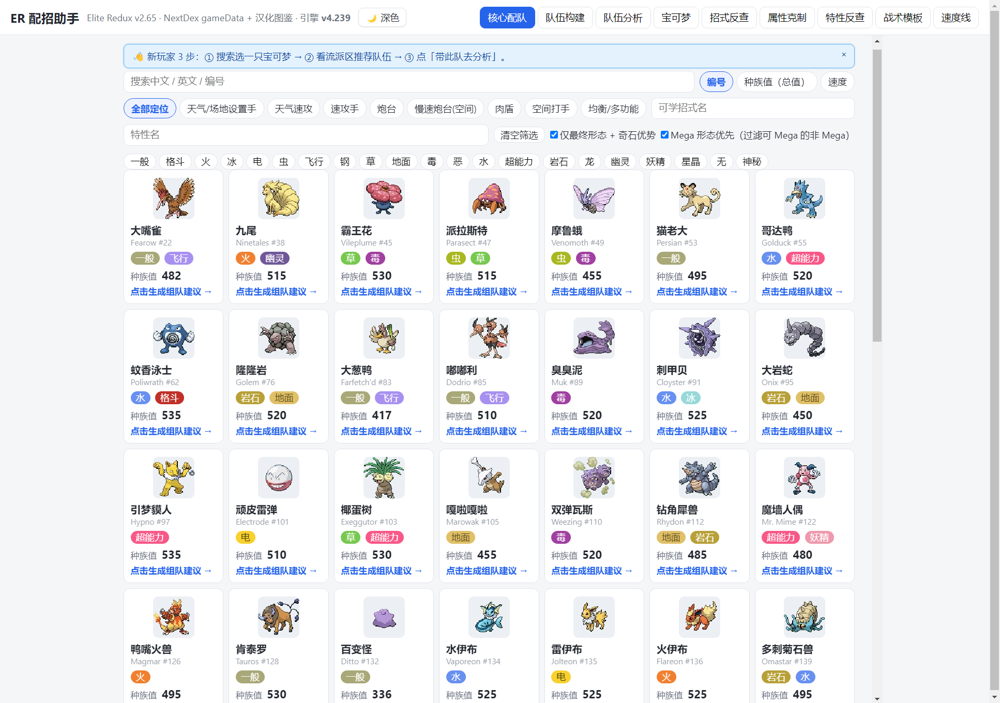

---

## 它解决什么问题

玩 Elite Redux 时，你大概反复遇到过这几件事：

- 看上一只宝可梦，**却不知道它能怎么配** —— 几百个特性、上千个招式，全靠记
- 配好一只，**不知道该配谁当队友** —— 凑六只总是靠感觉
- 想打得快一点，**却不知道速度该投多少努力值** —— 投多了浪费，投少了被超速
- 伤害算不准，**不知道这一下到底能不能秒**
- 特性说明只有一句官方文字，**真实效果藏在代码里** —— 实际打起来和想的不一样

这个工具把这些变成**问一句就有答案**。

---

## 九个工作台

| 工作台 | 你在这里做什么 |
|:---:|---|
| **核心配队** | 选一只当核心，反推它可以怎么配、配谁当队友 |
| **队伍构建** | 拼六只、算缺口、试「换掉 X 换入 Y」 |
| **队伍分析** | 六槽位队伍画像 + 伤害判定 + OHKO 反解 |
| **宝可梦** | 全图鉴检索，点开一只看到完整详情 |
| **招式反查** | 一个招式，查谁学得会 |
| **属性克制** | 进攻视角 / 防守视角双表 |
| **特性反查** | 一个特性，查真实效果和持有者 |
| **战术模板** | 24 套现成体系，机制数值一次看全 |
| **速度线** | 全库速度分布 + 配速建议 |

---

## 这一项，别的地方给不了

### 特性 / 招式一律按游戏源码判定，不照抄数据层文案

ER 的数据层只写一句说明，真正生效的倍率、条件、例外都在 `src/abilities.cc` 里。这个工具的每一条特性结论，都是**翻开源码一句句读出来**的：

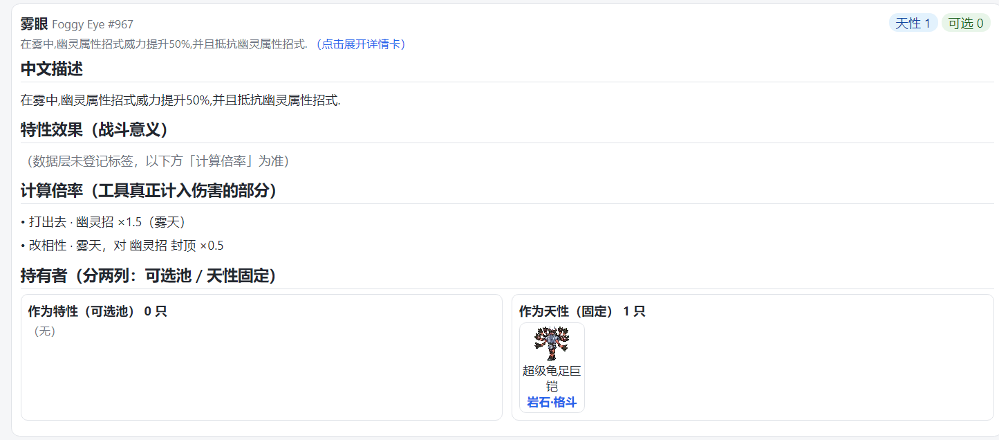

> **雾眼**：`打出去 · 幽灵招 ×1.5（雾天）` / `改相性 · 雾天 封顶 ×0.5`
>
> 这两行不是把官方说明复述一遍，是从源码的 `.onOffensiveMultiplier` 和 `.onAfterTypeEffectiveness` 两个钩子里拆出来的真实数值与触发条件。

拆出来的结论会**落到工具每一个相关角落** —— 不是只写在一个说明页里：

| 位置 | 体现 |
|---|---|
| 核心配队 | 「伤害倍率」块，特性增伤 / 减伤与条件逐条列出 |
| 伤害面板 | 「倍率分解」行，克制 · 特性 · 天气 · 道具 · 随机各是多少 |
| 配速滑块 | 「提速来自 轻装 ×2（消耗掉道具后）」—— 连触发前提都写出来 |
| 特性反查 | 每条特性带源码依据，不是官方文案 |
| 属性克制 | 结合具体宝可梦与特性，不是只看属性表 |

---

## 流派合理性：不硬造，也不漏判

工具会先判断「这只配不配走这条流派」，再决定要不要给你，判据是**耐久三角 + 减伤特性 + 回复手段一起看**：

- **玻璃炮台**不再硬塞一条全是变化招的联防/辅助流派。像超级大针蜂（耐久三角 205、三特性全适应力），现在只保留两条物理输出流派：

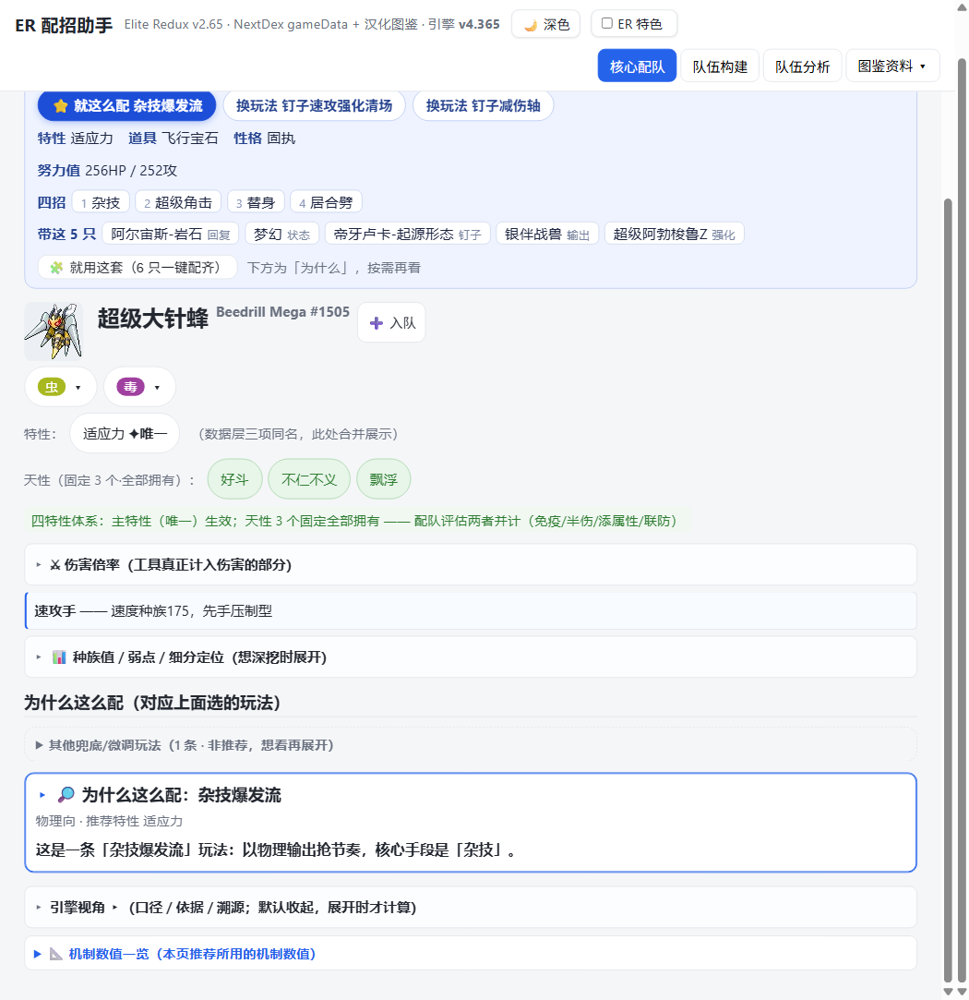

- **慢速耐久重炮**会补回名实相符的输出流派。像超级土王（145 物攻 + 地面本系 + 350 耐久），原来误标「双刀」的破盾流改为物理向的「速攻压制」，四招垃圾射击 / 挖洞 / 撒菱 / 剧毒，性格勇敢：

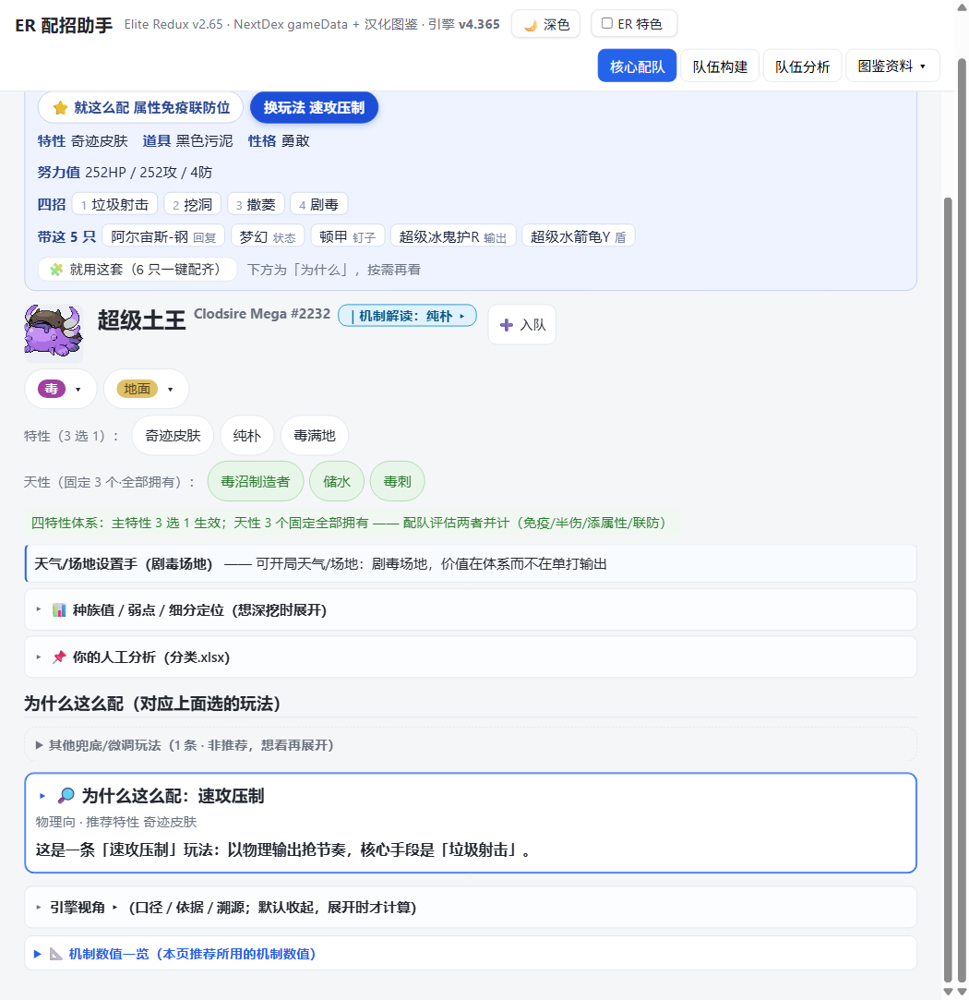

- **触发条件不满足的特性**（发电机、不仁不义、天气依赖、狙击手/超幸运、神枪手/炮术等）会自动降权或换成不依赖该条件的特性，不会让你带着一条永远不触发的特性。
- **晴、雨、场地触发的特性**（叶绿素/太阳之力/悠游自如/雨盘/速度之力/草之皮毛等）同样按「有源才生效」判：自身或队伍开不出对应天气/场地就降权；干燥皮肤因自带水吸收免疫，不判死。

---

## 功能细节

### 核心配队

选一只当核心，工具按**真实流派**拆出几种配法，每种给配招 / 特性 / 道具 / 努力值 / 性格，并反向推出「为了这套打法，我需要什么样的队友」。

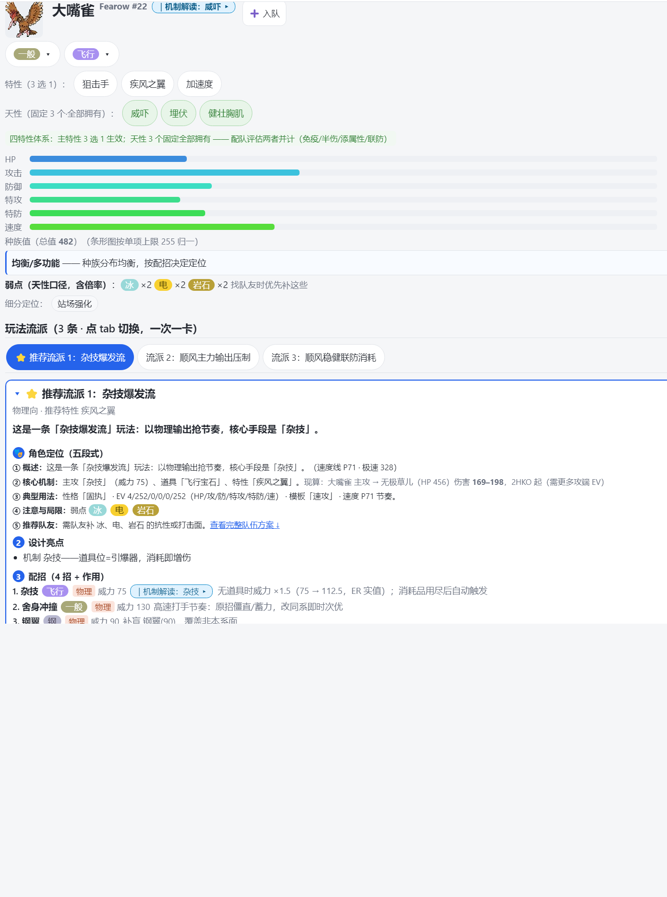

**「伤害倍率」块**把这只宝可梦能打出的增伤倍率单独摊开 ——

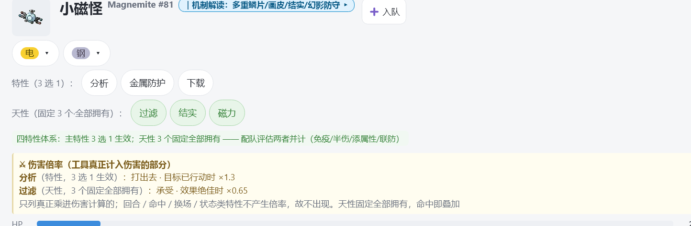

> 小磁怪「分析」特性：目标已行动时 ×1.3。工具直接写明 `3 选 1` 和条件，不用你自己猜哪个特性在起作用。

---

### 队伍构建：边际评估

队伍拼到一半，算一下**离达标还差多少**，然后给出「换掉谁 → 换入谁」的具体方案，每组都带**得到什么、失去什么**：

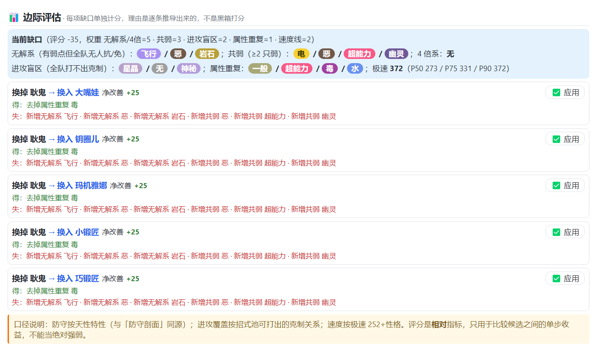

> 当前缺口 −35。工具给出 5 条替换方案，每条都算清了得失，点「应用」直接落地。

---

### 队伍分析：伤害判定

六槽位摆好后，直接进入伤害计算 —— **不是模拟器，是带你队伍真实数值的判定**：

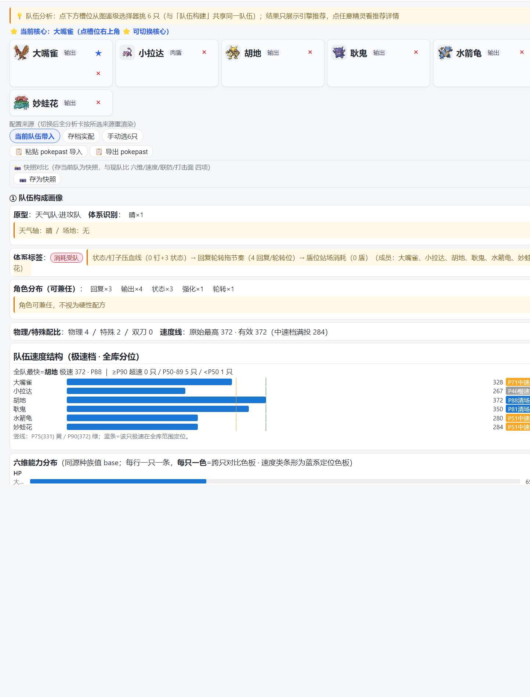


> 这一行把最终伤害是怎么乘出来的全摊开：`克制 ×1 · 特性增伤 ×1.5［贤者之力×1.5(特殊招)］ · 生命宝珠 ×1.3 · 随机 0.85–1.00`
>
> 每个乘区都带名字和条件，不是只给一个总数。

还能做 **OHKO 反解**：想知道「要投多少努力值才能确定秒掉对手」，反过来算给你。

---

### 速度线：配速到每一个 EV

全库 1906 只的速度分布、分位锚点（P50 273 / P75 331 / P90 372 / P95 394 / P99 441），以及**卡线省 EV 建议**：

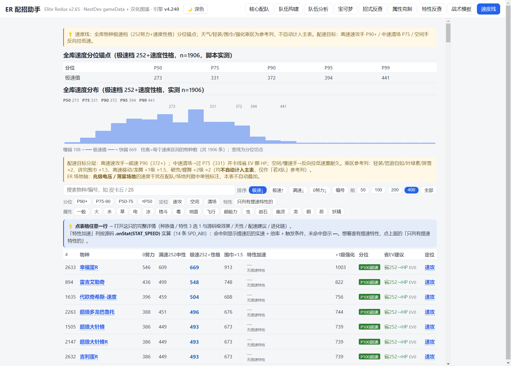

配速滑块还会告诉你**这个速度凭什么**：

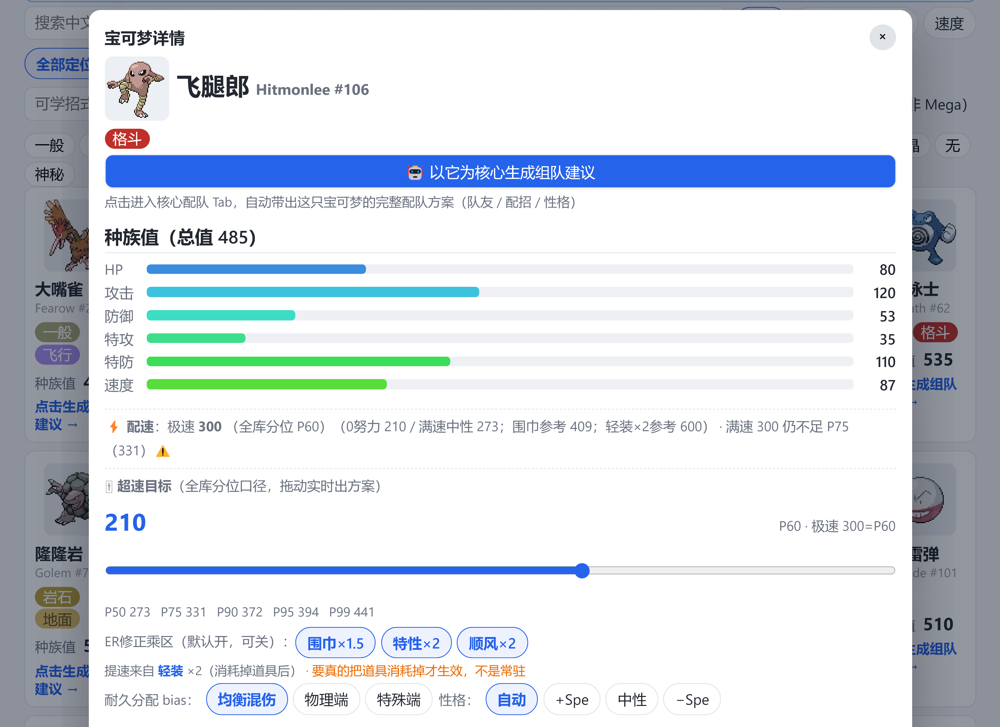

> `提速来自 轻装 ×2（消耗掉道具后） · 要真的把道具消耗掉才生效，不是常驻`
>
> 倍率旁边把**是哪个特性、什么条件**一起写出来。像「轻装 ×2」必须真吃道具才成立、「慢启动」只在前 5 回合生效 —— 这些前提不写清，配速结论就是错的。

---

### 宝可梦详情：一只看到底

种族值、配速、多目标对比、特性 3 选 1、天性固定 3 个、进化链，全在同一个弹层里：

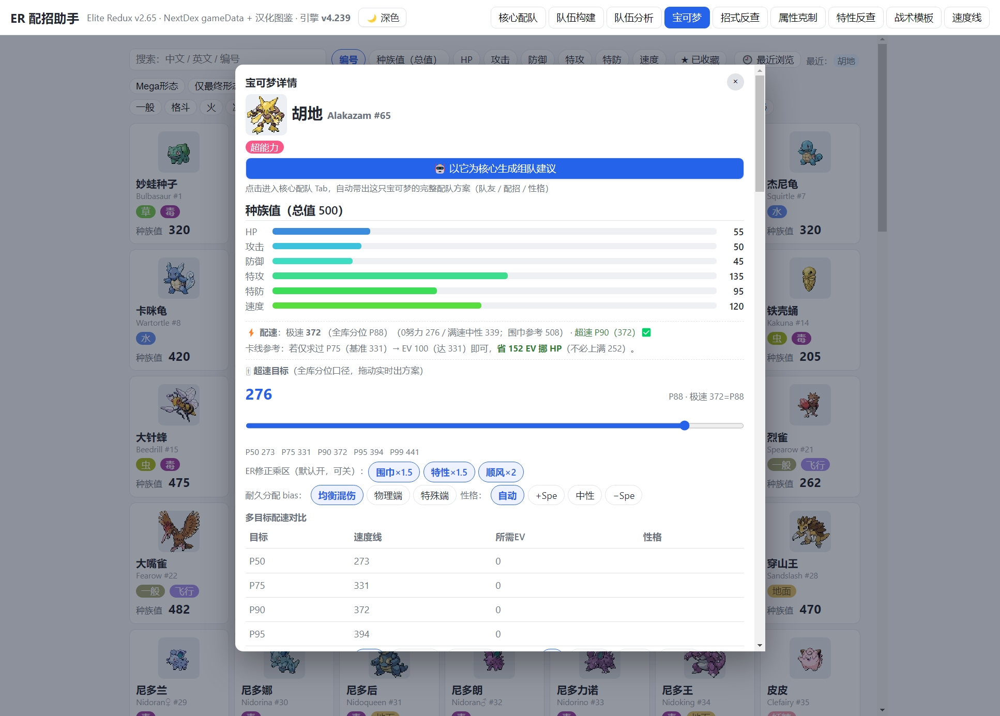


---

### 属性克制：结合具体宝可梦

不是一张干巴巴的属性表，而是**结合每只宝可梦的属性与特性**算真实克制关系：

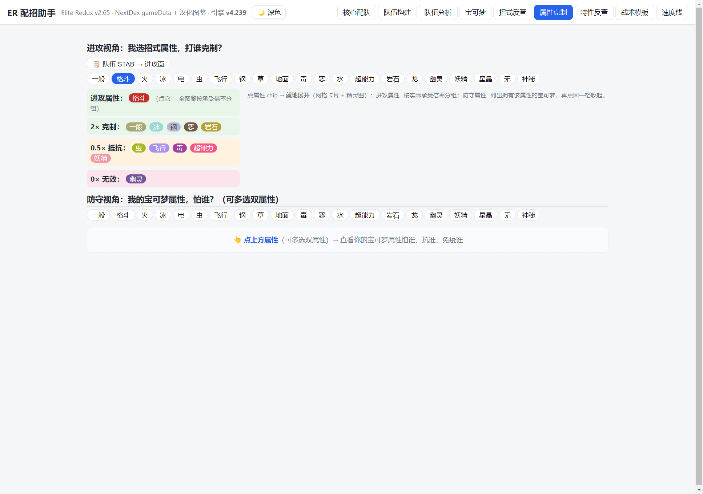

---

## 快速开始

### 在线用（推荐）

打开 **https://wsjshy.github.io/elite-redux-teambuilder/**

手机浏览器也能用，界面自适应。

### 本地用

下载仓库，双击 **`index.html`** 即可（纯 HTML，不需服务器）。

> 需要和 `assets/`、`data_*_v498.js` 在同一目录。
>
> 顺便说明：仓库里的 `配招助手_ER.html` 只是**兼容旧书签的跳转页**（约 1.7 KB），会自动跳到 `index.html`。**它不是第二份程序，也不单独维护。**

### 解析存档

```bash
python parse_er_save_v4.py 你的存档.sav
```

导出队伍与箱子全部宝可梦的物种、等级、能力值、特性、招式、道具。

---

## 数据来源与版权

| 内容 | 来源 |
|---|---|
| 物种 / 特性 / 招式 / 道具 | [NextDex](https://github.com/erithen/ER-NextDex) 官方 `gameDataV2.65beta.json` |
| 中文名 | 汉化图鉴映射（未收录项回退英文） |
| 精灵图 | NextDex 精灵 PNG，版权归原作者 / 官方所有 |
| 对战惯例先验 | [Smogon](https://www.smogon.com/dex/) / [Pikalytics](https://www.pikalytics.com/)，仅作**软先验** |

> **原版使用率 ≠ ER 使用率**。ER 没有对战统计，Smogon 数据只用来在同档位里微调排序，不改变推荐结论的量级。这条缺口如实标着，没有装作有。

---

## 想深入看

这个仓库同时是一套**代码即文档**的工程。技术内容全部在下面几处，README 只做对外介绍：

| 文档 | 用途 |
|---|---|
| [**AGENTS.md**](AGENTS.md) | **开发者唯一入口**。架构、源码判定口径、部署流程、每版实现与验证记录 |
| [功能清单与使用手册](docs/manual/功能清单与使用手册.md) | 逐功能说明 + 排查清单，约 40 张截图 |
| [VERSIONS.md](docs/changelog/VERSIONS.md) | 完整版本历史（v4.3 至今，含每条改动与验证结论） |
| [docs/research/](docs/research/) | 源码审计报告、机制口径、覆盖台账 |

页头显示的版本号取自 `index.html` 里的 `ER_ENGINE_VER`，不是手写文本。

---

*本工具为玩家辅助工具，非官方产品。Pokémon 及相关商标归 Game Freak / The Pokémon Company 所有。*
