# Elite Redux 配招助手 · 使用手册

> **这份文档是给玩家看的。** 每个工作台能干什么、怎么点、看到的东西是什么意思，都在这里。
>
> 引擎版本 **v4.324**｜数据源 Elite Redux v2.65 · NextDex · gameData 全量 ＋ 汉化图鉴
> 线上地址 `https://wsjshy.github.io/elite-redux-teambuilder/`
> 想查内部实现、源码判定口径、坏了怎么排查 → 看 [`../dev/排查与内部口径.md`](../dev/排查与内部口径.md)

---

## 目录

| 章节 | 内容 |
|---|---|
| [0](#0-这份文档怎么用) | 这份文档怎么用 |
| [1](#1-九个工作台) | 九个工作台 |
| [2](#2-为什么这里的结论可信) | 为什么这里的结论可信 |
| [3](#3-核心配队) | 核心配队 |
| [4](#4-队伍构建) | 队伍构建 |
| [5](#5-队伍分析) | 队伍分析 |
| [6](#6-宝可梦) | 宝可梦 |
| [7](#7-招式反查) | 招式反查 |
| [8](#8-属性克制) | 属性克制 |
| [9](#9-特性反查) | 特性反查 |
| [10](#10-战术模板) | 战术模板 |
| [11](#11-速度线) | 速度线 |

---

## 0. 这份文档怎么用

不用从头读。先看第 1 章建立方位感（九个工作台各管一件事），然后按你手头要做的事直接跳：

| 你想做的事 | 去哪节 |
|---|---|
| 「我抽到一只宝可梦，配什么队、走什么路线」 | §3 核心配队 |
| 「把 6 只拼成一队，看还缺什么」 | §4 队伍构建 |
| 「这队到底强在哪、怕什么、能不能一击必杀」 | §5 队伍分析 |
| 「查这只的种族值 / 配速 / 进化 / 特性三选一」 | §6 宝可梦 |
| 「这个招式谁能学、什么属性、威力多少」 | §7 招式反查 |
| 「我打它到底几倍？它打我几倍？」 | §8 属性克制 |
| 「这个特性到底干什么」 | §9 特性反查 |
| 「有没有现成打法模板」 | §10 战术模板 |
| 「我这只速度够不够快、要投多少努力值」 | §11 速度线 |

**三条贯穿全文档的原则**，每节都会用到：

1. **以源码为准，不以数据层文案为准。** 官方文案常常很笼统（例如「改变所有技能」），工具里显示与参与计算的是从游戏源码读出来的真实判定。两者不一致时，判定优先，并在界面上并列展示。
2. **特性一旦判出来，必须进所有地方。** 属性克制、打击面、队伍分析、伤害判定、补队推荐、速度线，六处拿到同一份数值，不会只有一处生效。
3. **算不出来就不假装算得出。** 依赖对手状态、回合计数、场上他人的特性，静态算不了，工具明写「当前未接入 + 原因」，也不给一个错的数字。
4. **操作习惯（v4.291）**：鼠标放在页面左右空白区滚轮也能滚动页面（自动转发给内容区）；任何弹窗点击周围暗色背景即可关闭，不用找右上角 ×，但点内容区不会误关。清空队伍这类危险确认框只能点按钮。

---

## 1. 九个工作台

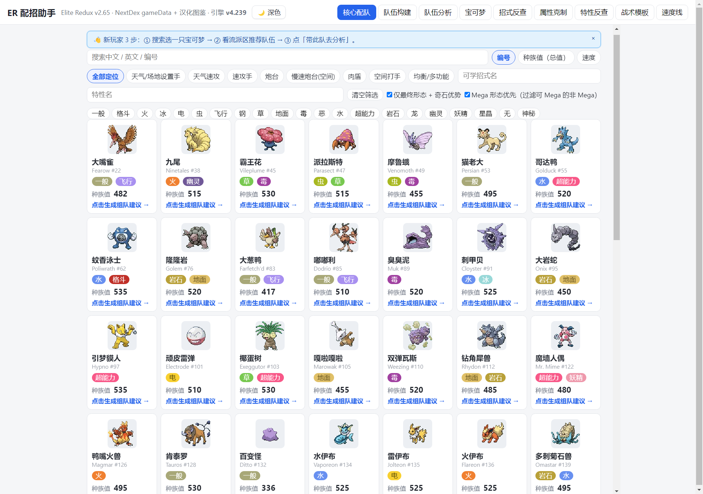

顶栏从左到右：

| 区域 | 内容 |
|---|---|
| 左 | 「ER 配招助手」标题 + 副标题 + **引擎版本号** |
| 中右 | 深色 / 浅色模式切换 |
| 右 | 九个 Tab 按钮 |

**引擎版本号是排查第一入口。** 觉得某个功能「没有」时，先看一眼这个号码 —— 不同版本界面会有差异，能一眼判断你看的是不是最新页面。

| 工作台 | 一句话 |
|---|---|
| **核心配队** | 选一只当核心，反推它可以怎么配、配谁当队友 |
| **队伍构建** | 拼 6 只、评估缺口、智能补位 |
| **队伍分析** | 六槽位 + 伤害判定 + OHKO 反解 |
| **宝可梦** | 全图鉴检索 + 单只完整详情弹层 |
| **招式反查** | 按招式查谁能学 |
| **属性克制** | 进攻视角 / 防守视角双表 |
| **特性反查** | 按特性查真实效果与持有者 |
| **战术模板** | 24 套现成体系 + 机制数值 |
| **速度线** | 全库速度分布 + 配速建议 |

**切换 Tab 不会丢数据** —— 队伍、核心标记、速度线筛选条件都跨 Tab 保留。

---

## 2. 为什么这里的结论可信

ER 的数据层对每个特性只写一句话，真正生效的倍率、条件、例外都在**游戏源码**里。官方文案经常漏掉三样东西：

- **前提** —— 什么时候才生效
- **范围** —— 只对哪些招、哪些目标
- **防守侧** —— 挨打时是不是也变


▲ 同一张特性卡的两段对照。上面「中文描述」是**官方文案**（只写「在雾中，幽灵属性招式威力提升50%」）；下面「计算倍率」是**工具实际计入伤害的数字**：

| 行 | 含义 |
|---|---|
| `打出去 · 幽灵招 ×1.5（雾天）` | 自己打出去的幽灵招，**只在雾天** ×1.5 |
| `改相性 · 雾天，对幽灵招封顶 ×0.5` | 被打时，幽灵招倍率**封顶 0.5** |

文案里这三样一样都没有 —— **前提**（只在雾天）、**范围**（只对幽灵招）、**防守侧**（被打时封顶）。只照抄文案，玩家会以为「随时 ×1.5」，实际打起来完全对不上。

**所以这个工具的每条特性结论，都是翻源码一句句读出来的。** 判出来之后，会落到工具每一个相关角落，而不是只写在一个说明页里。

---

## 3. 核心配队

### 3.1 怎么用

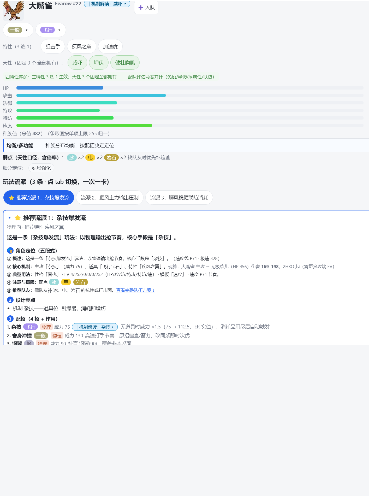

**一句话：选一只当核心，工具反推「它可以怎么配」。**

四步操作：

1. **找核心**：顶部搜索框输中文 / 英文 / 编号；或按种族值总值、速度排序；或点定位 chips（天气场地设置手 / 天气速攻 / 速攻手 / 炮台 / 慢速炮台(空间) / 肉盾 / 空间打手 / 均衡/多功能）。
2. **点卡片** —— 卡片底部有「点击生成组队建议 →」。选中后下方推荐区展开。
3. **读推荐区**（截图中大嘴雀那一段）：
   - **机制解读**：`威吓 ▸` —— 这只的体系价值一句话
   - **特性（3 选 1）**：三个可选特性并排，**点一下即模拟生效**，推荐区与全队分析即时重算
   - **天性（固定 3 个·全部拥有）**：不走三选一，直接全部生效
   - **四特性体系说明**：`主特性 3 选 1 生效；天性 3 个固定全部拥有`
   - **⚔ 伤害倍率（工具真正计入伤害的部分）**：把这只**每个特性 / 天性**在伤害公式里真正乘上去的数字摊开，**不用点开就能看**
4. **入队**：点 `➕ 入队 / 一般 / 飞行` 这类按钮直接进队伍，或进「队伍构建」Tab 继续。

**「⚔ 伤害倍率」这一块单独说明**：它出现在特性 / 天性 chip 的正下方，**只在有货时才出现**。

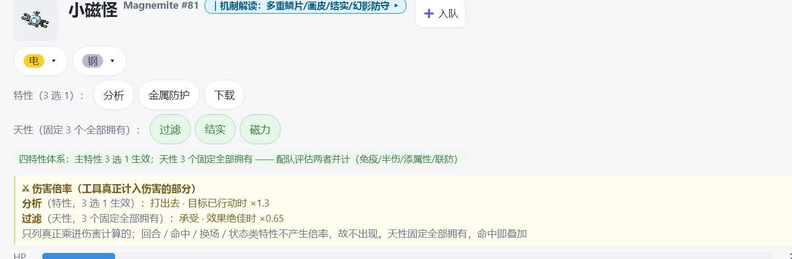

*实测：小磁怪 #81，特性「分析」→ `打出去 · 目标已行动时 ×1.3`；天性「过滤」→ `承受 · 效果绝佳时 ×0.65`。*

三个前缀的含义固定不变：`打出去 ·` = 自己进攻时乘上去、`承受 ·` = 挨打时乘上去、`改相性 ·` = 改属性克制倍率。

**别读成叠加**：特性标的是 `（特性，3 选 1 生效）` —— 三个里只有一个真生效，块里把有倍率的都列出来是为了让你**比较**哪个更值；天性标的是 `（天性，3 个固定全部拥有）` —— 这些是**真叠加**。

**整块不出现，不是漏了**：说明这只的特性和天性都属于**回合 / 命中 / 换场 / 状态类**，源码里没有伤害倍率钩子，本来就不乘数字。全库 1033 条特性里只有 108 条（10.5%）产生倍率。

**筛选开关**

| 开关 | 作用 |
|---|---|
| 仅最终形态 + 奇石优势 | 过滤掉还能进化的中间形态（但保留有奇石优势的） |
| Mega 形态优先 | 剔除「族群里有 Mega、但自身不是 Mega」的普通形态（喷火龙这类），列表只剩真能 Mega 的形态 |
| 18 类属性 chip | 含 星晶 / 无 / 神秘 三个 ER 特有 |

### 3.2 在流派卡里直接调速度（与速度线、滑块同一口径）

每个流派的**第 6 段「努力值分配」**，现在不只是努力值数字，顶部还有一条速度语境：

- **实际速度**：这只按当前配法真正能跑到的速度（大字号强调）。
- **快过约 X%**：在全宝可梦里的速度位置，以及「超速 / 清场 / 中速 / 慢速」定位徽标。
- **「调整速度」按钮**：点它打开和「速度线」页（§11）一模一样的速度滑块。

调整并采用的三步：

1. 点「调整速度」打开抽屉，拖动滑块（或点常用速度）到你想要的速度，下方即时给出最省努力值的性格类别、速度投入和剩余努力值分配。
   常用速度下面还有一张**「多目标配速对比」**表：逐条列出 P50/P75/P90/P95 各要什么性格、多少 EV，投满会标红「满」；够不到的档位写「够不到」并给出上限与替代手段（围巾 / 提速特性 / 顺风 / 戏法空间）。**点任意一行，滑块和配法卡会一起跳过去。**
2. 点**「采用此配法」**，回到核心卡：第 6 段会高亮「你的配速」并按你的选择重算努力值——
   - 选了更慢的速度：省下的努力值自动转给 HP；
   - 选了更快的速度：需要的努力值先从 HP 抽调、不够再从其他项抽；
   - 六项努力值总和始终不变，单项不会超过 252。
3. 采用的配法会**保存在本机**，刷新页面、下次打开都还在；想回到流派原本的推荐，点第 6 段的**「恢复默认」**即可。
4. 这一套速度口径会跟到**所有页面**：图鉴（宝可梦）列表卡写「极速 X」或「速度 Y · 已配速」，详情页在种族值下面单列一行「你的配速 / 极速」；核心配队第 6 段在没有采用配法时还会给「再 +N EV 到 P75 / 退到 P50 省 M EV」的卡线建议。也就是说：你在任何一处看到的「速度」都是同一个数。
5. **有先制时先看先制，再看速度**：只要这只靠条件先制吃先手（例：烈焰猴R 的「闪电拳击」满血拳招 +1），核心第 6 段与配速抽屉会多一行「先制：XX（满血时 拳招）」，下面直接给两条线：**先制线**（只投到 P50 的那点 EV，其余点数转投攻/耐久，可一键采用）、**常态线**（想常态也抢手就用加速性格卡 P75）。它还会检查你 4 招里哪几招真能吃先制——主攻不是拳招（例如愤怒）时会明说「4 招里只有吸取拳能用」，别为了一个用不上的特性去改速度。满血条件只能靠轮转保（虫返/换人再上），堆 HP 换不来；对手也有同档先制时仍然比速度。
   「恶作剧之心 / 先行治疗 / 飓风之翼」这类**无条件先制**是另一种说法：先制变化招只看先后手、不看速度，结论直接是「速度可以不投」（点「不投速」即把配速记成 0 EV）。「速度线」页的「我的队伍」条上，这类成员后面也会挂一个橙色「先制」小标。
6. **想只看自己定过速的那几只**：宝可梦页工具栏点「◎ 已配速」，网格只留已采用配法的宝可梦（卡片上写实速 + 「已配速」）；一只都没定时会提示去「核心配队」第 6 段点「采用」。反过来，「队伍分析」的「队伍速度结构」卡右上有「去速度线页 →」，一步跳到全库分位锚点。
7. 采用的是**这一只**的速度，因此会同步出现在别的页面：「队伍构建」的选人卡从「极速 X」变成「速度 Y · 已配速」，「我的队伍」名单和「队伍分析」的槽位都带「速 Y」小标；「队伍分析」的**队伍速度结构卡**里，已采用的成员按你的实速排位（并注明「其中 N 只按已采用配速实算」，那条灰线是它理论极速，只作参照），全队最快与速度线塌陷告警也都按实速判断。没有采用配法的成员仍按极速口径计算——两种口径都会写在卡面上，不会悄悄换算法。

8. **先制省下的努力值，到底换到了什么**：有先制的第 6 段，速度结论下面还有一张「降速省下的 N 点努力值换到了什么」对照卡。它把**先制线**和**常态线**两套配法各算成实数并排：实速（含性格修正）+ 分位、HP 实数、主攻实数，最后一句结论由数据生成，例如「速度让出 23 个百分点（P74→P47），多出的 112 点落在：主攻 +112 EV（实数 +28）」。也就是说你能直接看出「少抢这半个身位，是换来更疼的一拳还是更厚的一层血」。
9. **「加速」这类越打越快的特性**：速度线表的「特性加速」列以前对它只显示「—」（它不是固定倍率），现在会标「加速 +1/回合（第2回合起 ×1.5）」。第 6 段与配速抽屉里会算三档：从当前实速起，第 2 / 3 / 4 回合分别是多少，超出全库极速档（P99 441）就直接写出来。结论是**不必按 P75 拼满**——起手让一回合可以接受，速度投入只要够「第一回合别被直接带走」，点位换成守住 / 替身 / 虫返这类过桥手段；这只同时有先制时，会补一句「第一回合本来就能先手」。
10. **戏法空间：这里速度越低越好**：定位是「空间」的宝可梦（速≤30，或速≤60 且攻≥95），第 6 段和抽屉会给一条反向结论：速度 EV 应该 0、性格用减速（物攻手勇敢 / 特攻手冷静），并算出「空间内你能先行全库多少 %」；省下的努力值先给主攻拉满、纯盾则全给耐久（HP/防/特防 都给实数）。它还会点名空间里的**负收益**——讲究围巾、顺风、加速、速度 +1 级都只让你更晚出手，反倒是黏黏网 / 电磁波 / 岩石封锁等于给你加速；能自己开戏法空间的还会提醒「优先度 −7，全场最后发动，开空间那回合基本白挨一次打」。速度线表里这些行的「省EV建议」直接写「0EV·减速」。
11. **轻装：一次性开关，不是常驻翻倍**：特性「轻装」看着像白送 ×2，其实必须先真的把道具吃掉（源码写明「消耗掉道具后速度加倍，**换下即失效**」）。核心第 6 段与配速抽屉会给完整结论：现在多少 → 吃掉道具后多少（超全库极速档会直说），并给能真正触发的手段（电气 / 精神 / 薄雾 / 青草种子在对应场地上场即消耗、白色药草、弱点保险、气势披带、各类果子）。三条要记住：**它一场基本只有一次**（道具吃掉不回来）、**消耗前那一回合仍是真空期**（速度该按「消耗前要压过谁」投，别按翻倍后的数字省 EV）、**换下就没了**（轮转流别指望它当常驻速度线）。速度线表的「特性加速」列在这类行会额外标「一次性，换下失效」。
12. **围巾和顺风：提速来自别人**：这两样不占宝可梦自己的努力值，一个占道具位（讲究围巾 ×1.5），一个占队友的回合（顺风 ×2，只有 4 个回合时段）。核心第 6 段会把两条线都算给你，并提醒三件事：顺风要「有人先手开出来」（恶作剧之心这类变化招先制最稳）、自己学得了顺风就该当开风手、**轻装与围巾不能同时要**（围巾本身就是道具，轻装要把它吃掉才有 ×2，同一个道具位只能选一个）。
13. **飞毛腿：先看代价，再看速度**：特性飞毛腿要你自己先中一个异常状态才有 ×1.5，所以第 6 段会逐条算代价——中毒/剧毒只提速但每回合掉血，灼伤提速但物攻减半，**麻痹会被本身 ×0.5 抵消（净 0.75 倍）**，睡眠/冰冻根本不能动不算提速。结论句会直接告诉你划不划得来：除非这只还有毅力或中毒激升（那时攻击也 ×1.5，状态变双收益，会给实数），否则别为了速度主动吃状态。反过来，对手的毒菱 / 磷火 / 电磁波等于免费送提速——这时候别用队医去清状态。
14. **队伍速度联动：谁给谁提速、谁拖谁**：队伍分析页这张卡不看单只，看六只之间的关系。它从数据层认出八类角色——开戏法空间的、开顺风的、先制 / 满血先制的、清钉的、上状态的、靠吃状态提速的、队医——再只在真的互相拖时才提醒：空间和顺风不能当同一套主轴、空间手遇上 P90+ 快攻手会让它们反而最后出手、满血先制没人清钉就等于先制失效、飞毛腿的状态会被自己的治愈铃声清掉（同一只兼任时只能二选一）。如果三种控速（空间 / 顺风 / 围巾）一个都没带、全队最快又低于 P75，它会直接指出这就是「联动差」。
    这张卡判角色看的是**每只的推荐配置**（配招 + 推荐特性），不是「能不能学」——能学戏法空间但配招没带，就不算空间手。所以每行都会把配招写出来，你能直接看见它凭什么算这个角色。「能学但没配」会单独列一行（比如「戏法空间 → 胡地」），明确写「这些不算冲突，只是没选」；特性也一样，多一行「特性能用但没选：布鲁皇（飞毛腿）」。每条冲突都给出口：换同物种另一套不带该招的流派，或者指出「谁会清钉但没带」。换配置也解决不了时，它会直接从图鉴里筛同定位替补并附上推荐配招（按「真会高速旋转」优先排序，主属性跟队里重复的不列）；只按「能学」凑出来的候选会单独标注「推荐配置默认不带，要手动换一个槽」。
    紧随其后的「配队体检」卡查四件事：弱点分布（同一种属性弱 3 只以上又没人免疫就报警）、胜负手（推荐配置里真带强化招才算，没有就直说残局没人收）、钉子是不是 0:0、有没有一只同时扛两个功能（是优点也是断点）。换人候选还会避开「再叠一层已有弱点」的人选。
    每条结论带严重度（硬伤／提示／参考）并按级排序，卡头报「硬伤 N 条 · 提示 M 条」；另有一行**入场税**：岩钉按岩石相性（上限 50%）、一层撒菱 12.5%，4 倍相性且没人清钉直接算硬伤。
    每条硬伤下面接「怎么修」：缺清钉/缺撒钉/缺收尾分别给出全库候选（优先默认配招里就带的，其次才标「能学但要手动换一个槽」），候选按自身岩钉税排序，附 `速N · 岩钉X%`。
    每个候选还会写「换掉哪一只、换上来之后整队怎么变」：弱点超标几个属性、平均入场税、P90 以上只数、队内最快，变好绿字、变坏红字，末尾一句「整队变好／有得有失／整队没变好」。
    每个候选还写一行配置：**特性 / 道具 / 性格 / EV 六项**。四招里已经带那招写「配置原样可用」，没带就写「改槽：第 N 槽「X」→「高速旋转」」（跳过强化、钉子、清钉这类不能砍的槽，从威力最低的挑）。清钉手另给速度口径：已到上限就说抢不过更快的撒钉手，EV 已够就只改性格，都不够才给「性格改爽朗 + 速补到 N EV」。
    **候选只从你自己的存档里挑（v4.289）**：在「队伍分析」导入 mGBA 存档（.sav）后，上面这些人不再从全图鉴里找，而是**只在你存档里那 400 多种里挑**；判定「这只能不能补这个功能」看的是**存档里它实际带的四招**，不是「它能不能学」。卡头写「已读存档 N 种」，每条候选按来源分三种写法：
    - 存档里这只**已经在用**那招 → 「存档实配：特性／道具／性格／EV ＋ 存档里这只已经在用「高速旋转」，上场不用改」；
    - 存档里有这只但四招没带 → 「改槽：把「X」换成「Y」，其余三招照存档」（挑威力最低、且不是强化/钉子/清钉的那一槽）；
    - 存档里根本没有 → 才回全图鉴找，并标红「未持有」。
    队伍里有成员不在这一档时会点名「队伍里有 N 只不在你存档里」，它们仍按推荐配置参与判定，但不进候选。
    **进程标注（v4.290）**：候选配置行末尾会按当前游戏进程加提示——升级招等级不够显示红色「要 LvM 才解锁，先练级」，教学招显示橙色「需找教学 NPC」，Mega 形态显示需要「超级手镯 + 对应进化石」；背包里的库存存档读不到，这类会写明「无法确认」，不会假装你已经有。


> 说明：速度块里标的「加速 / 中性 / 减速」是性格**类别**；流派第 5 段写的具体性格名（如胆小、冷静）保持不变。若选了本只达不到的速度，滑块会自动停在它最近能到的位置。

---

## 4. 队伍构建

### 4.1 怎么用

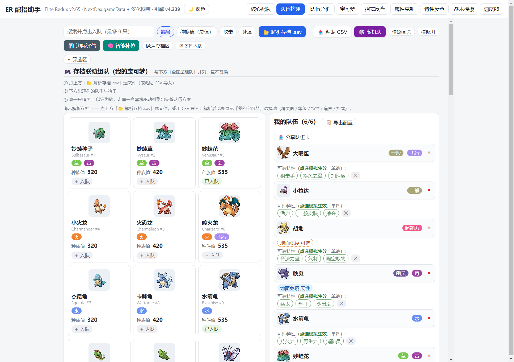

三块区域，从上到下：

**① 顶部工具条**

| 按钮 | 作用 |
|---|---|
| 搜索并点击入队（最多 6 只） | 主路径：搜到就点，点了就进队 |
| 编号 / 种族值(总值) / 攻击 / 速度 | 排序 |
| 📤 解析存档 .sav | 直接读玩家存档，导入真实队伍 |
| 📋 粘贴 CSV | 批量导入 |
| 🎲 随机队 | 随机凑一队（`传说档:关`、`模板:开`） |
| 📊 边际评估 | 算「当前缺口 + 换谁最赚」 |
| 🧠 智能补位 | 自动补满 6 只 |
| 候选:存档区 / ☑ 多选入队 | 存档导入后的候选池 |
| 筛选区 | 展开属性/特性筛选 |

**② 「🖥 存档电脑区」+「🎮 存档联动组队（我的宝可梦）」**

三步走：点「解析存档 .sav」选文件 → 下方出现「我的宝可梦」选择池（精灵图 / 等级 / 特性 / 道具 / 招式）→ 点一只以它为核心，走同一套需求驱动引擎出完整方案。

未解析时这里显示「尚未解析存档 —— 点上方 📤 解析存档 .sav 选文件，或 CSV 导入；解析后此处显示…」。

**③ 「我的队伍（6/6）」+ 📋 导出配置 + 分享队伍卡**

每只一条，带：

- 属性标签（`一般` `飞行`）
- **可选特性（点选模拟生效，单选）** chip 行 —— 如 `狙击手 / 疾风之翼 / 加速度`，末尾一个 `✕` 取消
- **`地面免疫·可选` / `地面免疫·天性` 标记** —— 提醒你「这只如果选了某特性会免疫地面」
- `×` 移除

这一行是整个工具最关键的交互点：**点了特性，防守剖面、全队分析、伤害判定同时重算。**

### 4.2 边际评估（📊）

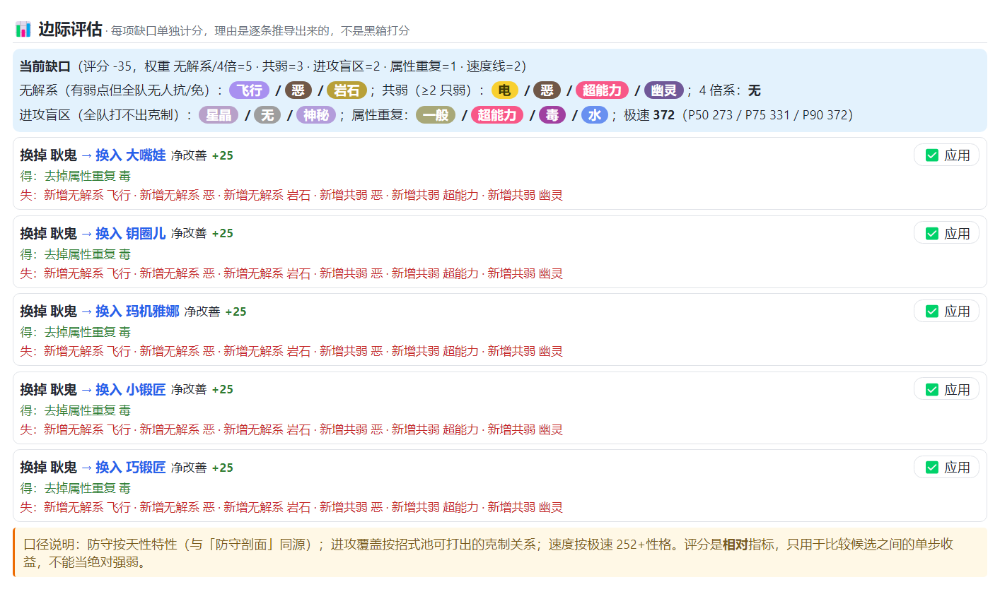

这块回答的是「**我的队现在缺什么，换谁最赚**」，而且是**逐条推导**，不是黑箱打分。

**① 当前缺口**（带权重）

```
评分 -35，权重 无解系/4倍=5 · 共弱=3 · 进攻盲区=2 · 属性重复=1 · 速度线=2
无解系（有弱点但全队无人抗/免）：飞行 / 恶 / 岩石
共弱（≥2 只弱）：电 / 恶 / 超能力 / 幽灵
4 倍系：无
进攻盲区（全队打不出克制）：星晶 / 无 / 神秘
属性重复：一般 / 超能力 / 毒 / 水
极速 372（P50 273 / P75 331 / P90 372）
```

五项缺口的定义：

| 缺口 | 判定 | 权重 |
|---|---|---|
| 无解系 | 队伍里有只弱 X，但全队**无人能抗/免疫 X** | 5 |
| 4 倍系 | 某只被一个属性打出 ×4 | 5（与无解系同权） |
| 共弱 | ≥2 只弱同一属性 | 3 |
| 进攻盲区 | 全队招式池**打不出**任何克制该属性的招 | 2 |
| 属性重复 | 两只以上同属性 | 1 |
| 速度线 | 队伍极速相对分位 | 2 |

**② 候选建议**（每条带「得/失」）

`换掉 耿鬼 → 换入 大嘴娃` `净改善 +25`
- 得：去掉属性重复 毒
- 失：新增无解系 飞行 · 恶 · 岩石；新增共弱 恶 · 超能力 · 幽灵

每条右侧一个 `✅ 应用` 按钮，点了直接换人。

**这块的价值不在于「+25 分」，而在于「得/失」被明写出来。** 你看得见「换掉耿鬼能去掉毒重复，但会新增三个无解系」——所以你可以拒绝这个建议，这正是设计意图。

**③ 口径说明**（底部）

> 防守按天性特性（与「防守剖面」同源）；进攻覆盖按招式池可打出的克制关系；速度按极速 252+性格。评分是**相对**指标，只用于比较候选之间的单步收益，不能当绝对强弱。

**④ 一个已知的展示特性**：多个候选如果**属性组合相同**（比如大嘴娃 / 锁圈儿 / 玛机雅娜 / 小锻匠 / 巧锻匠 都是钢系），缺口变化会一模一样（都是「去掉毒重复 + 新增同样四个无解系」），分数也都是 +25。这不是 bug，是「同属性候选缺口收益必然相同」的必然结果；差异在招式池与特性，工具不展开到那一层。

### 4.3 智能补位（🧠）

与边际评估互补：边际评估是「换谁最赚」，智能补位是「直接补满」。补位后同样走 `renderTm / renderSlots / renderAnalyze / saveTeam` 全套。

---

## 5. 队伍分析

### 5.1 怎么用

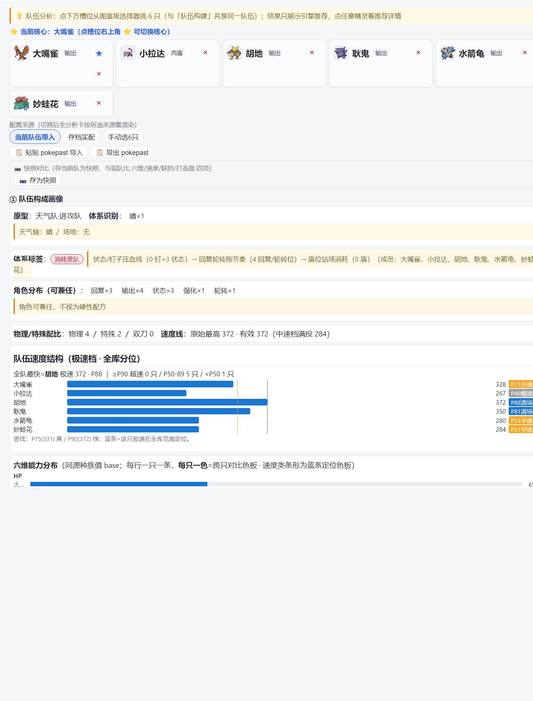

这一页装的是「**这队到底能不能打**」，分四层：

1. **六槽位** —— 与队伍构建共享同一个 `team`，不重复录入
2. **伤害判定 / OHKO 反解** —— 算「我这一击能不能秒它」「它能不能秒我」
3. **防守剖面与全队分析** —— 逐属性看每只被谁克制、全队盲区在哪
4. **核心标记** —— 用 ★ 指定「以谁为中心」

### 5.2 六槽位

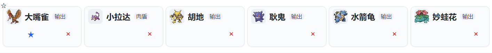

每个槽位显示：

| 元素 | 含义 |
|---|---|
| 精灵图 + 名字 | 物种 |
| 角色标签（`物攻手` / `特攻手` / `盾`） | 工具按能力值自动推断，可兼任 |
| **★ / ☆** | ★ = 当前核心（`蓝★`）；点 ☆ 切换核心 |
| `×` | 移除该成员 |

点槽位本体 → 打开图鉴级选择器替换。

顶部「★ 当前核心：大嘴雀（点槽位右上角 ★ 可切换核心）」。核心的作用是决定「推荐区围绕谁展开」。

**配置来源三路互斥**（`anCfgSrc`）：

| 值 | 含义 |
|---|---|
| `team`（默认） | 当前队伍带入 |
| `sav` | 存档实配（吃玩家真实配招/道具/EV/性格） |
| `manual` | 手动选 6 只兜底（`anManualIds`，**不污染**队伍构建 Tab 的 `team[]`） |

### 5.3 伤害判定 / OHKO 反解

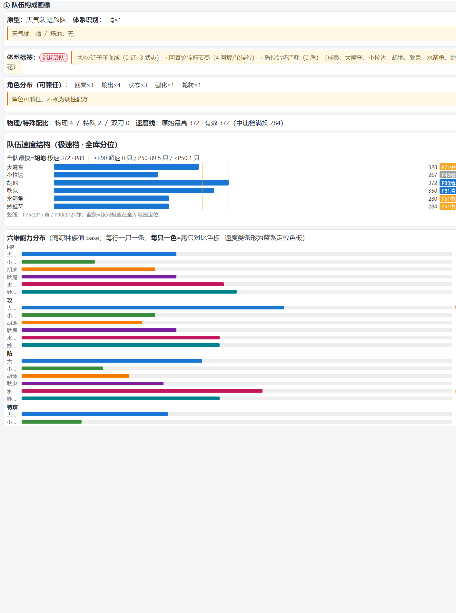

界面元素：

| 控件 | id / 说明 |
|---|---|
| 攻方（我方） | 攻方搜索框 + 「从队伍选」按钮；下方候选列表 |
| 防守方 | 防守方搜索框 + 「载入NPC队」/「载入存档队」；下方候选列表 |
| 常用对手 chips | 常用对手 chips —— 格斗弱 / 冰弱 / 电弱 / 虫弱 / 草弱（一键选典型对手） |
| 我方招式 | 招式搜索框 + 候选列表 |
| 结果 | 输出区 |

**输出区读法**（以「探探鼠 → 小拉达（HP 96）」为例）：

```
伤害 137–162 · 特性增伤 ×2 确定 OHKO · 达到 OHKO 最低攻端 EV=0
耐久反推：
  扛1下：HP+40 / 物防+236
  扛2下：252/252 也必死
```

- **伤害区间** 137–162 是 `dmgCalc` 算出的随机数范围
- **特性增伤 ×2** 是这条特性在这里的实际倍率（不是文案，是按源码实算出来的）
- **确定 OHKO** 是区间下限 ≥ 对方 HP
- **最低攻端 EV** 是 `ohkoSolveEv` 反解「要投到多少攻才能必杀」
- **耐久反推** 是反解「要多少 HP/防才能扛住 N 下」

**「倍率分解」行（v4.248 新增）** —— 在伤害数字下面，把这一发伤害**每一项乘数**摊开：

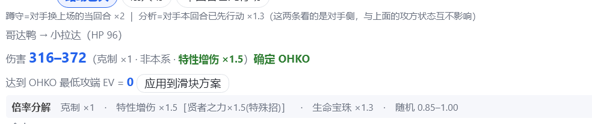

*实测：哥达鸭「贤者之力」打十万伏特 → `倍率分解　克制 ×1　·　特性增伤 ×1.5［贤者之力×1.5(特殊招)］　·　生命宝珠 ×1.3　·　随机 0.85–1.00`*

读法：

| 项 | 含义 |
|---|---|
| `克制 ×1` | 属性相性倍率（`defCellTrio` 判，含对手特性的免疫/减半） |
| `本系 ×1.5` | 本系加成（`-ate` 类转换后也算本系，见 §12.1） |
| `特性增伤 ×N［…］` | 攻方特性乘数，方括号里是**哪一条特性、什么条件**判出来的 |
| `特性减伤 ×N［…］` | 守方特性乘数，同上 |
| `晴天/雨天 ×1.5` | 天气只在对应属性上生效 |
| `电气/青草/精神场地 ×1.3` | 场地加成 |
| `生命宝珠 ×1.3` / `讲究×1.5` | 道具 |
| `会心 ×2` | 勾了暴击才出现 |
| `随机 0.85–1.00` | 伤害浮动区间来源 |

**它的意义**：此前这些明细只藏在伤害行某个 `title` 属性里（要鼠标悬停才看得到），而下面这行只显示一个合并后的 `特性增伤 ×1.5`——**你看得到「有倍率」，看不到「凭什么是这个倍率」**。这一行把 `dmgAtkAbiMul` / `dmgDefAbiMul` 返回的 `hits` 明细提到了明面。

**注意它不改变计算**：只读 `dmgCalc` 已返回的 `eff/stab/atkMul/atkHit/abiMul/abiHit`，加上 `__spdSl` 里的天气/场地/道具/暴击状态，**`dmgCalc` 一行没动**。

**两行状态 chip（v4.238 新增，这是最容易忽略但影响巨大的两块）**

`攻方状态`：`无` / `异常` / `中毒`

- `异常` → 毅力 ×1.5（物理）、决心 ×1.5（特殊）
- `中毒` → 中毒激升 ×1.5（**只中毒/剧毒，不是任意异常**）

`目标状态`：`站场已久` / `刚入场` / `本回合已先行动`

- `刚入场` → **蹲守** ×2.0（源码判据见开发文档）
- `本回合已先行动` → **分析** ×1.3（源码判据见开发文档）

**这两行为什么必须分开看**：它们判的是**对手侧**的状态，和你自己有没有异常、有没有强化是**两回事**。

### 5.4 分析结果

「分析结果」是一张很长的诊断卡（实测 3057 字），内容依次是：

| 块 | 内容 |
|---|---|
| ① 队伍构成画像 | 原型（如「天气队·进攻队」）、体系识别（`晴×1`）、天气轴、场地、体系标签（如「消耗受队 状态/钉子压血线（0 钉+3 状态）→ 回复轮转拖节奏（4 回复/轮转位）→ 盾位站场消耗（0 盾）」）、成员列表 |
| ② 角色分布 | `回复×3 输出×4 状态×3 强化×1 轮转×1`（可兼任） |
| ③ 防守剖面 | 行=攻击属性，列=队伍成员，格值 `基础→天性修正`；尾三列 `弱×N / 抗×N / 免×N` |
| ④ 整队盲区 | `整队盲区：...` 或 `无整队盲区` |
| ⑤ 推荐详情 | 点任意精灵缩略图/名字 → 弹出该只的「推荐详情」层（「推荐详情」层）。内含**角色定位五段式卡**：①概述 ②核心机制（含**现算击杀线**）③典型用法 ④注意与局限 ⑤推荐队友 |

**⑤ 里那张「角色定位五段式」卡怎么读**

| 段 | 内容 |
|---|---|
| ① 概述 | 一句话定位 + 速度线分位（`P88`）+ 极速实值 |
| ② 核心机制 | 主攻招（含威力）、道具、特性（**带计算倍率**）、以及**现算击杀线** |
| ③ 典型用法 | 上场时机、招式循环 |
| ④ 注意与局限 | 弱点、`warn` 提示 |
| ⑤ 推荐队友 | 补盲方向 |

**「现算击杀线」是当场算的，不是写死的**：拿该只的主攻招，对「该招属性克制（`opt≥2`）里 HP 最高的那只」打一发，
显示 `伤害 lo–hi` + `确定 OHKO / 概率 OHKO / 2HKO 起`。

**关键：它会按这只自己的推荐特性去定情景。** 如果推荐特性是毅力/决心/中毒激升/蹲守/分析，
数字后面会带一行灰字 `（按「自身有异常」前提）` / `（按「对手刚上场」前提）` 之类。
看到这行灰字，说明这个击杀线是在那个前提下算的——不满足这个前提时实际打不到这个数。


> **v4.246：② 核心机制里的特性名后面，现在会跟一段灰字倍率。**
> 上面这张图里「特性「分析」」后面紧接着 `（打出去 · 目标已行动时 ×1.3）` —— 这一段不是文案复述，而是**这个特性在伤害计算里真正乘上去的数字**，来源是按源码实算。
> 没有这段灰字的卡片（如「疾风之翼」「再生力」），表示该特性属**回合 / 命中 / 换场 / 状态类**，不产生伤害倍率 —— 不是漏了，是不该有。

*实测例：小磁怪（特性「分析」）主攻「铁蹄光线」→ 浩大鲸，伤害 `1107–1302`，后面跟着 `（按「对手已先行动」前提）`。这行前提字是 v4.241 新增的——此前这里既不传 `tgt`、也不标前提，数字会掉回 `850–1000` 一档。*

> **v4.241 修的真缺陷**：这个击杀线此前调 `dmgCalc` 时只传了 `crit/evA/evD/itemA/moveId/natA/natD/sA/sD/terrain/weather`，
> **漏了 `stA` 和 `tgt`** ——于是毅力 / 决心 / 中毒激升 / 蹲守 / 分析 这 5 条特性在这里**全部静默失效**，数字偏低且不报错。
> 实测对照：毅力·腕力的「吸取拳 → 幸福蛋」由 `775–912` 变 `1163–1368`（×1.5）；蹲守·狡小狐的「欺诈 → 果然翁」由 `226–267` 变 `453–534`（×2.0）。 |

**防守剖面格值读法**：

- 只写一个数 = 基础倍率，天性没改
- `2→0.5` = 基础 ×2，但天性特性把它压到 ×0.5
- 标「可选」= 可选池里有能改善的特性，但**未勾选不生效**

---

## 6. 宝可梦

### 6.1 怎么用

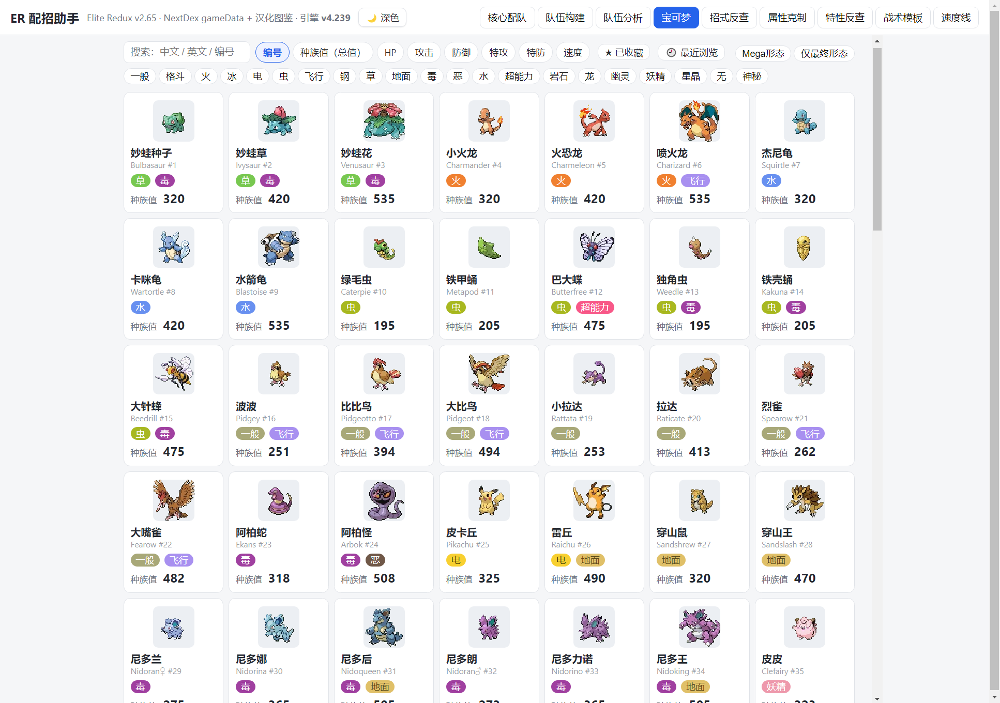

全图鉴检索页。找到一个物种后**点它 → 打开完整详情弹层**。

**检索与排序**

| 控件 | 说明 |
|---|---|
| 搜索框 | 中文 / 英文 / 编号 |
| 排序 | 编号 / 种族值(总值) / **HP / 攻击 / 防御 / 特攻 / 特防 / 速度**（单维排序，做配速时用速度） |
| ★ 已收藏 | 收藏过的排前面 |
| 🕘 最近浏览 | 最近看过的（右上角显示「最近：胡地」） |
| **Mega 形态优先**（v4.249 改名） | 剔除「族群里有 Mega、但自身不是 Mega」的普通形态 |
| 仅最终形态 | 只留进化链末端 |

**「Mega 形态优先」到底滤掉谁** —— 这是**反直觉的一格**，值得单独看。

ER 里可以永久 Mega，所以「喷火龙」和「超级喷火龙X」是两只独立的物种条目。这个开关的意思是：**既然这只迟早要 Mega，就别在普通列表里再摆一个「喷火龙」让你选** —— 开启后全库 1906 只里会去掉 247 只这类「有 Mega 但自己不是 Mega」的形态，剩 1659 只。

开 / 关对比（同一页、同一排序）：

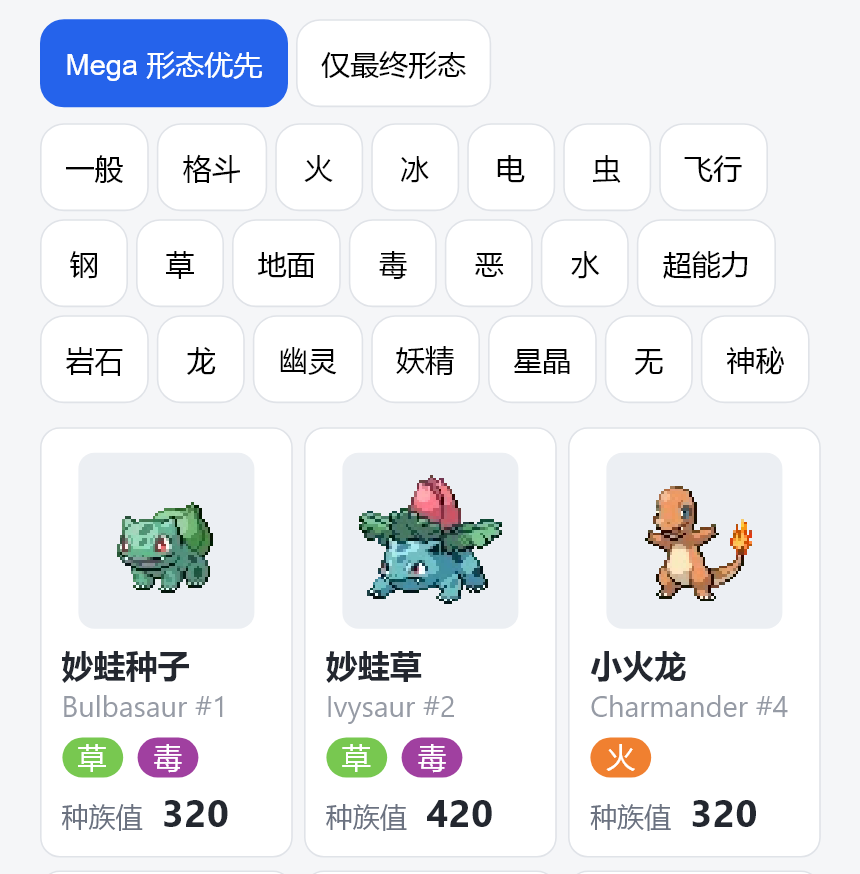

*开启：妙蛙种子 → 妙蛙草 → 小火龙。**妙蛙花 #3 消失了**（它有 Mega 形态）。*

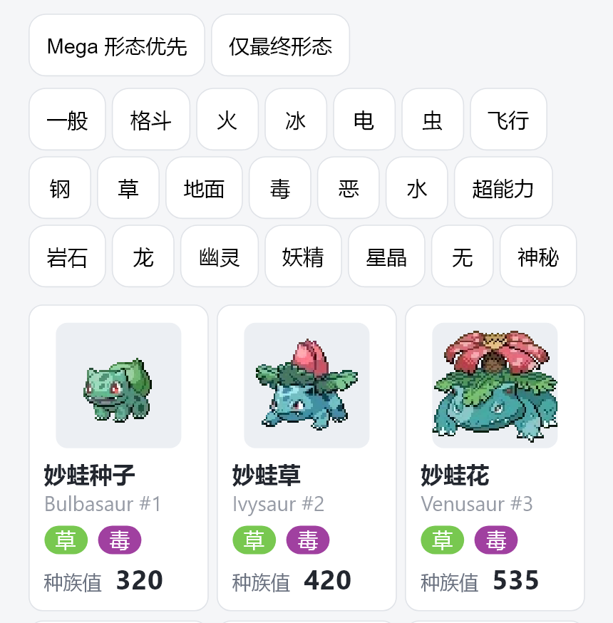

*关闭：妙蛙种子 → 妙蛙草 → **妙蛙花 #3 在**。*

实测口径（`spQuery`，1906 只）：

| 开关 | 结果 | 其中「可 Mega 的普通形态」 |
|---|---|---|
| 关 | 1906 只 | 247 只 |
| 开 | 1659 只 | **0 只** |

1906 − 247 = 1659，**一条不漏、一条不多**。

**ER 特色（v4.289，顶栏总开关）** —— 和上面那格不是一回事，别混。

「Mega 形态优先」是**在族群内部做取舍**（留 Mega 本体、藏起普通形态）；「ER 特色」是**跨全站的另一把筛子**：勾上以后只留 ER 这个改版真正新增的东西，其余一律不显示。它同时管六处列表：宝可梦（图鉴）、核心配队、队伍构建与分析的选择器、招式反查的「谁能学」、特性反查的「谁有」、速度线。

判定三条任一命中即算特色：

| 口径 | 例子 | 为什么算 |
|---|---|---|
| 中文名以 **超级 / 原始 / 究极** 开头，或含「原始回归 / 究极爆发」 | 超级喷火龙X、原始固拉多、究极奈克洛兹玛 | 所有 Mega 类形态，**原版 Mega 与 ER 自创 Mega 一视同仁** |
| 英文名含 **Redux** | Bulbasaur Redux、Mega Garchomp Redux | ER 重制的形态 |
| 中文名以 **R** 结尾 | 大钢蛇R（Carbonix）、盐石宝R（Blocli）、管侍熊（Bewarden Redux） | ER 原创宝可梦，官方图鉴里没有 |

勾上后全库 1906 只 → **451 只**，开关旁边直接写「· 451 只」。官方各世代的普通宝可梦、地区形态（阿罗拉 / 洗翠等）**不算**特色 —— 想看改版特有的东西就开，想按全图鉴配队就关。状态记在本机，下次打开还是上次的选择。

**注意它保的是「Mega 本体」，不是「所有 Mega 相关」。** 超级喷火龙X / Y 本身不是 `hasMegaForm`（它们自身就是 Mega 形态），不受影响 —— 想看 Mega 本体就开，想看普通形态就关。
| 18 类属性 chip | 含 星晶 / 无 / 神秘 |

### 6.2 详情弹层

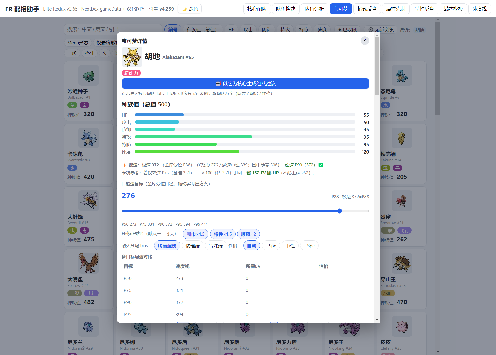

进入方式：**点卡片本体**。弹层最宽 520 px / 92% 屏宽，内部可滚动。

**第 1 屏：种族值 + 配速**

| 块 | 内容 |
|---|---|
| 头部 | 精灵图 + 中文名 + 英文名 + 编号（`胡地 Alakazam #65`）+ 属性标签 |
| 一键配队 | 蓝色按钮「🎯 以它为核心生成组队建议 → 点进入核心配队 Tab，自动带出这只宝可梦的完整配队方案（队友 / 配招 / 性格）」 |
| 种族值 | 六条横向条形图 + 数值（`HP 55 / 攻击 50 / 防御 45 / 特攻 135 / 特防 95 / 速度 120`，总值 500） |
| 速度滑块 | 紧接着就是目标速度滑块（见下），是配速的主要工具 |
| 配速口径速览 | 旧的极速/分位/卡线静态参考已折叠，默认收起，需要时点开即可 |

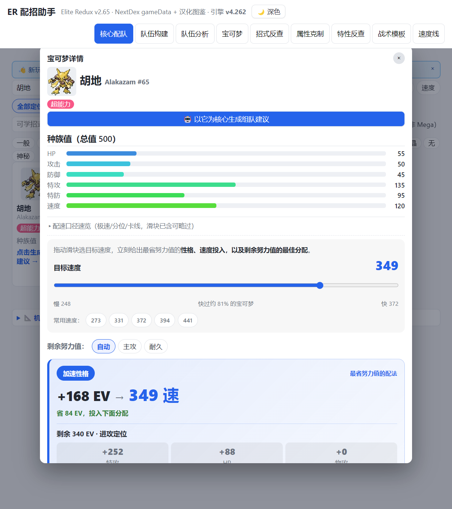

**第 2 屏：拖滑块，一张卡片直接给完整配法（v4.262 重排）**

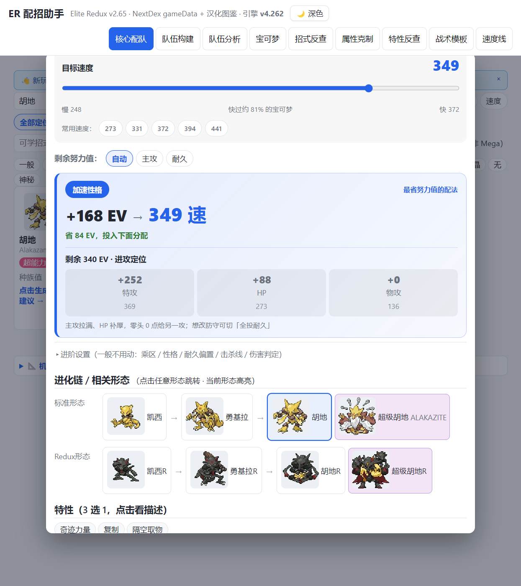

这一屏分上下两块，用法很简单：

1. **上面灰色框 = 你来选目标速度**。拖动滑块，右上角「目标速度」数字就变；滑块左下标「慢」、右下标「快」，中间写着「快过约百分之多少的宝可梦」，让你知道这个速度处在什么位置。下方一排「常用速度」数字，点一下直接跳过去。
2. **下面蓝色卡片 = 系统给的完整答案，照着抄即可**。卡片顶部用颜色标出性格（加速=蓝、中性=灰、减速=紫）；中间最大字号写着「投多少努力值 → 达到多少速度」；绿色字写「省下多少努力值」；分隔线下面是剩余努力值的三格分配，**进攻时是主攻 / HP / 另一攻，防守时是 HP / 防御 / 特防**。
   格子里**大字是投入多少 EV，下面小字是分配后的实际数值**。

**两个真实例子（胡地 #65）**

| 你拖到 | 卡片结论 | 意思 |
|---|---|---|
| 目标 349 | 加速性格 +168 EV → 349 速，省 84 EV，剩余 340 投特攻 | 卡上高速线，剩余主攻拉满、补 HP |
| 目标 276 | 中性性格 +0 EV → 276 速，省 252 EV | 0 努力就有这个速度，速度 EV 全省 |

> **滑块每一档都精确停在这只宝可梦真实能达到的速度上**，不会再出现「滑到的数字和实际对不上」；打开时已经帮你停在「投入不多、却能超过一大批宝可梦」的位置——速攻手停在高速线，耐久手只稍微提速，空间打手干脆不抢速度。你也可以自己再拖。

**剩下的 EV 投哪里，会先看这只宝可梦的定位：**

- 速攻手、空间打手这类进攻型：剩余 EV 先把主攻（物攻或特攻）投满，再尽量补厚 HP，最后若还有零头就给另一攻；每一项都不会超过 252。
- 盾、耐久型：剩余 EV 投 HP / 防御 / 特防。
- 想自己说了算？滑块下方有「自动 / 主攻 / 耐久」三个按钮，点「主攻」或「耐久」就按你的来，随时能切回自动。

**性格也会自动选最省的**：只走特攻或只走物攻的单攻手，会自动选「+速度」的性格，把它用不到的另一攻稍微降一点，就能少投很多速度努力值（比如妙蛙花从中性要 96 点降到加速只要 16 点）；两攻都要用的双刀和纯盾，则保持不修正的性格，免得降了关键能力。想自己定性格，进「进阶设置」手动选即可。


滑块的范围会**自动贴合这只宝可梦自己的速度**：最左是它最慢、0 努力时的实速，最右是极速；若在进阶设置里开了围巾 / 顺风乘区，最右会自动延伸到乘区后的速度。所以无论怎么拖，目标都在「能达到」的区间里，点「常用速度」若超出本只范围，也会自动停在最近的边界——不会再出现「追不上」的红色警告。切换乘区时，已选的目标速度会尽量保持不变。

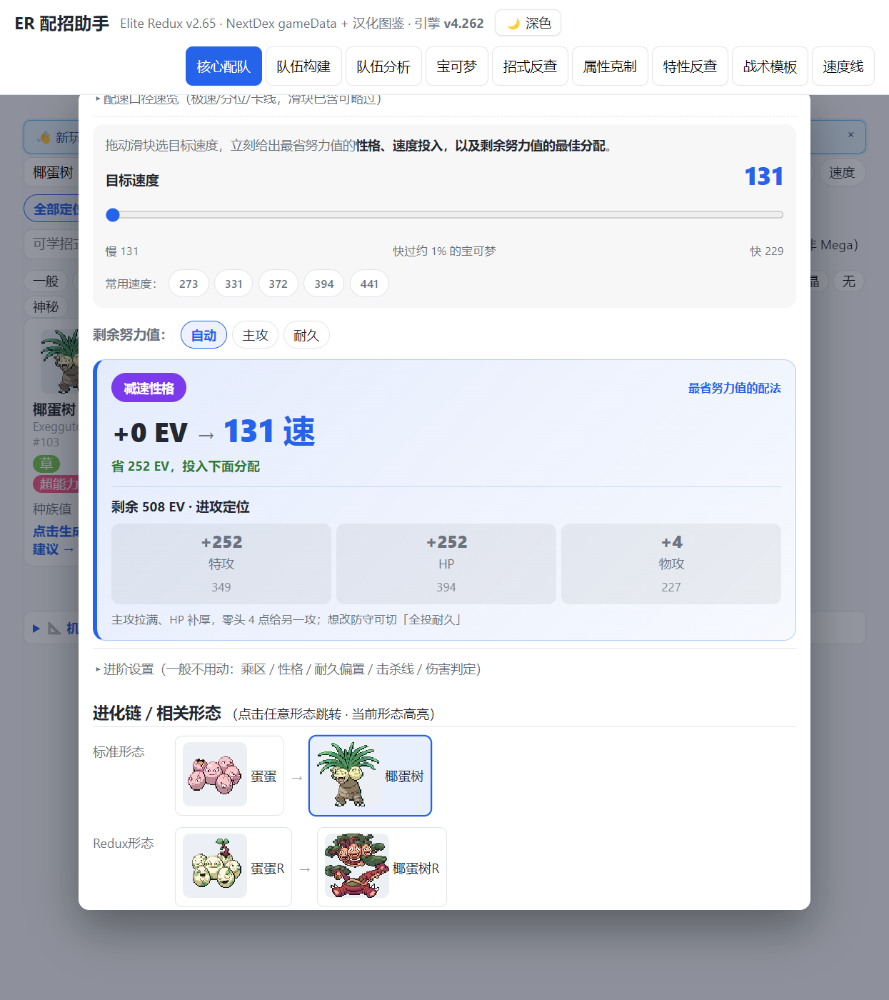

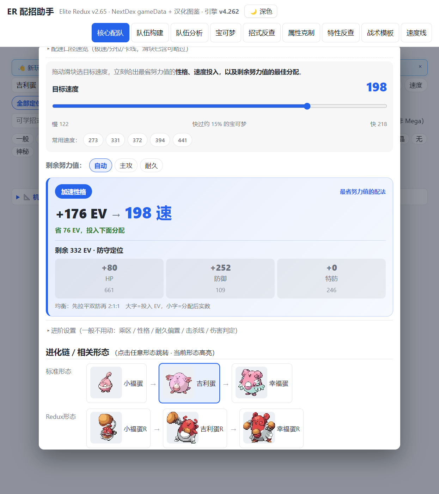

**进阶设置（默认收起）**

这一屏原来还堆着 30 多个 chip（乘区 / 性格 / 耐久偏置 / 击杀线 / HP 断点 / 完整伤害判定面板）。全展开时结论被挤到屏幕外，所以现在全部收进底部的「▸ 进阶设置」：

| 分组 | 什么时候用 |
|---|---|
| ER 修正乘区 | 你有围巾 / 有天气 / 有顺风时，勾上让它按 ×1.5 / ×2 重算 |
| 性格 | 想强制指定某个性格，不按自动建议 |
| 耐久偏置 | 防御高的走物理端、特防高的走特殊端，改变剩余 EV 的分法 |
| 击杀线 / HP 断点 | 需要「攻击刚好 OHKO」或「HP 卡剩饭整除」时 |
| 伤害判定 | 反查这一发打不打得死对手 |

**乘区默认是关的**。原来默认三项全开，等于假设你同时挂着围巾 + 天气特性 + 顺风（×4.5），于是「目标 372」会算成「+0 EV 就够、有效速度 1242」—— 这种结果没法用。现在默认按**裸速**算，勾哪项才加哪项。

乘区开了之后，下面会多一行说明**提速来自哪个特性、要什么条件**：

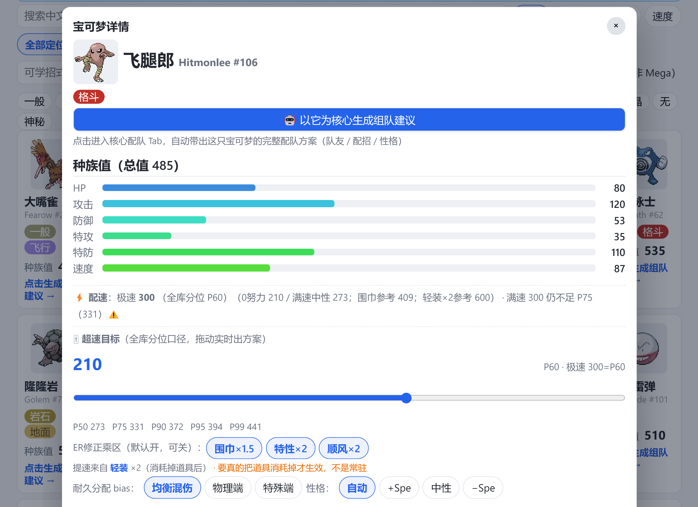

| 位置 | 例子 | 意思 |
|---|---|---|
| 乘区 chip 行 | `特性×2` | 这一项参与算速度，倍率 ×2 |
| 「提速来自 …」 | `轻装 ×2（消耗掉道具后）` | **哪个特性**在起作用 + **触发条件** |
| 橙色警示 | `要真的把道具消耗掉才生效，不是常驻` | 别把它当常驻 ×2 用 |

天气类速度特性**全部 ×1.5**（不是 ×2），只有轻装是 ×2。减速度特性显示成「减速来自 …」；这只没有速度特性时整行不出现。

**耐久分配 bias**：`均衡混伤` / `物理端` / `特殊端` / `性格: 自动 / +Spe / 中性 / -Spe`

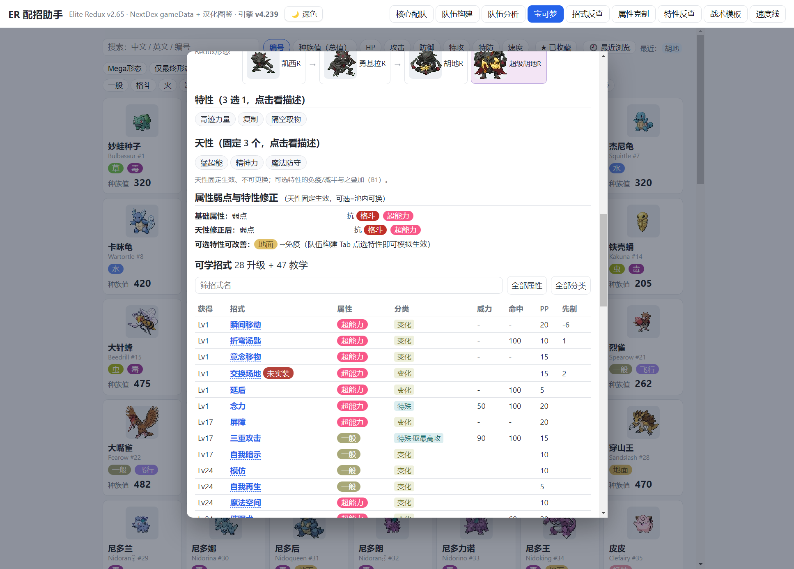

**第 3 屏：多目标配速对比**

表列 `目标 / 速度线 / 所需EV / 性格`，逐行给 `P50 273 → EV 0`、`P75 331 → EV 0`、`P90 372 → EV 0`、`P95 394 → EV 0`… 

读法：**左边是「你想超过谁」，右边是「为了超过它，速度要投多少 EV、性格怎么选」。** 这是配速最实用的一块——把「抽象的努力值」变成「具体超过哪条线」。

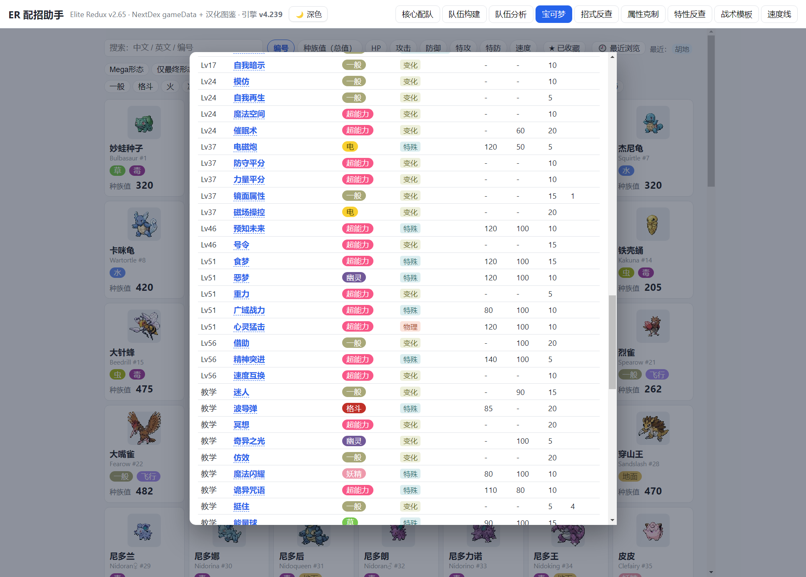

**第 4 屏：特性、天性、进化链**

- **特性（3 选 1）**：三个 chip，可点，点了立刻展开源码级效果说明
- **天性（固定 3 个·全部拥有）**：三个 chip，只读，点开也展开说明
- **进化链**：这条物种从哪来、能进化到哪

### 6.3 特性说明卡长什么样


这是本工具最核心的信息密度体现。每张卡的结构：

```
【特性名（英文）· 图鉴编号】 [特性反查 →]
数据层官方描述（可能很笼统）
数据层补充描述（lDesc / abiTags.nt）
✨ 相性改写（源码 .onAfterTypeEffectiveness·会改属性克制表）：<真实判定>
   —— 或 ——
⚔ 进攻增伤（源码 .onOffensiveMultiplier；只放大自己打出去的伤害，与上面的减伤方向相反，也不改相性表）：<真实判定>
战斗意义：<一句话结论>
```

**四个必须对照读的例子**

| 特性 | 数据层文案 | 源码真实判定 | 差在哪 |
|---|---|---|---|
| **太晶甲壳** #607 | 「HP全满时，所有攻击都将变得效果不好」 | HP 全满 → **倍率封顶 ×0.5**（把 ≥1.0 的倍率都压到 0.5） | 文案说「效果不好」，但没说清是「封顶 0.5」还是「×0.5」——是**封顶**，原本 ×0.25 的不会被抬到 0.5 |
| **神奇守护** #25 | 「仅会被效果绝佳的招式或间接伤害命中」 | 始终对所有属性相性 → **倍率归零**（仅效果绝佳可打进） | 文案像描述，源码是「归零」这个硬动作 |
| **雾眼** #967 | 「在雾中，幽灵属性招式威力提升50%，并且抵抗幽灵属性招式」 | 两条方向相反的判定：`onAfterTypeEffectiveness` 对幽灵招式倍率封顶 ×0.5（守方）；`onOffensiveMultiplier` 幽灵招式 ×1.5（攻方，雾天） | **一个特性同时改两个方向**，只写一条就漏一半 |
| **技术高手** #101 | 「威力≤60的招式威力×1.5」 | `onOffensiveMultiplier`，基础威力 ≤ 60 → ×1.5 | 关键词是**基础威力**，不是算完 STAB 之后的威力 |

---

## 7. 招式反查

### 7.1 怎么用

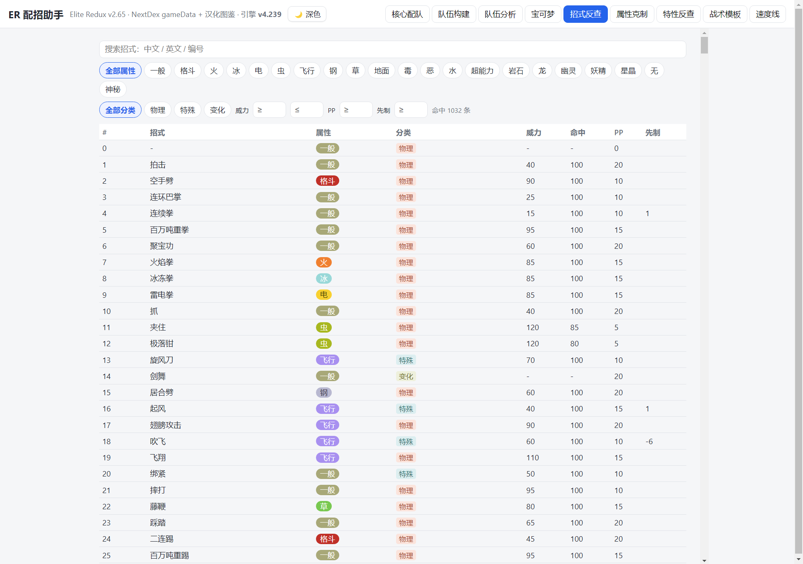

整页是一张全招式表，列：`# / 招式 / 属性 / 分类 / 威力 / 命中 / PP / 先制`。

**点任意一行 = 打开招式详情。**

### 7.2 招式详情弹层

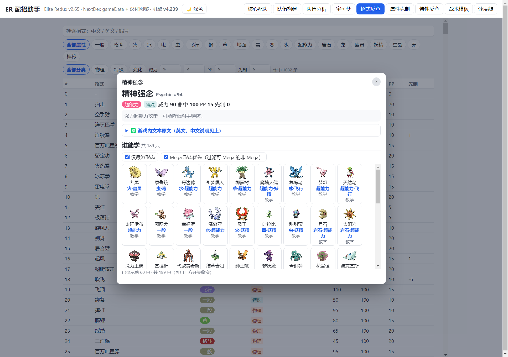

内容：

| 块 | 内容 |
|---|---|
| 头部 | 中文名 + 英文名 + 编号（`精神强念 Psychic #94`）+ 属性标签 + 分类 + 数值行 `超能力 特殊 威力 90 命中 100 PP 15 先制 0` |
| 中文说明 | `强力超能力攻击，可能降低对手特防。` |
| 游戏内原文 | `🈯 游戏内文本原文（英文，中文说明见上）` |
| **谁能学（共 189 只）** | 分列展示：精灵图 + 名字 + 属性标签 + `教学` / `遗传` 等来源 |
| 两个过滤开关 | `仅最终形态` / `Mega 形态优先（过滤可 Mega 的非 Mega）` |

**分类字段是 7 值枚举**，包括 `物理` / `特殊` / `变化` / **`特殊(取防御)`** 等。`特殊(取防御)` 这类是 ER 特色：按特殊分类但吃对方**物防**，伤害判定里必须按 `[4]` 分类字段走，不能只看「特殊」两个字。

---

## 8. 属性克制

### 8.1 怎么用

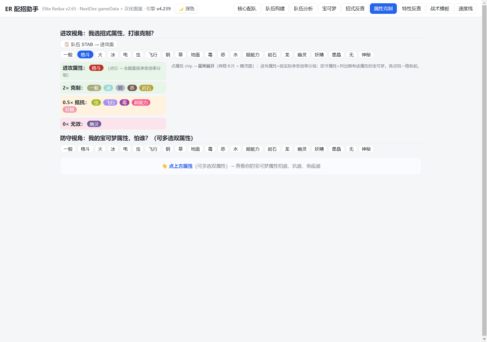

这一页有**两个互不干扰的视角**，各自一排属性 chip：

- **进攻视角：我选招式属性，打谁克制？** —— 选一个属性，看它能打出什么
- **防守视角：我的宝可梦属性，怕谁？（可多选双属性）** —— 选一到两个属性，看它怕什么

**进攻视角**

点一个属性 chip（例如 `格斗`），下方就地展开四组：

```
进攻属性：格斗（点它 → 全图鉴按承受倍率分组）
2× 克制：  一般 冰 钢 恶 岩石
0.5× 抵抗：虫 飞行 毒 超能力 妖精
0× 无效：  幽灵
```

同时展开**全图鉴卡片**：把这个倍率分组对应的所有宝可梦列出来。**再点同一格收起。**

**防守视角**

点一个或两个属性 chip（双属性可多选），看：

- 弱什么（会被 ×2 / ×4）
- 抗什么
- 免疫什么

**一键入口**：`📋 队伍 STAB → 进攻面` —— 把当前队伍 6 只的本系招式属性全部喂给进攻视角，一次看全队能打出什么。这是「组完队想知道覆盖够不够」的最快路径。

**18 类属性 chip**：`一般 格斗 火 水 电 草 冰 毒 地面 飞行 超能力 虫 岩石 幽灵 龙 恶 钢 妖精` + ER 特有的 `星晶 / 无 / 神秘`。

### 8.2 这张表被特性改写了什么（重点）

**属性克制不是固定表。** 一批特性会直接改写倍率，所以工具里的克制度是「**基础表 + 特性修正**」两段算出来的。当前改写的三类：

**① 归零（免疫化）** —— 把某个属性对自己的倍率直接压到 0

| 特性 | 效果 | 源码入口 |
|---|---|---|
| 飘浮 | 地面 → 0 | `onAfterTypeEffectiveness` |
| 引水 / 蓄电 / 避雷针 / 引火 | 对应属性 → 0 | `onAfterTypeEffectiveness` |
| **神奇守护** #25 | **所有属性 → 归零，仅效果绝佳（≥2.0）能打进** | `onAfterTypeEffectiveness` |

**② 封顶（减伤化）** —— 不是 ×0.5，是**把超过 0.5 的倍率压到 0.5**

| 特性 | 效果 | 关键差别 |
|---|---|---|
| **太晶甲壳** #607 | HP 全满 → 所有倍率封顶 ×0.5 | 原本 ×0.25 的**不会**被抬到 0.5，仍是 0.25 |
| **雾眼** #967 | 雾天，对「幽灵」属性招式 → 封顶 ×0.5 | 只对幽灵招式，不是全部 |

**③ 改向（反转为正常/克制）**

| 特性 | 效果 |
|---|---|
| **胆量** #1003 | 格斗/一般 打 幽灵 从 **0 倍 → 1.0 倍** |
| **腐蚀** #954 | 毒 打 钢 从 抵抗 → **效果绝佳 2.0 倍** |

**这三类在 UI 上的表现**：防守剖面格值写成 `基础→修正`（如 `2→0.5`），能用一眼看出「这只本来怕，但特性把它压住了」。

**为什么必须这么做**：用户的原话是「**比如配招的时候就要考虑到自己特性可能会导致电反而克制地面系而不是免疫**」。固定表回答不了这个问题，只有把特性接进倍率链才能回答。

---

## 9. 特性反查

### 9.1 怎么用

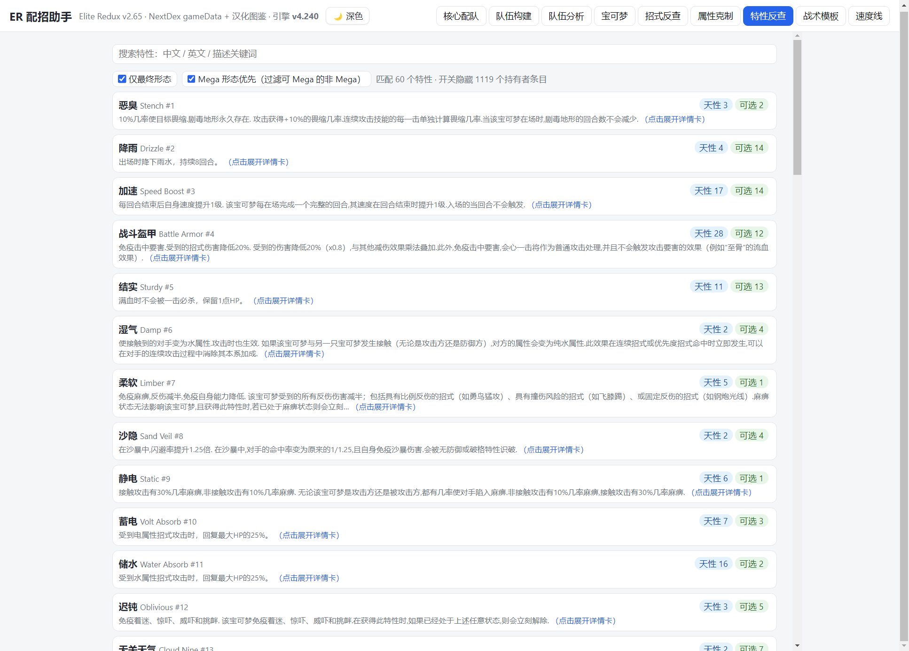

整页是**按特性组织的卡片流**，每张卡三块：

| 块 | 内容 |
|---|---|
| 中文描述 | 数据层官方文案（可能很笼统） |
| **特性效果（战斗意义）** | 源码判出来的真实作用，一句话 |
| **持有者（分两列）** | 左「可选池」= 三选一里能选的；右「天性固定」= 天生就有 |

**「分两列」这件事很关键**：同一只宝可梦可能「可选池里有 A、B、C」但「天性是 X、Y、Z」。查「这只有没有这个特性」时，两列要分开看——可选池里有意味着**你可以主动选**，天性有意味着**它默认就有且不能换**。

### 9.2 特性卡成品

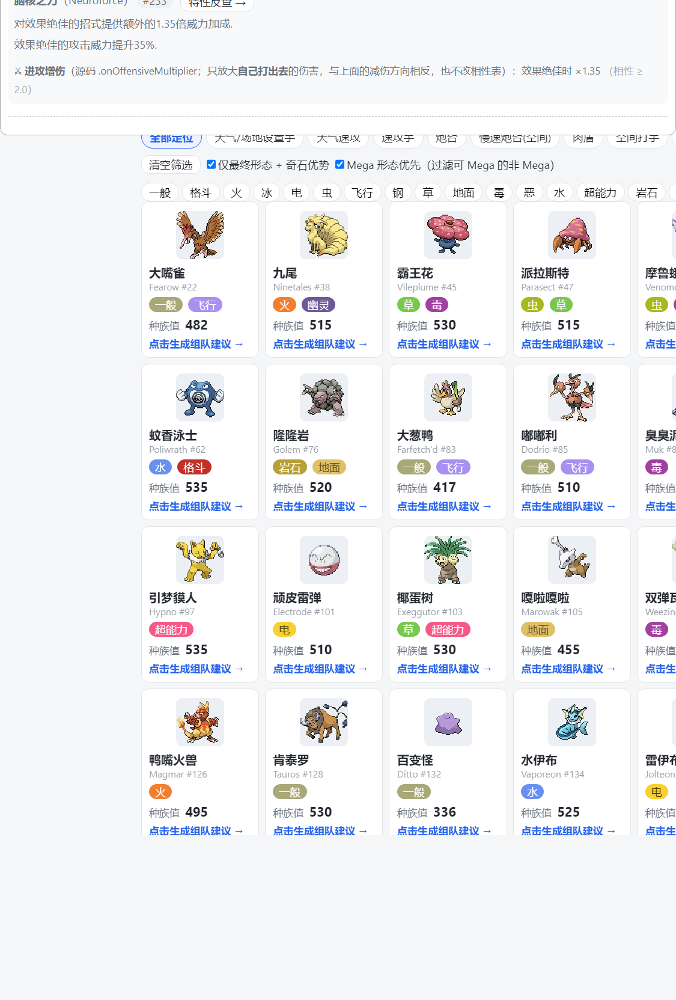

每张卡的完整形态：

```
太晶甲壳（Tera Shell） #607   [特性反查 →]
HP全满时,所有攻击都将变得效果不好.
当HP全满时,所有对该宝可梦的攻击都将造成效果不好的伤害,无论属性相性如何.
与其他类似特性不同,此效果在连续攻击的每次命中都会激活.
✨ 相性改写（源码 .onAfterTypeEffectiveness·会改属性克制表）：HP 全满时 → 倍率封顶 ×0.5
   （HP 全满时把 ≥1.0 的倍率压到 0.5）
```

注意最后那行括号里的补充——**它写明了「压到 0.5」这个方向**，这是文案里没有的信息。

### 9.3 看到「本作无人拥有」的红标是什么意思


有些特性的标题行旁会挂一个红色小标「本作无人拥有」，标题上的「可选 0 / 天性 0」也都是零。

**这不是数据出错，是有意告诉你的**：这个特性在源码里有完整实现，但本作没有把它分配给任何一只宝可梦。它的官方描述、计算倍率都能照常看，只是你在配队、属性克制、速度线、伤害面板里都找不到任何使用者。

遇到这种卡，就说明它是「有实现、没投放」。本作这样的特性共 **35 条**，例如回声定位、等离子灯、守护者外套、龙之威仪、慢启动。

每个特性下面都会给出**有几只宝可梦拥有它**，数字是实际统计出来的，不是估的。

---

## 10. 战术模板

### 10.1 怎么用

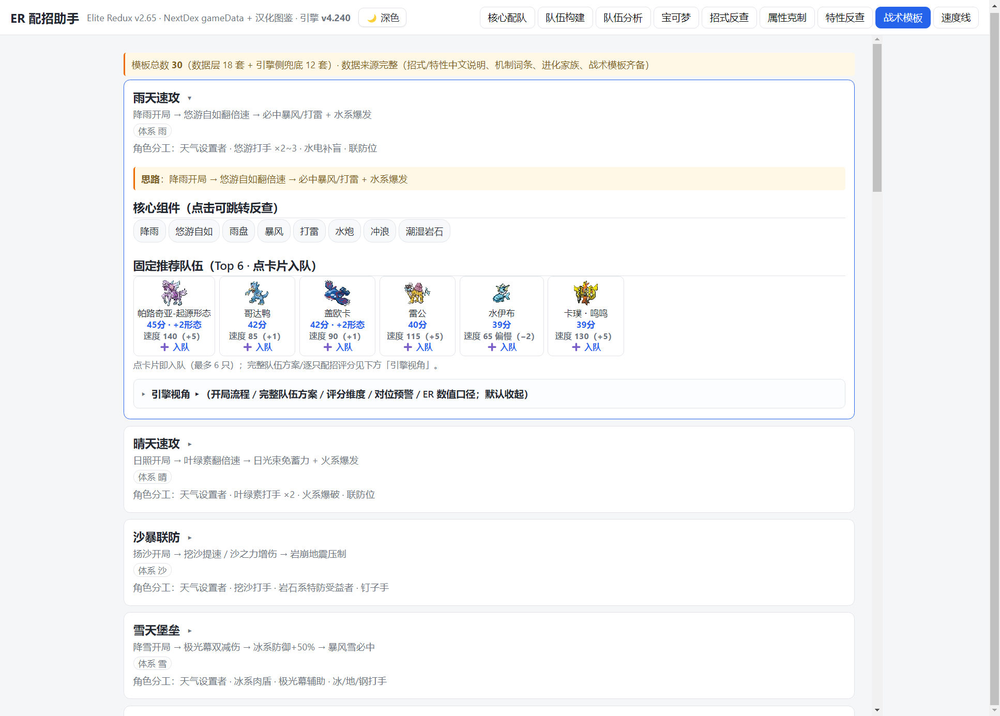

**24 套现成体系**，每套一个 h3 标题 + 「查看机制数值」展开。

| # | 模板 | # | 模板 |
|---|---|---|---|
| 1 | 雨天速攻 | 13 | 强化接力 |
| 2 | 晴天速攻 | 14 | 天气双核 |
| 3 | 沙暴联防 | 15 | 场地控制 |
| 4 | 雪天堡垒 | 16 | 吸血站场 |
| 5 | 电气场地速攻 | 17 | 双天气轮换 |
| 6 | 精神场地特攻 | 18 | 雨天必中炮台 |
| 7 | 青草场地回复 | 19 | 威吓折返轮转轴 |
| 8 | 薄雾场地龙盾 | 20 | 沙暴特防轴 |
| 9 | 强化清场轴 | 21 | 雪天极光幕受核 |
| 10 | 顺风游击 | 22 | 腐蚀受队闭环 |
| 11 | 戏法空间 | 23 | 场地延展器爆发轴 |
| 12 | 钉子受队 | 24 | 毒钉受队 |

**用法**：点模板标题 → 展开机制数值（哪些特性/招式/道具在起作用、倍率多少）→ 照着组队。

---

## 11. 速度线

### 11.1 怎么用

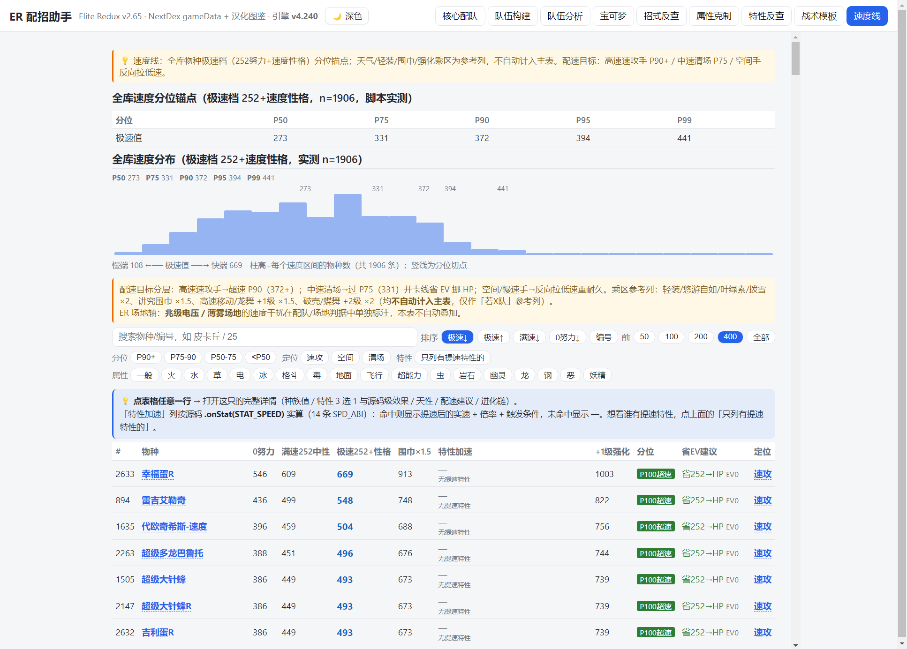

**这一页回答「我这只够不够快、要投多少努力值」。**

### 11.2 分位锚点与直方图

顶部是**全库速度分布**：`n = 1906`，24 个桶从慢端 108 到极值端 669。

**分位锚点**（这套数贯穿全工具，别处也引用它）：

| 分位 | 速度 |
|---|---|
| P50 | **273** |
| P75 | **331** |
| P90 | **372** |
| P95 | **394** |
| P99 | **441** |

直方图每根柱子可点，「选中区间高亮」，用来回答「我这只落在哪个档」。

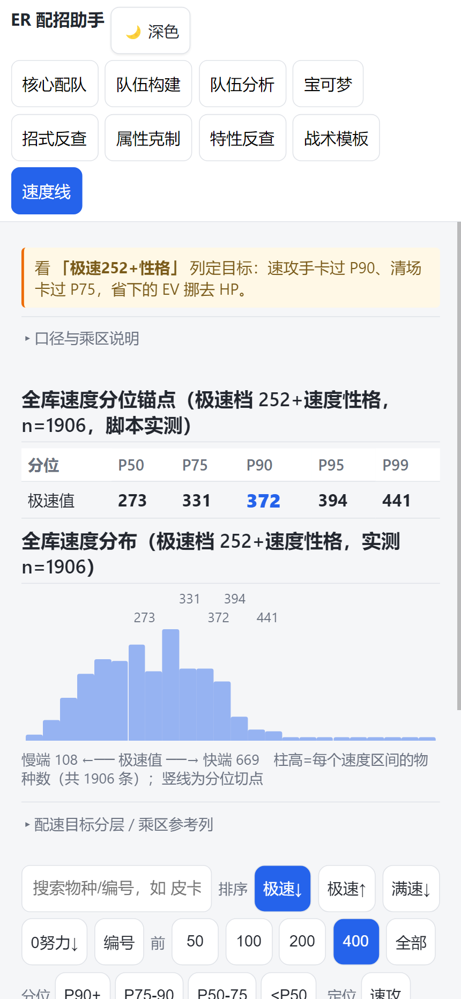

直方图上方的分位刻度会**分两行错开**：`P75 / P95` 抬到上一行，`P50 / P90 / P99` 留在下一行。因为 P90（372）与 P95（394）只差 22 点，在手机宽度里硬排一行一定会挤成「37294」。分位锚点表里 **P90 用蓝色大号字单独标出**——那是速攻手最常用的目标线，扫一眼就能认出来。

> **怎么一眼抓住重点**：本工具每个区域都遵守「**大字 = 结论，灰小字 = 补充**」。速度线页顶部只留一句话告诉你「该看哪一列」，完整口径收进「口径与乘区说明」，需要时再展开——不必先读完一屏解释才见到数据。

### 11.2.1 我的队伍 · 速度现状（v4.266）

分位锚点正下方多了一条**你队伍自己的速度刻度**，回答「我这 6 只到底够不够快」：

- 每只一行：**大字实速** + 分位 + 结论标签（`超 P90` 绿 / `过 P75 清场` 黄 / `中速` / `慢速`）。
- 口径标记：带 **`配速`** 橙标 = 你在核心配队第 6 段采用的实速；标 **`极速`** 灰字 = 还没采用，按 252 努力 + 速度性格的理论上限。两种口径并排写在行里，不会混算。
- 最下面一句话按**全队最快**给结论：高于 P75 → 「已有清场级先手」并给差值；低于 P75 → 用告警色提示「控速 / 戏法空间 / 讲究围巾先想一遍」。
- **点任意一行** → 打开这只的详情（种族值 / 特性 / 配速建议），可直接在核心配队里调速度。

> 采用更慢的配速后，这只落到锚点下方是**正常结果**（省钱换耐久），工具不会判你「退步」，只告诉你差多少、可以用什么手段补先手。

### 11.3 排序与筛选

| 控件 | 选项 |
|---|---|
| 排序 | 极速↓ / 极速↑ / 满速↓ / 0努力↓ / 编号 |
| 前 N | 50 / 100 / 200 / 400 / 全部 |
| 分位 | P90+ / P75-90 / P50-75 / < P50 |
| 定位 | 速攻 / 空间 / 清场 |
| 特性 | **只列有提速特性的** |
| 属性 | 18 类 |

### 11.4 表格 11 列怎么读

| 列 | 含义 |
|---|---|
| `#` | 编号 |
| 物种 | 名字（点名字开详情弹层） |
| `0努力` | 不投速度 EV 的速度 |
| `满速252中性` | 252 EV、中性性格 |
| `极速252+性格` | 252 EV、加速性格（**最常用的一条线**） |
| `围巾×1.5` | 带讲究围巾 |
| **`特性加速`** | **特性倍率实算 + 触发条件**（如 `854 轻装 ×2（消耗掉道具后）`） |
| `+1级强化` | 吃一次速度强化后 |
| 分位 | `P98超速` 这类标签 |
| `省EV建议` | 如 `省252→HP EV0`——为了过某条线，速度只需投很少，剩下的挪去 HP |
| 定位 | 速攻 / 空间 / 清场 |

### 11.5 「只列有提速特性的」（v4.239 新增）

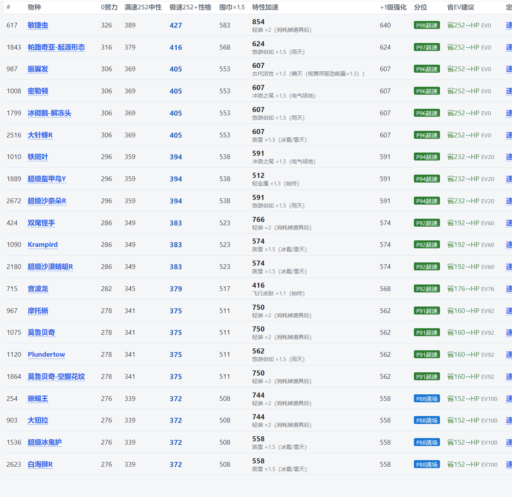

勾上后剩 **293 只**，并在「特性加速」列直接写出**倍率 + 触发条件**。

> **手机端注意**：不勾这个筛选时，「特性加速」列在窄屏会被收起（表格 11 列挤手机屏太窄）。勾上之后这一列会**自动展开**——因为你要看的就是它。桌面端始终显示。

| 例子 | 数值 | 特性 | 条件 |
|---|---|---|---|
| 敏捷虫 | 854 | 轻装 ×2 | 消耗掉道具后 |
| 帕路奇亚-起源形态 | 624 | 悠游自如 ×1.5 | 雨天 |
| 振翼发 | 607 | 古代活性 ×1.5 | 晴天（或携带驱劲能量×1.3） |
| 密勒顿 | 607 | 冲浪之尾 ×1.5 | 电气场地 |
| 大针蜂R | 607 | 拨雪 ×1.5 | 冰雹/雪天 |
| 铁斑叶 | 591 | 冲浪之尾 ×1.5 | 电气场地 |
| 超级盔甲鸟Y | 512 | 轻金属 ×1.3 | 始终 |
| 音波龙 | 416 | **飞行皮肤 ×1.1** | 始终 |
| 超级伦琴猫R-B | 612 | 丛林热 ×1.5 | 青草场地 |
| 超级帝王拿波R | 595 | 热滑 ×1.5 | 晴天或雪天（二者其一） |
| Rexcadrill | 136 | 厚脂 ×0.5 | 始终（减速） |

**这张表的真正价值**：把「特性 ×**1.5**」这个抽象倍率变成 **「在什么条件下、我的实际速度是多少」**。你看到「振翼发 607」就知道它晴天时比你 372 的极速快得多，必须另想办法。

**天气类速度特性全部 ×1.5，不是 ×2。** 只有轻装是 ×2。这条判错过（曾按 ×2 算，全部数值偏高），已修正。

### 11.6 页面提示条（v4.239）

表格上方有一条醒目的提示：

> 💡 点表格任意一行 → 打开这只的完整详情（种族值 / 特性 3 选 1 与源码级效果 / 天性 / 配速建议 / 进化链）
> 「特性加速」列按源码逐条实算（共 17 条速度特性）

**这条提示是补用户体验缺陷的**：用户两次说「这个就只能看吗，详细信息完全看不到」——功能本身是好的（点行确实会弹出完整详情），但**没有任何视觉提示说这行能点**。修法就是加这条蓝底提示 + 把「特性×2」表头改成「特性加速」并把「—」换成小字「无提速特性」。

---

---

## 想深入看

| 文档 | 内容 |
|---|---|
| [**内部口径与排查手册**](../dev/排查与内部口径.md) | 每个功能背后的实现、源码判定口径、按现象定位的排查总表、覆盖率台账、门禁与部署、历史踩坑 |
| [**AGENTS.md**](../../AGENTS.md) | 开发者唯一入口：架构、版本记录、每版的实现与验证结论 |
| [**README**](../../README.md) | 对外介绍：这是个什么工具、能解决什么问题 |
| [**版本历史**](../changelog/VERSIONS.md) | v4.3 至今的完整改动记录 |

---

*本工具为玩家辅助工具，非官方产品。Pokémon 及相关商标归 Game Freak / The Pokémon Company 所有。*

### 形态开关会告诉你「隐藏了多少」

「Mega 形态优先」和「仅最终形态」这两个开关，开启后下方会直接出现一行回执：

```
筛选已生效　已隐藏 247 只「有 Mega 但本身不是 Mega」的普通形态（如喷火龙、超梦只剩超级形态）
　　　　　　已隐藏 653 只非最终形态（1253 / 1906 可见）
```

- **「Mega 形态优先」到底筛掉谁**：筛掉的是「族群里有 Mega、但自己不是 Mega」的普通形态 —— 喷火龙、妙蛙花、超梦、水箭龟都在内。留着的是它们的超级形态。
- **搜名字时不受影响**：搜索词非空时这两个开关会临时放开，所以你搜「喷火龙」仍然能搜到普通形态。清空搜索就恢复过滤。
- 开关关掉时这行不显示，不占版面。

