# Elite Redux 配招助手 · 使用手册

> **这份文档是给玩家看的。** 每个工作台能干什么、怎么点、看到的东西是什么意思，都在这里。
>
> 引擎版本 **v4.428**｜数据源 Elite Redux v2.65 · NextDex · gameData 全量 ＋ 汉化图鉴
> 线上地址 `https://wsjshy.github.io/elite-redux-teambuilder/`
> 想查内部实现、源码判定口径、坏了怎么排查 → 看 [`../dev/排查与内部口径.md`](../dev/排查与内部口径.md)


### v4.428：替身不再乱塞，开墙手判定全库统一

- **替身收口**：以前超过一半的配招会在第 3、4 格塞一个替身，但替身要先掉 1/4 最大血、还占一个招式格，普通输出手开替身往往被对手一招破掉，等于白掉血还少一个攻击招。现在只有真有战术依据时才保留——卡内确实带了强化招（用替身挡招、安全强化）、特性是魔法防守/毒疗/恶作剧之心、定位是耐久或功能辅助、或硬撑这类专门机制；其余替身会换成攻击招或电磁波/鬼火等实用功能招，不再拿它凑数。
- **开墙手判定统一**：全库改用同一套判据，只有真正能开双墙（光墙＋反射壁，或雪天极光幕）且不是玻璃大炮的精灵才会被当开墙手、并据此推荐强化队友；脆皮高速输出（如胡地）不再被凭空要求配强化推队手。
- 结果：带替身的配招从 2080 张（51.2%）降到 1205 张（29.6%），所有配招仍满 4 招、无空槽；双墙流派卡数量保持不变。


### v4.427：谁该开墙、谁该推队——分工不再颠倒

- **以前**：答案卡会给你配出这种组合——引梦貘人（慢、火力一般）当「强化推队手」，超级胡地（175 特攻/150 速、自己会冥想和阴谋）当成「双墙辅助手」去给队友铺墙。等于让最强的矛去当盾，让盾去当矛。
- **现在**：① **玻璃大炮不再开墙**。速度和火力本来就是它推队的本钱，占两格开墙等于自废一半战力；开墙交给耐久/辅助型精灵，它的正确定位是「强化推队手」，墙由队友给它开。② **强化推队手必须是进攻型**——会强化招、而且打得动（力度 ≥95 且速度 ≥70）。只会强化却很慢、火力又不够的精灵（如引梦貘人、鼠霸王）不再占这个位置，只保留回复/状态/盾这些本职。③ 修了一处漏判：以前识别「会不会强化」只看有没有剑舞/龙舞/诡计/蝶舞/破壳，**漏了最常见的冥想**，导致会冥想 + 阴谋的超级胡地根本不被认成强化手——现在补上了。
- 结果就是分工反过来了：耐久辅助（如引梦貘人）带双墙卡站场布墙，高速高火力手（如超级胡地）带强化招在墙里安全强化、然后推队。

### v4.426：双墙辅助流说真话，真带两面墙、配强化推队手

- **以前**：像超级胡地这种玻璃大炮，也会被塞一套「淘气/剩饭/耐久努力/只有一面墙」的辅助模板，名字叫「双墙辅助流」却只带一面墙，还把它的高特攻往下降，属于名实不符。
- **现在**：① 玻璃大炮改走**高速开墙**（胆小、满速、特攻努力），不浪费它的速度和输出底子；耐久型精灵才走耐久开墙。② 双墙卡真的同时带光墙＋反射壁（雪天物种是极光幕），并统一配**光之黏土**，减伤窗口从 5 回合延长到 8 回合。③ 答案卡会强制给你配一只**强化推队手**（比如引梦貘人），双墙的减伤窗口正好让它安全强化、再推队——双墙的战术价值被队友真正接过去。
- 学了极光幕却开不了雪天的精灵（比如盖欧卡）不再生成这种卡，避免配出永远用不出来的死招。

### v4.415：修掉「2 倍弱岩被报成 4 倍」

- **以前**：岩钉入场税的基数算错了一倍，2 倍弱岩的精灵（比如风暴翼、雷电云-灵兽形态）被误报成「4 倍相性、换上来就掉半血」红色硬伤。
- **现在**：岩钉基数改回真实的 1/8（12.5%）——2 倍弱岩显示 25%、不再报半血硬伤；只有喷火龙这种真 4 倍弱岩才会报 50% 半血。
- 全库原本 515 只被误标半血，修正后真 4 倍只有 68 只。

### v4.414：队伍体检只先给你真问题

- **以前**：队伍分析里检查分类平铺 17 个、体检卡 25 条混在一起——真硬伤、优化提示、「没问题」的确认型参考和小众数学（打穿速度、最坏情况）全排在一起，要自己一条条挑重点。
- **现在**：体检卡分成三级，默认只露第一级——3 条红色硬伤（每条自带「看怎么修」），卡片高度从 596px 缩到 245px。
  - 第二级「提示 9 条（建议优化）」：整组一个折叠，需要时再展开。
  - 第三级「速览与参考（深度数据 · 8 条参考）」：方法论、速览、小众数学全收在这里。
- 重复内容合并：先制弱点原来 3 只各写一条近乎相同的话，现在合并成 1 条；体系标签和细化体系两张卡合成一张。
- 顺手修掉热力表的深色硬伤：联防聚合、两两对位的彩色格子底色做了主题变量，深色下红/蓝/绿格都换成深色底，文字清晰。

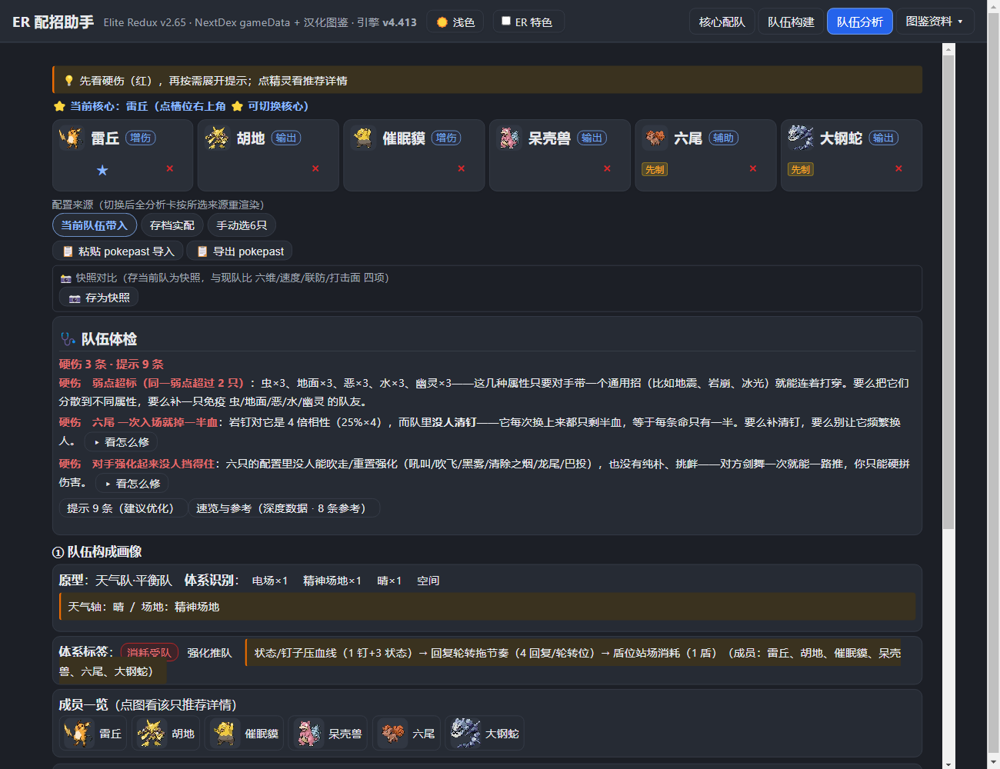

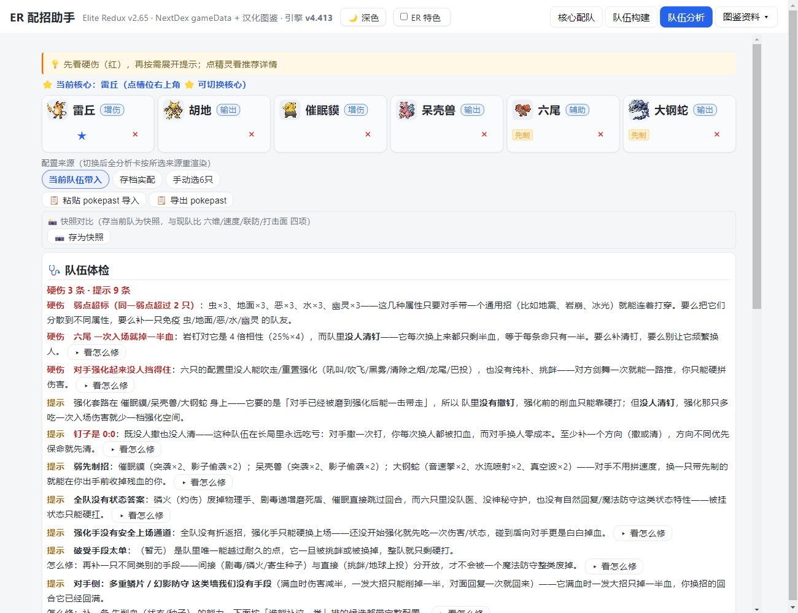

### v4.413：深色模式下每个字都看得清

- 以前深色模式有两类硬伤：浅字压浅底（详情弹窗的特性 / 天性 chip、进化链盒子）和深字压深底（属性筛选条、没有指定文字色的按钮），部分文字几乎不可见。
- 本版把全库的浅色硬底和文字颜色全部改成主题变量：浅色模式长相一字不变，深色模式下表面统一换深灰、文字换亮色，语义色（成功绿 / 警示橙 / 链接蓝）都有深色专用亮色值。
- 例子：打开 #1503 超级喷火龙Y 详情，特性 / 天性 chip、进化链、「跳到可学招式表 ↓」链接全部清晰；图鉴页顶部 21 个属性 chip 浅字深底，一眼可辨。
- 经四轮对比度审计，白底白字 / 黑底黑字类不可见文字归零；类型标签这类白字彩色品牌徽章与浅色模式同口径，予以保留。

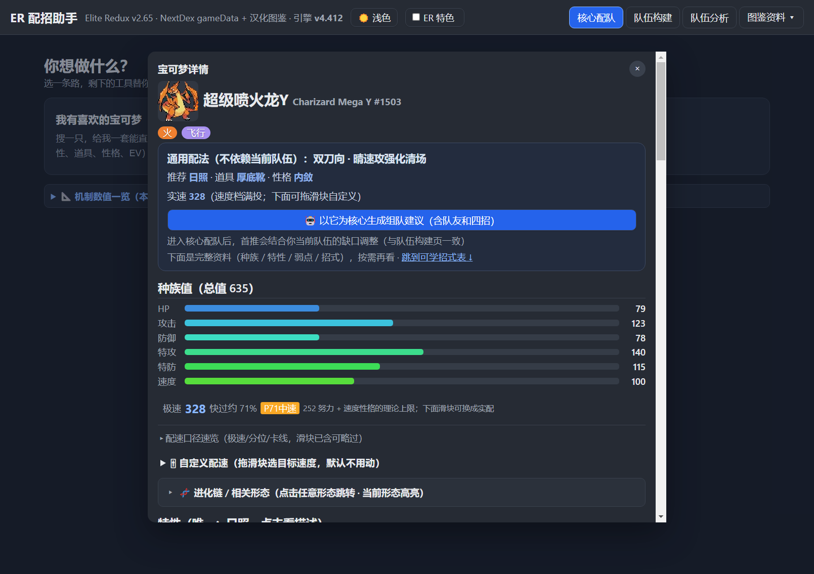

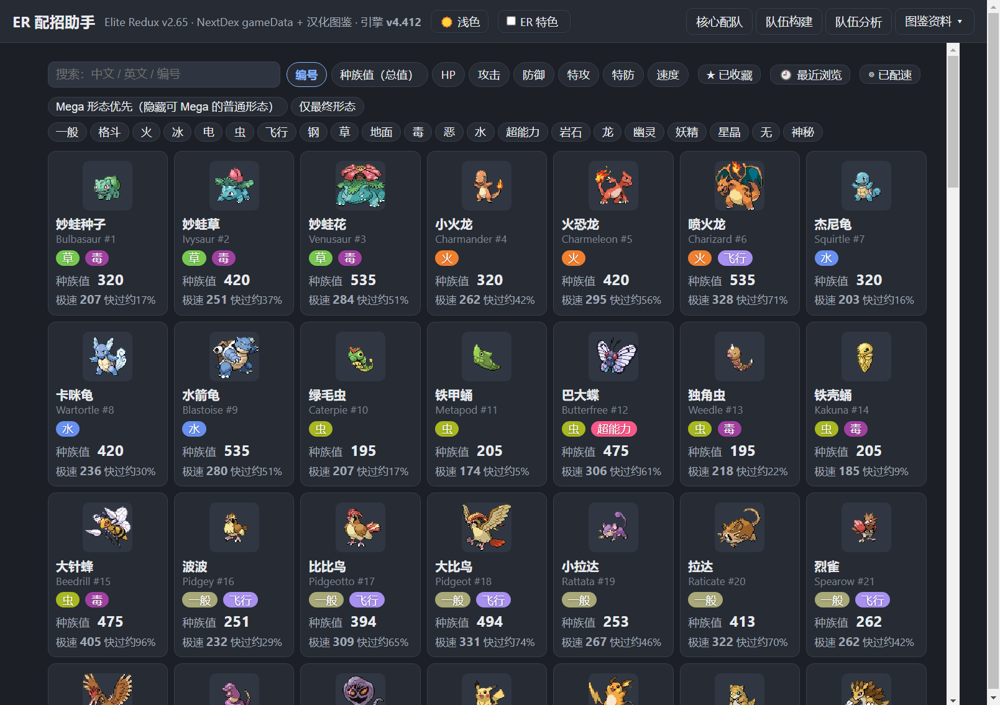

### v4.412：一眼看完全队速度线

- 答案卡「努力值」那一行新增「速度值」：直接给实际数值 + 档位（超速 / 高速 / 中速 / 慢速），不用自己拿种族值和努力值去算。
- 点这个数字，弹出**全队 6 只**的速度排行：从快到慢、核心带 ⭐，末尾一句话写清「比它快几只、比它慢几只」以及先手权归谁。
- 数字与队友弹窗里的速度 chip 是同一套算法（同一函数），两边不会打架；「换玩法」切换后跟着新配置重算。


### v4.411：文案不再一遍遍叫名字

- 同一句里把同一只提两次（戏法空间那条，全库 206 例）→ 第二个名字改「自身」：「队友 呆呆兽先开戏法空间（6 时段），**自身的**低速重炮先手且威力翻档」。
- 相邻两句各提一次（全库 1,244 例）→ 第二句改「它」：「…窗口 8 回合。**它**铺钉子压血线，你的本系（折算威力 208）更容易收残」。
- 带特性括注的句子保留全名（「队友 X（干旱）」），否则会变成「它（干旱）替你…」。


### v4.410：「为什么带它」不再自己跟自己打架

- **以前**：当**你和队友都能开同一天气、又都吃它的增伤**时，这段会并排出现两句主语相反的话 —— 「你开晴，席多蓝恩的本系直接吃晴增伤」+「队友 席多蓝恩（干旱）替你 把晴铺开」。读起来到底谁开晴？说不清。全库有 2,969 对组合是这种情况。
- **现在**：合成一句 —— 「你和席多蓝恩都能开晴、也都能吃晴增伤——谁先上场谁铺，窗口 8 回合」。谁开、谁吃、几个回合，信息都在。


### v4.409：队友大卡片点开不再跳页

- **以前**：核心卡「推荐 6 人队」那一排大卡片，点一下直接跳到那只的资料页，当前核心被切走；可同一排的「带这 5 只」小词条点开却是弹窗、不离开。同一个区块两种行为。
- **现在**：大卡片点开也弹窗（与词条一套），里面是这只**在本队定位下**的完整配置：特性 / 道具 / 性格 / 努力值 / 速度档位 / 弱点 / 四招。想看种族值和可学招式表，弹窗底部点「📖 看完整资料页」。
- **例子**：核心是超级喷火龙Y 时点「席多蓝恩」大卡片 —— 弹出「队友 · 席多蓝恩」，标注「配在『超级喷火龙Y』队里」，特性 日照 / 道具 剩饭 / 性格 内敛，252HP / 4防 / 252特攻，速度 190 慢速、怕 地面×4 · 格斗×2，四招 睡觉 / 替身 / 喷火 / 铁蹄光线。关掉弹窗，核心卡还在原处。


### v4.408：队友的「属性对位」，攻守两边都说了

- **以前**：在队友弹窗点「怕 地面×4」，打开的「属性对位」只列 21 个属性你怕多少 —— 防守侧。而详情页点属性 chip 展开的同类面板，本来就有「攻 / 防」两视角。同一个名字，两处给的东西不一样。
- **现在**：队友「属性对位」副弹窗底部多了**🔱 顺带看看：本系打谁疼**，一行一个本系属性，写清 2× 克制谁、0.5× 抵抗谁。
- **例子**：席多蓝恩（火 / 钢）—— `火：2× 克制 冰 虫 钢 草`、`钢：2× 克制 冰 岩石 妖精`；上面 21 项防守表不变。
- **同源**：这块和详情页折叠块读同一份克制表、走同一个函数，不会再出现「两处说法不一样」。


### v4.407：核心卡和队友弹窗，说的速度档位终于一样了

- **你会看到什么**：核心卡「努力值分配」那一行，速度数字后面有一枚 `P12 慢速` 徽标；队友小窗里是 `速度 190 慢速`。以前这两处各用一套门槛 —— 核心卡是 P90 超速 / P75 清场 / P50 中速，队友窗是 80% / 60% / 35% 分四档。
- **为什么必须统一**：同一个速度会得到两个结论。253 速度，核心卡写「P40 慢速」，队友窗写「中速」；438 速度一处算 P99、一处算 P98（两段代码一个用 `<=`、一个用 `<`，差 1 个分位点）。
- **现在**：只有一套门槛 **P90+ 超速 / P75+ 高速 / P50+ 中速 / 其余慢速**，核心卡、队友窗、速度表页三处同一个函数取词。「清场」这个词也改成了「高速」（清场是打法，不是速度档）。
- **例子**：席多蓝恩 #485 实速 190（P12）→ 两处都「慢速」；253 → 两处都「慢速」（原来弹窗写「中速」）；438 → 两处都「超速 P98」（原来一处 P99）。
- **一句话**：同一个数字，不会再有两个说法。


### v4.406：速度数字后面多了「档位」两个字

- **你会看到什么**：队友小窗原来只给一个裸数字「速度 190」，快不快全靠自己换算。现在数字后面多一个档位词：**极速 / 高速 / 中速 / 慢速**。
- **怎么算的**：把全库 1,906 只各按「252 努力值 + 31 个体值 + 加速性格」算出的满速排成一队（最低 108、中位 273、最高 669），看你这只的速度排在什么位置：超过 80% 叫极速、超过 60% 叫高速、超过 35% 叫中速，其余是慢速。
- **例子**：超级喷火龙Y 队里的席多蓝恩（#485）这张卡把速度努力值全投给了特攻，速度只有 190 —— 它会显示「速度 190 **慢速**」，鼠标悬停能看到「高于其中 12%（236/1906）」。同一套算法下，253 速度显示中速（40%），438 速度显示极速（99%）。
- **一句话**：数字告诉你「多少」，档位告诉你「这算快还是慢」。
- **截图**：`docs/shots/v4406_speed_rank.png`


### v4.405：队友弹窗直接回答「它能先手吗、怕什么」

- **你会看到什么**：队友小窗里原来只有「配了什么」，没有「能拿它做什么」。
- **速度**：新增一枚「速度 190」——和你在答案卡上看到的**是同一个算法**（努力值、天生速度、性格一起算），性格加速会写成「·性格加速」，减速写「·性格减速」。
- **怕什么**：新增「怕 地面×4 格斗×2」这样的短标签，**只列真弱点**（×4 优先、最多 3 个）；抗性和免疫不占位置。席多蓝恩的水本来 2 倍，被它的天性压到 1.4 倍，就不算「怕」；阿尔宙斯-钢的地面干脆是免疫，也不会出现。
- **点开看全表**：点任意一个弱点，进「属性对位」页 —— **21 个属性一条不落**，一屏就能看完。前面那个数是「算上它的天性」，箭头后面是「再把免疫 / 半伤特性也算进去」（比如引火让火变免疫、某些特性让恶减到 0.5）；纯粹只看属性的数字把鼠标悬停上去就能看到。
- **顺手清掉重复**：原来努力值那行下面又摆了一遍六项明细（`HP 252 / 防 4 / 特攻 252`），和上面那句「252HP / 4 防 / 252 特攻」是同一件事说了两次，现在只留一句。


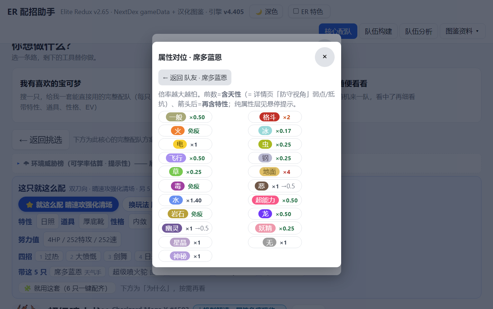

### v4.404：队友弹窗能点开细节，点完不丢窗

- **你会看到什么**：v4.403 的队友小窗信息偏少 —— 四招只有名字，点一条招式详情会把整个队友窗顶掉，关掉就回不去。
- **现在补齐了**：四招每条都带属性色标和**威力**（席多蓝恩是「睡觉 变化／替身 变化／喷火 威力 150／铁蹄光线 威力 140」）；努力值给**六项明细**（252HP / 4 防 / 252 特攻）；道具理由并入同一行（「站场续航」）；顶部写明这只配在「超级喷火龙Y」的队里。
- **能点了**：**特性、道具、性格、四招**四个元素全部可点，点开各自详情 —— 特性解释（如日照「出场时召唤晴天，持续 8 回合」）、道具说明、性格修正、招式威力/命中/PP 与中文描述。
- **点完不丢**：详情在**上层另开一窗**，底下这层队友弹窗原样保留；上层有「← 返回 队友 · 席多蓝恩」，× 与点空白也只关上层。关掉上层，队友窗还在。
- **底部按钮常驻**：小窗内容变多后，「🎯 以它为主核心重配」固定在窗底，不用滚到底也能点。

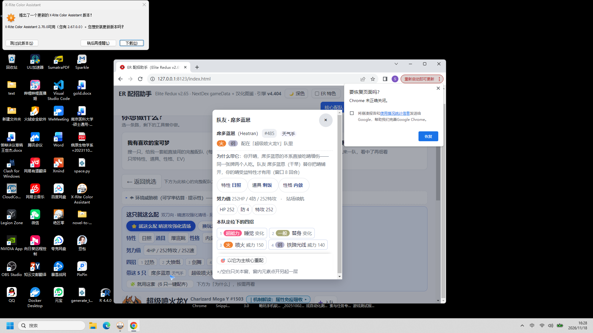

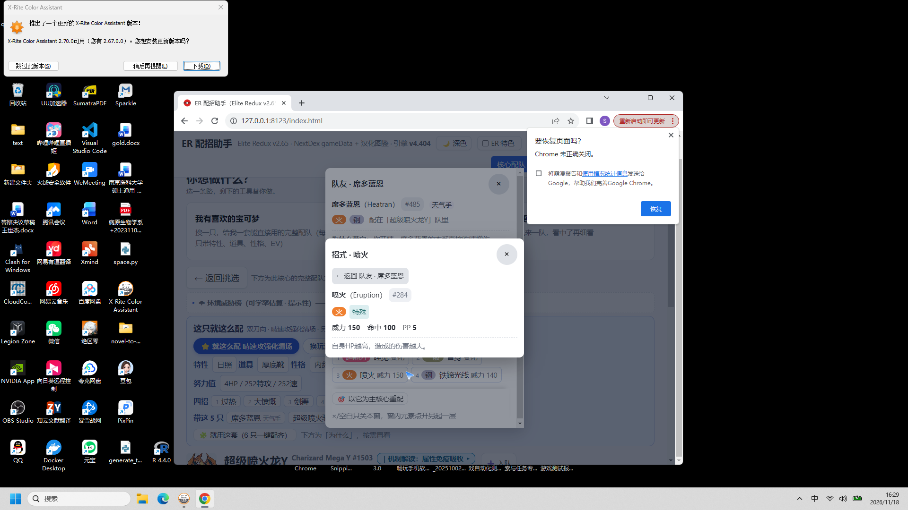

### v4.403：点队友名字先看配置，不再把当前核心弄丢

- **你会看到什么**：核心答案卡「带这 5 只」那一排名字，原来点一下就把整个页面换成那个队友的核心配队 —— 你自己选的这只、它的流派和四招**全没了**，想回来只能重新搜。
- **现在**：点名字先弹一个小窗，把这只队友**在本队里的完整配置**摆给你看 —— 特性 / 道具 / 性格 / 努力值 / 四招（带属性色标，点一条能看招式详情）/ 为什么带它（它补你哪一块）。看完关掉就留在原来那只。
- **真想换**：窗底有「🎯 以它为主核心重配」，点了才真正切换。切过去之后**顶部会出现一条「你刚是从『超级喷火龙Y』的队友跳过来的 ← 回到 超级喷火龙Y」，点一下原路返回**，不会把你原来的配置弄丢。
- **关窗姿势**：右上 ×、点窗外灰底、点「直接关掉就留在当前这只」，三个都一样 —— 只关窗，不动核心。


### v4.400：卡片名字说「强化」，四招里就得真有一招强化

- **你会看到什么**：有些卡原来叫「强化轮转补盲」「强化受队消耗」，点进去发现四招里全是 急速折返 / 电磁波 / 月光 / 光墙 —— **一个强化招都没有**。这类卡六人队 70 张、空队 51 张，本版全部改回诚实名字：**轮转补盲**、**受队消耗**。
- **为什么会这样**：引擎判断「加不加『强化』前缀」时看的是**这个物种能不能学强化招**，而不是**这张卡实际带没带**。一个物种能学剑舞，它名下每一种打法都会被冠上「强化」——包括本来就不带强化招的打法。
- **为什么不去把强化招塞进去**：能学不等于该带。硬塞会挤掉一个攻击位，把纯轮转卡改成「轮转+强化」两条腿走路，反而更难用。所以这一版只改名字，招组 / EV / 道具 / 特性 / 性格一个字都没动。
- **顺带修的**：`#1788` 这张卡标签写着「强化」、四招是 替身 / 守住 / 电磁波 / 蹭蹭脸颊，现在叫「替身流」。「接棒」前缀同理 —— 只有真带接棒或急速折返 / 伏特替换的卡才配叫接棒（`#162` 接棒破盾 → 破盾）。
- **不受影响**：`#117 海刺龙`「强化主力输出压制」去掉『强化』后底子火力 95 仍达标，保留「主力」二字，改名「主力输出压制」。


---

## 目录

| 章节 | 内容 |
|---|---|
| [0](#0-这份文档怎么用) | 这份文档怎么用 |
| [1](#1-九个工作台) | 九个工作台 |
| [2](#2-为什么这里的结论可信) | 为什么这里的结论可信 |
| [3](#3-核心配队) | 核心配队 |
| [4](#4-队伍构建) | 队伍构建 |
| [5](#5-队伍分析) | 队伍分析 |
| [6](#6-宝可梦) | 宝可梦 |
| [7](#7-招式反查) | 招式反查 |
| [8](#8-属性克制) | 属性克制 |
| [9](#9-特性反查) | 特性反查 |
| [10](#10-战术模板) | 战术模板 |
| [11](#11-速度线) | 速度线 |

---

## 0. 这份文档怎么用

不用从头读。先看第 1 章建立方位感（九个工作台各管一件事），然后按你手头要做的事直接跳：

| 你想做的事 | 去哪节 |
|---|---|
| 「我抽到一只宝可梦，配什么队、走什么路线」 | §3 核心配队 |
| 「把 6 只拼成一队，看还缺什么」 | §4 队伍构建 |
| 「这队到底强在哪、怕什么、能不能一击必杀」 | §5 队伍分析 |
| 「查这只的种族值 / 配速 / 进化 / 特性三选一」 | §6 宝可梦 |
| 「这个招式谁能学、什么属性、威力多少」 | §7 招式反查 |
| 「我打它到底几倍？它打我几倍？」 | §8 属性克制 |
| 「这个特性到底干什么」 | §9 特性反查 |
| 「有没有现成打法模板」 | §10 战术模板 |
| 「我这只速度够不够快、要投多少努力值」 | §11 速度线 |

**三条贯穿全文档的原则**，每节都会用到：

1. **以源码为准，不以数据层文案为准。** 官方文案常常很笼统（例如「改变所有技能」），工具里显示与参与计算的是从游戏源码读出来的真实判定。两者不一致时，判定优先，并在界面上并列展示。
2. **特性一旦判出来，必须进所有地方。** 属性克制、打击面、队伍分析、伤害判定、补队推荐、速度线，六处拿到同一份数值，不会只有一处生效。
3. **算不出来就不假装算得出。** 依赖对手状态、回合计数、场上他人的特性，静态算不了，工具明写「当前未接入 + 原因」，也不给一个错的数字。
4. **操作习惯（v4.291）**：鼠标放在页面左右空白区滚轮也能滚动页面（自动转发给内容区）；任何弹窗点击周围暗色背景即可关闭，不用找右上角 ×，但点内容区不会误关。清空队伍这类危险确认框只能点按钮。

---

## 1. 九个工作台

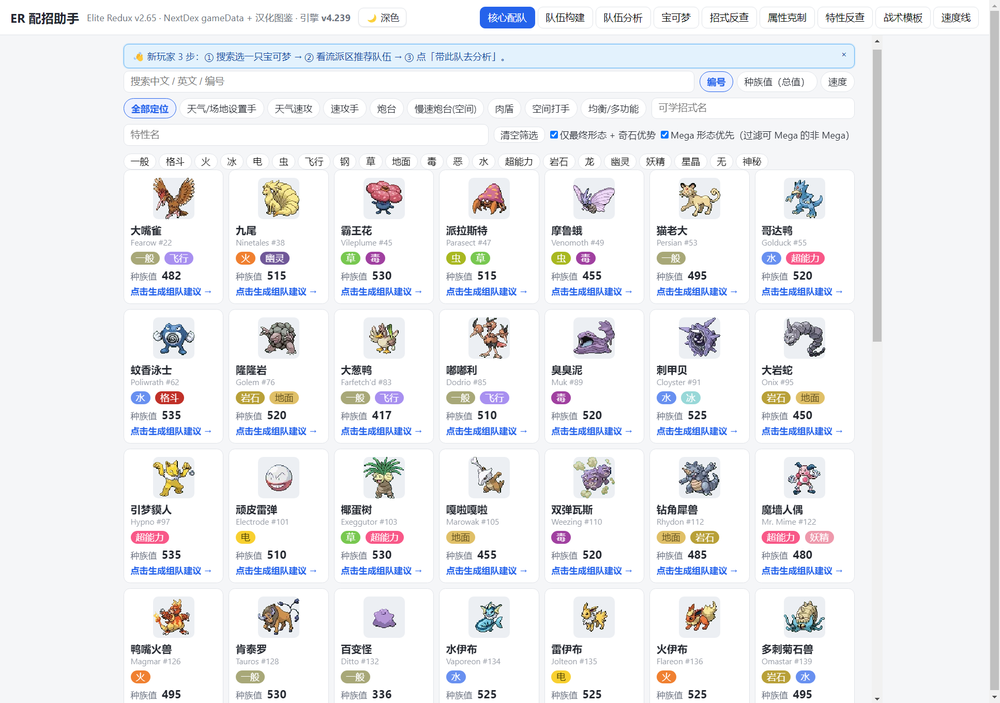

顶栏从左到右：

| 区域 | 内容 |
|---|---|
| 左 | 「ER 配招助手」标题 + 副标题 + **引擎版本号** |
| 中右 | 深色 / 浅色模式切换 |
| 右 | 九个 Tab 按钮 |

**引擎版本号是排查第一入口。** 觉得某个功能「没有」时，先看一眼这个号码 —— 不同版本界面会有差异，能一眼判断你看的是不是最新页面。

| 工作台 | 一句话 |
|---|---|
| **核心配队** | 选一只当核心，反推它可以怎么配、配谁当队友 |
| **队伍构建** | 拼 6 只、评估缺口、智能补位 |
| **队伍分析** | 六槽位 + 伤害判定 + OHKO 反解 |
| **宝可梦** | 全图鉴检索 + 单只完整详情弹层 |
| **招式反查** | 按招式查谁能学 |
| **属性克制** | 进攻视角 / 防守视角双表 |
| **特性反查** | 按特性查真实效果与持有者 |
| **战术模板** | 24 套现成体系 + 机制数值 |
| **速度线** | 全库速度分布 + 配速建议 |

**切换 Tab 不会丢数据** —— 队伍、核心标记、速度线筛选条件都跨 Tab 保留。

---

## 2. 为什么这里的结论可信

ER 的数据层对每个特性只写一句话，真正生效的倍率、条件、例外都在**游戏源码**里。官方文案经常漏掉三样东西：

- **前提** —— 什么时候才生效
- **范围** —— 只对哪些招、哪些目标
- **防守侧** —— 挨打时是不是也变


▲ 同一张特性卡的两段对照。上面「中文描述」是**官方文案**（只写「在雾中，幽灵属性招式威力提升50%」）；下面「计算倍率」是**工具实际计入伤害的数字**：

| 行 | 含义 |
|---|---|
| `打出去 · 幽灵招 ×1.5（雾天）` | 自己打出去的幽灵招，**只在雾天** ×1.5 |
| `改相性 · 雾天，对幽灵招封顶 ×0.5` | 被打时，幽灵招倍率**封顶 0.5** |

文案里这三样一样都没有 —— **前提**（只在雾天）、**范围**（只对幽灵招）、**防守侧**（被打时封顶）。只照抄文案，玩家会以为「随时 ×1.5」，实际打起来完全对不上。

**所以这个工具的每条特性结论，都是翻源码一句句读出来的。** 判出来之后，会落到工具每一个相关角落，而不是只写在一个说明页里。

---

## 3. 核心配队

### 3.1 怎么用

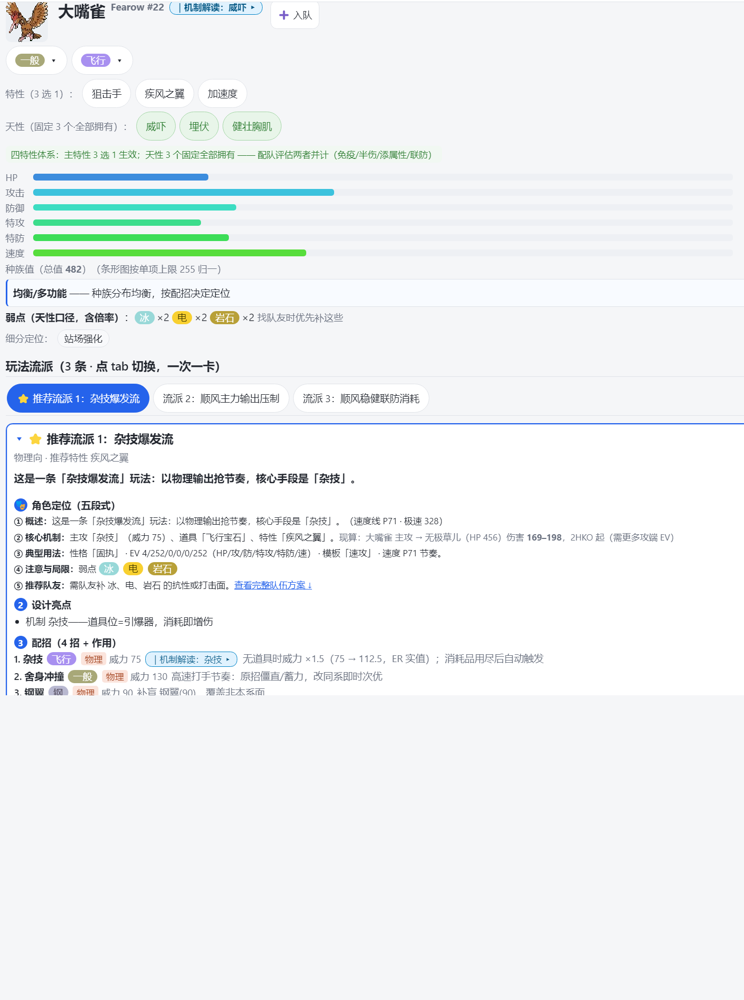

**一句话：选一只当核心，工具反推「它可以怎么配」。**

四步操作：

1. **找核心**：顶部搜索框输中文 / 英文 / 编号；或按种族值总值、速度排序；或点定位 chips（天气场地设置手 / 天气速攻 / 速攻手 / 炮台 / 慢速炮台(空间) / 肉盾 / 空间打手 / 均衡/多功能）。
2. **点卡片** —— 卡片底部有「点击生成组队建议 →」。选中后下方推荐区展开。
3. **读推荐区**（截图中大嘴雀那一段）：
   - **机制解读**：`威吓 ▸` —— 这只的体系价值一句话
   - **特性（3 选 1）**：三个可选特性并排，**点一下即模拟生效**，推荐区与全队分析即时重算
   - **天性（固定 3 个·全部拥有）**：不走三选一，直接全部生效
   - **四特性体系说明**：`主特性 3 选 1 生效；天性 3 个固定全部拥有`
   - **⚔ 伤害倍率（工具真正计入伤害的部分）**：把这只**每个特性 / 天性**在伤害公式里真正乘上去的数字摊开，**不用点开就能看**
4. **入队**：点 `➕ 入队 / 一般 / 飞行` 这类按钮直接进队伍，或进「队伍构建」Tab 继续。

**「⚔ 伤害倍率」这一块单独说明**：它出现在特性 / 天性 chip 的正下方，**只在有货时才出现**。


*实测：小磁怪 #81，特性「分析」→ `打出去 · 目标已行动时 ×1.3`；天性「过滤」→ `承受 · 效果绝佳时 ×0.65`。*

三个前缀的含义固定不变：`打出去 ·` = 自己进攻时乘上去、`承受 ·` = 挨打时乘上去、`改相性 ·` = 改属性克制倍率。

**别读成叠加**：特性标的是 `（特性，3 选 1 生效）` —— 三个里只有一个真生效，块里把有倍率的都列出来是为了让你**比较**哪个更值；天性标的是 `（天性，3 个固定全部拥有）` —— 这些是**真叠加**。

**整块不出现，不是漏了**：说明这只的特性和天性都属于**回合 / 命中 / 换场 / 状态类**，源码里没有伤害倍率钩子，本来就不乘数字。全库 1033 条特性里只有 108 条（10.5%）产生倍率。

**筛选开关**

| 开关 | 作用 |
|---|---|
| 仅最终形态 + 奇石优势 | 过滤掉还能进化的中间形态（但保留有奇石优势的） |
| Mega 形态优先 | 剔除「族群里有 Mega、但自身不是 Mega」的普通形态（喷火龙这类），列表只剩真能 Mega 的形态 |
| 18 类属性 chip | 含 星晶 / 无 / 神秘 三个 ER 特有 |

### 3.2 在流派卡里直接调速度（与速度线、滑块同一口径）

每个流派的**第 6 段「努力值分配」**，现在不只是努力值数字，顶部还有一条速度语境：

- **实际速度**：这只按当前配法真正能跑到的速度（大字号强调）。
- **快过约 X%**：在全宝可梦里的速度位置，以及「超速 / 清场 / 中速 / 慢速」定位徽标。
- **「调整速度」按钮**：点它打开和「速度线」页（§11）一模一样的速度滑块。

调整并采用的三步：

1. 点「调整速度」打开抽屉，拖动滑块（或点常用速度）到你想要的速度，下方即时给出最省努力值的性格类别、速度投入和剩余努力值分配。
   常用速度下面还有一张**「多目标配速对比」**表：逐条列出 P50/P75/P90/P95 各要什么性格、多少 EV，投满会标红「满」；够不到的档位写「够不到」并给出上限与替代手段（围巾 / 提速特性 / 顺风 / 戏法空间）。**点任意一行，滑块和配法卡会一起跳过去。**
2. 点**「采用此配法」**，回到核心卡：第 6 段会高亮「你的配速」并按你的选择重算努力值——
   - 选了更慢的速度：省下的努力值自动转给 HP；
   - 选了更快的速度：需要的努力值先从 HP 抽调、不够再从其他项抽；
   - 六项努力值总和始终不变，单项不会超过 252。
3. 采用的配法会**保存在本机**，刷新页面、下次打开都还在；想回到流派原本的推荐，点第 6 段的**「恢复默认」**即可。
4. 这一套速度口径会跟到**所有页面**：图鉴（宝可梦）列表卡写「极速 X」或「速度 Y · 已配速」，详情页在种族值下面单列一行「你的配速 / 极速」；核心配队第 6 段在没有采用配法时还会给「再 +N EV 到 P75 / 退到 P50 省 M EV」的卡线建议。也就是说：你在任何一处看到的「速度」都是同一个数。
5. **有先制时先看先制，再看速度**：只要这只靠条件先制吃先手（例：烈焰猴R 的「闪电拳击」满血拳招 +1），核心第 6 段与配速抽屉会多一行「先制：XX（满血时 拳招）」，下面直接给两条线：**先制线**（只投到 P50 的那点 EV，其余点数转投攻/耐久，可一键采用）、**常态线**（想常态也抢手就用加速性格卡 P75）。它还会检查你 4 招里哪几招真能吃先制——主攻不是拳招（例如愤怒）时会明说「4 招里只有吸取拳能用」，别为了一个用不上的特性去改速度。满血条件只能靠轮转保（虫返/换人再上），堆 HP 换不来；对手也有同档先制时仍然比速度。
   「恶作剧之心 / 先行治疗 / 飓风之翼」这类**无条件先制**是另一种说法：先制变化招只看先后手、不看速度，结论直接是「速度可以不投」（点「不投速」即把配速记成 0 EV）。「速度线」页的「我的队伍」条上，这类成员后面也会挂一个橙色「先制」小标。
6. **想只看自己定过速的那几只**：宝可梦页工具栏点「◎ 已配速」，网格只留已采用配法的宝可梦（卡片上写实速 + 「已配速」）；一只都没定时会提示去「核心配队」第 6 段点「采用」。反过来，「队伍分析」的「队伍速度结构」卡右上有「去速度线页 →」，一步跳到全库分位锚点。
7. 采用的是**这一只**的速度，因此会同步出现在别的页面：「队伍构建」的选人卡从「极速 X」变成「速度 Y · 已配速」，「我的队伍」名单和「队伍分析」的槽位都带「速 Y」小标；「队伍分析」的**队伍速度结构卡**里，已采用的成员按你的实速排位（并注明「其中 N 只按已采用配速实算」，那条灰线是它理论极速，只作参照），全队最快与速度线塌陷告警也都按实速判断。没有采用配法的成员仍按极速口径计算——两种口径都会写在卡面上，不会悄悄换算法。

8. **先制省下的努力值，到底换到了什么**：有先制的第 6 段，速度结论下面还有一张「降速省下的 N 点努力值换到了什么」对照卡。它把**先制线**和**常态线**两套配法各算成实数并排：实速（含性格修正）+ 分位、HP 实数、主攻实数，最后一句结论由数据生成，例如「速度让出 23 个百分点（P74→P47），多出的 112 点落在：主攻 +112 EV（实数 +28）」。也就是说你能直接看出「少抢这半个身位，是换来更疼的一拳还是更厚的一层血」。
9. **「加速」这类越打越快的特性**：速度线表的「特性加速」列以前对它只显示「—」（它不是固定倍率），现在会标「加速 +1/回合（第2回合起 ×1.5）」。第 6 段与配速抽屉里会算三档：从当前实速起，第 2 / 3 / 4 回合分别是多少，超出全库极速档（P99 441）就直接写出来。结论是**不必按 P75 拼满**——起手让一回合可以接受，速度投入只要够「第一回合别被直接带走」，点位换成守住 / 替身 / 虫返这类过桥手段；这只同时有先制时，会补一句「第一回合本来就能先手」。
10. **戏法空间：这里速度越低越好**：定位是「空间」的宝可梦（速≤30，或速≤60 且攻≥95），第 6 段和抽屉会给一条反向结论：速度 EV 应该 0、性格用减速（物攻手勇敢 / 特攻手冷静），并算出「空间内你能先行全库多少 %」；省下的努力值先给主攻拉满、纯盾则全给耐久（HP/防/特防 都给实数）。它还会点名空间里的**负收益**——讲究围巾、顺风、加速、速度 +1 级都只让你更晚出手，反倒是黏黏网 / 电磁波 / 岩石封锁等于给你加速；能自己开戏法空间的还会提醒「优先度 −7，全场最后发动，开空间那回合基本白挨一次打」。速度线表里这些行的「省EV建议」直接写「0EV·减速」。
11. **轻装：一次性开关，不是常驻翻倍**：特性「轻装」看着像白送 ×2，其实必须先真的把道具吃掉（源码写明「消耗掉道具后速度加倍，**换下即失效**」）。核心第 6 段与配速抽屉会给完整结论：现在多少 → 吃掉道具后多少（超全库极速档会直说），并给能真正触发的手段（电气 / 精神 / 薄雾 / 青草种子在对应场地上场即消耗、白色药草、弱点保险、气势披带、各类果子）。三条要记住：**它一场基本只有一次**（道具吃掉不回来）、**消耗前那一回合仍是真空期**（速度该按「消耗前要压过谁」投，别按翻倍后的数字省 EV）、**换下就没了**（轮转流别指望它当常驻速度线）。速度线表的「特性加速」列在这类行会额外标「一次性，换下失效」。
12. **围巾和顺风：提速来自别人**：这两样不占宝可梦自己的努力值，一个占道具位（讲究围巾 ×1.5），一个占队友的回合（顺风 ×2，只有 4 个回合时段）。核心第 6 段会把两条线都算给你，并提醒三件事：顺风要「有人先手开出来」（恶作剧之心这类变化招先制最稳）、自己学得了顺风就该当开风手、**轻装与围巾不能同时要**（围巾本身就是道具，轻装要把它吃掉才有 ×2，同一个道具位只能选一个）。
13. **飞毛腿：先看代价，再看速度**：特性飞毛腿要你自己先中一个异常状态才有 ×1.5，所以第 6 段会逐条算代价——中毒/剧毒只提速但每回合掉血，灼伤提速但物攻减半，**麻痹会被本身 ×0.5 抵消（净 0.75 倍）**，睡眠/冰冻根本不能动不算提速。结论句会直接告诉你划不划得来：除非这只还有毅力或中毒激升（那时攻击也 ×1.5，状态变双收益，会给实数），否则别为了速度主动吃状态。反过来，对手的毒菱 / 磷火 / 电磁波等于免费送提速——这时候别用队医去清状态。
14. **队伍速度联动：谁给谁提速、谁拖谁**：队伍分析页这张卡不看单只，看六只之间的关系。它从数据层认出八类角色——开戏法空间的、开顺风的、先制 / 满血先制的、清钉的、上状态的、靠吃状态提速的、队医——再只在真的互相拖时才提醒：空间和顺风不能当同一套主轴、空间手遇上 P90+ 快攻手会让它们反而最后出手、满血先制没人清钉就等于先制失效、飞毛腿的状态会被自己的治愈铃声清掉（同一只兼任时只能二选一）。如果三种控速（空间 / 顺风 / 围巾）一个都没带、全队最快又低于 P75，它会直接指出这就是「联动差」。
    这张卡判角色看的是**每只的推荐配置**（配招 + 推荐特性），不是「能不能学」——能学戏法空间但配招没带，就不算空间手。所以每行都会把配招写出来，你能直接看见它凭什么算这个角色。「能学但没配」会单独列一行（比如「戏法空间 → 胡地」），明确写「这些不算冲突，只是没选」；特性也一样，多一行「特性能用但没选：布鲁皇（飞毛腿）」。每条冲突都给出口：换同物种另一套不带该招的流派，或者指出「谁会清钉但没带」。换配置也解决不了时，它会直接从图鉴里筛同定位替补并附上推荐配招（按「真会高速旋转」优先排序，主属性跟队里重复的不列）；只按「能学」凑出来的候选会单独标注「推荐配置默认不带，要手动换一个槽」。
    紧随其后的「配队体检」卡查四件事：弱点分布（同一种属性弱 3 只以上又没人免疫就报警）、胜负手（推荐配置里真带强化招才算，没有就直说残局没人收）、钉子是不是 0:0、有没有一只同时扛两个功能（是优点也是断点）。换人候选还会避开「再叠一层已有弱点」的人选。
    每条结论带严重度（硬伤／提示／参考）并按级排序，卡头报「硬伤 N 条 · 提示 M 条」；另有一行**入场税**：岩钉按岩石相性（上限 50%）、一层撒菱 12.5%，4 倍相性且没人清钉直接算硬伤。
    每条硬伤下面接「怎么修」：缺清钉/缺撒钉/缺收尾分别给出全库候选（优先默认配招里就带的，其次才标「能学但要手动换一个槽」），候选按自身岩钉税排序，附 `速N · 岩钉X%`。
    每个候选还会写「换掉哪一只、换上来之后整队怎么变」：弱点超标几个属性、平均入场税、P90 以上只数、队内最快，变好绿字、变坏红字，末尾一句「整队变好／有得有失／整队没变好」。
    每个候选还写一行配置：**特性 / 道具 / 性格 / EV 六项**。四招里已经带那招写「配置原样可用」，没带就写「改槽：第 N 槽「X」→「高速旋转」」（跳过强化、钉子、清钉这类不能砍的槽，从威力最低的挑）。清钉手另给速度口径：已到上限就说抢不过更快的撒钉手，EV 已够就只改性格，都不够才给「性格改爽朗 + 速补到 N EV」。
    **候选只从你自己的存档里挑（v4.289）**：在「队伍分析」导入 mGBA 存档（.sav）后，上面这些人不再从全图鉴里找，而是**只在你存档里那 400 多种里挑**；判定「这只能不能补这个功能」看的是**存档里它实际带的四招**，不是「它能不能学」。卡头写「已读存档 N 种」，每条候选按来源分三种写法：
    - 存档里这只**已经在用**那招 → 「存档实配：特性／道具／性格／EV ＋ 存档里这只已经在用「高速旋转」，上场不用改」；
    - 存档里有这只但四招没带 → 「改槽：把「X」换成「Y」，其余三招照存档」（挑威力最低、且不是强化/钉子/清钉的那一槽）；
    - 存档里根本没有 → 才回全图鉴找，并标红「未持有」。
    队伍里有成员不在这一档时会点名「队伍里有 N 只不在你存档里」，它们仍按推荐配置参与判定，但不进候选。
    **进程标注（v4.290）**：候选配置行末尾会按当前游戏进程加提示——升级招等级不够显示红色「要 LvM 才解锁，先练级」，教学招显示橙色「需找教学 NPC」，Mega 形态显示需要「超级手镯 + 对应进化石」；背包里的库存存档读不到，这类会写明「无法确认」，不会假装你已经有。


> 说明：速度块里标的「加速 / 中性 / 减速」是性格**类别**；流派第 5 段写的具体性格名（如胆小、冷静）保持不变。若选了本只达不到的速度，滑块会自动停在它最近能到的位置。

### 3.3 流派合理性收口：玻璃炮台不硬造联防，耐久重炮补输出（v4.365）

工具现在会先判断「这只到底配不配走防守/辅助」，再决定要不要给这条流派，判据是**耐久三角 + 减伤特性 + 回复手段一起看**，不是只看种族值：

- **玻璃炮台**（低耐久、没有通用减伤特性、也没有回复）不再硬塞一条纯变化招的联防/辅助流派。
- **慢速耐久重炮**（低速、高耐久、物攻/特攻达标）会补回名实相符的输出流派，不再只标一条名不副实的「双刀」。

**例 1：超级大针蜂 #1505**。耐久三角只有 205，三条特性全是适应力，纯变化招的「钉子稳健联防消耗」流派已移除，现在只保留两条物理输出流派：


**例 2：超级土王 #2232**。145 物攻 + 地面本系 + 350 耐久三角，攻防综合接近，适合做慢速耐久重炮。原来误标「双刀」的破盾流改为物理向的「速攻压制」，四招为垃圾射击 / 挖洞 / 撒菱 / 剧毒，性格勇敢：


### 3.4 第五批特性死联动：触发条件不满足就降权（v4.365）

下面这批特性，工具会核对**当前流派/整队有没有满足它的触发条件**；不满足时优先换成不依赖该条件的通用防守特性，换不了就降权并写明「此特性当前不生效」，不会让你带着一条永远不触发的特性：

| 特性 | 触发条件（源码口径） |
|---|---|
| 发电机 | 携带电属性伤害招（下一个电招一次性 ×2，下场清空） |
| 不仁不义 | 自身能挂毒/麻痹/减速优先，否则整队要有挂状态手段 |
| 沙隐 / 沙之力 | 自身或队伍能开沙暴（扬沙/沙暴招） |
| 白茫茫 / 冰冻之躯 / 拨雪 / 暴雪之力 | 自身或队伍能下冰雹（降雪/冰雹招） |
| 狙击手 / 超幸运 | 携带高会心招或暴击道具（焦点镜片/锐利之爪等），否则暴击率太低不适合带 |
| 神枪手 / 炮术 | 携带波动类（Mega Launcher）招；神枪手还认箭类招 |


### 3.5 第六批特性死联动：晴/雨/场地也要有源才生效（v4.366）

v4.365 只覆盖沙暴、冰雹，这版把同样的纪律扩到晴、雨和四场地。工具会核对自身或整队有没有对应的天气/场地源，没有就换通用防守特性或降权：

| 特性 | 触发条件（源码口径） |
|---|---|
| 叶绿素 / 太阳之力 / 叶绿体 | 自身或队伍处于晴天（干旱特性/大晴天）；速度或最高攻击端 ×1.5、晴中治愈异常 |
| 悠游自如 / 雨盘 | 自身或队伍处于雨天（降雨特性/求雨）；速度 ×1.5、回合末回复 |
| 速度之力 | 电气场地激活（电气制造者/电气场地），速度 ×1.5 |
| 草之皮毛 | 自身处于青草场地（青草制造者/青草场地），防御 ×1.5 |

干燥皮肤虽然雨回复靠雨，但它另带水吸收免疫（独立收益），不在判死之列。

### 3.6 第七批特性死联动：雾天气有源才生效，打嗝/肉盾道具纠偏（v4.367）

把同样的纪律扩到雾天气（WEATHER_FOG），并顺手修掉双弹瓦斯#110 暴露的道具问题。

雾依赖特性（11 个）：流质/精神集中/缥缈奔腾/圣诞噩梦/受热激升/安然入睡/烟雾弹/狂化增强/灵魂之触/吓一跳/回声定位。工具核对自身或整队有没有开雾手段（特性低能见度/造雾机，或招式诡异浓雾），没有就换通用防守特性或降权。画皮（首次免费受击）、白噪音（接触麻痹）另带独立收益，不判死。

另外两条道具联动：

- 打嗝（562）必须持有/吃过果实才能选；主推道具不是果实（名以「果」结尾）时换成果实（特攻向给龙火果），否则这招根本点不出来。
- 肉盾/受队/联防/辅助流派不挂生命宝珠：毒系换黑色污泥、其余换剩饭——站场消耗位不该带每回合自伤的输出件。


---

### 3.7 标签按招式算：防守流派显示「防御向」，慢速流派不投速度（v4.368）

两处「名字与配置对不上」的修正。

**方向标签**：肉盾 / 受队 / 联防 / 辅助类流派，如果四招里只有 0–1 个伤害招，标签显示「防御向」而不是「物理向 / 特殊向」。
典型是双墙辅助流：光墙 / 反射壁 / 月光 / 守住，一只伤害招都没有，写「特殊向」会让人以为要堆特攻。全库 330 条按此口径显示，
引擎内部的 side 字段（决定队友挑选与 EV 模板）没动，改了只是标签。


**慢速流派的速度 EV**：流派名里带「慢速 / 空间」的，EV 按空间低速模板给 —— 252HP + 252 主输出 + 4 防，速度 0，
并且不再配 +速度性格。海龙狮#1058「慢速重炮」（基础速度 60）、超级妙蛙花X#2188「强化慢速重炮」原来按速攻模板投满 252 速度，
这两条改后在卡上直接写明改动原因。慢速手抢速度抢不过，这 252 点投到 HP 或主输出更值。

> 口径：上述改动只在展示层。慢速流派的其他配置（招 / 特性 / 道具）不变；名字里没有「慢速 / 空间」但基础速度很低的流派仍按原模板，
> 因为「慢速」是流派自己的定位，不是按基础速度自动套的。

---

### 3.8 条件不成立的特性，直接替你换掉（v4.369，第八批 38 个）

有些特性只在特定条件下才生效，条件不成立时它就是个白板。这一版把「结构上不可能触发」的那批一次性收口：
看四招、看道具、看整队，缺什么就换掉，不再让你自己回去翻「这个特性到底要不要某招」。

- **属性伤害招族（16 个）**：黑暗亲和、电力爆发、原木、发电细胞、南极鸟、水栖栖息者、厄运冲击、地狱愤怒、等离子灯、战争贩子、石匠、搬岩、恶作剧礼物、月之意志、霜龙、超导体。四招里没有该属性伤害招，威力加成永远是 0。
- **满血先制族（6 个）**：疾风之翼、燃烧之魂、冰冻之魂、伏特猛冲、墓地冲刺、飓风之翼。只判有没有该属性招；满血与否打起来才知道，所以有招就保留，卡上写「满血才 +1 先制，掉血即失效」。
- **单招绑定族（8 个）**：巨型手里剑（飞水手里剑）、摔跤表演家（飞身重压）、撕裂虚空（亚空裂斩）、时空断裂（时光咆哮）、摇篮曲（唱歌）、催眠师（催眠术）、耀眼闪电（打雷）、未知力量（觉醒力量·秘密之力）。没带那招就是白板。
- **天气 / 道具双通道（4 个）**：花之礼、花项链、古代活性、夸克充能。前两个看大晴天 / 青草场地；后两个是双通道 —— 大晴天 / 电气场地，或者直接带「驱劲能量」，只要有一条成立就保留。
- **队友依赖（4 个）**：钢之意志、花幕、飞空助力、鼠王。整队找不到配对（钢属性、草属性、飞行伤害招、种族值低于 400 的同伴）就换掉。

换的顺序：先换通用防守特性（魔法防守 / 毛皮大衣 / 持久力 / 自我修复 / 奇迹皮肤）；
本队没有这类备选时，直接换成**队里分数最高的其他可选特性** —— 你拿到的还是一套完整配置，不用自己再挑。


另外，「核心思路」那句话原来会写成「肉盾核心物理向」，现在耐久向统一显示「防御向」，与答案卡的方向标签一致。

> 口径：残血双档族（HP≤1/3 才吃满的那批）和依赖当前 HP、自身异常、击倒、回合计数的特性，**不判死** —— 它们满血/常态就有 1.2–1.3 底档，或者条件打起来才知道，本轮只登记台账并在卡上写明条件。

### 3.9 杂技流派收紧：非本系、无加成的冠名删掉，厄诡椪回归荆棘棒核心（v4.370）

以前超级厄诡椪-水井面具会被首推「杂技爆发流」，但杂技是飞行系物理招，厄诡椪没有飞行属性、吃不到本系加成，mega 特性「体现形态」也只升一级能力、不加伤害；它的专属荆棘棒（威力 100 + 高暴击，属性随面具变化且始终本系）才是输出核心。

按游戏源码核实全部能给杂技加成的能力后，门控改为只认三类：飞行本系、轻装、或 18 个白名单能力（飘浮、硬爪、远隔、活力、亲子爱、毒焰钳等），原来「物攻高就放行」的兜底删除。

- 全库杂技核心流派 209 → 188：38 个无本系无加成的冠名硬剔除（被删物种都还有其他流派），同时补回 17 个持有白名单能力、旧门控漏掉的物种。
- 8 个厄诡椪形态新增「荆棘棒核心流」：荆棘棒 + 日光刃 / 飞膝踢 / 剑舞，生命宝珠，完整配置直接给齐。


### 3.10 进攻流派同玩法去重：近同卡只留最优解（v4.371）

综合特性与技能，很多宝可梦本来就有唯一最优解，工具不再把多个相似进攻流派平铺出来。两条流派如果方向、主推特性、主推道具、EV 模板都相同，且四招里至少三招重合（也包括同样四招只是排序不同的情况），就认定是同一个玩法，只保留评分最高的一条。

防御和辅助流派不受影响；同招但特性或道具不同（比如讲究头带与生命宝珠两种打法）仍会保留，因为那确实是两种配置。

全库 94 个物种共精简 96 个流派，每个被精简的物种都还有完整流派可抄，没有空流派；流派总数 4465 → 4369。


### 3.11 答案卡可点击下钻 + 性格分条件 + 杂技/攻击位收口（v4.373）

**答案卡每个值都能点开。** 顶部「这只就这么配」答案卡原本只能看、点不开。现在招式、道具、性格、努力值、特性、队友全部可点击，弹层展示完整底层信息（属性、类别、威力、命中、PP、先制、完整描述等），点空白或 × 关闭、不跳页。显示保持精简，想深入时点一下就能看全。

**性格按速度带分，不再一律爽朗。** 速度种族 ≥110 时，工具会统计全库有多少物种的中性满速落在该物种的加成区间：达到约全库 2% 的阈值才需要爽朗抢速；速度种族 ≥155 的极高速带能多压的对手不足 0.5%，加力更划算 → 固执。

**非本系杂技不再冠名。** 杂技（飞行/物 75）只有飞行系、轻装，或其有效威力确实不弱于本系最强招时才保留；否则删掉。白名单 56 条里 13 条保留、43 条删除。

**攻击位按评分取最强。** 前两个攻击槽固定放评分最高的两招，避免最强本系招被挤掉。

此外修复了高速玻璃大炮的 EV 越界：卡速度线不再把速度清零、HP 也不会超过 252，全库单项越界 17 → 0。


### 3.12 玻璃大炮不挂被动团队辅助钉子（v4.374）

**高速纸耐久打手不再花一回合铺毒菱/隐形岩/撒菱/黏黏网。** 玻璃大炮（速度种族 ≥100 且耐久三角 HP+物防+特防 <270）铺被动钉子的那回合容易被一击秒掉，而钉子是团队被动收益、它自己吃不到。现在工具会把这个槽位换成更合适的招：优先急速折返/伏特替换（打一下就换人、不留场），其次补盲攻击或替身保命。

**命名也同步收口。** 只要可学钉子就被冠「钉子」名、再被强制补钉的旧逻辑已修复——玻璃大炮不再获得「钉子」身份，也不会生成靠多回合站场的「钉子轮转流」（它本就扛不住）。

**唯一例外是恶作剧之心。** 恶作剧之心让变化招 +1 先制（源码核实），能先手撒钉再走、不被动留场，这类「恶作剧之心控场」流派保留。


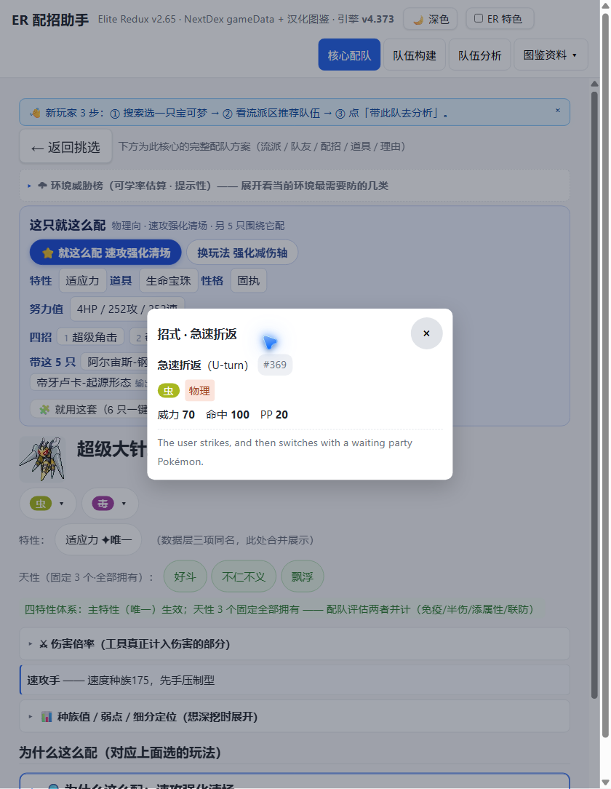

### 3.13 招族判定补全：箭/角/空/锤/投掷/钻头/光线七族入表（v4.375）

**有些特性只对特定「招族」的招式增伤。** 比如「巨翼」强化空中/翼类招、「强大之角」强化角类招、「超级重击者」强化锤类招。这类判定依赖一张招式招族表（MV_FLAG），旧表只覆盖了拳/颚/波动/声音/舞蹈等少数族，缺了箭、角、空、锤、投掷、钻头、光线这七族——理论上相关特性会因为查不到招族而「永不触发」。

**现在七族全部补齐。** 工具按游戏源码里每个招式的招族标记，把箭（19 招）、角（22 招）、空（36 招）、锤（32 招）、投掷（23 招）、钻头（5 招）、光线（21 招）全部录入，12 个对应增伤特性也接入了同一套判定：实配招式里有对应招族就加一分并说明倍率，没有就降权提示换特性。

**倍率文案也更诚实。** 多数特性是 1.3 倍，但「灵魂粉碎者」是 1.1 倍、「锤拳」是 1.25 倍、「岩石载荷」「恶作剧礼物」是 1.5 倍，答案卡现在会显示各自真实倍率，不再一律写 1.3。


### 3.14 防守流派死特性自动换常驻防守特性（v4.376）

**受队、联防、辅助流里，特性要是触发不了，等于白占一个槽。** 比如一只肉盾的首推是「叶绿素」（要晴天才加速），可这套配招里既没有晴天也没有晴队友，这个特性就永远不生效。旧版会老实标注「当前不生效」，但要你自己去备选里翻一个能用的。

**现在工具直接帮你换好。** 只要是防守流派（肉盾/受队/联防/辅助），首推特性确实拿不到触发条件，而备选里有「不依赖天气、场地、指定招式，常驻就生效」的防守特性——比如纯朴（无视对手强化）、硬壳盔甲（防暴击+减伤）、坚硬岩石（弱招减伤）、防尘、我行我素等，就自动把首推换成它，并写明原来的特性为什么不生效。

**换不掉的也不硬凑。** 如果备选里没有任何常驻防守特性，工具保留原来的诚实标注，不会随便塞一个同样没用的特性；进攻流派不在这个处理范围内。本版共 9 个防守流派（7 只宝可梦）换成了常驻防守特性，其余全库推荐不变。


### 3.15 修复巨钳螳螂三处判定缺陷：反伤误纳、狙击手误推、技术高手纳入评估（v4.377）
**有玩家对超级巨钳螳螂 #1518 的默认「反伤后手流」提出质疑，审计后确认是三个独立的引擎缺陷，本版全部修复。**
**① 反伤流不再误纳高物攻手。** 旧的反伤资格门用「物攻低或特攻低」跨攻击类型判断，物攻高达150的巨钳螳螂只因特攻65偏低就被塞进物理反伤流，白白浪费它的高物攻。现在物理双倍奉还只看物攻、镜面反射只看特攻，全库共清掉113个被错误纳入的反伤流派（卡比兽、怪力、隆隆岩、超甲狂犀、武道熊师等）。
**② 狙击手只在本流派真的带高暴击招时才推荐。** 旧判定看的是这只宝可梦「能学」什么，而不是这套配招实际带什么，导致大量误推。现在改用流派实际招式，全库17个首推会心流特性里16个误推被纠正。
**③ 技术高手现在会被真正评估。** 旧的威力硬门在技术高手加成之前就把子弹拳（40威力，加成后60）过滤掉了，引擎根本没评估过它——这正是玩家质疑的盲点。现在先折算技术高手再过威力门。需要说明的是，巨钳螳螂这套顺风打法因为顺风已经解决了速度问题，最终仍优先更硬的钢翼；若你想要靠先制收残的打法，技术高手子弹拳就是标准选择。
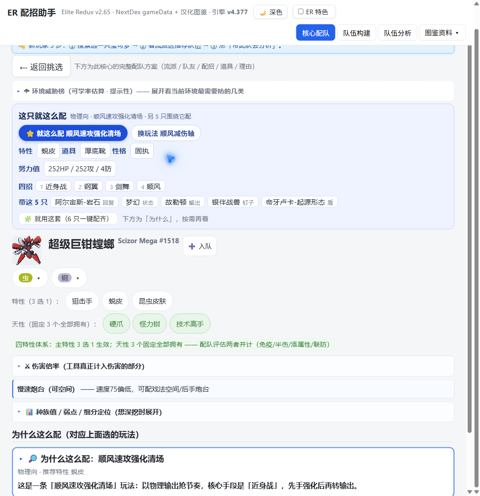
### 3.16 修复黑鲁加欺诈流误配：高速特殊攻击手不再被当成欺诈物反流（v4.378）
**有玩家对超级黑鲁加 #1520 的默认「欺诈物反流」提出三问：欺诈流是什么、真的存在吗；欺诈适合黑鲁加吗；黑鲁加不算肉盾。审计确认是真实引擎缺陷，本版修复。**
**先回答「欺诈是什么」。** 欺诈（Foul Play）是恶系物理招，威力95，特殊之处在于它**按对方的物攻结算，而不是用自己的物攻**。所以它是真实存在的合法招式，但正统用法是给不投资攻击的耐久防守宝可梦——靠物攻手自己的高攻击反制物攻手。把它放在高速特殊攻击手身上当核心招，就是误配。
**① 高速攻击手不再给欺诈流。** 旧资格门只看物攻、不看特攻和速度，黑鲁加（特攻140、速度125、耐久三角仅255，确实不是肉盾）被错误保留欺诈流还当成默认。现在只要最高攻击种族≥110且速度≥100就直接剔除，全库精确移除22个速攻手（耿鬼、超梦、黑鲁加、甲贺忍蛙、达克莱伊等）；慢速高耐久的宝可梦则保留欺诈用法。
**② 欺诈流性格不再错。** 旧的通用性格块会把欺诈流正确的「大胆」（+防御−攻击）覆盖成「固执」（+攻击），而加攻击对欺诈完全没用。修复后保留的135个欺诈流派性格全部正确（大胆130、悠闲5）。
**③ 死特性随之解决。** 黑鲁加旧欺诈流挂的太阳之力是死特性（没有大晴天、且只加成特殊招）。欺诈流移除后，黑鲁加只剩晴增伤清场特殊流，太阳之力在大晴天加特殊招下才真正生效。


### 3.17 速攻手不手动开天气/场地：队伍级辅助交给队友（v4.379）
**有玩家指出：黑鲁加是玻璃大炮，回合金贵，没有多余回合手动开晴天；如果没有队友给它开，它宁愿不带这个体系。这是队伍级的配队思维，本版举一反三覆盖全部速攻手。**
**核心原则。** 天气/场地这类队伍级辅助，速攻手不该自己花回合开——应由队友提供；没有队友提供，就不依赖该体系，而不是自己手动开。两个例外：恶作剧之心（变化招先制，不占正常回合）、自身特性就自动开天气（本来就不用手动）。
**工具会自动做三件事。** ①把手动天气/场地招换成补盲攻击招（优先异属性、非蓄力、威力≥70、命中≥90）；②把残留的晴免蓄力招（日光束、日光刃）也换掉——没有晴天它们要蓄力两回合，雨/沙/雪天更亏；③把依赖天气的特性换成常驻特性（如黑鲁加换「燃烧」，火招常驻×1.5），并去掉流派名里的「晴/雨/沙/雪」前缀。
**如果特性同时带常驻效果就保留。** 比如「沙之守卫」反先制、「北风」入场自动开极光幕，这些不依赖天气也生效，不会被误删。
全库共 40 条速攻流派收口，换出常驻特性 25 条；其余本就是常驻特性或无更好备选。#1520 答案卡现在四招为过热/日食/诡计/污泥波，不再带大晴天；想要天气体系时，队友建议里会给天气手。

### 3.18 速攻手不再自己撒钉、开戏法空间：队伍的活交给队友（v4.380）

**上一版让速攻手别自己开晴天、场地；这一版把同一原则推到钉子和戏法空间上。** 一只速度很快、主打输出的宝可梦，回合金贵：撒菱、隐形岩、毒菱、黏黏网这类钉子，以及戏法空间，收益都落在全队身上，自己花一回合铺开，这一回合就少打一下。现在工具把这类队伍级辅助交给队友提供——队里有专人撒钉、开空间时它专心输出；没有队友提供，也不由速攻手自己扛这个回合。

**单张墙还是会留下。** 光墙、反射壁、极光幕这类减伤墙，自己站场时也吃到这份减伤，属于保命手段；所以双墙叠在一起的会收掉一张，单张墙保留，答案卡上会注明「自身同吃减伤，保留作保命」。

**顺风仍然保留。** 顺风让全队速度翻倍，但携带它的这只自己也提速，本质是给自己加速的自我强化，不是纯辅助队友，因此不拿掉——这和之前「零速高速手可以带顺风」的口径一致。

**换下来的槽位补攻击招。** 钉子 / 空间被拿掉后，工具从攻击候选里补位：优先急速折返 / 伏特替换这类打一下就走的 pivot，其次异属性补盲攻击招。


### 3.19 脆皮不再自己开顺风：耐久位保留自己的顺风（v4.381）

**上一版说顺风自己也提速、所以整体保留；这一版再按耐久拆开。** 扛得住一回合的耐久进攻手，开顺风不亏；但脆皮（速度快、纸耐久）开顺风那一回合容易被一击带走，而顺风主要是全队提速，留给队友开更划算。

**工具会怎么处理脆皮。** 配招里的顺风换成游击招（急速折返 / 伏特替换，打一下就走）或补盲攻击招，流派名里的「顺风」前缀也一并去掉。换完如果这套没有别的提速手段、种族速度也不够快，答案卡会写明「速度前提由队友顺风提供」——流派照样保留、配置完整，不是删卡。

**耐久进攻手不动。** 耐久三角 ≥270 的宝可梦站得住场，自己带顺风仍然合法，工具不替它拿掉。


### 3.20 气势披带不再发给耐久核：反伤流改剩饭+凸凸头盔，替身流改剩饭（v4.381）

**气势披带的价值，是满血时真可能被一下带走、靠它撑过第一回合。** 耐久很高的宝可梦本就不容易被秒，披带发出去等于浪费道具位；这类耐久核改发续航件。

**按耐久分三档。** 耐久三角 ≥300 的，首位披带撤掉：反伤后手流改剩饭+凸凸头盔+防岩果，替身强化流改剩饭；270–299 边缘档保留披带，答案卡注明「仅满血生效，边缘耐久才值得」；耐久 <270 的脆皮不动。

**唯一例外是 #151 梦幻的变身流。** 变身者本就是围巾 / 披带 / 脱壳壳三选一，保留披带并在卡上写清这三选。


### 3.21 速度轴看自己：队友快不等于你快（v4.382）

**以前工具判断一只宝可梦「快不快」时，会把队友的速度也算进去。** 队里有高速手，它就被冠上速攻；队里有慢速手，它就被归成慢速重炮。结果是一只 45 速的宝可梦也能拿到速攻流派，卡片上自相矛盾地写着「速度 45（≥100 高线）」。

**现在改成只看自己。** 速攻身份必须本人真有当场生效的速度——种族速度 ≥100，或自带提速体系（顺风、叶绿素、悠游自如、拨沙、拨雪、轻装配消耗件、电气引擎等）折算后有效速度 ≥100；慢速重炮必须本人速度 ≤60。队友快或慢，只写进卡片说明（如「队内高速 2 只」），不再决定它生成什么流派。

**合法例外。** 轻装特性 ×2 后有效速度达标的低速手（如 #106 飞腿郎 87、#308 恰雷姆 80）保留速攻名，EV 真投 252 速；带顺风 / 晴天 / 雨天 / 轻装 / 沙暴 / 雪天 / 场地前缀的，都必须真有对应的自有倍率来源。


### 3.22 速攻卡名实一致：没有速度投入就不叫速攻（v4.382）

**还有一类卡片，名字叫着速攻，但努力值根本没投速度、自己也没有提速来源。** 这个名字是旧版本留下的。这类卡片不再硬挂速攻名，降级成按耐久输出定位的普通冠名（强化清场 / 主力输出压制 / 增伤清场 / 破盾，以及雪·沙·雨前缀版），说明里写清「原速度依赖已移除，本卡按耐久输出定位」。

**这一步只改卡片名字**，不动努力值、性格和队友挑选模板；真有倍率来源（天气提速特性、保留的顺风、轻装、讲究围巾）的 97 条保留速攻名与 0 速投入，属正当例外；这些卡的说明里都写清了速度从哪来（天气提速 / 顺风 / 轻装等），玩家能看到为什么不投速度——不是「100 速不用投速」，而是「速度由体系提供」。

**界面上的模板名也跟着改口。** 不叫速攻的卡，正文里不再挂「速攻模板」字样，改显示「高速线」；这只是上屏文字的映射，引擎内部模板与努力值配置不变——工具不再把「速攻」二字贴到名实不符的卡上。

**样例 #6 喷火龙：** 卡名由「速攻强化清场」降为「强化清场」，EV 252HP / 252特攻 / 4特防，四招 过热 / 暴风 / 流星群 / 替身，名实一致。


### 3.23 减伤轴只认卡面上的特性：减伤算、保命和回复不算（v4.383）

**以前判断一只宝可梦能不能走「减伤轴」，会把队友的减伤/免疫也算进去。** 队里有个减伤位，它也被贴上减伤轴标签；自身特性其实和减伤无关（#57 火暴猴特性一猩一意，却挂着「强化减伤轴」）。

**现在只看这张卡首推的那个特性（含固定天性）。** 自己真有减伤/免疫能力才冠「减伤轴」；队友有减伤位只写进说明（如「队内减伤位 2 只」），不再决定它的身份。

**三类要分清。** 减伤（算）：伤害减半、受某系伤害减半、伤害 −N%、不受到某类伤害（多重鳞片、幻影防守、毛皮大衣、毛茸茸、厚脂肪、坚硬岩石、过滤、棱镜装甲、原始铠甲、冰鳞粉、铅衣、铬涂层等）。保命（不算）：靠满血不被一击带走（结实、画皮、结冻头、假死、懦夫、英勇、薄葬、备用电源）。回复（不算）：续航回血（再生力、毒疗、自然回复、接触/击倒触发回血等）。属性免疫另有独立的「属性免疫联防位」流派，不混进减伤轴。

**说明里写真实幅度和条件。** 哪个特性、减多少、什么条件下生效（满血 / 天气 / 先制 / 对手属性）都标清楚；文案与源码冲突时以源码为准并并列标注。

**卡面写的减伤幅度是照着游戏源码核过的。** 几个容易记混的例子：厚脂肪（47）受到火/冰招式 ×0.5；厚脂（889，Thick Blubber）是另一个特性，火/冰减到四分之一且速度减半。也有官方描述与实际不一致的：永冻层（317）/厚皮肤（582）写 −25%，源码实为 −35%；羽衣（1004）写 10%/20%，源码实为被抵抗时 −30%、其余 −15%。卡面会同时列出源码值并保留原描述措辞。


### 3.24 叫「轮转」就必须真有急速折返或伏特替换（v4.383）

**「轮转」的打法核心是打一下就换人。** 名字里带轮转（轮转补盲 / 强化轮转补盲 / 钉子轮转 / 再生力轮转 / 场地轮转、电场轮转等）的卡片，四招里必须真有急速折返（369）或伏特替换（521）；再生力特性靠换人回血，没有换人招，这条流派同样不成立。缺游击招的「轮转」卡片改落到实配对应的既有流派名，不新造名字。

### 3.25 「体系前缀」必须是自己的：队伍有天气手不等于你有晴天流（v4.384）

**以前只要队伍里有天气手 / 场地手，就给这只宝可梦挂上「晴 / 雨 / 沙 / 雪 / 场地」前缀。** 队友开体系，自己其实并不吃这套加成，名字先于配置。

**现在前缀必须由自己满足其一。** 自己的特性 / 固定天性自动开体系；四招里自己带开体系招（求雨 / 大晴天 / 沙暴 / 冰雹 / 青草·薄雾·电气·精神场地）；或自己的特性真吃到该体系的进攻 / 速度加成——防御耐久加成、免疫、闪避类（雪隐 / 沙隐 / 雨幕）不算进攻加成。队友体系手只写进说明（「队内体系手 N 只」）。

**自身没有来源就去掉前缀，按实配归一。** 有 ≥2 个伤害招、攻击投资够、且有本系或特性 / 机制加成 → 强化清场；攻击投资不够 → 主力输出压制；不过进攻门 → 稳健联防。不新造名字。


### 3.26 真肉盾不挂弱点保险；叫「受队消耗」就得真能消耗（v4.384）

**「受队消耗」得自己真能站住。** 要么有回复手段（剩饭 / 黑色污泥 / 再生力 / 毒疗 / 吸取或自回复招）；要么耐久够厚（bulk≥300）且带消耗 / 保命招（寄生种子 / 剧毒 / 磷火 / 诅咒 / 再来一次 / 守住 / 替身）。两条都不满足的，不再叫受队消耗，改判稳健联防；队友的消耗位 / 回复位不算。

**弱点保险靠被克制招翻双攻，真会被打到才成立。** 耐久三角 ≥300 的肉盾撤下首位弱点保险、改续航件；270–299 边缘保留，注明「仅在被克制命中时生效」。


### 3.27 名字换了，努力值和性格也要跟着换（v4.385）

**以前的流程是先定配招和模板、再改名；名字在最后才调整。** 于是出现过这种卡：名字叫「速攻强化清场」，速度努力值却投 0——名字是新身份，努力值和性格还是旧身份那套。

**现在所有卡片在定名之后，会再过一遍最终化检查。** 这一遍只动努力值分配和性格，招组、道具、特性、名字本身都不改；重算沿用现有的努力值/性格算法，不另起一套。

**按最终身份对表：**

- **进攻流**（名字含 速攻 / 清场 / 压制 / 输出）：攻击或特攻努力值 ≥120；名字含「速攻」的，速度努力值投 252，或靠天气提速 / 顺风 / 轻装 / 围巾这类自有倍率来源。
- **防守身份**（肉盾 / 受队 / 联防 / 辅助，或名字含 受队消耗 / 稳健联防 / 肉盾 / 减伤 / 属性免疫）：HP+物防+特防合计 ≥252，速度努力值 ≤4；空间队例外（速度 0、攻或特攻 252 照旧）。
- **注意**：名字里的「钉子 / 墙」只是招组前缀，不构成防守身份。
- **性格对齐主投资**：物理满投固执、特殊满投内敛、速度线爽朗/胆小、耐久大胆/悠闲、空间勇敢/冷静。

**拿不准的不硬凑。** 重算后仍互相打架的卡回退保留原配置，登记待人工复核；已合规的卡不会被重复计算。


### 3.28 默认答案就是进攻答案，睡觉也不该留在玻璃大炮身上（v4.386）

**以前机制流派会被无条件排到第一张。** 有些进攻物种第一个答案却是一张防守/机制卡，进攻配置得翻到后面备选才看得到。**现在定名、换招之后会再过一遍排序**：只要物种有一张通过严格进攻门（≥2 伤害招、攻击/特攻投资 ≥120、≥1 本系或特性加成招）的进攻卡，它就排到第一；机制卡保留为「换玩法」备选，不删除。13 只机制即身份的宝可梦（变身复制流、毒疗站场流）维持默认第一，why 已注明。

**引擎顺序对了还不够，展示层也要认引擎的 [0]。** 排序之后，卡片列表原先还会按分数把机制/防守卡顶回第一个标签页；现在展示层直接以引擎排好的第一张为准，默认看到的就是进攻答案，其余卡不删不藏，换标签照样找得到。复核 3812 个物种-口径，错位 363 处、修完 0。

**玻璃大炮不该带睡觉。** 睡觉是两回合脱战招，脆皮速攻手带它等于白送两回合。共 103 张：37 张换成可学的真回复招（羽栖/自我再生/月光/光合作用/晨光/吸取类）；其余 66 张没有可学的真回复，睡觉槽改补盲伤害招（守住兜底 0 张）。耐久达标的防守位不在替换范围：例如 #1503 超级喷火龙Y 耐久三角 272，按玻璃大炮口径（bulk<270）不属脆皮，其防守备选卡的睡觉保留——是否对 270–272 边缘另开口径，留待裁定。

**性格候选自相矛盾的，展示层归一化。** 以前性格数组里首项被换掉、旧候选还留在后面，出现互相冲突的两个性格并列；现在以第一个性格为准，过滤掉加成/减项冲突的候选，引擎数组本身不改。


### 3.29 图鉴里的数字，现在和游戏源码一致了（v4.387）

**以前图鉴正文和卡面各写一套。** 卡面早就在照着游戏源码核幅度，图鉴里的特性描述还留着老文案：写「减 25%」实际是 35%，写「火 ×4」实际是 ×2，有的倍率在 ER 里根本不存在。以 317 永冻层为例，现在显示「受伤减少 35%（旧图鉴写 25%，以游戏内实际结算为准）」；旧数字并列保留是为了对照，不是两套都生效。本版把图鉴正文也对齐源码。而且做了两层：数据层写对，展示层也要能读出来——以前技术注记写进图鉴字段后，会被页面的泄漏守卫整句剥掉，玩家看到空白；本版把玩家可读文案单独放进干净字典（150 条），技术注记原样保留，两套并存。

**为什么以源码为准：** 同一特性有三个来源——汉化分片、游戏内文案注册表、源码；三者冲突时以源码为准，卡面同时列出源码值和旧文案，方便对照。两个容易误读的点：接触减伤特性（极致蓬松/厚重毛皮）代码里只结算接触 ×0.5、火 ×2，不是文案的 1/4 与 4 倍；原版有的倍率文案在 ER 改版里已被删掉（如钢能力者并无 1.3 倍钢招），图鉴不再保留那句残留。

**睡觉判据也收紧了一档。** 睡觉是两回合脱战招：耐久三角 ≥300，或耐久 ≥270 且双防 ≥90、无 4 倍弱点的防守位才允许保留；其余把睡觉换成可学的真回复招（羽栖/自我再生/月光/光合作用/晨光/吸取类），没有真回复的改补盲伤害招，兜底才用守住。受队消耗位和食梦位因睡觉承担回复/睡眠来源，写进理由保留。#1503 超级喷火龙Y 耐久 272 但物防 78、岩石 ×4，不达标，睡觉换成羽栖。

**性格推荐也只留一个有效候选。** 同一张卡上互相冲突的性格（加一项又减同一项）只保留与首项一致的，详情页、成员摘要、详情卡三处同一套规则；#1503 防守卡只显示内敛。少数防守墙卡首推性格本身偏进攻，过滤后仍留两项，记台账待引擎侧复核。

**洛托姆五形态**的进攻组（原睡觉槽所在位置，2 伤害招 + 特攻 EV252）经核实改名主力输出压制，钉子组保留；速度门未动。


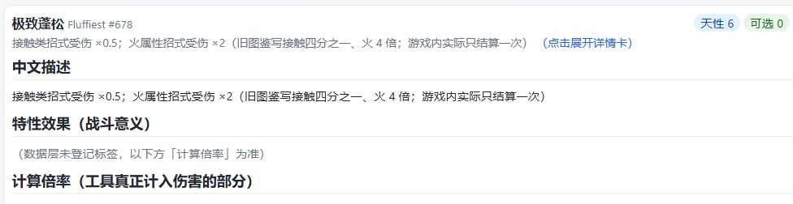


### 3.30 「受队消耗」不再是个筐：脆皮骚扰位改名，快卡真的加满速度（v4.389）

**问题出在一个兜底**。引擎以前把「所有没能归类的卡」都倒进「受队消耗」这一个名字里，于是同一个名字下面坐着两种完全不同的物种：真能吃伤害、靠毒/寄生慢慢磨的耐久核，和四招全是变化招、耐久又不高的脆皮骚扰位。以前者为例它是名实相符；以后者为例，名字在骗人——而且这类卡还常常挂着「内敛」这种 **+特攻 −攻击** 的性格，卡上一个伤害招都没有、特攻努力值还是 0，性格的正项完全空转。

本版按「耐久」和「有没有真回复」把这一族拆成三档：

| 卡名 | 判据 | 代表的打法 |
|---|---|---|
| **受队消耗**（保留） | 耐久三角 ≥300，或 ≥270 且自带真回复（回血招 / 回复特性；**剩饭、黑色污泥不算**） | 真能吃伤害、靠消耗磨死对手 |
| **骚扰消耗** | 不满足上面，且实配伤害招 **≤1** 条 | 脆皮快卡：剧毒/电磁波/替身/守住 撒状态、封锁、先手骚扰 |
| **耐久压制** | 不满足上面，且实配伤害招 **≥2** 条 | 耐久够、也真带了两招以上输出，靠站场压制 |

同时补上两件事：

- **快卡不再「零速空投」**：名字落到「骚扰消耗」、速度种族 ≥100、速度努力值却为 0 的卡，努力值改为 `252HP / 4特防 / 252速`，性格换成加速项（特攻侧胆小、物攻侧爽朗）。速度种族 ≥100 却不投速度，等于把唯一的优势让掉。
- **零伤害招的防守卡，性格正项给真实投资项**：一张卡一个伤害招都没有、却推「内敛/固执」，性格加的那一项永远用不上。现在按实际投资改成沉着/慎重（特防向）或大胆/淘气（防御向）；并且**减项避开已经投满的那一侧**——攻击努力值高的卡改用淘气/慎重（减特攻），避免又造出一个「减攻但攻击满投」的新矛盾。这一档只改性格，努力值一点不动。

**你原来问的那只**：`#1509 超级耿鬼Y` 的这张卡现在是 **骚扰消耗｜胆小｜252HP / 4特防 / 252速｜剧毒 / 电磁波 / 替身 / 守住｜剩饭**；它的主卡「速攻强化清场」一个字没动，仍然是默认首卡。#94 耿鬼、#65 胡地 同模子的卡一起落地。

**顺带承认一处早前判定的口径过粗**：上一版收口时把「防守卡首项性格偏进攻」整体裁定为「不修（属优化空间）」。其中「零伤害招」那一档不是浪费，是配置自相矛盾，必须修；「有伤害招但进攻项努力值 ≤4」那一档维持不修。


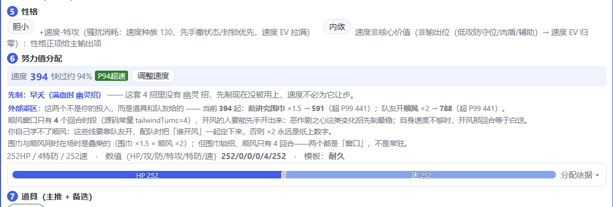

### 3.31 「耐久压制」这个名字撤了：说耐久就得真够厚（v4.390）

**上一版自己挖的坑**。v4.389 把兜底名字拆三档时，第三档「耐久压制」只按「手里有几招伤害招（≥2 条）」来分，**没看这张卡到底扛不扛得住**。结果是：六人队 **349 张**、空队 **47 张** 耐久三角不到 270 的脆皮卡，被贴上了「耐久」两个字——跟你投诉的「不带攻击招却叫受队消耗」是同一种错，只是换了个词。而且这一档本来就是我自己追加的，你当初只拍板了「脆皮改名骚扰消耗」和「快卡零速一起修」两件事。

**判断不该是一条线，该是分档**。你的话是对的：说「肉盾 / 脆皮」不能一个阈值切，说「暴力输出手」更不能。所以本版把判据写成两条：

- **名字里出现属性词（耐久 / 肉盾 / 铁壁 / 大炮 / 重炮）→ 按种族底子的绝对档来卡**。这是属性承诺，厚不厚得看底子，不能看努力值投了多少。
- **名字里出现战术词（骚扰 / 轮转 / 强化 / 清场 / 补盲 / 辅助）→ 只看这张卡自己的配置**（招组 + 努力值 + 道具）。这是打法意图，不是身体条件。

底子的档位不是拍脑袋，是按全库 1906 只的分位定的：

| 维度 | 脆 / 弱 | 中等 | 高 | 极端 |
|---|---|---|---|---|
| 耐久三角（HP+防+特防） | < 240（中位以下） | 240–299 | **≥ 300**（前 18%，340 只） | **≥ 360**（前 4%，仅 70 只） |
| 火力 max(攻,特攻) | < 95 | 95–109 | **≥ 110** | **≥ 130**（前 22%，422 只） |
| 速度 | < 60 慢 | 60–99 中 | ≥ 100 快（551 只） | ≥ 130 极速 |

**极端流派得两条硬门槛同时满足**，不能只靠一条。比如「超级抗伤」要耐久 ≥360 **并且**速度 ≤60，全库只有 30 只（吉利蛋、壶壶、幸福蛋、护城龙这类）；「超级大炮」要火力 ≥130 **并且**有速度或空间支撑。这就是你说的「特别突出才能去走」。

**本版怎么修的：撤档，不是抬门槛。** 因为这一档要处理的本来就是「没通过耐久 ≥300 或（≥270 且自带真回复）」的卡，所以把线从 270 抬到 300 也没用——那只会留下一个**有名字、没住户**的死名字。于是直接撤掉第三档：手里伤害招 1 条的和 2 条以上的，**一律回「骚扰消耗」**，回到你拍板的两档口径，不新造词。

落地数字（六人队 / 空队）：**耐久压制 382 / 57 → 0 / 0**；**骚扰消耗 470 → 852**、11 → 68。连带好处：这批卡名字改回「骚扰消耗」后，正好落进「快卡零速」这条规则的处理范围，**又修好 140 / 2 张**速度种族 ≥100 却一点速度都没投的卡（以前它们被「耐久压制」这个名挡在门外，规则根本没跑到）。

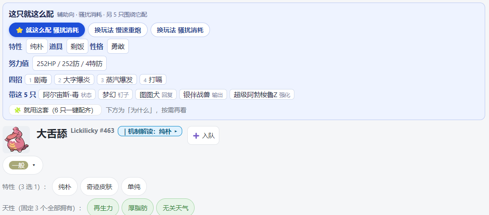
### 3.32 「主力输出压制」补回打手门：火力不到 95 的不当主力打手（v4.391）

**同一个毛病的第二处。** 上一版撤掉「耐久压制」时顺手记了这件事：名字叫「主力输出压制」的卡，准入看的其实是**努力值投了多少**（攻或特攻投满 120 以上就算），不是这只宝可梦本身火力够不够。结果六人队 **299 张**里 **185 张**火力（物攻与特攻取高者）**不到 95**——空队 388 张里 203 张。

**更尴尬的是工具自己前后矛盾**：速攻候选那里明明写着「火力不到 95 不许当打手」（95 这个门槛在卡片上还印着「力度达标（≥95）」），可兜底发名字那一段压根没接这条门。同一只宝可梦，一个地方说它不是打手，另一个地方给它发了「主力输出」的名。

**修法很简单：只改名字。** 含「主力输出压制」而火力不到 95 的，去掉「主力」两个字，叫「**输出压制**」；「强化 / 钉子 / 顺风 / 空间 / 免疫 / 接棒」这些前缀**全部保留**（它们说的是打法，不是身体条件）。努力值、招式、道具、特性一个字都不动——变的只有那一行名字。

**个别卡走已有规则。** 火力不过门、手里又只有一发伤害招的（#605「空间主力输出压制」），去掉「主力」也还是名不副实，于是按上一版就有的路由带强化招回「**强化清场**」（落成「空间强化清场」），不为了它单独发明规则。

落地（六人队 / 空队）：**主力输出压制 299 → 114** / **388 → 185**，火力不到 95 的残留 **0 / 0**；改名落成「输出压制」**184 / 202**。门槛取的是**工具本来就在用的 95**，不是更狠的 110——110 会把 95–109 这 37 张合格的「主力输出」一起误降。


### 3.33 「骚扰消耗」得真带骚扰手段：423 张空壳卡按自己的配置落回既有名字（v4.392）

**这次查的是上一版那条判据的另一半。** 前面两版都在查「属性词」——名字说「耐久」得真够厚，名字说「主力输出」得火力够。可名字里还有一类词是**打法**：骚扰、轮转、强化、清场。打法类名字的检验方式不同：不看这只宝可梦的底子，看它**自己这一栏招式到底带没带那件家伙**。

**「骚扰消耗」这个名字是捡来的。** 上一版拆「受队消耗」时，凡是不带属性免疫、不满足打手条件、也没有折返招的卡，一律被改成「骚扰消耗」——名字来自兜底桶，而不是来自卡里的钉子和状态招。于是六人队 852 张「骚扰消耗」里，**423 张的招式栏里一件骚扰手段都没有**：钉子（撒菱 / 毒菱 / 隐形岩 / 黏黏网）、状态（剧毒 / 电磁波 / 鬼火 / 催眠术 / 寄生种子）、削弱逼换（威吓 / 挑衅 / 吹飞 / 龙尾等），三族全无。

**怎么落回名字（全用工具里已有的词，不发明新的）：**

1. 带着强化招（剑舞 / 龙之舞 / 蝶舞 / 冥想 / 诡计 / 破壳…）且至少一发伤害招 → **强化清场**
2. 伤害招两发以上、火力（物攻与特攻取高者）够 95 → **主力输出压制**（正好是上一版刚立的那道打手门）
3. 伤害招两发以上、火力不到 95 → **输出压制**
4. 伤害招只有一发或没有、但带着墙（光墙 / 反射壁 / 极光幕）→ **双墙辅助流**
5. 剩下的一律 → **稳健联防**

努力值、招式、道具、特性、方向、定位**一个字都不动** —— 变的只有卡面那一行名字。

**落地数字**（六人队 / 空队）：强化清场 **276** / 主力输出压制 **45** / 输出压制 **38** / 双墙辅助流 **29** / 稳健联防 **35**，合计 **423 / 0**。留下「骚扰消耗」**429 / 68** 张，逐张核过**确实带着骚扰手段**（这条有断言守着，不是抽样）。空队口径那 68 张本来就全部合格，一张没动。

**几个例子**：#79 呆呆兽（偷懒·戏法空间·光墙·铁壁）→ 双墙辅助流；#2596 草苗龟R（羽栖·顺风·替身·破壳，破壳但零伤害招）→ 稳健联防；#279 大嘴鸥（火力 95、只有一发伤害招）→ 稳健联防。


### 3.34 攻击向流派不再挂「肉盾」：定位标签和名字、努力值一起对齐（v4.393）

**前面几版改名字时都留了个尾巴。** 从 v4.389 到 v4.392，每次改名都只改卡面那一行名字，明确写着「定位（roleTag）不动」。于是引擎内部的定位标签还停在候选生成那一刻——一张最终叫「强化清场」、走特殊方向、满特攻满速的卡，内部定位仍写着「肉盾」，还沿用候选期的耐久努力值。名字在进攻，标签和努力值却在防守，这就是名实不符。

**有多少这种卡**：六人队里 **584 张**攻击向名字（强化清场 / 轮转补盲 / 主力输出压制 / 输出压制）、物理或特殊方向的卡，仍挂着「肉盾」跑耐久；空队为 0（空队的肉盾卡名字全是「稳健联防」，没有攻击向名字）。

**本版怎么对齐**：对每张「肉盾」卡，按它的最终名字算新定位——强化清场→「强化」、轮转补盲→「轮转」、主力输出压制 / 输出压制→「输出」，再重新算对应的努力值和性格。只有当新努力值干净合理（减项不投一半、正项不零投）时才回写；不干净的卡标成「边缘」保留肉盾，不硬改。招式、道具、特性、方向都不动。

**落地数字**（六人队 / 空队）：干净对齐 **547 / 0**、边缘保留 **35 / 0**。35 张边缘卡是双刀+强化、减速性格却满速、正项零投这类自身矛盾的情况，保留原定位更稳妥。

**顺手修了两个环境问题**：① 无头校验里道具初始化在特定情况下被静默中断、使部分卡保留旧回复件（CONS_ITEM 可移植性）；② 速度中位数在数据加载前被提前算成 80 并记住，真实值是 **75**（medSpe 初始化顺序）。这两项让浏览器和无头校验的结果完全对齐。

**一个个案**：#314 甜甜萤靠「恶作剧之心」做弱攻控场，对齐后本会被默认规则误判，加了窄豁免——名字带恶作剧之心且攻击种族不到 95 的弱攻控场算合法默认，仅甜甜萤一例。


### 3.35 自己不是天气手，就别手动开天气：六人队 299 张、空队 157 张把天气招换成了有用的招（v4.395，合并 v4.394）

**一句话**：没带天气特性、却手动开「大晴天 / 求雨 / 沙暴 / 冰雹」的卡，这次全清掉了 —— 技能格只有 4 个，开天气占一格，收益却常常落空。

**为什么**：开天气要花一回合，而天气是**队伍级**资源。你自己不是天气手，队友不一定受益；对手换天气手上场就把你的天气顶掉。几种常见场景都推不动：想续天气窗口得看队友配置；想让沙暴 / 冰雹当消耗手段，却打不过钉子（全库沙暴卡把沙暴换掉后，补进来的全是「隐形岩」）；想反制对手天气，不如直接换自己的天气手上场，更快还省一格。

**唯一的例外**：`恶作剧之心`。变化招先制 +1，出场当回合天气就落地，不需要牺牲一回合节奏 —— 六人队 8 张、空队 4 张保留。

**改完之后什么样**：删掉天气招留下的空格不会空着，按「名字兑现 → 进攻补盲 → 耐久池 → 兜底」补进去。三个真实例子：

- **#1501 超级妙蛙花Y**：原本三张卡都带「大晴天」。现在 [0] 强化清场｜花粉团 / 大地之力 / 生长 / 污泥炸弹，[1] 受队消耗｜寄生种子 / 终极吸取 / 大地之力 / 生长，[2] 增伤清场｜污泥炸弹 / 飞叶风暴 / 生长 / 花粉团 —— 天气格换成了真用得上的输出与回复。
- **#86 小海狮**：稳健联防｜偷懒 / 治愈铃声 / 清除浓雾 / 守住。求雨换成治愈铃声，开不出雪天的极光幕换成清除浓雾。
- **#456 荧光鱼**：[1] 双墙辅助流｜羽栖 / 反射壁 / 光墙 / 守住 —— **两面墙都在**，名字成立，原样保留。

**顺带修的三件**：

1. 「双墙辅助流」这个名字，全库 851 张里 **848 张只带了一面墙**（4 个格子放不下两面墙，这是行业惯例叫法，没动）；**一面墙都没有的 10 张**才是真名不副实，改成「稳健联防」。比如 #712 冰宝：现在 稳健联防｜自我再生 / 替身 / 高速旋转 / 铁壁。
2. 名字顶着「雨增伤清场」「晴强化清场」这种前缀、但自身没有任何天气来源的 35 张（六人队）/ 26 张（空队），把前缀去掉。
3. **#1503 超级喷火龙Y 不是问题卡**：它的特性「干旱」就是晴天手，名字里的「晴」是真的，带日光束也合法。

**同版还修了「强化清场」的老毛病**：以前只要这个物种「能学」强化招就写成「强化清场」，可一张卡的第四格常常被替身 / 守住 / 顺风 / 撒菱占走 —— 能学不等于会带。现在按实配招数重算，六人队 1057→1017 张、空队 860→822 张改了名字。


---

## 4. 队伍构建

### 4.1 怎么用

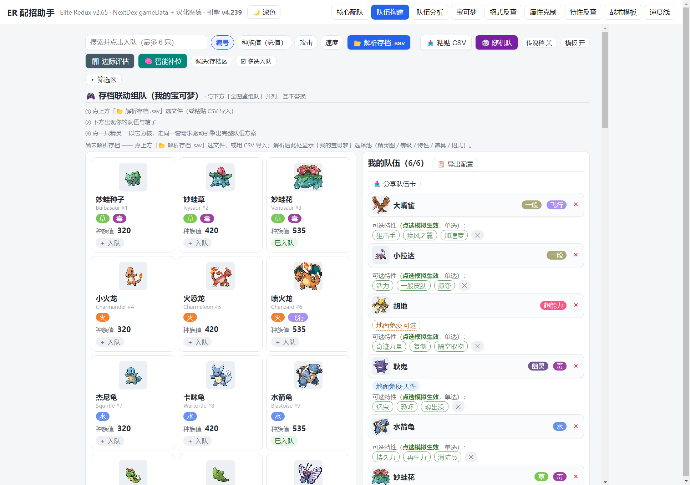

三块区域，从上到下：

**① 顶部工具条**

| 按钮 | 作用 |
|---|---|
| 搜索并点击入队（最多 6 只） | 主路径：搜到就点，点了就进队 |
| 编号 / 种族值(总值) / 攻击 / 速度 | 排序 |
| 📤 解析存档 .sav | 直接读玩家存档，导入真实队伍 |
| 📋 粘贴 CSV | 批量导入 |
| 🎲 随机队 | 随机凑一队（`传说档:关`、`模板:开`） |
| 📊 边际评估 | 算「当前缺口 + 换谁最赚」 |
| 🧠 智能补位 | 自动补满 6 只 |
| 候选:存档区 / ☑ 多选入队 | 存档导入后的候选池 |
| 筛选区 | 展开属性/特性筛选 |

**② 「🖥 存档电脑区」+「🎮 存档联动组队（我的宝可梦）」**

三步走：点「解析存档 .sav」选文件 → 下方出现「我的宝可梦」选择池（精灵图 / 等级 / 特性 / 道具 / 招式）→ 点一只以它为核心，走同一套需求驱动引擎出完整方案。

未解析时这里显示「尚未解析存档 —— 点上方 📤 解析存档 .sav 选文件，或 CSV 导入；解析后此处显示…」。

**③ 「我的队伍（6/6）」+ 📋 导出配置 + 分享队伍卡**

每只一条，带：

- 属性标签（`一般` `飞行`）
- **可选特性（点选模拟生效，单选）** chip 行 —— 如 `狙击手 / 疾风之翼 / 加速度`，末尾一个 `✕` 取消
- **`地面免疫·可选` / `地面免疫·天性` 标记** —— 提醒你「这只如果选了某特性会免疫地面」
- `×` 移除

这一行是整个工具最关键的交互点：**点了特性，防守剖面、全队分析、伤害判定同时重算。**

### 4.2 边际评估（📊）


这块回答的是「**我的队现在缺什么，换谁最赚**」，而且是**逐条推导**，不是黑箱打分。

**① 当前缺口**（带权重）

```
评分 -35，权重 无解系/4倍=5 · 共弱=3 · 进攻盲区=2 · 属性重复=1 · 速度线=2
无解系（有弱点但全队无人抗/免）：飞行 / 恶 / 岩石
共弱（≥2 只弱）：电 / 恶 / 超能力 / 幽灵
4 倍系：无
进攻盲区（全队打不出克制）：星晶 / 无 / 神秘
属性重复：一般 / 超能力 / 毒 / 水
极速 372（P50 273 / P75 331 / P90 372）
```

五项缺口的定义：

| 缺口 | 判定 | 权重 |
|---|---|---|
| 无解系 | 队伍里有只弱 X，但全队**无人能抗/免疫 X** | 5 |
| 4 倍系 | 某只被一个属性打出 ×4 | 5（与无解系同权） |
| 共弱 | ≥2 只弱同一属性 | 3 |
| 进攻盲区 | 全队招式池**打不出**任何克制该属性的招 | 2 |
| 属性重复 | 两只以上同属性 | 1 |
| 速度线 | 队伍极速相对分位 | 2 |

**② 候选建议**（每条带「得/失」）

`换掉 耿鬼 → 换入 大嘴娃` `净改善 +25`
- 得：去掉属性重复 毒
- 失：新增无解系 飞行 · 恶 · 岩石；新增共弱 恶 · 超能力 · 幽灵

每条右侧一个 `✅ 应用` 按钮，点了直接换人。

**这块的价值不在于「+25 分」，而在于「得/失」被明写出来。** 你看得见「换掉耿鬼能去掉毒重复，但会新增三个无解系」——所以你可以拒绝这个建议，这正是设计意图。

**③ 口径说明**（底部）

> 防守按天性特性（与「防守剖面」同源）；进攻覆盖按招式池可打出的克制关系；速度按极速 252+性格。评分是**相对**指标，只用于比较候选之间的单步收益，不能当绝对强弱。

**④ 一个已知的展示特性**：多个候选如果**属性组合相同**（比如大嘴娃 / 锁圈儿 / 玛机雅娜 / 小锻匠 / 巧锻匠 都是钢系），缺口变化会一模一样（都是「去掉毒重复 + 新增同样四个无解系」），分数也都是 +25。这不是 bug，是「同属性候选缺口收益必然相同」的必然结果；差异在招式池与特性，工具不展开到那一层。

### 4.3 智能补位（🧠）

与边际评估互补：边际评估是「换谁最赚」，智能补位是「直接补满」。补位后同样走 `renderTm / renderSlots / renderAnalyze / saveTeam` 全套。

---

## 5. 队伍分析

### 5.1 怎么用

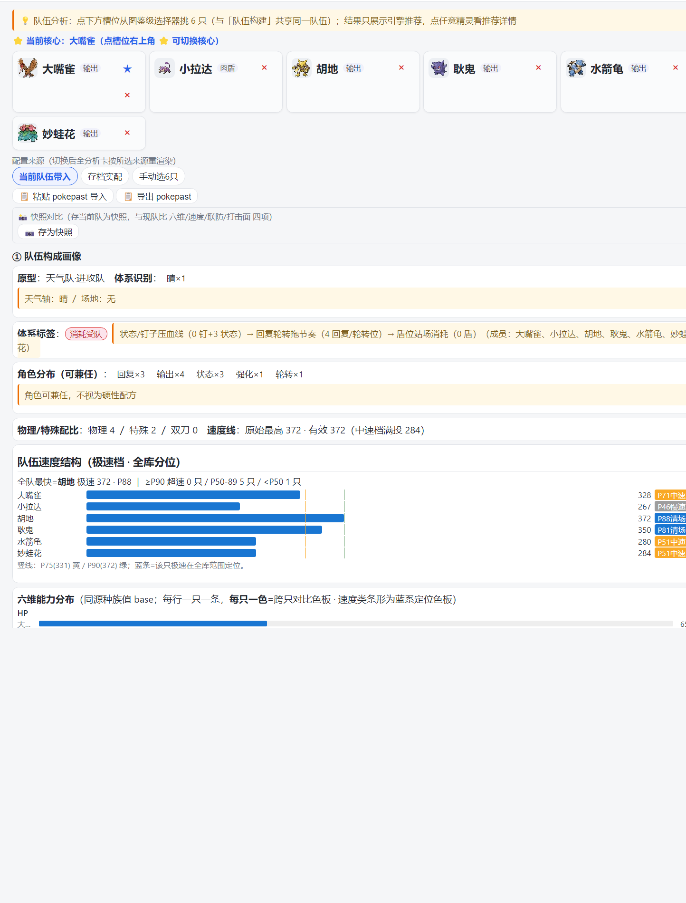

这一页装的是「**这队到底能不能打**」，分四层：

1. **六槽位** —— 与队伍构建共享同一个 `team`，不重复录入
2. **伤害判定 / OHKO 反解** —— 算「我这一击能不能秒它」「它能不能秒我」
3. **防守剖面与全队分析** —— 逐属性看每只被谁克制、全队盲区在哪
4. **核心标记** —— 用 ★ 指定「以谁为中心」

### 5.2 六槽位

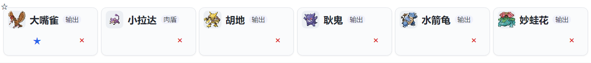

每个槽位显示：

| 元素 | 含义 |
|---|---|
| 精灵图 + 名字 | 物种 |
| 角色标签（`物攻手` / `特攻手` / `盾`） | 工具按能力值自动推断，可兼任 |
| **★ / ☆** | ★ = 当前核心（`蓝★`）；点 ☆ 切换核心 |
| `×` | 移除该成员 |

点槽位本体 → 打开图鉴级选择器替换。

顶部「★ 当前核心：大嘴雀（点槽位右上角 ★ 可切换核心）」。核心的作用是决定「推荐区围绕谁展开」。

**配置来源三路互斥**（`anCfgSrc`）：

| 值 | 含义 |
|---|---|
| `team`（默认） | 当前队伍带入 |
| `sav` | 存档实配（吃玩家真实配招/道具/EV/性格） |
| `manual` | 手动选 6 只兜底（`anManualIds`，**不污染**队伍构建 Tab 的 `team[]`） |

### 5.3 伤害判定 / OHKO 反解

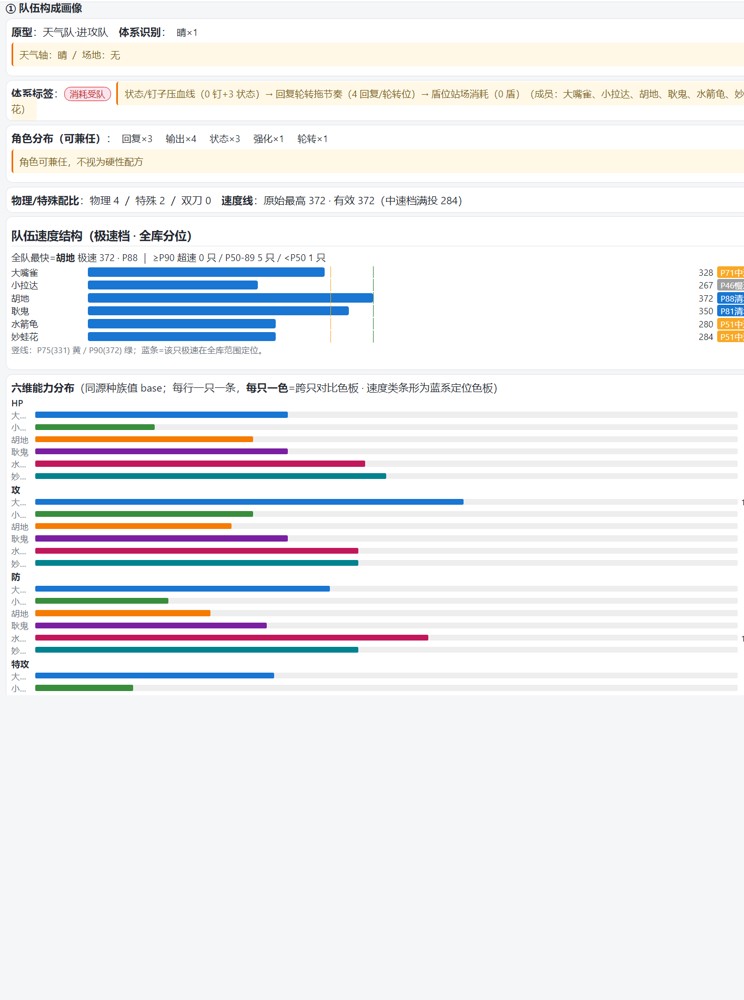

界面元素：

| 控件 | id / 说明 |
|---|---|
| 攻方（我方） | 攻方搜索框 + 「从队伍选」按钮；下方候选列表 |
| 防守方 | 防守方搜索框 + 「载入NPC队」/「载入存档队」；下方候选列表 |
| 常用对手 chips | 常用对手 chips —— 格斗弱 / 冰弱 / 电弱 / 虫弱 / 草弱（一键选典型对手） |
| 我方招式 | 招式搜索框 + 候选列表 |
| 结果 | 输出区 |

**输出区读法**（以「探探鼠 → 小拉达（HP 96）」为例）：

```
伤害 137–162 · 特性增伤 ×2 确定 OHKO · 达到 OHKO 最低攻端 EV=0
耐久反推：
  扛1下：HP+40 / 物防+236
  扛2下：252/252 也必死
```

- **伤害区间** 137–162 是 `dmgCalc` 算出的随机数范围
- **特性增伤 ×2** 是这条特性在这里的实际倍率（不是文案，是按源码实算出来的）
- **确定 OHKO** 是区间下限 ≥ 对方 HP
- **最低攻端 EV** 是 `ohkoSolveEv` 反解「要投到多少攻才能必杀」
- **耐久反推** 是反解「要多少 HP/防才能扛住 N 下」

**「倍率分解」行（v4.248 新增）** —— 在伤害数字下面，把这一发伤害**每一项乘数**摊开：


*实测：哥达鸭「贤者之力」打十万伏特 → `倍率分解　克制 ×1　·　特性增伤 ×1.5［贤者之力×1.5(特殊招)］　·　生命宝珠 ×1.3　·　随机 0.85–1.00`*

读法：

| 项 | 含义 |
|---|---|
| `克制 ×1` | 属性相性倍率（`defCellTrio` 判，含对手特性的免疫/减半） |
| `本系 ×1.5` | 本系加成（`-ate` 类转换后也算本系，见 §12.1） |
| `特性增伤 ×N［…］` | 攻方特性乘数，方括号里是**哪一条特性、什么条件**判出来的 |
| `特性减伤 ×N［…］` | 守方特性乘数，同上 |
| `晴天/雨天 ×1.5` | 天气只在对应属性上生效 |
| `电气/青草/精神场地 ×1.3` | 场地加成 |
| `生命宝珠 ×1.3` / `讲究×1.5` | 道具 |
| `会心 ×2` | 勾了暴击才出现 |
| `随机 0.85–1.00` | 伤害浮动区间来源 |

**它的意义**：此前这些明细只藏在伤害行某个 `title` 属性里（要鼠标悬停才看得到），而下面这行只显示一个合并后的 `特性增伤 ×1.5`——**你看得到「有倍率」，看不到「凭什么是这个倍率」**。这一行把 `dmgAtkAbiMul` / `dmgDefAbiMul` 返回的 `hits` 明细提到了明面。

**注意它不改变计算**：只读 `dmgCalc` 已返回的 `eff/stab/atkMul/atkHit/abiMul/abiHit`，加上 `__spdSl` 里的天气/场地/道具/暴击状态，**`dmgCalc` 一行没动**。

**两行状态 chip（v4.238 新增，这是最容易忽略但影响巨大的两块）**

`攻方状态`：`无` / `异常` / `中毒`

- `异常` → 毅力 ×1.5（物理）、决心 ×1.5（特殊）
- `中毒` → 中毒激升 ×1.5（**只中毒/剧毒，不是任意异常**）

`目标状态`：`站场已久` / `刚入场` / `本回合已先行动`

- `刚入场` → **蹲守** ×2.0（源码判据见开发文档）
- `本回合已先行动` → **分析** ×1.3（源码判据见开发文档）

**这两行为什么必须分开看**：它们判的是**对手侧**的状态，和你自己有没有异常、有没有强化是**两回事**。

### 5.4 分析结果

「分析结果」是一张很长的诊断卡（实测 3057 字），内容依次是：

| 块 | 内容 |
|---|---|
| ① 队伍构成画像 | 原型（如「天气队·进攻队」）、体系识别（`晴×1`）、天气轴、场地、体系标签（如「消耗受队 状态/钉子压血线（0 钉+3 状态）→ 回复轮转拖节奏（4 回复/轮转位）→ 盾位站场消耗（0 盾）」）、成员列表 |
| ② 角色分布 | `回复×3 输出×4 状态×3 强化×1 轮转×1`（可兼任） |
| ③ 防守剖面 | 行=攻击属性，列=队伍成员，格值 `基础→天性修正`；尾三列 `弱×N / 抗×N / 免×N` |
| ④ 整队盲区 | `整队盲区：...` 或 `无整队盲区` |
| ⑤ 推荐详情 | 点任意精灵缩略图/名字 → 弹出该只的「推荐详情」层（「推荐详情」层）。内含**角色定位五段式卡**：①概述 ②核心机制（含**现算击杀线**）③典型用法 ④注意与局限 ⑤推荐队友 |

**⑤ 里那张「角色定位五段式」卡怎么读**

| 段 | 内容 |
|---|---|
| ① 概述 | 一句话定位 + 速度线分位（`P88`）+ 极速实值 |
| ② 核心机制 | 主攻招（含威力）、道具、特性（**带计算倍率**）、以及**现算击杀线** |
| ③ 典型用法 | 上场时机、招式循环 |
| ④ 注意与局限 | 弱点、`warn` 提示 |
| ⑤ 推荐队友 | 补盲方向 |

**「现算击杀线」是当场算的，不是写死的**：拿该只的主攻招，对「该招属性克制（`opt≥2`）里 HP 最高的那只」打一发，
显示 `伤害 lo–hi` + `确定 OHKO / 概率 OHKO / 2HKO 起`。

**关键：它会按这只自己的推荐特性去定情景。** 如果推荐特性是毅力/决心/中毒激升/蹲守/分析，
数字后面会带一行灰字 `（按「自身有异常」前提）` / `（按「对手刚上场」前提）` 之类。
看到这行灰字，说明这个击杀线是在那个前提下算的——不满足这个前提时实际打不到这个数。


> **v4.246：② 核心机制里的特性名后面，现在会跟一段灰字倍率。**
> 上面这张图里「特性「分析」」后面紧接着 `（打出去 · 目标已行动时 ×1.3）` —— 这一段不是文案复述，而是**这个特性在伤害计算里真正乘上去的数字**，来源是按源码实算。
> 没有这段灰字的卡片（如「疾风之翼」「再生力」），表示该特性属**回合 / 命中 / 换场 / 状态类**，不产生伤害倍率 —— 不是漏了，是不该有。

*实测例：小磁怪（特性「分析」）主攻「铁蹄光线」→ 浩大鲸，伤害 `1107–1302`，后面跟着 `（按「对手已先行动」前提）`。这行前提字是 v4.241 新增的——此前这里既不传 `tgt`、也不标前提，数字会掉回 `850–1000` 一档。*

> **v4.241 修的真缺陷**：这个击杀线此前调 `dmgCalc` 时只传了 `crit/evA/evD/itemA/moveId/natA/natD/sA/sD/terrain/weather`，
> **漏了 `stA` 和 `tgt`** ——于是毅力 / 决心 / 中毒激升 / 蹲守 / 分析 这 5 条特性在这里**全部静默失效**，数字偏低且不报错。
> 实测对照：毅力·腕力的「吸取拳 → 幸福蛋」由 `775–912` 变 `1163–1368`（×1.5）；蹲守·狡小狐的「欺诈 → 果然翁」由 `226–267` 变 `453–534`（×2.0）。 |

**防守剖面格值读法**：

- 只写一个数 = 基础倍率，天性没改
- `2→0.5` = 基础 ×2，但天性特性把它压到 ×0.5
- 标「可选」= 可选池里有能改善的特性，但**未勾选不生效**

---

## 6. 宝可梦

### 6.1 怎么用

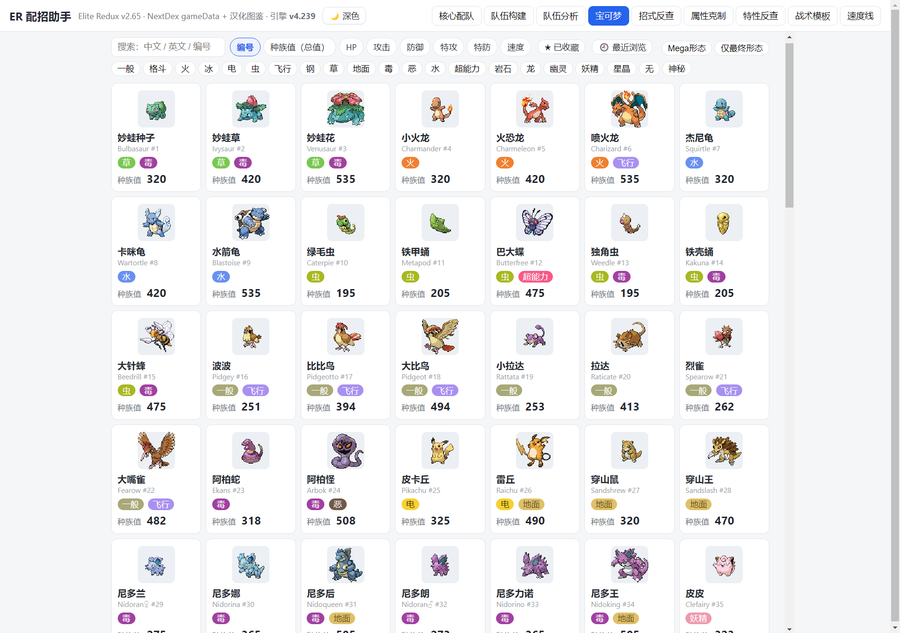

全图鉴检索页。找到一个物种后**点它 → 打开完整详情弹层**。

**检索与排序**

| 控件 | 说明 |
|---|---|
| 搜索框 | 中文 / 英文 / 编号 |
| 排序 | 编号 / 种族值(总值) / **HP / 攻击 / 防御 / 特攻 / 特防 / 速度**（单维排序，做配速时用速度） |
| ★ 已收藏 | 收藏过的排前面 |
| 🕘 最近浏览 | 最近看过的（右上角显示「最近：胡地」） |
| **Mega 形态优先**（v4.249 改名） | 剔除「族群里有 Mega、但自身不是 Mega」的普通形态 |
| 仅最终形态 | 只留进化链末端 |

**「Mega 形态优先」到底滤掉谁** —— 这是**反直觉的一格**，值得单独看。

ER 里可以永久 Mega，所以「喷火龙」和「超级喷火龙X」是两只独立的物种条目。这个开关的意思是：**既然这只迟早要 Mega，就别在普通列表里再摆一个「喷火龙」让你选** —— 开启后全库 1906 只里会去掉 247 只这类「有 Mega 但自己不是 Mega」的形态，剩 1659 只。

开 / 关对比（同一页、同一排序）：

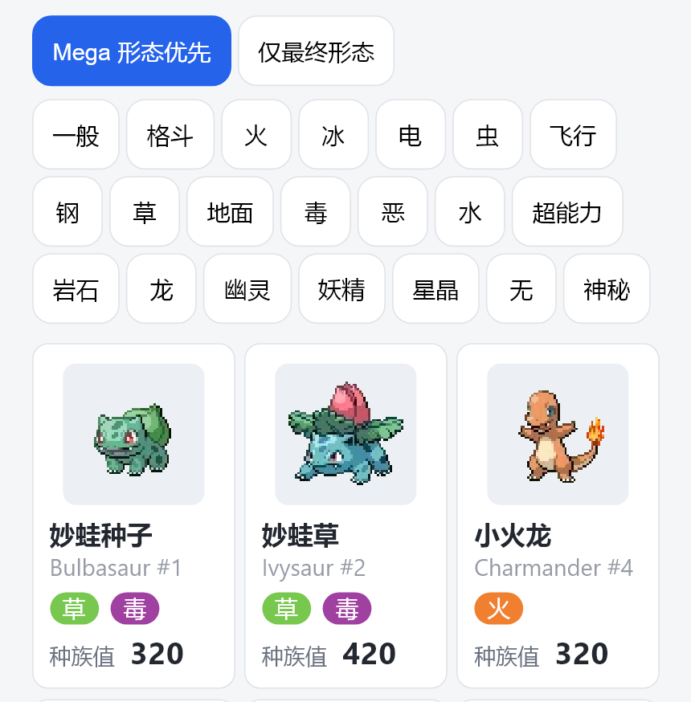

*开启：妙蛙种子 → 妙蛙草 → 小火龙。**妙蛙花 #3 消失了**（它有 Mega 形态）。*

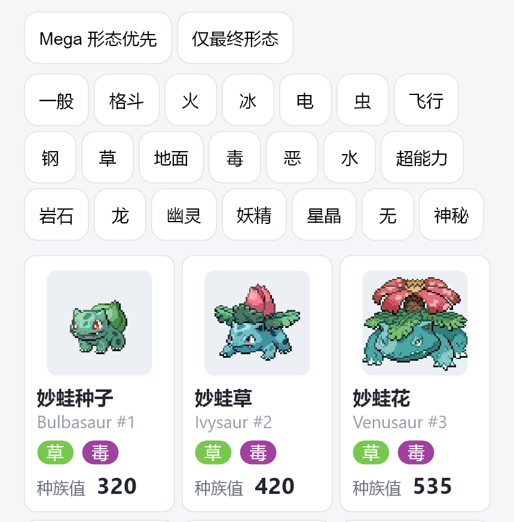

*关闭：妙蛙种子 → 妙蛙草 → **妙蛙花 #3 在**。*

实测口径（`spQuery`，1906 只）：

| 开关 | 结果 | 其中「可 Mega 的普通形态」 |
|---|---|---|
| 关 | 1906 只 | 247 只 |
| 开 | 1659 只 | **0 只** |

1906 − 247 = 1659，**一条不漏、一条不多**。

**ER 特色（v4.289，顶栏总开关）** —— 和上面那格不是一回事，别混。

「Mega 形态优先」是**在族群内部做取舍**（留 Mega 本体、藏起普通形态）；「ER 特色」是**跨全站的另一把筛子**：勾上以后只留 ER 这个改版真正新增的东西，其余一律不显示。它同时管六处列表：宝可梦（图鉴）、核心配队、队伍构建与分析的选择器、招式反查的「谁能学」、特性反查的「谁有」、速度线。

判定三条任一命中即算特色：

| 口径 | 例子 | 为什么算 |
|---|---|---|
| 中文名以 **超级 / 原始 / 究极** 开头，或含「原始回归 / 究极爆发」 | 超级喷火龙X、原始固拉多、究极奈克洛兹玛 | 所有 Mega 类形态，**原版 Mega 与 ER 自创 Mega 一视同仁** |
| 英文名含 **Redux** | Bulbasaur Redux、Mega Garchomp Redux | ER 重制的形态 |
| 中文名以 **R** 结尾 | 大钢蛇R（Carbonix）、盐石宝R（Blocli）、管侍熊（Bewarden Redux） | ER 原创宝可梦，官方图鉴里没有 |

勾上后全库 1906 只 → **451 只**，开关旁边直接写「· 451 只」。官方各世代的普通宝可梦、地区形态（阿罗拉 / 洗翠等）**不算**特色 —— 想看改版特有的东西就开，想按全图鉴配队就关。状态记在本机，下次打开还是上次的选择。

**注意它保的是「Mega 本体」，不是「所有 Mega 相关」。** 超级喷火龙X / Y 本身不是 `hasMegaForm`（它们自身就是 Mega 形态），不受影响 —— 想看 Mega 本体就开，想看普通形态就关。
| 18 类属性 chip | 含 星晶 / 无 / 神秘 |

### 6.2 详情弹层

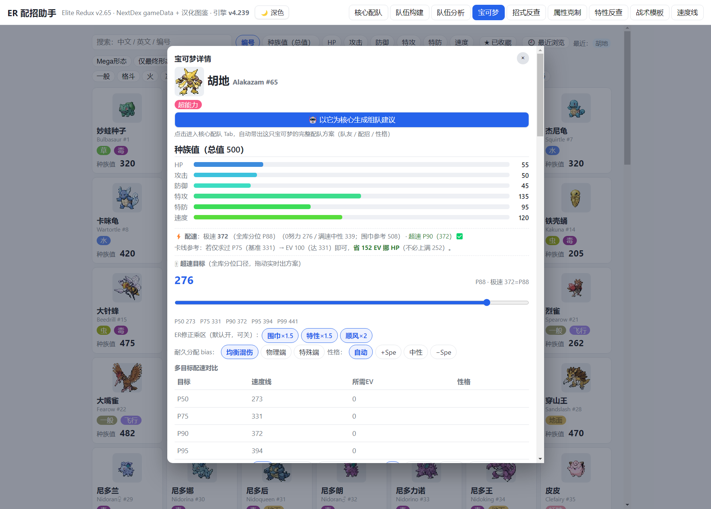

进入方式：**点卡片本体**。弹层最宽 520 px / 92% 屏宽，内部可滚动。

**第 1 屏：种族值 + 配速**

| 块 | 内容 |
|---|---|
| 头部 | 精灵图 + 中文名 + 英文名 + 编号（`胡地 Alakazam #65`）+ 属性标签 |
| 一键配队 | 蓝色按钮「🎯 以它为核心生成组队建议 → 点进入核心配队 Tab，自动带出这只宝可梦的完整配队方案（队友 / 配招 / 性格）」 |
| 种族值 | 六条横向条形图 + 数值（`HP 55 / 攻击 50 / 防御 45 / 特攻 135 / 特防 95 / 速度 120`，总值 500） |
| 速度滑块 | 紧接着就是目标速度滑块（见下），是配速的主要工具 |
| 配速口径速览 | 旧的极速/分位/卡线静态参考已折叠，默认收起，需要时点开即可 |

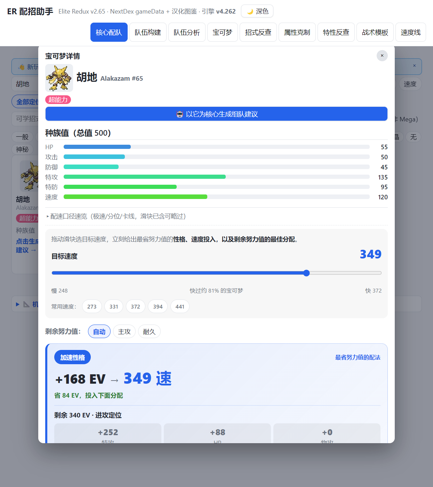

**第 2 屏：拖滑块，一张卡片直接给完整配法（v4.262 重排）**

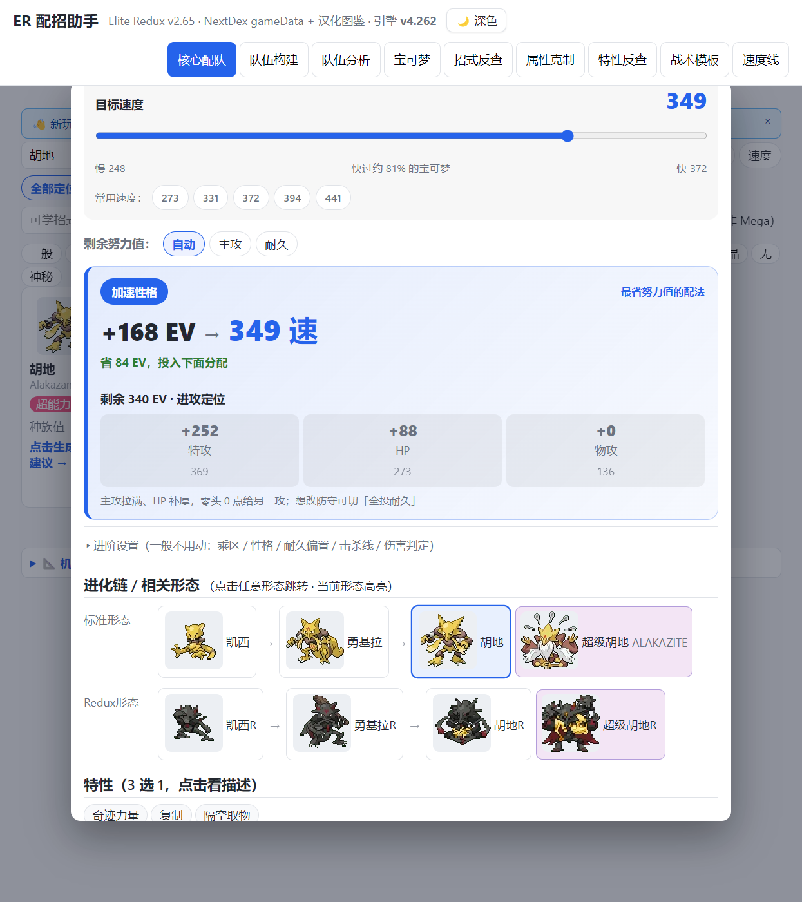

这一屏分上下两块，用法很简单：

1. **上面灰色框 = 你来选目标速度**。拖动滑块，右上角「目标速度」数字就变；滑块左下标「慢」、右下标「快」，中间写着「快过约百分之多少的宝可梦」，让你知道这个速度处在什么位置。下方一排「常用速度」数字，点一下直接跳过去。
2. **下面蓝色卡片 = 系统给的完整答案，照着抄即可**。卡片顶部用颜色标出性格（加速=蓝、中性=灰、减速=紫）；中间最大字号写着「投多少努力值 → 达到多少速度」；绿色字写「省下多少努力值」；分隔线下面是剩余努力值的三格分配，**进攻时是主攻 / HP / 另一攻，防守时是 HP / 防御 / 特防**。
   格子里**大字是投入多少 EV，下面小字是分配后的实际数值**。

**两个真实例子（胡地 #65）**

| 你拖到 | 卡片结论 | 意思 |
|---|---|---|
| 目标 349 | 加速性格 +168 EV → 349 速，省 84 EV，剩余 340 投特攻 | 卡上高速线，剩余主攻拉满、补 HP |
| 目标 276 | 中性性格 +0 EV → 276 速，省 252 EV | 0 努力就有这个速度，速度 EV 全省 |

> **滑块每一档都精确停在这只宝可梦真实能达到的速度上**，不会再出现「滑到的数字和实际对不上」；打开时已经帮你停在「投入不多、却能超过一大批宝可梦」的位置——速攻手停在高速线，耐久手只稍微提速，空间打手干脆不抢速度。你也可以自己再拖。

**剩下的 EV 投哪里，会先看这只宝可梦的定位：**

- 速攻手、空间打手这类进攻型：剩余 EV 先把主攻（物攻或特攻）投满，再尽量补厚 HP，最后若还有零头就给另一攻；每一项都不会超过 252。
- 盾、耐久型：剩余 EV 投 HP / 防御 / 特防。
- 想自己说了算？滑块下方有「自动 / 主攻 / 耐久」三个按钮，点「主攻」或「耐久」就按你的来，随时能切回自动。

**性格也会自动选最省的**：只走特攻或只走物攻的单攻手，会自动选「+速度」的性格，把它用不到的另一攻稍微降一点，就能少投很多速度努力值（比如妙蛙花从中性要 96 点降到加速只要 16 点）；两攻都要用的双刀和纯盾，则保持不修正的性格，免得降了关键能力。想自己定性格，进「进阶设置」手动选即可。


滑块的范围会**自动贴合这只宝可梦自己的速度**：最左是它最慢、0 努力时的实速，最右是极速；若在进阶设置里开了围巾 / 顺风乘区，最右会自动延伸到乘区后的速度。所以无论怎么拖，目标都在「能达到」的区间里，点「常用速度」若超出本只范围，也会自动停在最近的边界——不会再出现「追不上」的红色警告。切换乘区时，已选的目标速度会尽量保持不变。

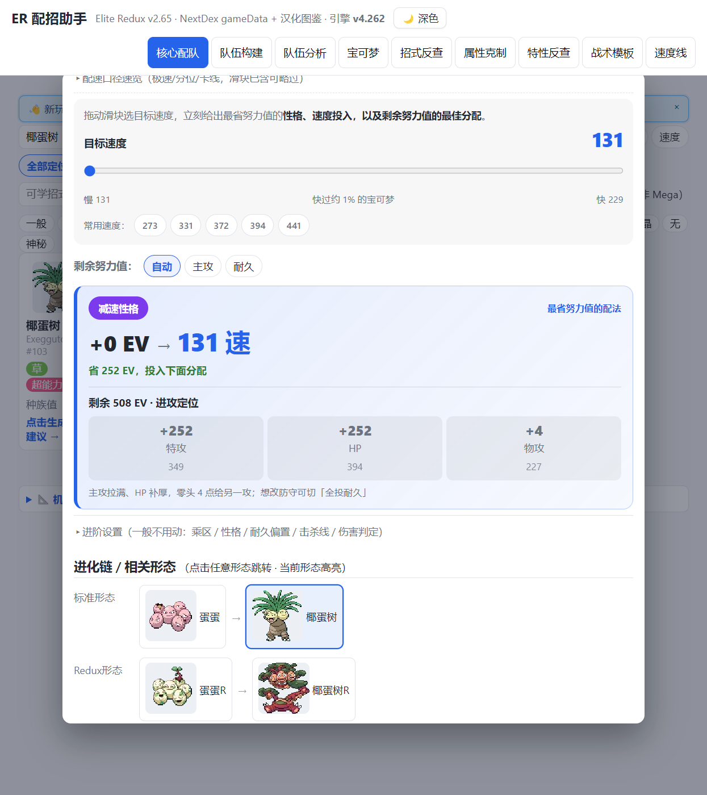

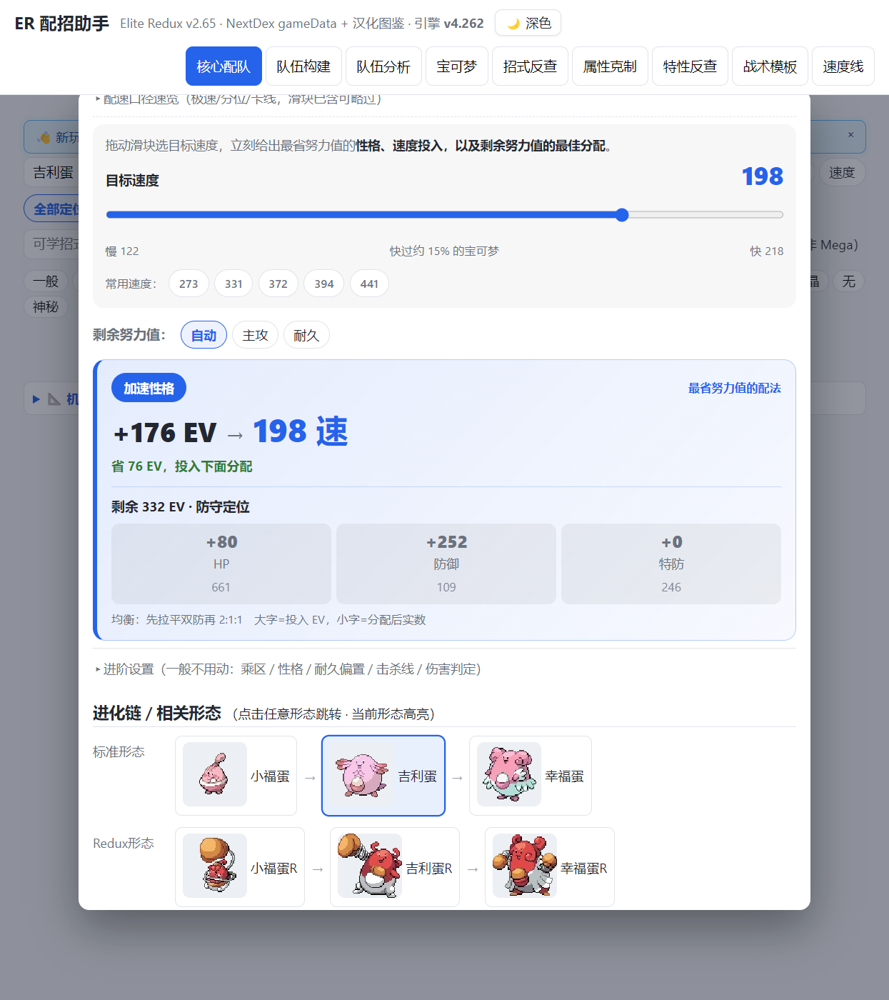

**进阶设置（默认收起）**

这一屏原来还堆着 30 多个 chip（乘区 / 性格 / 耐久偏置 / 击杀线 / HP 断点 / 完整伤害判定面板）。全展开时结论被挤到屏幕外，所以现在全部收进底部的「▸ 进阶设置」：

| 分组 | 什么时候用 |
|---|---|
| ER 修正乘区 | 你有围巾 / 有天气 / 有顺风时，勾上让它按 ×1.5 / ×2 重算 |
| 性格 | 想强制指定某个性格，不按自动建议 |
| 耐久偏置 | 防御高的走物理端、特防高的走特殊端，改变剩余 EV 的分法 |
| 击杀线 / HP 断点 | 需要「攻击刚好 OHKO」或「HP 卡剩饭整除」时 |
| 伤害判定 | 反查这一发打不打得死对手 |

**乘区默认是关的**。原来默认三项全开，等于假设你同时挂着围巾 + 天气特性 + 顺风（×4.5），于是「目标 372」会算成「+0 EV 就够、有效速度 1242」—— 这种结果没法用。现在默认按**裸速**算，勾哪项才加哪项。

乘区开了之后，下面会多一行说明**提速来自哪个特性、要什么条件**：

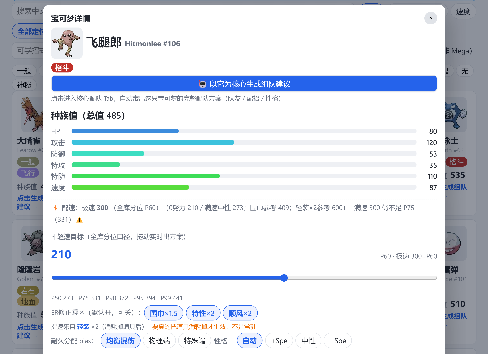

| 位置 | 例子 | 意思 |
|---|---|---|
| 乘区 chip 行 | `特性×2` | 这一项参与算速度，倍率 ×2 |
| 「提速来自 …」 | `轻装 ×2（消耗掉道具后）` | **哪个特性**在起作用 + **触发条件** |
| 橙色警示 | `要真的把道具消耗掉才生效，不是常驻` | 别把它当常驻 ×2 用 |

天气类速度特性**全部 ×1.5**（不是 ×2），只有轻装是 ×2。减速度特性显示成「减速来自 …」；这只没有速度特性时整行不出现。

**耐久分配 bias**：`均衡混伤` / `物理端` / `特殊端` / `性格: 自动 / +Spe / 中性 / -Spe`

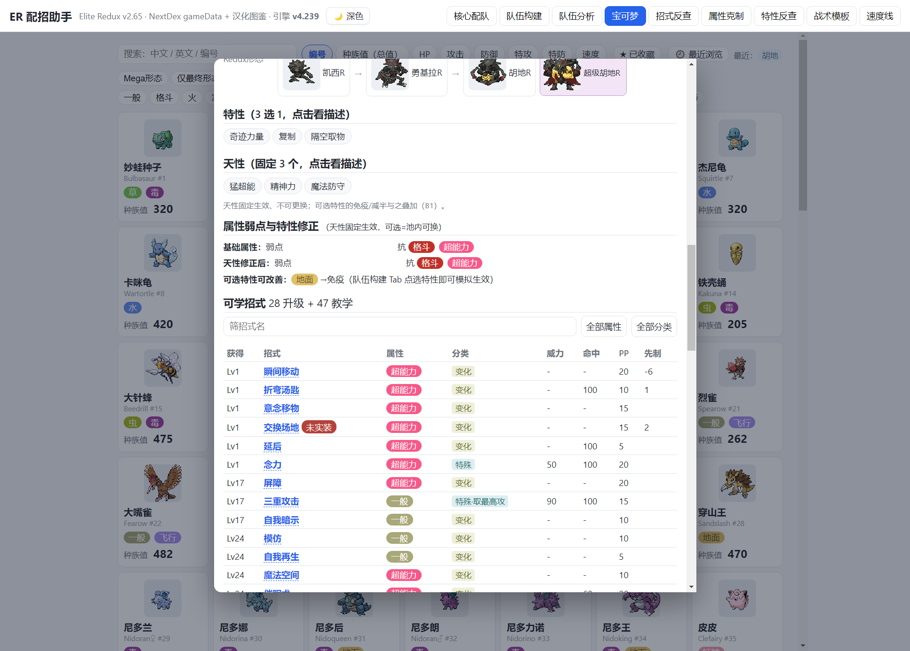

**第 3 屏：多目标配速对比**

表列 `目标 / 速度线 / 所需EV / 性格`，逐行给 `P50 273 → EV 0`、`P75 331 → EV 0`、`P90 372 → EV 0`、`P95 394 → EV 0`… 

读法：**左边是「你想超过谁」，右边是「为了超过它，速度要投多少 EV、性格怎么选」。** 这是配速最实用的一块——把「抽象的努力值」变成「具体超过哪条线」。

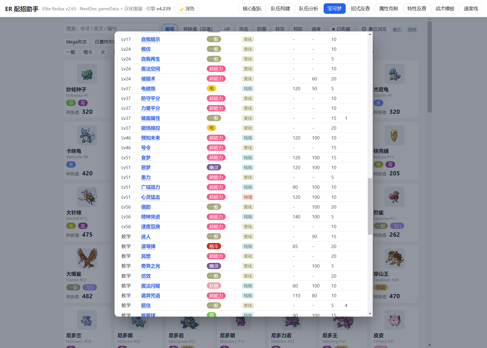

**第 4 屏：特性、天性、进化链**

- **特性（3 选 1）**：三个 chip，可点，点了立刻展开源码级效果说明
- **天性（固定 3 个·全部拥有）**：三个 chip，只读，点开也展开说明
- **进化链**：这条物种从哪来、能进化到哪

### 6.3 特性说明卡长什么样

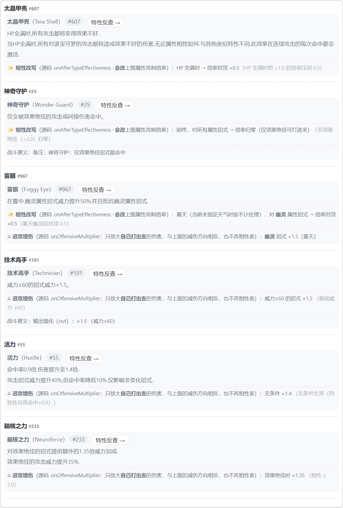

这是本工具最核心的信息密度体现。每张卡的结构：

```
【特性名（英文）· 图鉴编号】 [特性反查 →]
数据层官方描述（可能很笼统）
数据层补充描述（lDesc / abiTags.nt）
✨ 相性改写（源码 .onAfterTypeEffectiveness·会改属性克制表）：<真实判定>
   —— 或 ——
⚔ 进攻增伤（源码 .onOffensiveMultiplier；只放大自己打出去的伤害，与上面的减伤方向相反，也不改相性表）：<真实判定>
战斗意义：<一句话结论>
```

**四个必须对照读的例子**

| 特性 | 数据层文案 | 源码真实判定 | 差在哪 |
|---|---|---|---|
| **太晶甲壳** #607 | 「HP全满时，所有攻击都将变得效果不好」 | HP 全满 → **倍率封顶 ×0.5**（把 ≥1.0 的倍率都压到 0.5） | 文案说「效果不好」，但没说清是「封顶 0.5」还是「×0.5」——是**封顶**，原本 ×0.25 的不会被抬到 0.5 |
| **神奇守护** #25 | 「仅会被效果绝佳的招式或间接伤害命中」 | 始终对所有属性相性 → **倍率归零**（仅效果绝佳可打进） | 文案像描述，源码是「归零」这个硬动作 |
| **雾眼** #967 | 「在雾中，幽灵属性招式威力提升50%，并且抵抗幽灵属性招式」 | 两条方向相反的判定：`onAfterTypeEffectiveness` 对幽灵招式倍率封顶 ×0.5（守方）；`onOffensiveMultiplier` 幽灵招式 ×1.5（攻方，雾天） | **一个特性同时改两个方向**，只写一条就漏一半 |
| **技术高手** #101 | 「威力≤60的招式威力×1.5」 | `onOffensiveMultiplier`，基础威力 ≤ 60 → ×1.5 | 关键词是**基础威力**，不是算完 STAB 之后的威力 |

---

## 7. 招式反查

### 7.1 怎么用

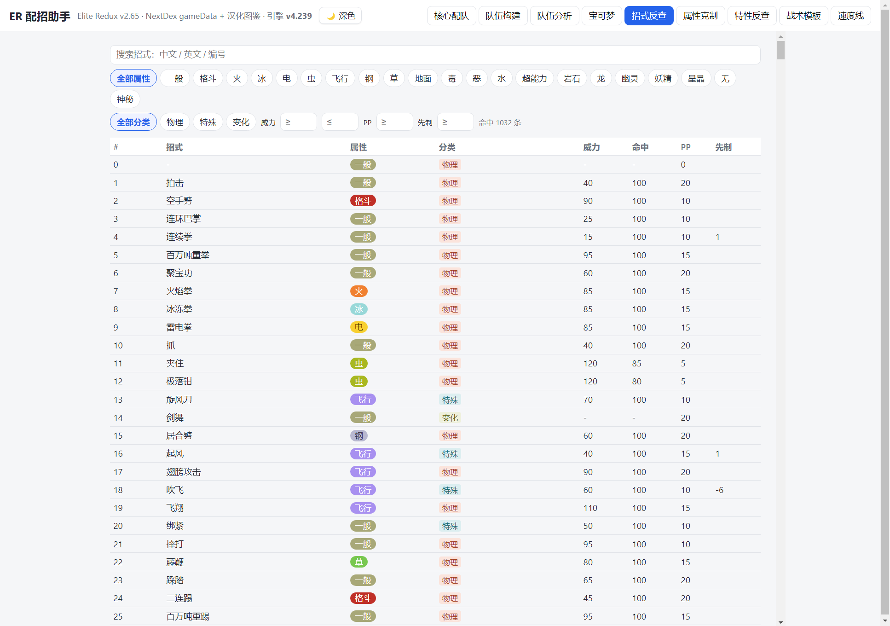

整页是一张全招式表，列：`# / 招式 / 属性 / 分类 / 威力 / 命中 / PP / 先制`。

**点任意一行 = 打开招式详情。**

### 7.2 招式详情弹层

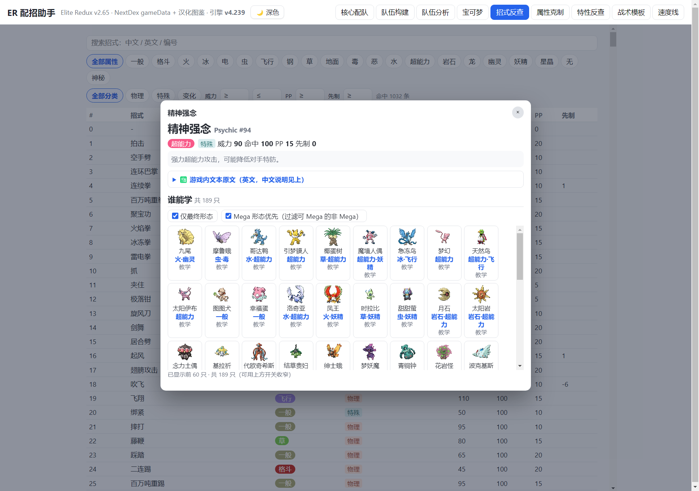

内容：

| 块 | 内容 |
|---|---|
| 头部 | 中文名 + 英文名 + 编号（`精神强念 Psychic #94`）+ 属性标签 + 分类 + 数值行 `超能力 特殊 威力 90 命中 100 PP 15 先制 0` |
| 中文说明 | `强力超能力攻击，可能降低对手特防。` |
| 游戏内原文 | `🈯 游戏内文本原文（英文，中文说明见上）` |
| **谁能学（共 189 只）** | 分列展示：精灵图 + 名字 + 属性标签 + `教学` / `遗传` 等来源 |
| 两个过滤开关 | `仅最终形态` / `Mega 形态优先（过滤可 Mega 的非 Mega）` |

**分类字段是 7 值枚举**，包括 `物理` / `特殊` / `变化` / **`特殊(取防御)`** 等。`特殊(取防御)` 这类是 ER 特色：按特殊分类但吃对方**物防**，伤害判定里必须按 `[4]` 分类字段走，不能只看「特殊」两个字。

---

## 8. 属性克制

### 8.1 怎么用

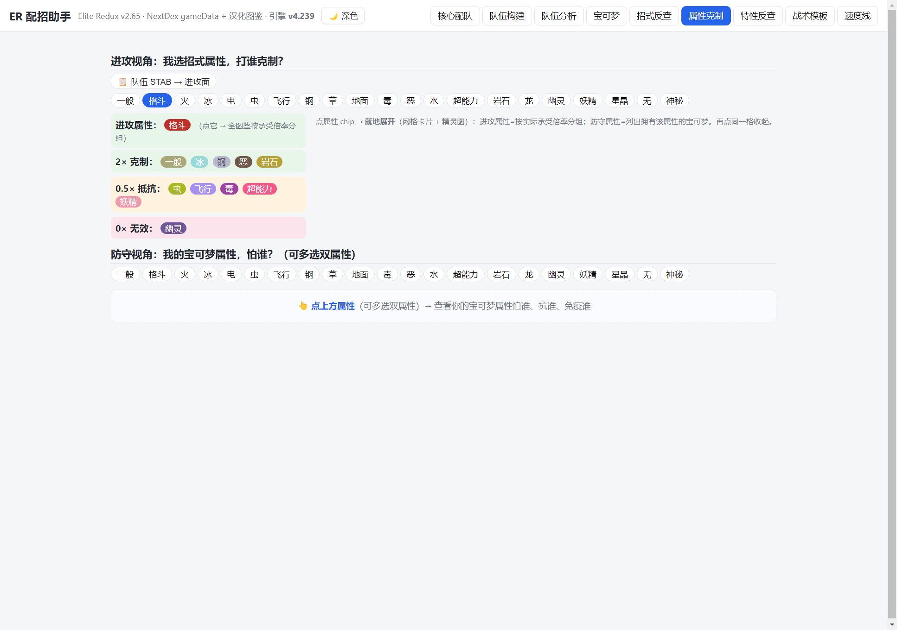

这一页有**两个互不干扰的视角**，各自一排属性 chip：

- **进攻视角：我选招式属性，打谁克制？** —— 选一个属性，看它能打出什么
- **防守视角：我的宝可梦属性，怕谁？（可多选双属性）** —— 选一到两个属性，看它怕什么

**进攻视角**

点一个属性 chip（例如 `格斗`），下方就地展开四组：

```
进攻属性：格斗（点它 → 全图鉴按承受倍率分组）
2× 克制：  一般 冰 钢 恶 岩石
0.5× 抵抗：虫 飞行 毒 超能力 妖精
0× 无效：  幽灵
```

同时展开**全图鉴卡片**：把这个倍率分组对应的所有宝可梦列出来。**再点同一格收起。**

**防守视角**

点一个或两个属性 chip（双属性可多选），看：

- 弱什么（会被 ×2 / ×4）
- 抗什么
- 免疫什么

**一键入口**：`📋 队伍 STAB → 进攻面` —— 把当前队伍 6 只的本系招式属性全部喂给进攻视角，一次看全队能打出什么。这是「组完队想知道覆盖够不够」的最快路径。

**18 类属性 chip**：`一般 格斗 火 水 电 草 冰 毒 地面 飞行 超能力 虫 岩石 幽灵 龙 恶 钢 妖精` + ER 特有的 `星晶 / 无 / 神秘`。

### 8.2 这张表被特性改写了什么（重点）

**属性克制不是固定表。** 一批特性会直接改写倍率，所以工具里的克制度是「**基础表 + 特性修正**」两段算出来的。当前改写的三类：

**① 归零（免疫化）** —— 把某个属性对自己的倍率直接压到 0

| 特性 | 效果 | 源码入口 |
|---|---|---|
| 飘浮 | 地面 → 0 | `onAfterTypeEffectiveness` |
| 引水 / 蓄电 / 避雷针 / 引火 | 对应属性 → 0 | `onAfterTypeEffectiveness` |
| **神奇守护** #25 | **所有属性 → 归零，仅效果绝佳（≥2.0）能打进** | `onAfterTypeEffectiveness` |

**② 封顶（减伤化）** —— 不是 ×0.5，是**把超过 0.5 的倍率压到 0.5**

| 特性 | 效果 | 关键差别 |
|---|---|---|
| **太晶甲壳** #607 | HP 全满 → 所有倍率封顶 ×0.5 | 原本 ×0.25 的**不会**被抬到 0.5，仍是 0.25 |
| **雾眼** #967 | 雾天，对「幽灵」属性招式 → 封顶 ×0.5 | 只对幽灵招式，不是全部 |

**③ 改向（反转为正常/克制）**

| 特性 | 效果 |
|---|---|
| **胆量** #1003 | 格斗/一般 打 幽灵 从 **0 倍 → 1.0 倍** |
| **腐蚀** #954 | 毒 打 钢 从 抵抗 → **效果绝佳 2.0 倍** |

**这三类在 UI 上的表现**：防守剖面格值写成 `基础→修正`（如 `2→0.5`），能用一眼看出「这只本来怕，但特性把它压住了」。

**为什么必须这么做**：用户的原话是「**比如配招的时候就要考虑到自己特性可能会导致电反而克制地面系而不是免疫**」。固定表回答不了这个问题，只有把特性接进倍率链才能回答。

---

## 9. 特性反查

### 9.1 怎么用

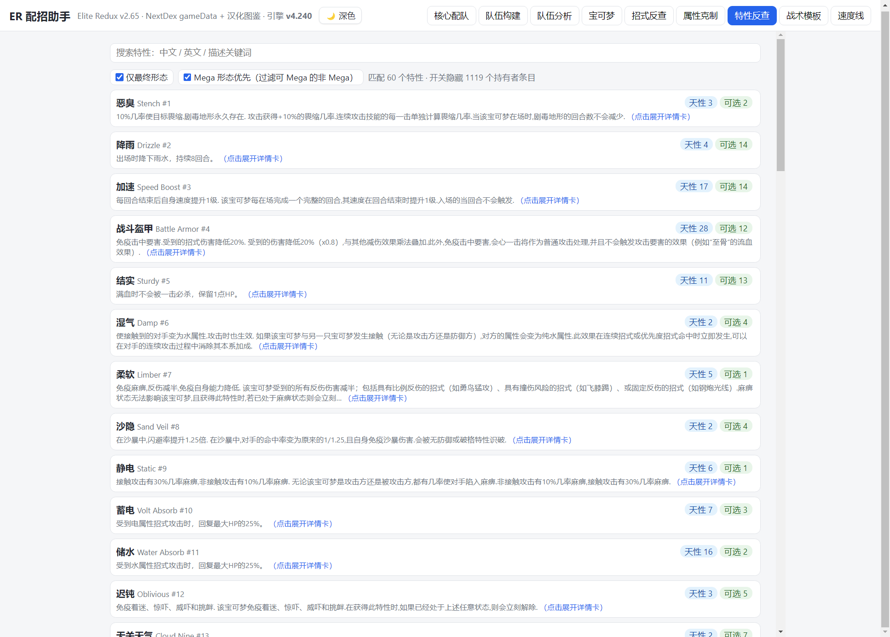

整页是**按特性组织的卡片流**，每张卡三块：

| 块 | 内容 |
|---|---|
| 中文描述 | 数据层官方文案（可能很笼统） |
| **特性效果（战斗意义）** | 源码判出来的真实作用，一句话 |
| **持有者（分两列）** | 左「可选池」= 三选一里能选的；右「天性固定」= 天生就有 |

**「分两列」这件事很关键**：同一只宝可梦可能「可选池里有 A、B、C」但「天性是 X、Y、Z」。查「这只有没有这个特性」时，两列要分开看——可选池里有意味着**你可以主动选**，天性有意味着**它默认就有且不能换**。

### 9.2 特性卡成品

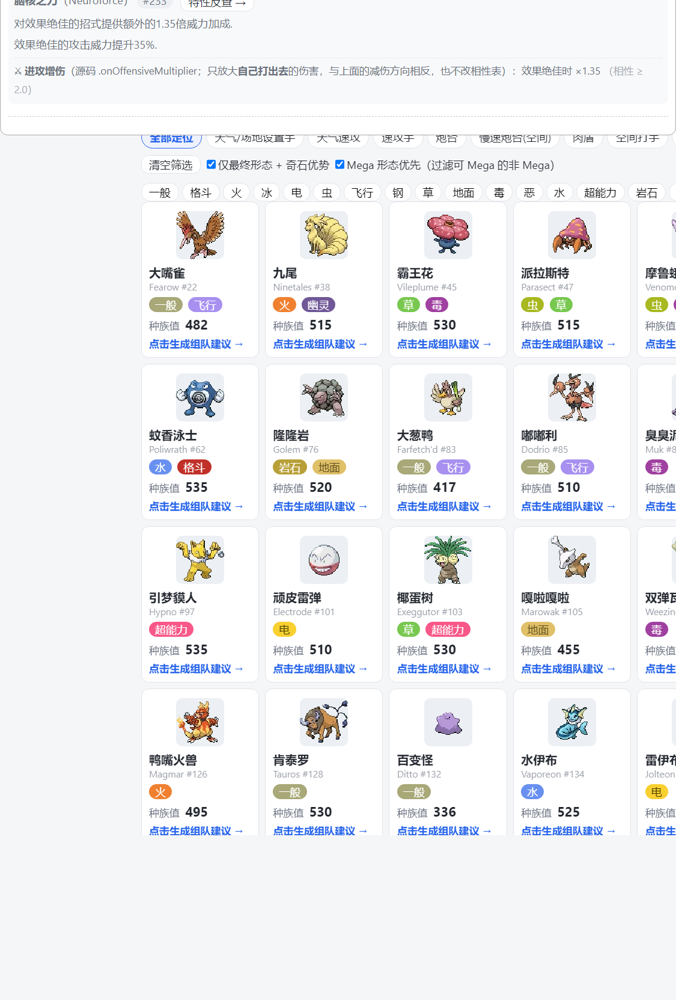

每张卡的完整形态：

```
太晶甲壳（Tera Shell） #607   [特性反查 →]
HP全满时,所有攻击都将变得效果不好.
当HP全满时,所有对该宝可梦的攻击都将造成效果不好的伤害,无论属性相性如何.
与其他类似特性不同,此效果在连续攻击的每次命中都会激活.
✨ 相性改写（源码 .onAfterTypeEffectiveness·会改属性克制表）：HP 全满时 → 倍率封顶 ×0.5
   （HP 全满时把 ≥1.0 的倍率压到 0.5）
```

注意最后那行括号里的补充——**它写明了「压到 0.5」这个方向**，这是文案里没有的信息。

### 9.3 看到「本作无人拥有」的红标是什么意思


有些特性的标题行旁会挂一个红色小标「本作无人拥有」，标题上的「可选 0 / 天性 0」也都是零。

**这不是数据出错，是有意告诉你的**：这个特性在源码里有完整实现，但本作没有把它分配给任何一只宝可梦。它的官方描述、计算倍率都能照常看，只是你在配队、属性克制、速度线、伤害面板里都找不到任何使用者。

遇到这种卡，就说明它是「有实现、没投放」。本作这样的特性共 **35 条**，例如回声定位、等离子灯、守护者外套、龙之威仪、慢启动。

每个特性下面都会给出**有几只宝可梦拥有它**，数字是实际统计出来的，不是估的。

---

## 10. 战术模板

### 10.1 怎么用

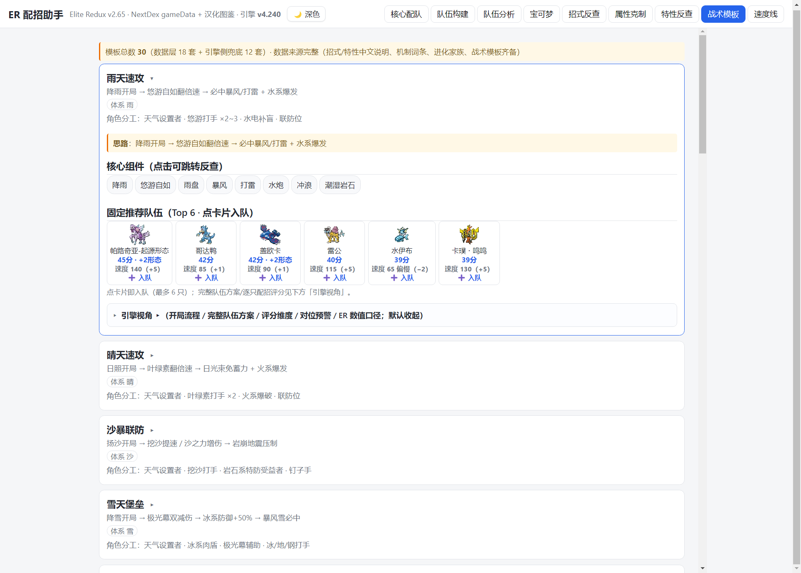

**24 套现成体系**，每套一个 h3 标题 + 「查看机制数值」展开。

| # | 模板 | # | 模板 |
|---|---|---|---|
| 1 | 雨天速攻 | 13 | 强化接力 |
| 2 | 晴天速攻 | 14 | 天气双核 |
| 3 | 沙暴联防 | 15 | 场地控制 |
| 4 | 雪天堡垒 | 16 | 吸血站场 |
| 5 | 电气场地速攻 | 17 | 双天气轮换 |
| 6 | 精神场地特攻 | 18 | 雨天必中炮台 |
| 7 | 青草场地回复 | 19 | 威吓折返轮转轴 |
| 8 | 薄雾场地龙盾 | 20 | 沙暴特防轴 |
| 9 | 强化清场轴 | 21 | 雪天极光幕受核 |
| 10 | 顺风游击 | 22 | 腐蚀受队闭环 |
| 11 | 戏法空间 | 23 | 场地延展器爆发轴 |
| 12 | 钉子受队 | 24 | 毒钉受队 |

**用法**：点模板标题 → 展开机制数值（哪些特性/招式/道具在起作用、倍率多少）→ 照着组队。

---

## 11. 速度线

### 11.1 怎么用

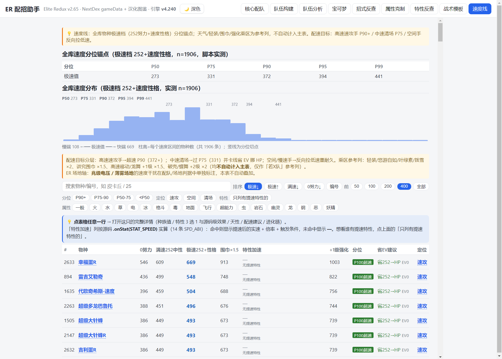

**这一页回答「我这只够不够快、要投多少努力值」。**

### 11.2 分位锚点与直方图

顶部是**全库速度分布**：`n = 1906`，24 个桶从慢端 108 到极值端 669。

**分位锚点**（这套数贯穿全工具，别处也引用它）：

| 分位 | 速度 |
|---|---|
| P50 | **273** |
| P75 | **331** |
| P90 | **372** |
| P95 | **394** |
| P99 | **441** |

直方图每根柱子可点，「选中区间高亮」，用来回答「我这只落在哪个档」。

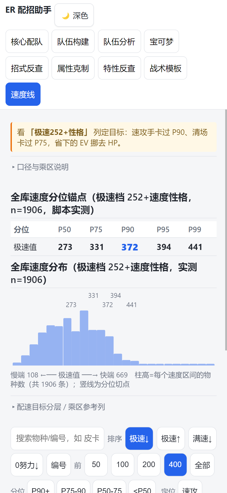

直方图上方的分位刻度会**分两行错开**：`P75 / P95` 抬到上一行，`P50 / P90 / P99` 留在下一行。因为 P90（372）与 P95（394）只差 22 点，在手机宽度里硬排一行一定会挤成「37294」。分位锚点表里 **P90 用蓝色大号字单独标出**——那是速攻手最常用的目标线，扫一眼就能认出来。

> **怎么一眼抓住重点**：本工具每个区域都遵守「**大字 = 结论，灰小字 = 补充**」。速度线页顶部只留一句话告诉你「该看哪一列」，完整口径收进「口径与乘区说明」，需要时再展开——不必先读完一屏解释才见到数据。

### 11.2.1 我的队伍 · 速度现状（v4.266）

分位锚点正下方多了一条**你队伍自己的速度刻度**，回答「我这 6 只到底够不够快」：

- 每只一行：**大字实速** + 分位 + 结论标签（`超 P90` 绿 / `过 P75 清场` 黄 / `中速` / `慢速`）。
- 口径标记：带 **`配速`** 橙标 = 你在核心配队第 6 段采用的实速；标 **`极速`** 灰字 = 还没采用，按 252 努力 + 速度性格的理论上限。两种口径并排写在行里，不会混算。
- 最下面一句话按**全队最快**给结论：高于 P75 → 「已有清场级先手」并给差值；低于 P75 → 用告警色提示「控速 / 戏法空间 / 讲究围巾先想一遍」。
- **点任意一行** → 打开这只的详情（种族值 / 特性 / 配速建议），可直接在核心配队里调速度。

> 采用更慢的配速后，这只落到锚点下方是**正常结果**（省钱换耐久），工具不会判你「退步」，只告诉你差多少、可以用什么手段补先手。

### 11.3 排序与筛选

| 控件 | 选项 |
|---|---|
| 排序 | 极速↓ / 极速↑ / 满速↓ / 0努力↓ / 编号 |
| 前 N | 50 / 100 / 200 / 400 / 全部 |
| 分位 | P90+ / P75-90 / P50-75 / < P50 |
| 定位 | 速攻 / 空间 / 清场 |
| 特性 | **只列有提速特性的** |
| 属性 | 18 类 |

### 11.4 表格 11 列怎么读

| 列 | 含义 |
|---|---|
| `#` | 编号 |
| 物种 | 名字（点名字开详情弹层） |
| `0努力` | 不投速度 EV 的速度 |
| `满速252中性` | 252 EV、中性性格 |
| `极速252+性格` | 252 EV、加速性格（**最常用的一条线**） |
| `围巾×1.5` | 带讲究围巾 |
| **`特性加速`** | **特性倍率实算 + 触发条件**（如 `854 轻装 ×2（消耗掉道具后）`） |
| `+1级强化` | 吃一次速度强化后 |
| 分位 | `P98超速` 这类标签 |
| `省EV建议` | 如 `省252→HP EV0`——为了过某条线，速度只需投很少，剩下的挪去 HP |
| 定位 | 速攻 / 空间 / 清场 |

### 11.5 「只列有提速特性的」（v4.239 新增）

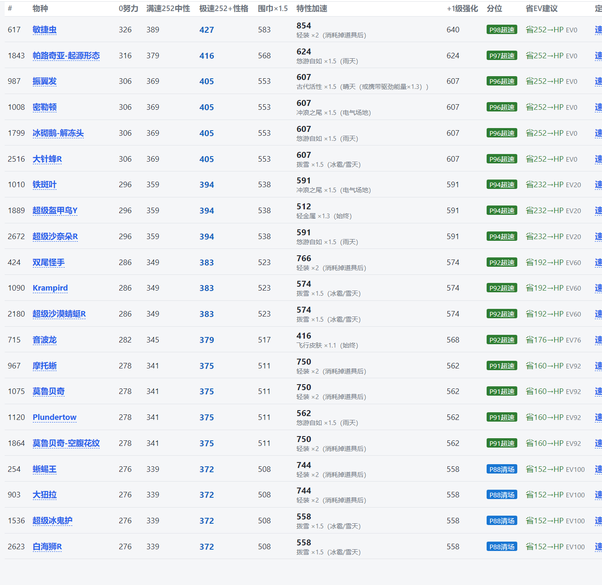

勾上后剩 **293 只**，并在「特性加速」列直接写出**倍率 + 触发条件**。

> **手机端注意**：不勾这个筛选时，「特性加速」列在窄屏会被收起（表格 11 列挤手机屏太窄）。勾上之后这一列会**自动展开**——因为你要看的就是它。桌面端始终显示。

| 例子 | 数值 | 特性 | 条件 |
|---|---|---|---|
| 敏捷虫 | 854 | 轻装 ×2 | 消耗掉道具后 |
| 帕路奇亚-起源形态 | 624 | 悠游自如 ×1.5 | 雨天 |
| 振翼发 | 607 | 古代活性 ×1.5 | 晴天（或携带驱劲能量×1.3） |
| 密勒顿 | 607 | 冲浪之尾 ×1.5 | 电气场地 |
| 大针蜂R | 607 | 拨雪 ×1.5 | 冰雹/雪天 |
| 铁斑叶 | 591 | 冲浪之尾 ×1.5 | 电气场地 |
| 超级盔甲鸟Y | 512 | 轻金属 ×1.3 | 始终 |
| 音波龙 | 416 | **飞行皮肤 ×1.1** | 始终 |
| 超级伦琴猫R-B | 612 | 丛林热 ×1.5 | 青草场地 |
| 超级帝王拿波R | 595 | 热滑 ×1.5 | 晴天或雪天（二者其一） |
| Rexcadrill | 136 | 厚脂 ×0.5 | 始终（减速） |

**这张表的真正价值**：把「特性 ×**1.5**」这个抽象倍率变成 **「在什么条件下、我的实际速度是多少」**。你看到「振翼发 607」就知道它晴天时比你 372 的极速快得多，必须另想办法。

**天气类速度特性全部 ×1.5，不是 ×2。** 只有轻装是 ×2。这条判错过（曾按 ×2 算，全部数值偏高），已修正。

### 11.6 页面提示条（v4.239）

表格上方有一条醒目的提示：

> 💡 点表格任意一行 → 打开这只的完整详情（种族值 / 特性 3 选 1 与源码级效果 / 天性 / 配速建议 / 进化链）
> 「特性加速」列按源码逐条实算（共 17 条速度特性）

**这条提示是补用户体验缺陷的**：用户两次说「这个就只能看吗，详细信息完全看不到」——功能本身是好的（点行确实会弹出完整详情），但**没有任何视觉提示说这行能点**。修法就是加这条蓝底提示 + 把「特性×2」表头改成「特性加速」并把「—」换成小字「无提速特性」。

---

---

## 日光束 / 日光刃：开了晴天才算数（v4.396）

- 这两招只有在**场上是晴天**、或这只宝可梦带 **chloroplast 类特性（叶绿体 / 耀斑 / 巨大树叶）** 时才免蓄力；否则要先蓄力一回合才打得出来。
- 沙暴、雨天、冰雹、雾天下威力还会 **×0.5**（带 chloroplast 特性同样免疫这个减半）。
- 所以本工具不再给「既开不出晴天、也没有这类特性」的卡配这两招，会自动换成属性不重复、招式不重复的功能或进攻招 —— 常见落点是 **113 光墙 / 414 大地之力 / 229 高速旋转 / 113 光墙 / 802 火焰舌**。
- 实测例子：`154 大竺葵[0] 扑击物防流` 的日光刃换成了嬉闹、`[3] 双墙辅助流` 换成了光墙（真正凑成双墙）、`324 煤炭龟[2]` 的日光束换成高速旋转、`331 刺球仙人掌[3] 沙增伤清场` 换成觉醒力量。
- 保留的卡都有理由：带 chloroplast 特性（`3 妙蛙花` 叶绿体、`1501 超级妙蛙花Y` 巨大树叶）、自己就能开晴天、或是机制核心点名的正好就是这两招。


## 全中文界面（v4.402）

从 v4.402 起，玩家在界面上能看到的内容已全部中文化，点任何招式、道具、特性都能读到中文说明。

- **招式详情弹窗**：点答案卡四招里的任意一招，弹窗里的「描述」是中文。例如 #1503 超级喷火龙Y 的羽栖，描述为「落地休息，回复最大HP的一半。」
- **图鉴与卡片**：原本核心名是英文的 35 个原创物种都有了中文名（如 1084 先知獴、1086 刺杰克、2667 风暴翼、2900 石板怪），8 个英文招式也已命名（如 1011 棱光爆破、1007 天震、1026 原子烈焰）。
- **道具与特性**：卡片上的对战道具描述（生命宝珠、气势披带、剩饭等）和组合特性（光滑鳞片、岩石铠甲、黏菌）全部中文。

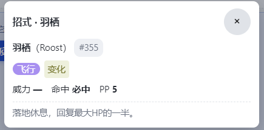

说明：弹窗标题里保留了英文对照（如 `羽栖 (Roost) #355`），方便查外文资料；描述里的「HP」是通用缩写。主信息一律以中文呈现。

## 想深入看

| 文档 | 内容 |
|---|---|
| [**内部口径与排查手册**](../dev/排查与内部口径.md) | 每个功能背后的实现、源码判定口径、按现象定位的排查总表、覆盖率台账、门禁与部署、历史踩坑 |
| [**AGENTS.md**](../../AGENTS.md) | 开发者唯一入口：架构、版本记录、每版的实现与验证结论 |
| [**README**](../../README.md) | 对外介绍：这是个什么工具、能解决什么问题 |
| [**版本历史**](../changelog/VERSIONS.md) | v4.3 至今的完整改动记录 |

---

*本工具为玩家辅助工具，非官方产品。Pokémon 及相关商标归 Game Freak / The Pokémon Company 所有。*

### 形态开关会告诉你「隐藏了多少」

「Mega 形态优先」和「仅最终形态」这两个开关，开启后下方会直接出现一行回执：

```
筛选已生效　已隐藏 247 只「有 Mega 但本身不是 Mega」的普通形态（如喷火龙、超梦只剩超级形态）
　　　　　　已隐藏 653 只非最终形态（1253 / 1906 可见）
```

- **「Mega 形态优先」到底筛掉谁**：筛掉的是「族群里有 Mega、但自己不是 Mega」的普通形态 —— 喷火龙、妙蛙花、超梦、水箭龟都在内。留着的是它们的超级形态。
- **搜名字时不受影响**：搜索词非空时这两个开关会临时放开，所以你搜「喷火龙」仍然能搜到普通形态。清空搜索就恢复过滤。
- 开关关掉时这行不显示，不占版面。

### 第 4 格为什么不再出现「瞪眼」

有些辅助卡以前第 4 格写的是 **瞪眼** 或 **摇尾巴**。这两招威力是 0，只降对手一项数值，却占了整整一格。

现在引擎会先看这个物种**能不能学到更有用的招**，能的话优先用：

| 原来 | 现在 | 这招干什么 |
|---|---|---|
| 瞪眼 / 摇尾巴 | **磷火** | 让对手烧伤，物理攻击减半 |
| 瞪眼 / 摇尾巴 | **芳香治疗** | 解除全队异常状态 |
| 瞪眼 / 摇尾巴 | **挑衅** | 三回合内封掉对手的变化招 |

只有在这个物种确实学不到更有用的招时，才会保留原本的变化招。


