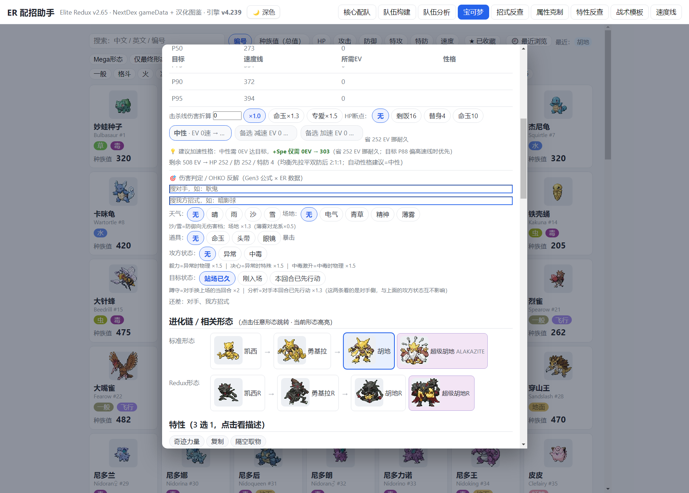

# Elite Redux 配招助手 · 功能清单与使用手册

> **一份文档，两种读法**
> - **玩家视角**：每个 Tab 能干什么、怎么点、看到的东西是什么意思。看每节的「▸ 怎么用」与截图。
> - **开发者视角**：这块功能背后吃什么数据、由哪个函数渲染、哪张源码判定表在管、坏了怎么查。看每节的「▸ 内部实现」「▸ 排查清单」与第 13 章的排查总表。
>
> 引擎版本 **v4.240**｜数据源 Elite Redux v2.65 · NextDex · gameData 全量＋汉化图鉴
> 线上地址 `https://wsjshy.github.io/elite-redux-teambuilder/`
> 截图采集：本机 Chrome CDP，视口 1560×1200，`--force-device-scale-factor=1.25`，采集于 v4.239→v4.240 迭代期间，个别图角标仍显示 v4.239，功能一致。

---

## 目录

| 章节 | 内容 | 面向 |
|---|---|---|
| [0](#0-这份文档怎么用) | 这份文档怎么用 | 全部 |
| [1](#1-全局框架九个-tab-一张顶栏) | 全局框架：九个 Tab、一张顶栏 | 全部 |
| [2](#2-数据层与源码为准原则) | 数据层与「源码为准」原则 | 开发者 |
| [3](#3-核心配队-core) | 核心配队 | 全部 |
| [4](#4-队伍构建-team) | 队伍构建 | 全部 |
| [5](#5-队伍分析-analyze) | 队伍分析 | 全部 |
| [6](#6-宝可梦-poke) | 宝可梦 | 全部 |
| [7](#7-招式反查-move) | 招式反查 | 全部 |
| [8](#8-属性克制-type) | 属性克制 | 全部 |
| [9](#9-特性反查-abi) | 特性反查 | 全部 |
| [10](#10-战术模板-tpl) | 战术模板 | 全部 |
| [11](#11-速度线-speed) | 速度线 | 全部 |
| [12](#12-特性招式通用机制覆盖台账) | 特性/招式/通用机制 覆盖台账 | 开发者 |
| [13](#13-开发排查清单总表) | 开发排查清单总表 | 开发者 |
| [14](#14-门禁与部署流程) | 门禁与部署流程 | 开发者 |
| [15](#15-已知限制与踩坑记录) | 已知限制与踩坑记录 | 开发者 |

---

## 0. 这份文档怎么用

### 0.1 玩家怎么读

从第 1 章建立整体方位感（九个 Tab 各管一件事），然后按你当前要做的事直接跳：

| 你想做的事 | 去哪节 |
|---|---|
| 「我抽到一只宝可梦，配什么队、走什么路线」 | §3 核心配队 |
| 「把 6 只拼成一队，看还缺什么」 | §4 队伍构建 |
| 「这队到底强在哪、怕什么、能不能一击必杀」 | §5 队伍分析 |
| 「查这只的种族值 / 配速 / 进化 / 特性三选一」 | §6 宝可梦 |
| 「这个招式谁能学、什么属性、威力多少」 | §7 招式反查 |
| 「我打它到底几倍？它打我几倍？」 | §8 属性克制 |
| 「这个特性到底干什么（源码级）」 | §9 特性反查 |
| 「有没有现成打法模板」 | §10 战术模板 |
| 「我这只速度够不够快、要投多少努力值」 | §11 速度线 |

### 0.2 开发者怎么读

每节固定四段结构：

```
▸ 怎么用        —— 玩家操作路径
▸ 内部实现      —— 容器 id / 渲染函数 / 关键 API
▸ 源码判定      —— 这块吃哪张表、哪条源码结论
▸ 排查清单      —— 坏了先查什么
```

遇到「某处显示不对」时，走 §13 的排查总表：按 **现象 → 先查哪个函数 → 再查哪张表** 三列定位。

### 0.3 三条贯穿全文档的原则

1. **以源码为准，不以数据层文案为准。** 数据层的 `abiDescZh` / `lDesc` 是「官方文案」，很多是笼统的（例如「改变所有技能」），但工具里显示与参与计算的是从 `src/abilities.cc` / `src/battle_moves` 读出来的真实判定。文案与判定不一致时，判定优先，并在 UI 上并列展示两者。
2. **特性一旦判出来，必须进所有消费点。** 属性克制表、打击面、六队分析、伤害判定、补队推荐、速度线，六处都要拿到同一份数值，不能只有一处生效。
3. **算不出来就不要假装算得出。** 依赖对手状态、回合计数、场上他人 volatile 的特性，静态不可解，宁可在 UI 明写「当前未接入 + 原因」，也不给一个错的数字。

---

## 1. 全局框架：九个 Tab、一张顶栏

### 1.1 界面速览


顶栏从左到右：

| 区域 | 内容 |
|---|---|
| 左 | 「ER 配招助手」标题 + 副标题 `Elite Redux v2.65 · NextDex gameData ＋ 汉化图鉴` + **引擎 vX.XXX** 版本徽标 |
| 中右 | 深色模式切换（🌙 深色 / ☀ 浅色） |
| 右 | 九个 Tab 按钮：核心配队 / 队伍构建 / 队伍分析 / 宝可梦 / 招式反查 / 属性克制 / 特性反查 / 战术模板 / 速度线 |

**引擎版本徽标是排查第一入口。** 用户报「某功能没有」时，先看一眼这个号码——v4.235 之前的截图里速度线表头是「特性×2」，v4.235 之后是「特性加速」，靠这个能一眼判定对方在旧页面上。

### 1.2 九个 Tab 一句话定位

| Tab | 内部 key | 一句话 | 主容器 |
|---|---|---|---|
| 核心配队 | `core` | 选一只当核心，反推它可以怎么配 | `#coreOut` |
| 队伍构建 | `team` | 拼 6 只、评估缺口、智能补位 | `#ruleBoxTeam`、`#tmAnalyze` |
| 队伍分析 | `analyze` | 六槽位 + 伤害判定 + OHKO 反解 | `#anSlots`、`#anOut`、`#dmgOut` |
| 宝可梦 | `poke` | 全图鉴检索 + 单只完整详情弹层 | `#spDrawer` |
| 招式反查 | `move` | 按招式查谁能学 | `#mvDrawer` |
| 属性克制 | `type` | 进攻视角 / 防守视角 双表 | 本节内联 |
| 特性反查 | `abi` | 按特性查效果与持有者 | 本节内联 |
| 战术模板 | `tpl` | 24 套现成体系 + 机制数值 | 本节内联 |
| 速度线 | `speed` | 全库速度分布 + 配速建议 | `#spdTableBox` |

### 1.3 切换 Tab

```js
switchTab('core'|'team'|'analyze'|'poke'|'move'|'type'|'abi'|'tpl'|'speed')
```

nav 按钮走 `data-tab` 属性。切换只切显示，**不重置数据**——队伍、核心标记、速度线筛选条件都跨 Tab 保留。

### 1.4 内部实现

| 项 | 值 |
|---|---|
| 文件形态 | **单文件巨型 HTML** `index.html`（v4.240 = 1,634,950 B） |
| 主数据 | `配招工具_data.js`（6,884,918 B），全局暴露 `ERDATA` |
| 精灵图 | `assets/` 下按 id 命名；另有 `qrcode_v498.js` 按需分片加载 |
| 全局状态 | `team`（数组，≤6）、`teamInfo`（按 id 存用例信息）、`TEAM_CFG`、`__spdSl`（伤害面板状态）、`window._spdFilter` / `_spdSort` / `_spdN` |
| 版本常量 | `ER_ENGINE_VER` |

> 单文件形态的原因：要能 `file://` 直接双击打开离线用，也要能一上传 GitHub Pages 就能手机访问。代价是所有改动都要在 1.6 MB 的同一个文件里做锚点级替换，见 §14.4 的补丁纪律。

---

## 2. 数据层与「源码为准」原则

### 2.1 EDRATA 结构（`配招工具_data.js`）

```js
ERDATA.species : [ { id, zh, en, t1, t2, base[6], abis[], inns[], abiIds[], innIds[], lv, tut } ]
ERDATA.moves   : { [id]: [0]id [1]中文名 [2]英文名 [3]属性 [4]分类 [5]威力 [6]命中 [7]PP [8]先制 [9]英文desc [10]ER lDesc }
ERDATA.abilities: [ [0]id [1]英文 [2]中文 [3]描述 [4]类型[] ]
ERDATA.matchup : [防守属性][攻击属性]   ← 注意方向
```

**五个高频踩坑点（每个都真踩过）**

| 坑 | 现象 | 正确写法 |
|---|---|---|
| `abis` / `inns` 是**中文名数组** | 按英文名匹配持有者，永远得 0 只 | 用 `abiIds` / `innIds`（id 字符串数组） |
| `matchup` 是 `[防守][攻击]` | 写反了整张表转置，克制关系全错 | `ERDATA.matchup[防][攻]` |
| 分类字段在 `[4]`，属性在 `[3]` | 物理/特殊判定取错位 | `mType = moves[id][3]`、`isPhys = moves[id][4]` |
| `ERDATA.abilities[1]` 英文 / `[2]` 中文 | 取反了显示成英文 | `[1]`=English，`[2]`=中文 |
| 全局名是 `ERDATA` | 手误写 `EDRATA` → `ReferenceError`，被 `try/catch` 兜成「渲染错误」 | 全局搜 `EDRATA` 应为 0 |

### 2.2 「源码为准」到底怎么做的

对每一项特性/招式/通用机制，分四步：

1. **读数据层文案** —— `abiDescZh`（特性）、`lDesc`（招式）、`ERDATA.abiTags`。
2. **定位源码实现** —— `src/abilities.cc` 里 `Impl<ABILITY_XXX> = ` 模板；招式看 `src/battle_moves.cc`；通用机制看 `src/battle_util.c` / `include/pokemon.h`。
3. **判入口类型** —— 这一步最关键，判错整条结论都错：

| 源码写法 | 含义 | 进哪张表 |
|---|---|---|
| `.onOffensiveMultiplier` | **攻方**伤害倍率，只放大自己打出去的 | `ABI_ATK_MOD` / `ABI_ATK_KIND` |
| `.onAfterTypeEffectiveness` | **改写属性相性倍率**，会改克制表 | `ABI_DMG_MOD`（相性改写块）|
| `.onDefensiveMultiplier` | **守方**减伤 | `ABI_DMG_MOD` |
| `.onStat(STAT_X)` | 能力值倍率（含速度） | `SPD_ABI` / 其他 |
| `.onBasePower` / `.onModifyDamage` | **不是攻击侧入口**（已证伪） | — |
| `MUL(x)` 配 `APPLY_ON_ALLY_ONLY` | 只给**同伴**，不给自己 | 单打视角不接 |

4. **接进所有消费点** —— 见 §2.3。

### 2.3 六处消费点（「不止属性克制」）

一条特性判定出来后，必须同步到六个地方，缺一处就是半接：

| 消费点 | 位置 | 体现形式 |
|---|---|---|
| 属性克制表 | §8 | 倍率被改写（如太晶甲壳 HP 全满时封顶 ×0.5） |
| 打击面 / 进攻覆盖 | §4 边际评估、§5 分析 | 招式池能打出什么克制 |
| 六队分析 | §5 | 防守剖面格值 `基础→天性修正` |
| 伤害判定 | §5 伤害面板 | 伤害区间、OHKO 判定 |
| 补队推荐 | §4 智能补位 / 边际评估 | 候选评分 |
| 速度线 | §11 | 实速 + 特性倍率 + 触发条件 |

### 2.4 特性/招式判定表清单（当前 16 张）

| 表 | 条数 | 管什么 |
|---|---|---|
| `ABI_TE_DEF_COND` | 5 | 防守侧条件型 |
| `ABI_ATK_COND` | 1 | 进攻侧条件型（少量） |
| `ABI_ATK_MOD` | 25 | 进攻侧无条件/静态条件增伤 |
| `ABI_FLAG_ATK` | 12 | 进攻侧标记（接触/声音/咬/拳等） |
| `ABI_ATK_KIND` | 15 | 进攻侧「需前置条件」型（含末两条 蹲守/分析） |
| `MV_FLAG` | 11 类 / 456 招 | 招式标记（接触、声音、拳、咬、斩、风、弹、波、光、舞、爆炸） |
| `MV_CONTACT` | 318 | 接触判定（供「健壮胸肌」等用） |
| `SPD_ABI` | 14 | 速度倍率特性 |
| `ABI_DMG_MOD` | 15 | 守方减伤 / 相性改写 |
| `ABI_TAG_PATCH` | 11 | 标签修正 |
| `ABI_DMG_ALL` | 11 | 无条件减伤 |
| `ABI_DMG_COND` | 33 | 条件减伤 |
| `ABI_TE_CALC` | 21 | 队伍级计算参与 |
| `ABI_ATE` | 1 | -ate 类（皮肤）属性转换 |
| `abiAtkKindOk` | 13 分支 | 上面 `ABI_ATK_KIND` 的 `need` 枚举判定 |
| `PURE_ATK` / 其他 | — | 纯攻击侧补充 |

`abiAtkKindOk` 的 `need` 枚举：`''` / `phys` / `spec` / `pow60` / `contact` / `se` / `crit` / `sound` / `stPhys` / `stSpec` / `poison` / `tgtNew` / `tgtMoved`。

---

## 3. 核心配队（core）

### 3.1 怎么用


**一句话：选一只当核心，工具反推「它可以怎么配」。**

四步操作：

1. **找核心**：顶部搜索框输中文 / 英文 / 编号；或按种族值总值、速度排序；或点定位 chips（天气场地设置手 / 天气速攻 / 速攻手 / 炮台 / 慢速炮台(空间) / 肉盾 / 空间打手 / 均衡/多功能）。
2. **点卡片** —— 卡片底部有「点击生成组队建议 →」。选中后下方推荐区展开。
3. **读推荐区**（截图中大嘴雀那一段）：
   - **机制解读**：`威吓 ▸` —— 这只的体系价值一句话
   - **特性（3 选 1）**：三个可选特性并排，**点一下即模拟生效**，推荐区与全队分析即时重算
   - **天性（固定 3 个·全部拥有）**：不走三选一，直接全部生效
   - **四特性体系说明**：`主特性 3 选 1 生效；天性 3 个固定全部拥有`
4. **入队**：点 `➕ 入队 / 一般 / 飞行` 这类按钮直接进队伍，或进「队伍构建」Tab 继续。

**筛选开关**

| 开关 | 作用 |
|---|---|
| 仅最终形态 + 奇石优势 | 过滤掉还能进化的中间形态（但保留有奇石优势的） |
| Mega 形态优先 | 过滤掉「可 Mega 但当前不是 Mega」的形态，只留 Mega 本体 |
| 18 类属性 chip | 含 星晶 / 无 / 神秘 三个 ER 特有 |

### 3.2 内部实现

| 项 | 值 |
|---|---|
| 入口函数 | `selectCore('22')` —— 传物种 id 字符串 |
| 推荐区容器 | `#coreOut`（1131×2675，很高，需按元素裁图） |
| 机制解读块 | `#ruleBoxCore` |
| 特性 chip 点击 | `pickAbi` → 写 `teamInfo[id].abi` → 触发重算 |
| 入队 | `addToTeam(speciesById(id))` |
| 物种取用 | `speciesById(id)` |

### 3.3 源码判定

- **「特性 3 选 1」不是 UI 想象**：ER 源码里每只宝可梦的 `abis` 槽位是「可选池」，同时只有一个生效；`inns`（天性）是固定叠加，全部生效。工具按这个语义渲染，所以「可选特性」chip 是单选、可点选模拟，而「天性」是只读展示。
- **地面免疫标记**：卡片上的 `地面免疫·可选` / `地面免疫·天性` —— 来自特性判定（如飘浮 /  Levitate）落进 `ABI_DMG_ALL` 的免疫项。这条标记的意义是：这只**默认**地面可打，但选了某个特性后变成免疫，配招时必须知道。

### 3.4 排查清单

| 现象 | 先查 | 再查 |
|---|---|---|
| 点卡片没反应 | `selectCore` 是否存在、`#coreOut` 是否为空 | 卡片是否带 `onclick="selectCore(...)"` |
| 推荐区一片空白 | `#coreOut` 高度是否为 0 | `isValidSp(s)` 是否过滤掉了（占位物种） |
| 特性 chip 点了数值不变 | `pickAbi` → `teamInfo` 是否写入 | 重算链路 `renderTm/renderSlots/renderAnalyze` 是否被调 |
| 「特性 3 选 1」显示成两个或一个 | `abis` 去重逻辑 | 用户口径：**只有一个就别显示三个**，已按去重处理 |

---

## 4. 队伍构建（team）

### 4.1 怎么用


三块区域，从上到下：

**① 顶部工具条**

| 按钮 | 作用 |
|---|---|
| 搜索并点击入队（最多 6 只） | 主路径：搜到就点，点了就进队 |
| 编号 / 种族值(总值) / 攻击 / 速度 | 排序 |
| 📤 解析存档 .sav | 直接读玩家存档，导入真实队伍 |
| 📋 粘贴 CSV | 批量导入 |
| 🎲 随机队 | 随机凑一队（`传说档:关`、`模板:开`） |
| 📊 边际评估 | 算「当前缺口 + 换谁最赚」 |
| 🧠 智能补位 | 自动补满 6 只 |
| 候选:存档区 / ☑ 多选入队 | 存档导入后的候选池 |
| 筛选区 | 展开属性/特性筛选 |

**② 「🖥 存档电脑区」+「🎮 存档联动组队（我的宝可梦）」**

三步走：点「解析存档 .sav」选文件 → 下方出现「我的宝可梦」选择池（精灵图 / 等级 / 特性 / 道具 / 招式）→ 点一只以它为核心，走同一套需求驱动引擎出完整方案。

未解析时这里显示「尚未解析存档 —— 点上方 📤 解析存档 .sav 选文件，或 CSV 导入；解析后此处显示…」。

**③ 「我的队伍（6/6）」+ 📋 导出配置 + 分享队伍卡**

每只一条，带：

- 属性标签（`一般` `飞行`）
- **可选特性（点选模拟生效，单选）** chip 行 —— 如 `狙击手 / 疾风之翼 / 加速度`，末尾一个 `✕` 取消
- **`地面免疫·可选` / `地面免疫·天性` 标记** —— 提醒你「这只如果选了某特性会免疫地面」
- `×` 移除

这一行是整个工具最关键的交互点：**点了特性，防守剖面、全队分析、伤害判定同时重算。**

### 4.2 边际评估（📊）


这块回答的是「**我的队现在缺什么，换谁最赚**」，而且是**逐条推导**，不是黑箱打分。

**① 当前缺口**（带权重）

```
评分 -35，权重 无解系/4倍=5 · 共弱=3 · 进攻盲区=2 · 属性重复=1 · 速度线=2
无解系（有弱点但全队无人抗/免）：飞行 / 恶 / 岩石
共弱（≥2 只弱）：电 / 恶 / 超能力 / 幽灵
4 倍系：无
进攻盲区（全队打不出克制）：星晶 / 无 / 神秘
属性重复：一般 / 超能力 / 毒 / 水
极速 372（P50 273 / P75 331 / P90 372）
```

五项缺口的定义：

| 缺口 | 判定 | 权重 |
|---|---|---|
| 无解系 | 队伍里有只弱 X，但全队**无人能抗/免疫 X** | 5 |
| 4 倍系 | 某只被一个属性打出 ×4 | 5（与无解系同权） |
| 共弱 | ≥2 只弱同一属性 | 3 |
| 进攻盲区 | 全队招式池**打不出**任何克制该属性的招 | 2 |
| 属性重复 | 两只以上同属性 | 1 |
| 速度线 | 队伍极速相对分位 | 2 |

**② 候选建议**（每条带「得/失」）

`换掉 耿鬼 → 换入 大嘴娃` `净改善 +25`
- 得：去掉属性重复 毒
- 失：新增无解系 飞行 · 恶 · 岩石；新增共弱 恶 · 超能力 · 幽灵

每条右侧一个 `✅ 应用` 按钮，点了直接换人。

**这块的价值不在于「+25 分」，而在于「得/失」被明写出来。** 你看得见「换掉耿鬼能去掉毒重复，但会新增三个无解系」——所以你可以拒绝这个建议，这正是设计意图。

**③ 口径说明**（底部）

> 防守按天性特性（与「防守剖面」同源）；进攻覆盖按招式池可打出的克制关系；速度按极速 252+性格。评分是**相对**指标，只用于比较候选之间的单步收益，不能当绝对强弱。

**④ 一个已知的展示特性**：多个候选如果**属性组合相同**（比如大嘴娃 / 锁圈儿 / 玛机雅娜 / 小锻匠 / 巧锻匠 都是钢系），缺口变化会一模一样（都是「去掉毒重复 + 新增同样四个无解系」），分数也都是 +25。这不是 bug，是「同属性候选缺口收益必然相同」的必然结果；差异在招式池与特性，工具不展开到那一层。

### 4.3 智能补位（🧠）

与边际评估互补：边际评估是「换谁最赚」，智能补位是「直接补满」。补位后同样走 `renderTm / renderSlots / renderAnalyze / saveTeam` 全套。

### 4.4 内部实现

| 项 | 值 |
|---|---|
| 入队 | `addToTeam(s, info, quiet)` —— `quiet=true` 时不发逐条 toast（批量导入用） |
| 入队校验 | `isValidSp(s)` 过滤无效/占位物种；重复入队有 `已在队伍中` 反馈；≤6 |
| 队伍渲染 | `renderTm(true)` |
| 槽位渲染 | `renderSlots()` |
| 分析渲染 | `renderAnalyze()` → 写 `#tmAnalyze`（**注意是队伍构建页，不是队伍分析页**） |
| 边际评估 | `edgeSuggest()` → 写 `#ruleBoxTeam` |
| 应用候选 | `edgeApply(candId, dropId)` |
| 存档解析 | 走 `er-save-parser` 同源逻辑，解析后进 `teamInfo` |
| 持久化 | `saveTeam()` |

**注意 `#ruleBoxTeam` 的默认高度是 31px**——不调 `edgeSuggest()` 它就是空的。截图/自动化时忘调会得到一张空图，这一点在 §13 排查表里单列。

### 4.5 源码判定

- **「防守按天性特性」**：`defProfiles()` 里格值写 `基础 → 天性修正`。天性固定生效，所以防守剖面用的是天性；可选特性只有被勾选才参与。这条口径与 §5 的防守剖面同源，改一处必须两处同步。
- **速度线极速**：`spdFullOf(s)` —— 252 EV + 加速性格。`P50 273 / P75 331 / P90 372` 来自 `speedPctiles()` 对全库 n=1906 的分位。

### 4.6 排查清单

| 现象 | 先查 | 再查 |
|---|---|---|
| 入队没反应 | `isValidSp` 是否 false | `team.length>=6` 是否已满 |
| 点了特性但分析不变 | `teamInfo[id].abi` 是否写入 | `renderAnalyze` 是否被调 |
| 边际评估空白 | 是否调了 `edgeSuggest()`（不调则容器只有 31px） | `team.length` 是否 0（0 只时只显示提示） |
| 边际评估建议全是「净改善 +25」但缺口一样 | 候选是否同属性组合 | 属正常，不是 bug |
| 存档导入后「我的宝可梦」空 | 解析是否成功（`teamInfo` 是否有 `fromSave`） | 存档格式是否 BPEE 基版 |

---


## 5. 队伍分析（analyze）

### 5.1 怎么用


这一页装的是「**这队到底能不能打**」，分四层：

1. **六槽位** —— 与队伍构建共享同一个 `team`，不重复录入
2. **伤害判定 / OHKO 反解** —— 算「我这一击能不能秒它」「它能不能秒我」
3. **防守剖面与全队分析** —— 逐属性看每只被谁克制、全队盲区在哪
4. **核心标记** —— 用 ★ 指定「以谁为中心」

### 5.2 六槽位


每个槽位显示：

| 元素 | 含义 |
|---|---|
| 精灵图 + 名字 | 物种 |
| 角色标签（`物攻手` / `特攻手` / `盾`） | 由 `spRoleTags(s)` 推断，可兼任 |
| **★ / ☆** | ★ = 当前核心（`蓝★`）；点 ☆ 切换核心 |
| `×` | 移除该成员 |

点槽位本体 = `anSlotPick(i)` → 打开图鉴级选择器替换。

顶部「★ 当前核心：大嘴雀（点槽位右上角 ★ 可切换核心）」。核心的作用是决定「推荐区围绕谁展开」。

**配置来源三路互斥**（`anCfgSrc`）：

| 值 | 含义 |
|---|---|
| `team`（默认） | 当前队伍带入 |
| `sav` | 存档实配（吃玩家真实配招/道具/EV/性格） |
| `manual` | 手动选 6 只兜底（`anManualIds`，**不污染**队伍构建 Tab 的 `team[]`） |

### 5.3 伤害判定 / OHKO 反解


界面元素：

| 控件 | id / 说明 |
|---|---|
| 攻方（我方） | `#dmgAtkQ` + 「从队伍选」按钮；候选列表 `#dmgAtkList` |
| 防守方 | `#dmgDefQ` + 「载入NPC队」/「载入存档队」；列表 `#dmgDefList` |
| 常用对手 chips | `#dmgQuickChips` —— 格斗弱 / 冰弱 / 电弱 / 虫弱 / 草弱（一键选典型对手） |
| 我方招式 | `#dmgMvQ` + 候选 `#dmgMvList` |
| 输出 | `#dmgOut` |

**输出区读法**（以「探探鼠 → 小拉达（HP 96）」为例）：

```
伤害 137–162 · 特性增伤 ×2 确定 OHKO · 达到 OHKO 最低攻端 EV=0
耐久反推：
  扛1下：HP+40 / 物防+236
  扛2下：252/252 也必死
```

- **伤害区间** 137–162 是 `dmgCalc` 算出的随机数范围
- **特性增伤 ×2** 是这条特性在这里的实际倍率（不是文案，是 `ABI_ATK_MOD` / `ABI_ATK_KIND` 判出来的）
- **确定 OHKO** 是区间下限 ≥ 对方 HP
- **最低攻端 EV** 是 `ohkoSolveEv` 反解「要投到多少攻才能必杀」
- **耐久反推** 是 `surviveSolve(o, N)` 反解「要多少 HP/防才能扛住 N 下」

**两行状态 chip（v4.238 新增，这是最容易忽略但影响巨大的两块）**

`攻方状态`：`无` / `异常` / `中毒`

- `异常` → 毅力 ×1.5（物理）、决心 ×1.5（特殊）
- `中毒` → 中毒激升 ×1.5（**只中毒/剧毒，不是任意异常**）

`目标状态`：`站场已久` / `刚入场` / `本回合已先行动`

- `刚入场` → **蹲守** ×2.0（源码 `if (gVolatileStructs[target].isFirstTurn == 2) MUL(2.0);`，无属性限制）
- `本回合已先行动` → **分析** ×1.3（源码 `if (GetBattlerTurnOrderNum(target) < gCurrentTurnActionNumber && effect != EFFECT_FUTURE_SIGHT) MUL(1.3);`）

**为什么这两行必须分开**：它们看的是**对手侧**的 volatile 状态，与攻方自己有没有异常是**完全独立的两个维度**。早前把「蹲守」错接到攻方状态上，导致选了「刚入场」但特性不生效——现在 `dmgCalc(o.tgt)` 单独传。

### 5.4 分析结果

`#anOut` 是一张很长的诊断卡（实测 3057 字），内容依次是：

| 块 | 内容 |
|---|---|
| ① 队伍构成画像 | 原型（如「天气队·进攻队」）、体系识别（`晴×1`）、天气轴、场地、体系标签（如「消耗受队 状态/钉子压血线（0 钉+3 状态）→ 回复轮转拖节奏（4 回复/轮转位）→ 盾位站场消耗（0 盾）」）、成员列表 |
| ② 角色分布 | `回复×3 输出×4 状态×3 强化×1 轮转×1`（可兼任） |
| ③ 防守剖面 | 行=攻击属性，列=队伍成员，格值 `基础→天性修正`；尾三列 `弱×N / 抗×N / 免×N` |
| ④ 整队盲区 | `整队盲区：...` 或 `无整队盲区` |
| ⑤ 推荐详情 | 点任意精灵看该只的推荐理由 |

**防守剖面格值读法**：

- 只写一个数 = 基础倍率，天性没改
- `2→0.5` = 基础 ×2，但天性特性把它压到 ×0.5
- 标「可选」= 可选池里有能改善的特性，但**未勾选不生效**

### 5.5 内部实现

| 项 | 值 |
|---|---|
| 槽位渲染 | `renderAnSlots()` → `#anSlots`（**不调则高度 0**） |
| 分析渲染 | `renderAnTab()` → `#anOut` |
| 核心 | `erCoreIdx()` / `erSetCore(i)` |
| 角色 | `anSlotRoleOf(s)`，缓存 `anRoleCache` |
| 选择器 | `anSlotPick(i)` |
| 伤害面板 | `dmgRender('dmgOut2')`（另一处在 `#dmgOut`） |
| 伤害计算 | `dmgCalc(o)` |
| OHKO 反解 | `ohkoSolveEv(o, hpD)` |
| 耐久反解 | `surviveSolve(o, N)` |
| 面板状态 | `__spdSl`（含 `defId` / `mvId` / `stA` / `tgt`） |

**`dmgCalc(o)` 的参数完整清单**（漏一个就静默算错）：

```js
dmgCalc({
  sA, sD,            // 攻方、守方物种
  moveId,            // 招式 id
  evA, evD,          // 攻/防 EV（注意 evD 只作用于物防或特防其中一项，不能同时调 HP）
  natA, natD,        // 性格
  itemA,             // 道具
  weather, terrain,  // 天气、场地
  crit,              // 会心
  stA,               // 攻方状态：'' | 'status'(异常) | 'poison'(中毒)
  tgt                // 目标状态：'' | 'new'(刚入场) | 'moved'(本回合已先行动)
})
```

> **v4.238 修过的一个真断链**：`ohkoSolveEv` / `surviveSolve` 内部是**逐项手抄** `dmgCalc` 参数，最初漏了 `stA` 和 `tgt`，导致 UI 上「刚入场已显示确定 OHKO」，下面却又写「即使 +252 攻击也无法 OHKO」——两个结论自相矛盾。全文件用正则扫 `dmgCalc({` 只找到这两个复算点，补上后四条结论才自洽。

### 5.6 源码判定

| 特性 | 源码位置 | 判定 | 进哪张表 |
|---|---|---|---|
| 蹲守 `STAKEOUT` | `src/abilities.cc:2702` | `isFirstTurn == 2` → ×2.0，**无属性限制** | `ABI_ATK_KIND`，`need:'tgtNew'` |
| 分析 `ANALYTIC` | `src/abilities.cc:2109` | 目标先行动且**非预知未来** → ×1.3 | `ABI_ATK_KIND`，`need:'tgtMoved'` |
| 毅力 `GUTS` | `src/abilities.cc:1263` | 物理 + 任意异常 → ×1.5 | `ABI_ATK_KIND`，`need:'stPhys'` |
| 决心 `DETERMINATION` | `src/abilities.cc:6565` | 特殊 + 任意异常 → ×1.5 | `ABI_ATK_KIND`，`need:'stSpec'` |
| 中毒激升 `TOXIC_BOOST` | 同文件 | `STATUS1_POISON_ANY && IS_MOVE_PHYSICAL` → ×1.5 | `ABI_ATK_KIND`，`need:'poison'` |

**`need` 枚举与 `abiAtkKindOk` 的对应**：

| need | 判定条件 |
|---|---|
| `''` | 无条件 |
| `phys` / `spec` | 招式分类为物理 / 特殊 |
| `pow60` | 基础威力 ≤ 60（技术高手） |
| `contact` | 招式接触（`MV_CONTACT`，318 招） |
| `se` | 相性 ≥ 2.0（脑核之力 ×1.35） |
| `crit` | 会心（狙击手 ×1.5） |
| `sound` | 声音类（湿润之声 ×1.2） |
| `stPhys` / `stSpec` | 攻方有异常 + 物理 / 特殊 |
| `poison` | 攻方中毒/剧毒 + 物理 |
| `tgtNew` | 目标刚入场（蹲守） |
| `tgtMoved` | 目标本回合已先行动（分析） |

### 5.7 排查清单

| 现象 | 先查 | 再查 |
|---|---|---|
| 六槽位一片空 | 是否调过 `renderAnSlots()` | `anCfgSrc` 是否为 `'team'` 且 `team` 非空 |
| 分析结果空 | 是否调过 `renderAnTab()` | `#anOut` 是否有内容（`innerText.length`） |
| 伤害面板不渲染 | `__spdSl.defId` / `__spdSl.mvId` 是否已设 | 未选对手或招式时按设计不渲染 |
| 上下两个结论打架 | `ohkoSolveEv` / `surviveSolve` 是否传全 `crit/stA/tgt` | 全文件扫 `dmgCalc({` 确认没有第三处手抄 |
| 选了「刚入场」但伤害没变 ×2 | 蹲守是否在 `ABI_ATK_KIND` | `tgt` 是否真的传进 `dmgCalc` |
| 槽位名字被截成一个字 | `.anslots .slot .nm` 是否 `flex:0 0 auto`（v4.240 修） | 6 列是否被改成 `auto-fit`（会塌成单列，已回退） |

---

## 6. 宝可梦（poke）

### 6.1 怎么用


全图鉴检索页。找到一个物种后**点它 → 打开完整详情弹层**。

**检索与排序**

| 控件 | 说明 |
|---|---|
| 搜索框 | 中文 / 英文 / 编号 |
| 排序 | 编号 / 种族值(总值) / **HP / 攻击 / 防御 / 特攻 / 特防 / 速度**（单维排序，做配速时用速度） |
| ★ 已收藏 | 收藏过的排前面 |
| 🕘 最近浏览 | 最近看过的（右上角显示「最近：胡地」） |
| Mega形态 / 仅最终形态 | 两个独立开关 |
| 18 类属性 chip | 含 星晶 / 无 / 神秘 |

### 6.2 详情弹层（`#spDrawer`）


进入方式：**点卡片本体** → `openSpById(id)`。弹层宽 `min(520px,92vw)`，内部可滚动（实测滚动容器是 `DIV#.mbox mboxwide`，`delta=3512`，即内部还有 3512px 内容）。

**第 1 屏：种族值 + 配速**

| 块 | 内容 |
|---|---|
| 头部 | 精灵图 + 中文名 + 英文名 + 编号（`胡地 Alakazam #65`）+ 属性标签 |
| 一键配队 | 蓝色按钮「🎯 以它为核心生成组队建议 → 点进入核心配队 Tab，自动带出这只宝可梦的完整配队方案（队友 / 配招 / 性格）」 |
| 种族值 | 六条横向条形图 + 数值（`HP 55 / 攻击 50 / 防御 45 / 特攻 135 / 特防 95 / 速度 120`，总值 500） |
| 配速 | `⚡ 配速：极速 372（全库分位 P88）（0努力 276 / 满速中性 339；围巾参考 508）· 超速 P90（372） ✅` |
| 卡线参考 | `若仅求过 P75（基准 331）→ EV 100（达 331）即可，省 152 EV 挪 HP（不必上满 252）。` |



**第 2 屏：超速目标滑块**

- 大数字 `276` 是当前可达速度，右侧 `P88 · 极速 372=P88`
- 滑块托动 = 设「我要超过多少速度」，右侧实时出方案
- 下面一排分位锚点：`P50 273 / P75 331 / P90 372 / P95 394 / P99 441`

**ER 修正乘区**（三个可点开关）：

| chip | 倍率 | 说明 |
|---|---|---|
| 围巾×1.5 | ×1.5 | 讲究围巾 |
| 特性×1.5 | ×1.5 | 速度倍率特性（走 `SPD_ABI`，14 条） |
| 顺风×2 | ×2 | 顺风 |

> 天气速度特性在 ER 源码里**全部 ×1.5**（不是 ×2）。只有 `UNBURDEN`（轻装）是 ×2。这条曾经判错过，见 §15。

**耐久分配 bias**：`均衡混伤` / `物理端` / `特殊端` / `性格: 自动 / +Spe / 中性 / -Spe`


**第 3 屏：多目标配速对比**

表列 `目标 / 速度线 / 所需EV / 性格`，逐行给 `P50 273 → EV 0`、`P75 331 → EV 0`、`P90 372 → EV 0`、`P95 394 → EV 0`… 

读法：**左边是「你想超过谁」，右边是「为了超过它，速度要投多少 EV、性格怎么选」。** 这是配速最实用的一块——把「抽象的努力值」变成「具体超过哪条线」。


**第 4 屏：特性、天性、进化链**

- **特性（3 选 1）**：三个 chip，可点，点了立刻展开源码级效果说明（`abiDesc(this, id)`）
- **天性（固定 3 个·全部拥有）**：三个 chip，只读，点开也展开说明（`abiDesc(this, id, 'spInnDesc')`）
- **进化链**：这条物种从哪来、能进化到哪

### 6.3 特性说明卡长什么样


这是本工具最核心的信息密度体现。每张卡的结构：

```
【特性名（英文） #id】 [特性反查 →]
数据层官方描述（可能很笼统）
数据层补充描述（lDesc / abiTags.nt）
✨ 相性改写（源码 .onAfterTypeEffectiveness·会改属性克制表）：<真实判定>
   —— 或 ——
⚔ 进攻增伤（源码 .onOffensiveMultiplier；只放大自己打出去的伤害，与上面的减伤方向相反，也不改相性表）：<真实判定>
战斗意义：<一句话结论>
```

**四个必须对照读的例子**

| 特性 | 数据层文案 | 源码真实判定 | 差在哪 |
|---|---|---|---|
| **太晶甲壳** #607 | 「HP全满时，所有攻击都将变得效果不好」 | HP 全满 → **倍率封顶 ×0.5**（把 ≥1.0 的倍率都压到 0.5） | 文案说「效果不好」，但没说清是「封顶 0.5」还是「×0.5」——是**封顶**，原本 ×0.25 的不会被抬到 0.5 |
| **神奇守护** #25 | 「仅会被效果绝佳的招式或间接伤害命中」 | 始终对所有属性相性 → **倍率归零**（仅效果绝佳可打进） | 文案像描述，源码是「归零」这个硬动作 |
| **雾眼** #967 | 「在雾中，幽灵属性招式威力提升50%，并且抵抗幽灵属性招式」 | 两条方向相反的判定：`onAfterTypeEffectiveness` 对幽灵招式倍率封顶 ×0.5（守方）；`onOffensiveMultiplier` 幽灵招式 ×1.5（攻方，雾天） | **一个特性同时改两个方向**，只写一条就漏一半 |
| **技术高手** #101 | 「威力≤60的招式威力×1.5」 | `onOffensiveMultiplier`，基础威力 ≤ 60 → ×1.5 | 关键词是**基础威力**，不是算完 STAB 之后的威力 |

### 6.4 内部实现

| 项 | 值 |
|---|---|
| 打开详情 | `openSpById(id)`（**正确入口，不是 `openSp(id)`**） |
| 弹层容器 | `#spDrawer`（`position:fixed`，宽 `min(520px,92vw)`，`z-index:80`） |
| 内部滚动容器 | `DIV#.mbox.mboxwide`（**不是 `#spDrawer` 本身**） |
| 特性说明 | `abiDesc(el, id, box)` —— **第三参是容器 id 字符串** |
| 天性说明 | `abiDesc(el, id, 'spInnDesc')` |
| 说明容器 | `#abiDesc`（特性）/ `#spInnDesc`（天性） |
| 配速计算 | `spdMaxOf` / `spdFullOf` / `spd0Of` / `spdScarfOf` / `spdSpeedAbiOf` |
| 分位 | `speedPctiles()` |
| 角色 | `speedRole(s)` |

> **`abiDesc` 第三参必须是字符串 id**。传元素对象（`abiDesc(d, id, d)`）不会报错，但 `$('...')` 拿不到容器 → 内容为空 → 看起来像「这张卡只有标题」。这个坑在截图采集时踩过两次。

### 6.5 源码判定

- **速度特性**只有 `SPD_ABI` 的 14 条参与「特性加速」列，全部按 `.onStat(STAT_SPEED)` 实算，天气类统一 ×1.5。
- **轻装 `UNBURDEN`** 是唯一 ×2（消耗道具后）。
- `P50 273 / P75 331 / P90 372 / P95 394 / P99 441` 是对全库 **n=1906** 的分位，不是拍脑袋的经验线。

### 6.6 排查清单

| 现象 | 先查 | 再查 |
|---|---|---|
| 点卡片没弹层 | `openSpById` 是否存在 | `#spDrawer` 的 `display` 是否为 `flex` |
| 弹层内容只有标题 | `abiDesc` 第三参是不是字符串 | `$('abiDesc')` 能否取到 |
| 弹层不能滚动 | 滚动容器是 `DIV#.mbox`，对 `#spDrawer` 设 `scrollTop` 无效 | - |
| 配速数字和速度线页对不上 | 两处是否都走 `spdFullOf` | 乘区开关状态是否一致 |
| 「特性×1.5」在雨天显示 ×2 | 源码全 ×1.5（已证伪 ×2） | 是否误用了 ×2 常量 |

---

## 7. 招式反查（move）

### 7.1 怎么用


整页是一张全招式表，列：`# / 招式 / 属性 / 分类 / 威力 / 命中 / PP / 先制`。

**点任意一行 = 打开招式详情。**

### 7.2 招式详情弹层（`#mvDrawer`）


内容：

| 块 | 内容 |
|---|---|
| 头部 | 中文名 + 英文名 + 编号（`精神强念 Psychic #94`）+ 属性标签 + 分类 + 数值行 `超能力 特殊 威力 90 命中 100 PP 15 先制 0` |
| 中文说明 | `强力超能力攻击，可能降低对手特防。` |
| 游戏内原文 | `🈯 游戏内文本原文（英文，中文说明见上）` |
| **谁能学（共 189 只）** | 分列展示：精灵图 + 名字 + 属性标签 + `教学` / `遗传` 等来源 |
| 两个过滤开关 | `仅最终形态` / `Mega 形态优先（过滤可 Mega 的非 Mega）` |

**分类字段是 7 值枚举**，包括 `物理` / `特殊` / `变化` / **`特殊(取防御)`** 等。`特殊(取防御)` 这类是 ER 特色：按特殊分类但吃对方**物防**，伤害判定里必须按 `[4]` 分类字段走，不能只看「特殊」两个字。

### 7.3 内部实现

| 项 | 值 |
|---|---|
| 打开详情 | `openMvById(id)` |
| 弹层 | `#mvDrawer`（实测 1530×1088） |
| 招式数据 | `ERDATA.moves[id]`，字段见 §2.1 |
| 可学列表 | 遍历 `ERDATA.species` 的 `lv` / `tut`，按 id 匹配 |
| 招式标记 | `MV_FLAG`（11 类 / 456 招）、`MV_CONTACT`（318） |

### 7.4 源码判定

招式侧的影响最终都落到两张表：

- **`MV_FLAG`** —— 给「技术高手（威力≤60 是看威力不看 flag）」「健壮胸肌（接触）」「湿润之声（声音）」这类特性提供判定依据。11 类 = 接触 / 声音 / 拳 / 咬 / 斩 / 风 / 弹 / 波 / 光 / 舞 / 爆炸。
- **`MV_CONTACT`** —— 接触名单，318 招。`健壮胸肌 ×1.3（接触）` 靠它。

**注意区分**：`.onBasePower` / `.onModifyDamage` 看起来像攻击侧入口，但**不是**。真入口是 `.onOffensiveMultiplier`。这一点判错会让整批「增伤型特性」全部失效。

### 7.5 排查清单

| 现象 | 先查 | 再查 |
|---|---|---|
| 点行不开弹层 | `openMvById` 是否被绑定 | 行是否带 `onclick` |
| 「谁能学」数量为 0 | 是否按 `abiIds`/`innIds` 之外的 id 匹配 | 招式 id 是否为字符串 |
| 分类显示成「特殊」但实际吃物防 | 是否读了 `[4]` 完整枚举 | `特殊(取防御)` 是否被折叠成 `特殊` |
| 特性「接触增伤」对某招不生效 | `MV_CONTACT` 是否包含该招 | 是否 318 条内 |

---


## 8. 属性克制（type）

### 8.1 怎么用


这一页有**两个互不干扰的视角**，各自一排属性 chip：

- **进攻视角：我选招式属性，打谁克制？** —— 选一个属性，看它能打出什么
- **防守视角：我的宝可梦属性，怕谁？（可多选双属性）** —— 选一到两个属性，看它怕什么

**进攻视角**

点一个属性 chip（例如 `格斗`），下方就地展开四组：

```
进攻属性：格斗（点它 → 全图鉴按承受倍率分组）
2× 克制：  一般 冰 钢 恶 岩石
0.5× 抵抗：虫 飞行 毒 超能力 妖精
0× 无效：  幽灵
```

同时展开**全图鉴卡片**：把这个倍率分组对应的所有宝可梦列出来。**再点同一格收起。**

**防守视角**

点一个或两个属性 chip（双属性可多选），看：

- 弱什么（会被 ×2 / ×4）
- 抗什么
- 免疫什么

**一键入口**：`📋 队伍 STAB → 进攻面` —— 把当前队伍 6 只的本系招式属性全部喂给进攻视角，一次看全队能打出什么。这是「组完队想知道覆盖够不够」的最快路径。

**18 类属性 chip**：`一般 格斗 火 水 电 草 冰 毒 地面 飞行 超能力 虫 岩石 幽灵 龙 恶 钢 妖精` + ER 特有的 `星晶 / 无 / 神秘`。

### 8.2 这张表被特性改写了什么（重点）

**属性克制不是固定表。** 一批特性会直接改写倍率，所以工具里的克制度是「**基础表 + 特性修正**」两段算出来的。当前改写的三类：

**① 归零（免疫化）** —— 把某个属性对自己的倍率直接压到 0

| 特性 | 效果 | 源码入口 |
|---|---|---|
| 飘浮 | 地面 → 0 | `onAfterTypeEffectiveness` |
| 引水 / 蓄电 / 避雷针 / 引火 | 对应属性 → 0 | `onAfterTypeEffectiveness` |
| **神奇守护** #25 | **所有属性 → 归零，仅效果绝佳（≥2.0）能打进** | `onAfterTypeEffectiveness` |

**② 封顶（减伤化）** —— 不是 ×0.5，是**把超过 0.5 的倍率压到 0.5**

| 特性 | 效果 | 关键差别 |
|---|---|---|
| **太晶甲壳** #607 | HP 全满 → 所有倍率封顶 ×0.5 | 原本 ×0.25 的**不会**被抬到 0.5，仍是 0.25 |
| **雾眼** #967 | 雾天，对「幽灵」属性招式 → 封顶 ×0.5 | 只对幽灵招式，不是全部 |

**③ 改向（反转为正常/克制）**

| 特性 | 效果 |
|---|---|
| **胆量** #1003 | 格斗/一般 打 幽灵 从 **0 倍 → 1.0 倍** |
| **腐蚀** #954 | 毒 打 钢 从 抵抗 → **效果绝佳 2.0 倍** |

**这三类在 UI 上的表现**：防守剖面格值写成 `基础→修正`（如 `2→0.5`），能用一眼看出「这只本来怕，但特性把它压住了」。

**为什么必须这么做**：用户的原话是「**比如配招的时候就要考虑到自己特性可能会导致电反而克制地面系而不是免疫**」。固定表回答不了这个问题，只有把特性接进倍率链才能回答。

### 8.3 内部实现

| 项 | 值 |
|---|---|
| 基础表 | `ERDATA.matchup[防守][攻击]` —— **方向不能反** |
| 特性修正 | `ABI_DMG_MOD`（15 条，含相性改写）、`ABI_DMG_ALL`（11 条无条件减伤）、`ABI_DMG_COND`（33 条条件减伤） |
| 标签修正 | `ABI_TAG_PATCH`（11 条，含胆量/腐蚀这类） |
| 属性转换 | `ABI_ATE`（-ate 类皮肤，如「飞行皮肤」把一般变飞行） |
| 展示 | `tlabel(at)` 属性标签；卡片走 `sprImg(s.id,...)` |

### 8.4 排查清单

| 现象 | 先查 | 再查 |
|---|---|---|
| 整张表全反了 | `matchup` 是否写成 `[攻][守]` | 正确是 `[守][攻]` |
| 特性选了但克制倍率不变 | 该特性是否在 `ABI_DMG_MOD` / `ABI_TAG_PATCH` | 特性 id 是否走 `abiIds` |
| 太晶甲壳显示 ×0.5 但实际应该封顶 | 代码是「`min(倍率, 0.5)`」还是「`倍率 * 0.5`」 | 必须是封顶（`min`），不是相乘 |
| 双属性倍率算错 | 是否两项相乘（×2 与 ×0.5 → ×1.0） | 不是相加 |
| `星晶 / 无 / 神秘` 没有对应格 | ER 特有属性是否在 `ERDATA.types` 里 | 这三个不参与经典相性 |

---

## 9. 特性反查（abi）

### 9.1 怎么用


整页是**按特性组织的卡片流**，每张卡三块：

| 块 | 内容 |
|---|---|
| 中文描述 | 数据层官方文案（可能很笼统） |
| **特性效果（战斗意义）** | 源码判出来的真实作用，一句话 |
| **持有者（分两列）** | 左「可选池」= 三选一里能选的；右「天性固定」= 天生就有 |

**「分两列」这件事很关键**：同一只宝可梦可能「可选池里有 A、B、C」但「天性是 X、Y、Z」。查「这只有没有这个特性」时，两列要分开看——可选池里有意味着**你可以主动选**，天性有意味着**它默认就有且不能换**。

### 9.2 特性卡成品


每张卡的完整形态：

```
太晶甲壳（Tera Shell） #607   [特性反查 →]
HP全满时,所有攻击都将变得效果不好.
当HP全满时,所有对该宝可梦的攻击都将造成效果不好的伤害,无论属性相性如何.
与其他类似特性不同,此效果在连续攻击的每次命中都会激活.
✨ 相性改写（源码 .onAfterTypeEffectiveness·会改属性克制表）：HP 全满时 → 倍率封顶 ×0.5
   （HP 全满时把 ≥1.0 的倍率压到 0.5）
```

注意最后那行括号里的补充——**它写明了「压到 0.5」这个方向**，这是文案里没有的信息。

### 9.3 持有者统计的正确做法

```
❌ 按英文名匹配 s.abis → 永远 0 只
✅ 按 id 匹配 s.abiIds（可选池）/ s.innIds（天性）
```

`ERDATA.species` 里 `abis` / `inns` 是**中文名数组**，`abiIds` / `innIds` 才是 id 字符串数组。这个坑踩过 5 次，每次都表现为「某特性持有者 0 只」。

### 9.4 内部实现

| 项 | 值 |
|---|---|
| 特性数据 | `ERDATA.abilities[id] = [id, 英文, 中文, 描述, 类型[]]` |
| 中文描述兜底链 | `abiDescZh[id]` → `ABI[id][3]` → `ERDATA.abiTags[id].nt` → `''` |
| 词条 | `GLOSSARY`（数据层缺时引擎侧兜底） |
| 说明渲染 | `abiDesc(el, id, boxId)` |
| 持有者 | `abiIds` / `innIds` |

### 9.5 排查清单

| 现象 | 先查 | 再查 |
|---|---|---|
| 持有者数量为 0 | 是否用了 `abis`（中文名） | 应改 `abiIds` |
| 描述区一片空白 | `abiDescZh[id]` 是否为空 | `ABI[id]` 是否存在 |
| 描述被清空成空白 | 走了 `esc()` 且命中 `scrubLeak`（`源码` / `v\d\.\d` / `[A-Z][A-Z0-9]*_[A-Z0-9_]+` / `L\d{2,5}` / `→` / `【` / 空括号） | 说明性长文本不要过 `esc()` |
| 「特性效果」与官方描述冲突 | 这是设计意图，判定优先 | 两块并存展示，不覆盖 |

---

## 10. 战术模板（tpl）

### 10.1 怎么用


**24 套现成体系**，每套一个 h3 标题 + 「查看机制数值」展开。

| # | 模板 | # | 模板 |
|---|---|---|---|
| 1 | 雨天速攻 | 13 | 强化接力 |
| 2 | 晴天速攻 | 14 | 天气双核 |
| 3 | 沙暴联防 | 15 | 场地控制 |
| 4 | 雪天堡垒 | 16 | 吸血站场 |
| 5 | 电气场地速攻 | 17 | 双天气轮换 |
| 6 | 精神场地特攻 | 18 | 雨天必中炮台 |
| 7 | 青草场地回复 | 19 | 威吓折返轮转轴 |
| 8 | 薄雾场地龙盾 | 20 | 沙暴特防轴 |
| 9 | 强化清场轴 | 21 | 雪天极光幕受核 |
| 10 | 顺风游击 | 22 | 腐蚀受队闭环 |
| 11 | 戏法空间 | 23 | 场地延展器爆发轴 |
| 12 | 钉子受队 | 24 | 毒钉受队 |

**用法**：点模板标题 → 展开机制数值（哪些特性/招式/道具在起作用、倍率多少）→ 照着组队。

### 10.2 内部实现

| 项 | 值 |
|---|---|
| 数据 | 模板定义内联在 HTML 里，每个模板一段 |
| 展开 | 点 h3 切换显示 |
| 机制数值 | 与 §2.4 几张表同源，模板只是「组合层」，不另建数据 |

### 10.3 排查清单

| 现象 | 先查 | 再查 |
|---|---|---|
| 点标题不展开 | h3 的 `onclick` 是否绑定 | 展开区是否 `display:none` 未切 |
| 机制数值与特性反查对不上 | 两处是否引用同一张表 | 模板里是否有硬编码数字（应改成引用） |
| 模板数量不是 24 | 是否被删改 | 用户口径：「清理冗余不是删功能」 |

---

## 11. 速度线（speed）

### 11.1 怎么用


**这一页回答「我这只够不够快、要投多少努力值」。**

### 11.2 分位锚点与直方图

顶部是**全库速度分布**：`n = 1906`，24 个桶从慢端 108 到极值端 669。

**分位锚点**（这套数贯穿全工具，别处也引用它）：

| 分位 | 速度 |
|---|---|
| P50 | **273** |
| P75 | **331** |
| P90 | **372** |
| P95 | **394** |
| P99 | **441** |

直方图每根柱子可点，「选中区间高亮」，用来回答「我这只落在哪个档」。

### 11.3 排序与筛选

| 控件 | 选项 |
|---|---|
| 排序 | 极速↓ / 极速↑ / 满速↓ / 0努力↓ / 编号 |
| 前 N | 50 / 100 / 200 / 400 / 全部 |
| 分位 | P90+ / P75-90 / P50-75 / < P50 |
| 定位 | 速攻 / 空间 / 清场 |
| 特性 | **只列有提速特性的** |
| 属性 | 18 类 |

### 11.4 表格 11 列怎么读

| 列 | 含义 |
|---|---|
| `#` | 编号 |
| 物种 | 名字（点名字开详情弹层） |
| `0努力` | 不投速度 EV 的速度 |
| `满速252中性` | 252 EV、中性性格 |
| `极速252+性格` | 252 EV、加速性格（**最常用的一条线**） |
| `围巾×1.5` | 带讲究围巾 |
| **`特性加速`** | **特性倍率实算 + 触发条件**（如 `854 轻装 ×2（消耗掉道具后）`） |
| `+1级强化` | 吃一次速度强化后 |
| 分位 | `P98超速` 这类标签 |
| `省EV建议` | 如 `省252→HP EV0`——为了过某条线，速度只需投很少，剩下的挪去 HP |
| 定位 | 速攻 / 空间 / 清场 |

### 11.5 「只列有提速特性的」（v4.239 新增）


勾上后剩 **227 只**，并在「特性加速」列直接写出**倍率 + 触发条件**：

| 例子 | 数值 | 特性 | 条件 |
|---|---|---|---|
| 敏捷虫 | 854 | 轻装 ×2 | 消耗掉道具后 |
| 帕路奇亚-起源形态 | 624 | 悠游自如 ×1.5 | 雨天 |
| 振翼发 | 607 | 古代活性 ×1.5 | 晴天（或携带驱劲能量×1.3） |
| 密勒顿 | 607 | 冲浪之尾 ×1.5 | 电气场地 |
| 大针蜂R | 607 | 拨雪 ×1.5 | 冰雹/雪天 |
| 铁斑叶 | 591 | 冲浪之尾 ×1.5 | 电气场地 |
| 超级盔甲鸟Y | 512 | 轻金属 ×1.3 | 始终 |
| 音波龙 | 416 | **飞行皮肤 ×1.1** | 始终 |

**这张表的真正价值**：把「特性 ×**1.5**」这个抽象倍率变成 **「在什么条件下、我的实际速度是多少」**。你看到「振翼发 607」就知道它晴天时比你 372 的极速快得多，必须另想办法。

**天气速度特性在 ER 源码里全部 ×1.5，不是 ×2。** 只有轻装 `UNBURDEN` 是 ×2。这条判错过（曾按 ×2 算，全部数值偏高），已修正。

### 11.6 页面提示条（v4.239）

表格上方有一条醒目的提示：

> 💡 点表格任意一行 → 打开这只的完整详情（种族值 / 特性 3 选 1 与源码级效果 / 天性 / 配速建议 / 进化链）
> 「特性加速」列按源码 `.onStat(STAT_SPEED)` 实算（14 条 `SPD_ABI`）

**这条提示是补用户体验缺陷的**：用户两次说「这个就只能看吗，详细信息完全看不到」——功能本身是好的（点行确实弹出完整详情，`#spDrawer` 1487×1008），但**没有任何视觉提示说这行能点**。修法就是加这条蓝底提示 + 把「特性×2」表头改成「特性加速」并把「—」换成小字「无提速特性」。

### 11.7 内部实现

| 项 | 值 |
|---|---|
| 表格渲染 | `speedRenderTable()` → `#spdTableBox`（实测 1131×18253，很高） |
| 刷新 | `speedRefreshTable()`，搜索防抖 `speedOnSearch()`（150ms） |
| 各档速度 | `spd0Of` / `spdMaxOf`（满速中性） / `spdFullOf`（极速+性格） / `spdScarfOf`（围巾） |
| 特性速度 | `spdSpeedAbiOf(s)` → `SPD_ABI`（14 条） |
| 分位 | `speedPctiles()` |
| 定位 | `speedRole(s)` |
| 筛选状态 | `window._spdFilter` / `window._spdSort`（默认 `'maxdesc'`）/ `window._spdN`（默认 `'400'`） |
| 点行 | `onclick="openSpById(id)"` |

### 11.8 排查清单

| 现象 | 先查 | 再查 |
|---|---|---|
| 点行没反应 | 是否锚错了表（页面默认在别的 Tab，`document.querySelectorAll('table tr')` 会抓到招式反查表的 1460 行） | 必须锚 `#spdTableBox` 再取 `tbody tr` |
| 「特性加速」列全是「—」 | `spdSpeedAbiOf(s)` 返回空 | 该只特性是否在 `SPD_ABI` 14 条内 |
| 数值比预期偏高 | 是否把天气特性算成 ×2 | 必须 ×1.5 |
| 筛选后行数不对 | `_spdFilter.abi` 判定 | 应筛出 227 只 |
| 提示条里的 `SPD_ABI` 显示成空白 | 该段是 `h+=` 直拼 DOM，不经 `esc()` | 若走 `esc()` 会被 `scrubLeak` 清空 |

---


## 12. 特性 / 招式 / 通用机制 覆盖台账

这一章是「**到底接了多少、还差多少、为什么差**」的对账表。判断标准只有一个：**这条判定有没有真的进到计算与展示里**，而不是「文档里写了」。

### 12.1 已接入：进攻侧

**① 静态条件型增伤（v4.236，10 条，覆盖 214 只）**

| 特性 | 倍率 | 条件 | 判定入口 |
|---|---|---|---|
| 活力 Hustle | ×1.4 | 物理 | `phys` |
| 远隔 Long Reach | ×1.2 | 物理 | `phys` |
| 毒焰钳 Toxic Chain | ×1.2 | 物理 | `phys` |
| 一猩一意 Gorilla Tactics | ×1.5 | 物理 | `phys` |
| 贤者之力 Sage Power | ×1.5 | 特殊 | `spec` |
| 技术高手 Technician | ×1.5 | 基础威力 ≤ 60 | `pow60` |
| 健壮胸肌 Strong Jaw 类 | ×1.3 | 接触 | `contact`（`MV_CONTACT` 318） |
| 脑核之力 Neuroforce | ×1.35 | 相性 ≥ 2.0 | `se` |
| 狙击手 Sniper | ×1.5 | 会心 | `crit` |
| 湿润之声 Liquid Voice | ×1.2 | 声音 | `sound` |

> 曾计划接入「能量点 ×1.3」「蓄电池」两条，读源码后发现是 `APPLY_ON_ALLY_ONLY`（只给同伴，不含自己），**已撤回**。

**② 状态型增伤（v4.237，3 条）**

| 特性 | 倍率 | 条件 | 覆盖 | need |
|---|---|---|---|---|
| 毅力 Guts | ×1.5 | 物理 + 攻方有异常 | 38 只 | `stPhys` |
| 决心 Determination | ×1.5 | 特殊 + 攻方有异常 | 5 只 | `stSpec` |
| 中毒激升 Toxic Boost | ×1.5 | 物理 + **中毒/剧毒** | 4 只 | `poison` |

**「中毒激升」不是「任意异常」——只认中毒/剧毒。** 这条曾判错（以为选「异常」就该 ×1.5），源码是 `STATUS1_POISON_ANY && IS_MOVE_PHYSICAL`。

**③ 目标状态型增伤（v4.238，2 条）**

| 特性 | 倍率 | 条件 | 覆盖 | need | 源码 |
|---|---|---|---|---|---|
| 蹲守 Stakeout | ×2.0 | 目标刚入场 | 11 只（可选 5 + 天性 6） | `tgtNew` | `abilities.cc:2702` |
| 分析 Analytic | ×1.3 | 目标本回合已先行动 | 24 只（可选 14 + 天性 10） | `tgtMoved` | `abilities.cc:2109` |

**这两条看的是对手侧 volatile，与攻方自身状态是独立维度，所以单独开了 `o.tgt` 通道**，不复用 `stA`。

### 12.2 已接入：速度侧

`SPD_ABI` **14 条**，全部按源码 `.onStat(STAT_SPEED)` 实算：

- 天气类（悠游自如 / 拨雪 / 冲浪之尾 / 古代活性 / 轻金属 等）→ **全部 ×1.5**
- **轻装 UNBURDEN → ×2**（消耗道具后，唯一 ×2 的一条）
- 飞行皮肤等转换类 → ×1.1

筛选出「有提速特性」的物种共 **227 只**，逐只显示「实速 + 特性名 ×倍率（触发条件）」。

### 12.3 已接入：属性相性改写

| 类型 | 特性 | 效果 |
|---|---|---|
| 归零 | 飘浮 / 引水 / 蓄电 / 避雷针 / 引火 | 对应属性 → 0 |
| 归零（仅 SE 可破） | **神奇守护** #25 | 所有属性 → 0，仅 ≥2.0 打进 |
| 封顶 | **太晶甲壳** #607 | HP 全满 → 倍率封顶 0.5 |
| 封顶（定向） | **雾眼** #967 | 雾天对幽灵招式封顶 0.5 |
| 改向 | **胆量** #1003 | 格斗/一般 打 幽灵 0 → 1.0 |
| 改向 | **腐蚀** #954 | 毒 打 钢 抵抗 → 2.0 |

关键概念：**`RESISTANCE(x)` 是 ×x，不是 ×x²**（曾判错）。

### 12.4 招式侧标记

| 表 | 内容 |
|---|---|
| `MV_FLAG` | 11 类 / **456 招**：接触 / 声音 / 拳 / 咬 / 斩 / 风 / 弹 / 波 / 光 / 舞 / 爆炸 |
| `MV_CONTACT` | **318 招**接触名单 |

招式分类是 **7 值枚举**，含 `特殊(取防御)` 这种「按特殊分类但吃物防」的特殊情形。

### 12.5 通用机制（已核）

| 机制 | 源码 | 结论 |
|---|---|---|
| 任意异常判定 | `battle_util.c:9362` `HasAnyStatusOrAbility` | 任意异常 / 梦游 / 血染，**与特性无关** |
| 无精打采 Lethargy | `abilities.cc:4974-5000` | timer 5→×1 / 4→×0.8 / 3→×0.6 / 2→×0.4 / 1,0→×0.2；**持有者 0 只，不接** |
| 慢启动 Slow Start | `abilities.cc:1714-1724` | **持有者 0 只，不接** |
| 巨型钻头 Mega Drill | `include/pokemon.h:289` `u8 drill:1;` | 全仓**零赋值** → 死代码 |
| `APPLY_ON_ALLY` | `include/abilities.hh:148` | 含自己 |
| `APPLY_ON_ALLY_ONLY` | `include/abilities.hh:149` | **排除自己** |

### 12.6 未接入清单（及原因）

> 判据：这些依赖**场上他人 / 回合计数 / 目标状态 / 组合天气场地**，静态不可解。宁可不接，也不给错数。

| 项 | 为什么接不了 |
|---|---|
| 幻影 Illusion | 依赖对手视角与替换历史，静态无从模拟 |
| 复仇者 RetaliateTimer | 依赖「本回合有同伴倒下」的实时事件 |
| 好胜 #172（35 只） | 依赖**双方性别**组合，需在 UI 加性别选择，未评估 |
| 公主的恩赐 | 效果是「目标降能力」，属对手侧链式触发 |
| 超级狙击手 | 转调 + 额外队列，非单次倍率 |
| `MARTIAL_ARTS` | 数据层无中文名，无法可靠呈现 |
| `BATTERY` / `POWER_SPOT` / `MOSH_PIT` | `APPLY_ON_ALLY_ONLY`，单打视角无意义 |
| `PIXIE_POWER` | 同上，需要场上同伴 |
| `AIRBORNE` | 数据层无中文名 |
| Dual Shadow | 恶/电 ×1.35，但**数据层无中文名**，无法挂到卡片 |
| 无精打采 / 慢启动 | 持有者 0 只，接了也没人用 |

另有约 30 余条依赖 `state` / `STATUS2_ENRAGED` / 回合序列 / 天气场地组合，同类原因。

### 12.7 已证伪的判法（勿重复试）

| 曾经的判断 | 实际 |
|---|---|
| `.onBasePower` / `.onModifyDamage` 是攻击侧入口 | **真入口是 `.onOffensiveMultiplier`** |
| `MUL(...)` 一律算给自己 | `APPLY_ON_ALLY_ONLY` 只给同伴 |
| 「中毒激升」选「异常」就 ×1.5 | 只中毒/剧毒 |
| 天气速度特性 ×2 | 源码全 ×1.5，只 `UNBURDEN` ×2 |
| `RESISTANCE(x)` = ×x² | 实际 ×x |
| `dmgCalc` 的 `evD` 能同时调 HP 和防御 | 只作用于物防或特防一项 |
| 「无精打采」= 慢启动减半 | 数据层 #394 是 Lethargy，与 Slow Start 是两条 |

---

## 13. 开发排查清单总表

### 13.1 按现象定位

| 现象 | 先查这个函数 | 再查这张表 / 这个点 |
|---|---|---|
| 属性克制倍率不对 | 相性链 `ABI_DMG_MOD` | `ERDATA.matchup[守][攻]` 方向 |
| 特性和文案不一致 | `abiDesc` / `abiDescZhOf` | 源码 `Impl<ABILITY_xxx>` |
| 某特性持有者 0 只 | 持有者统计 | 用了 `abis`（中文名）而非 `abiIds` |
| 伤害区间不对 | `dmgCalc(o)` | 九项参数是否传全（含 `crit/stA/tgt`） |
| 上下两个结论打架 | `ohkoSolveEv` / `surviveSolve` | 内部手抄参数是否漏 |
| 伤害面板不渲染 | `dmgRender('dmgOut2')` | `__spdSl.defId` / `mvId` 是否已设 |
| 六槽位空白 | `renderAnSlots()` | `#anSlots` 高度 0 = 没渲染 |
| 分析结果空白 | `renderAnTab()` | `#anOut` 的 `innerText.length` |
| 边际评估只有 31px | `edgeSuggest()` | `#ruleBoxTeam` 未调则塌陷 |
| 边际评估建议同名重复 | `edgeSuggest` 的 `fromTxt` | v4.240 已补候选名 |
| 槽位名字截成一个字 | `.anslots .slot .nm` | 应为 `flex:0 0 auto`（v4.240） |
| 速度线点行没反应 | `#spdTableBox tbody tr` | 别扫到招式表的 1460 行 |
| 「特性加速」全「—」 | `spdSpeedAbiOf(s)` | `SPD_ABI` 14 条内才有 |
| 配速数字和速度线对不上 | 两处是否都走 `spdFullOf` | 乘区开关状态 |
| 某段说明渲染成空白 | 是否过了 `esc()` | `scrubLeak` 命中即整段清空 |
| 整块面板不显示、只显示「渲染错误」 | 该块外层是否整块包 `try{}catch{}` | `ReferenceError` 被吞成普通错误 |
| `ReferenceError: EDRATA is not defined` | 全局名拼错 | 应为 `ERDATA` |
| 页面某个 Tab 滚动不到底 | 该 Tab 是内部容器滚动 | 只能按元素 `clip` |
| 线上版本和本地不一致 | `(Get-Item).Length` + `Get-FileHash -Algorithm SHA1` | 别用 `$r.Content.Length` |

### 13.2 「有调用点、无定义」这类断链怎么扫

`node --check` 查不出来（语法合法），`smoke.js` 也未必覆盖该路径。方法是：

1. 正则收定义：`function X` / `var|let|const X` / `window.X=` / `X=function(` + 函数与箭头函数形参
2. 正则收调用：`(?<![\w$.])X\s*\(`
3. 差集剔内建 → 得到候选集
4. **起 headless Chrome + CDP 对每个候选 `typeof eval(n)`** —— 运行时判定

实测结果：`defs=2784 / calls=1010 / cand=82`，逐个跑下来 **80 个 `undefined`**。人工按上下文筛后，只剩 `QRCode` 像真命中，而它是 `assets/qrcode_v498.js` 的**按需分片加载**（`__erLoadQrLib` 注入，加载后 `QRCode=function`、canvas 暗像素 7024、ratio 0.488），不是断链。

**关键方法**：字符串 / URL / 注释 / CSS 里的名字，静态看着像调用，运行时全 `undefined`——**必须用运行时判定筛**，否则假阳性会淹没真问题（`Acrobatics_` / `Body_Press_`、CSS 的 `minmax(` / `rgba(` / `hsl(`、句子里的 `P75(`、注释里的 `MUL(1.5)` 全是假阳性）。

**最终结论：全文件唯一真断链是 `surviveSolve`，已修。**

### 13.3 判断「这个数字为什么是这样」的三步

1. **先看 UI 是哪个容器** —— 用 `document.querySelector` 拿到 `innerText`，确认它到底有没有渲染
2. **再看渲染函数的入参** —— 例如 `dmgCalc` 的九项、`abiDesc` 的三参
3. **最后核对源码** —— `& 'D:\Git\bin\git.exe' -C $env:TEMP\ERrepo grep -n -A 14 'Impl<ABILITY_XXX> = ' FETCH_HEAD -- src/abilities.cc`（**`= ` 必须带，否则匹配到声明而非实现**）

---

## 14. 门禁与部署流程

### 14.1 三道门禁

| 门禁 | 命令 | 期望 |
|---|---|---|
| 语法 | `python -X utf8 %TEMP%\extract_js.py` → `node --check %TEMP%\er_main.js` | 退出码 0 |
| 冒烟 | `node tools\smoke.js` | **32/32 passed** |
| 探针 | `python -X utf8 tools\probe_sp_abi_detail.py` | **117 项 ALL PASS** |

探针里有几条是专门守特性判定的：

- `F89` —— `N=15`
- `F90` —— `stAtk`（毅力/决心/中毒激升）
- `F91` —— `tgtAtk`（蹲守 `N=1 / New=2 / Mov=1`、分析 `N=1 / New=1 / Mov=1.3`）

**为什么不靠 `node --check` 兜底**：它只验语法，验不出「有调用点无定义」；`smoke.js` 也没覆盖伤害面板端到端渲染（`surviveSolve` 那类「整块 `try/catch` 吞掉 `ReferenceError`」只有探针能抓）。

### 14.2 部署

```
powershell -ExecutionPolicy Bypass -File tools\deploy_er.ps1
```

- 白名单 **23 个文件**（assets 14 + ER-source 3 + `.nojekyll` 等）
- **不含 `tools`，也不含 `docs`** —— 手册与工具脚本不随站点发布
- 推送后等 **140 秒**（GitHub Pages CDN 刷新）
- 核验：`curl.exe -sS -L --max-time 180 -o <tmp> "https://wsjshy.github.io/elite-redux-teambuilder/?cb=<guid>"` → 比长度与 SHA1
- 想更强：`Compare-Object (Get-Content -Raw ...)` 得 `diff=0` 逐字节确认

**长命令（含 `Start-Sleep 140`）超过 15000 ms 前台会被转后台**，要用 `run_in_background: true` + `TaskOutput` 等。

### 14.3 线上核验的两个坑

| 坑 | 表现 | 正确做法 |
|---|---|---|
| `$r.Content.Length` | 拿到的是解压后字符串长度，与文件字节数无关 | `(Get-Item -LiteralPath ...).Length` |
| 短超时 curl | 1.6 MB 文件被静默截断 → 假「线上不一致」 | `--max-time 180` + 重试，先核文件大小 |

### 14.4 补丁纪律（单文件 1.6 MB 专用）

这个项目所有改动都在 `index.html` 里做锚点替换，因此有三条硬规矩：

1. **锚点必须唯一** —— `s.count(OLD)` 必须 `== 1`，否则 `raise SystemExit`，不许「取第一个就改」。
2. **多行锚点必须带前缀** —— 曾用 `s.find(endmark, i)` 按位置替换，`i=-1` 时把文件写成 2,460,187 B（= 整个文件被截断重拼）。所以多行锚点要带行首缩进前缀 + `if i<0: raise`。
3. **写盘要原子** —— 多锚点补丁若在内存里已经替换了几处、却在某处失配就 `raise`，不能留下半成品。要么全部替换成功再 `write`，要么一点不写。

**编码纪律**：

- `index.html` 是 **CRLF / LF 混合**（crlf=16652 / lf=17213），所以必须 `io.open(p, 'r', encoding='utf-8', newline='')` 读、`newline=''` 写，否则统一换行会污染整个 diff。
- PowerShell `Set-Content -Encoding UTF8` 会统一换行 → **不能用来做小改**。要 `[IO.File]::WriteAllText(...,(New-Object Text.UTF8Encoding $false))`。
- `python -c` 里嵌中文 / 引号 / 正则极易 `SyntaxError: unterminated string literal`，一律**写 `.py` 文件再 `python -X utf8`**。

### 14.5 git

- 主战场 `master`；每次上库前把代码用分支固定（当前 `fix/abi-dedup-detail-20261108`）。
- `git` 不在 PATH，必须 `D:\Git\bin\git.exe`。
- 移行 gh-pages 后**禁用 `git add --all`**，一律 `git add -- <files>`（防止本地未跟踪文件被推到公开站点）。
- 回滚：`git push github <old>:gh-pages --force`；单文件回滚 `git checkout -- index.html`。

---

## 15. 已知限制与踩坑记录

### 15.1 静态算不了的（已明写在 UI 或本文档）

约 30 余条依赖**场上他人 / 回合序列 / `state` / 目标状态 / `STATUS2_ENRAGED` / 天气场地组合**的特性，工具**不参与计算**，清单见 §12.6。原则是「宁可不接，也不给错数」。

### 15.2 本轮（v4.239→v4.240）新发现并修掉的两个 UI 缺陷

| 缺陷 | 现象 | 根因 | 修法 |
|---|---|---|---|
| 六槽位名字被截断 | 「大嘴雀」显示成「大」，「水箭龟」显示成「水…」 | `.slot .nm{flex:1}` 在 6 列 183px 宽下被 `flex-shrink` 压到 0 | `.anslots .slot .nm{flex:0 0 auto}` + 允许 `flex-wrap` 换行；`auto-fit` 会塌成单列已回退为固定 6 列 |
| 边际评估建议没有「换入谁」 | 5 条全是「换掉 耿鬼 净改善 +25」，看不出换谁 | `fromTxt` 只写了 `drop`，漏了 `cand` | `'换掉 X → 换入 Y'` |

**这两个都是「截图时才发现」的**——说明手册采集本身也是一种验证手段。

### 15.3 截图 / 自动化踩坑一览

| 坑 | 现象 | 正确做法 |
|---|---|---|
| `abiDesc` 第三参 | 传元素对象不报错但内容空，看起来「只有标题」 | **必须是容器 id 字符串** |
| `#anSlots` 高度 0 | 分析页空 | 先调 `renderAnSlots()` |
| `#ruleBoxTeam` 只有 31px | 边际评估空 | 先调 `edgeSuggest()` |
| `#anOut` 空 | 分析结果空 | 先调 `renderAnTab()` |
| 整页 `window.scrollBy` | 某些 Tab 无效（内部容器滚动） | 只能按元素 `clip` 截图 |
| `captureBeyondViewport` 深位置 | y 很大（如 9940）时截出空白 | 先把内容搬进 `position:fixed` 浮层再截 |
| 抓错表 | `document.querySelectorAll('table tr')` 抓到招式表 1460 行 | 锚 `#spdTableBox` 再取 `tbody tr` |
| 弹层滚动 | 对 `#spDrawer` 设 `scrollTop` 无效 | 滚动容器是 `DIV#.mbox.mboxwide`（delta=3512） |
| 打开详情 | `openSp(id)` 不是正确入口 | `openSpById(id)` / `openMvById(id)` |
| 浏览器参数 | 本地文件读不到资源 | 必须 `--allow-file-access-from-files` + `--user-data-dir` 独立 + `--remote-allow-origins=*` |

### 15.4 历史踩坑（仍可能复发）

| 坑 | 后果 | 记住 |
|---|---|---|
| 全局名写成 `EDRATA` | `ReferenceError`，被 `try/catch` 兜成「渲染错误」 | 全局搜 `EDRATA` 应为 0 |
| 整块 `try{}catch{}` | 真实 `ReferenceError` 被吞成「渲染错误」，整个面板不显示 | 排查时要临时去掉外层 catch |
| `esc()` 渲染说明文本 | `scrubLeak` 命中 `源码` / `v\d\.\d` / `[A-Z][A-Z0-9]*_[A-Z0-9_]+` / `L\d{2,5}` / `→` / `【` / 空括号 → **整段清空** | 说明性长文本走 `h+=` 直拼，不过 `esc()` |
| `python -X utf8` 里嵌中文 | 反复 `SyntaxError` | 写 `.py` 文件 |
| PowerShell `Set-Content -Encoding UTF8` | 统一换行污染 diff | `[IO.File]::WriteAllText` + `UTF8Encoding $false` |
| 探针 `mType` 取值 | 取错位导致分类判错 | `ERDATA.moves[id][3]` = 属性，`[4]` = 分类 |
| 探针 `evA` / `evD` | 传字符串 | 传数字 |
| 伤害面板测前 | 未选对手/招式不渲染 | `__spdSl.defId='19'; __spdSl.mvId=1;` 再 `dmgRender('dmgOut2')` |

### 15.5 尚未验证 / 待评估

| 项 | 说明 |
|---|---|
| 好胜 #172（35 只） | 依赖双方性别，需 UI 加性别选择，未评估是否值得接 |
| `dmgCondHit`、补队/六队分析里的 `dmgCalc` 调用 | 未逐个核参数完整性（`find_recalc.py` 只扫了 `sA:o.sA` 形态的复算点） |
| `tgt` / `stA` 的扩散范围 | 目前只在伤害面板暴露；属性克制表、打击面、六队分析、补队推荐尚未接这两个维度 |
| `smoke.js` 覆盖 | 仍未覆盖伤害面板端到端渲染 |
| `docs/manual/` 是否发布到站点 | 当前 `deploy_er.ps1` 白名单 23 文件不含 docs，手册仅仓库内可读 |

---

## 附：文件与目录约定

```
D:\game\elite-redux\
├─ index.html                    单文件主程序（v4.240，1,634,950 B）
├─ 配招工具_data.js               主数据（6,884,918 B，全局 ERDATA）
├─ assets\                       精灵图 / qrcode_v498.js（按需分片）
├─ tools\
│   ├─ smoke.js                  冒烟 32 项
│   ├─ probe_sp_abi_detail.py    探针 117 项
│   └─ deploy_er.ps1             部署（23 文件白名单）
├─ docs\
│   ├─ manual\
│   │   ├─ 功能清单与使用手册.md   本文档
│   │   └─ img\                  手册截图（整页 + 元素级裁剪）
│   └─ research\
│       ├─ ER通用机制与源码口径_20261108.md   源码口径研究（158 KB，含 §18.32 / §18.33）
│       ├─ 特性描述深化_20261108.md
│       └─ 特性覆盖台账_20261108.json         全量台账（268 KB）
└─ AGENTS.md                     项目唯一入口 / 目录 / 版本表
```

**版本表当前登记到 v4.239**（`425BAE9519F143C9643AD9592B8271046AA6486A`）；v4.240 改动为两处 UI 修复（槽位名截断、边际评估候选名），程序字节 1,634,950 B。

---

*本文档随工具迭代更新。新增特性/机制接入时，同步更新 §12 台账与 §13 排查表两处，不要只改一处。*
